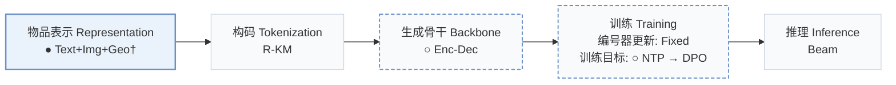
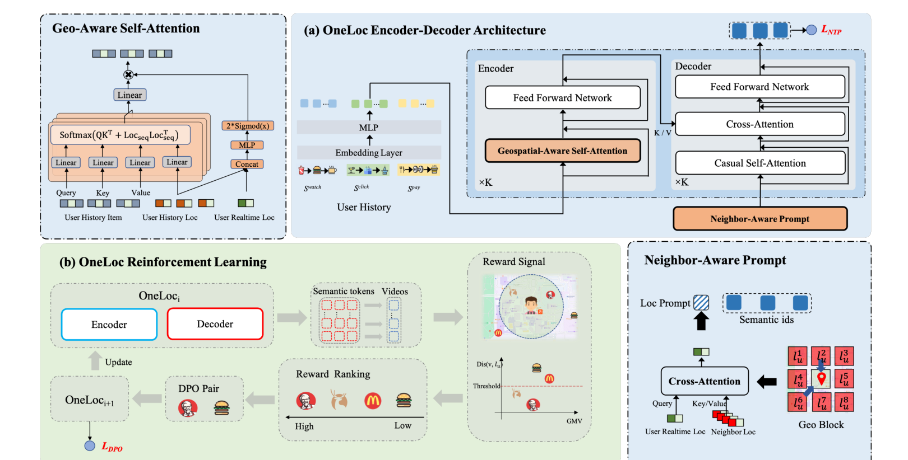
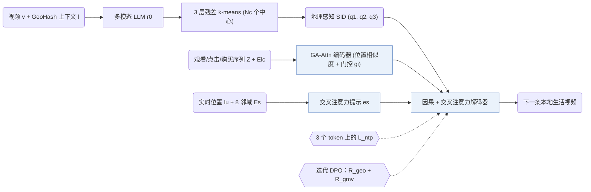
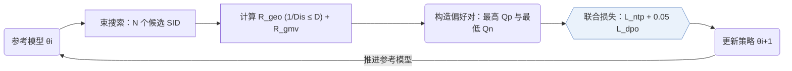
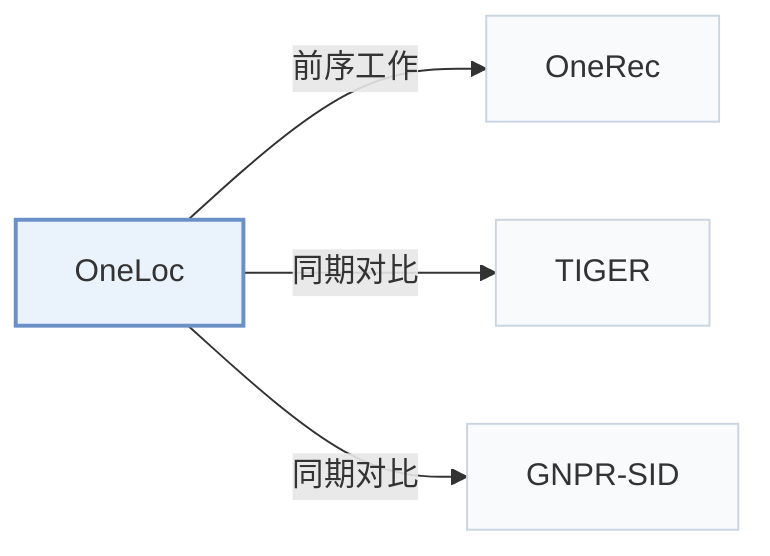

# OneLoc

[← 问题 × 阶段矩阵](../../../README.zh.md#i--representation) · [按阶段索引](../index/stages.md) · [按模态找论文](../index/modality.md) · [按领域找论文](../index/domain.md) · [English](../../papers/oneloc.md) | 中文

| **题目** | *Geo-Aware Generative Recommender Systems for Local Life Service* |
| :-- | :-- |
| **作者** | Wei et al. |
| **发表** | arXiv’25 |
| **问题与阶段** | `I. 信息量` · `物品表示（Representation）` · `POI` |
| **改动** | ● 物品表示 · ○ 生成骨干 · ○ 训练目标 |
| **构码输入** | `MM` + `Geo` |
| **领域** | `本地生活与 POI` |
| **应用场景** | `POI 与本地生活`；`线上实验或部署` |
| **链接** | [论文](https://arxiv.org/abs/2508.14646) |
| **阅读级别** | 代码级精读（第 3 级） |

**本页目录**：[TL;DR](#tldr) · [速览](#速览) · [1. 为什么重要](#1-为什么重要) · [2. 方法](#2-方法) · [3. 实验发现](#3-实验发现) · [4. 局限与分析](#4-局限与分析) · [5. 相关工作](#5-相关工作)



- `Text+Img+Geo†`：文本、图像与地理空间表征（由配置推断）。
- `R-KM`：残差 k-means 量化（Residual k-means）。
- `Enc-Dec`：编码器-解码器（Encoder-decoder）架构。
- `Fixed`：先独立训练并冻结编号器，生成器训练期间 SID 保持不变。
- `NTP → DPO`：先进行下一 token 预测微调，再执行直接偏好优化（DPO）。
- `Beam`：在 SID token 上执行自回归束搜索（Beam search）。

### TL;DR

> [!NOTE]
> OneLoc 在编号、编码器注意力与解码器提示中融入地理信息，并结合地理与 GMV 奖励做 DPO，将端到端生成式推荐扩展到本地生活短视频。

---

### 速览

| 维度 | 摘要 |
| :-- | :-- |
| 主要发现 | 在 10% 流量上做了一周的在线 A/B 测试，相比线上多阶段推荐链路，OneLoc 的 GMV +21.016%，订单量 +17.891%（Sec. 5，Table 4）。 |
| 局限 | 位置只通过残差 k-means 之前的一个融合嵌入进入语义 ID（Semantic ID，SID），SID 的任何一位都不直接对应地理（Sec. 2.2）。 |

---

### 1. 为什么重要

在快手本地生活服务里，每条推荐视频都关联一个门店位置，推荐既要匹配用户兴趣，又要兼顾用户与门店的距离及交易转化目标。OneRec 等此前的端到端生成式推荐器尚未建模地理距离与本地生活多目标奖励（Abstract）。

> "The first challenge is how to make full use of geographic information. The second challenge is how to balance multiple objectives, including user interests, the distance between user and stores, and some other business objectives."（Abstract）

---

### 2. 方法



#### 概览



#### 第 1 步：地理感知的语义 ID

每个视频 $`v`$ 对应一个位置 $`l`$。位置是一个 GeoHash 区块，带坐标、品牌、品类等上下文信息（Sec. 2.1）。OneLoc 沿用 OneRec，用残差 k-means 构建 SID。第一层的初始残差由多模态大语言模型从视频内容和位置上下文中联合提取，以此注入地理信息。

> "To inject geographic information, each residual $`r^{0}_{i}`$ in the initial residual set $`\mathcal{R}^{0}`$ is represented as an embedding of video content and location context information, extracted by a multimodal large language model."（Sec. 2.2）

在第 $`i`$ 层，对残差做 k-means 得到码本，每个残差归到最近的中心（Eq. 1–3）：

```math
\mathcal{C}^{i} = \mathrm{KMeans}(\mathcal{R}^{i}, N_c), \qquad q^{i}_{j} = \arg\min_{k} \left\| c^{i}_{k} - r^{i}_{j} \right\|, \qquad r^{i+1}_{j} = r^{i}_{j} - c^{i}_{q^{i}_{j}}
```

其中：
- $`\mathcal{R}^{i}`$ 是第 $`i`$ 层的残差集合，$`r^{i}_{j}`$ 是物品 $`j`$ 的残差；
- $`\mathcal{C}^{i} = \{c^{i}_{k}\}`$ 是第 $`i`$ 层由 $`N_c`$ 个中心组成的码本；
- $`q^{i}_{j}`$ 是物品 $`j`$ 的 SID 的第 $`i`$ 个 token。

#### 第 2 步：编码器中的地理感知自注意力

编码器读入用户的观看、点击和购买序列（Eq. 4）。每个行为 $`i`$ 有一个融合嵌入 $`z_i`$（由 MLP 从视频 ID、位置 ID 和位置上下文嵌入得到），以及一个位置上下文嵌入 $`e^{lc}_i`$（Eq. 5–7），用于按用户实时位置从交互历史中筛选相关行为。

> "GA-Attn module is proposed to capture relevant behaviors from the user's interaction history according to the user's real-time location."（Sec. 2.3.3）

GA-Attn 在注意力分数上加一项位置上下文相似度（Eq. 11–12），再用由用户实时位置算出的门缩放每一行输出（Eq. 13–14）：

```math
A = \mathrm{Softmax}\left( (Z W_q)(Z W_k)^{\top} / \sqrt{d} + E^{lc} (E^{lc})^{\top} \right), \qquad \widetilde{O} = A (Z W_v) W_o
```

```math
g_i = 2 \cdot \mathrm{Sigmoid}\left( \mathrm{MLP}\left( \mathrm{Concat}(e^{lc}_u, E^{lc}_{i*}) \right) \right), \qquad O_{i*} = g_i\, \widetilde{O}_{i*}
```

其中：
- $`Z`$ 是融合行为嵌入 $`z_i`$ 组成的序列，$`E^{lc}`$ 是位置上下文嵌入组成的序列；
- $`W_q, W_k, W_v, W_o`$ 是查询、键、值和输出矩阵；
- $`e^{lc}_u`$ 是用户实时位置 $`l_u`$ 的上下文嵌入；
- $`g_i \in (0, 2)`$ 缩放第 $`i`$ 行输出。

每个编码器块依次做 GA-Attn 和前馈网络，两者都带 RMSNorm 和残差连接（Eq. 8–10）。

#### 第 3 步：邻域感知提示与下一 token 预测

本地生活推荐依赖用户周边的品牌与热销商品信息，解码器因此从概括用户周边区域的邻域提示开始。

> "In local life service, it is vital to model location contexts surrounding the user, such as surrounding brands, bestselling products, etc. Thus, we use cross-attention to capture the surrounding information."（Sec. 2.4.1）

OneLoc 取 $`l_u`$ 周围 8 个位置的上下文嵌入作为 $`E^{s}`$，以 $`e^{lc}_u`$ 为查询，算出一个提示嵌入 $`e^{s} = \mathrm{CrossAttn}(e^{lc}_u, E^{s})`$（Eq. 15）。解码器输入为 $`H^{0} = \{e^{s}, e_{q^1_t}, e_{q^2_t}, e_{q^3_t}\}`$（Eq. 19）。每个解码器块含因果自注意力、对编码器输出的交叉注意力和前馈网络（Eq. 16–18）。提示位置的输出预测 SID 的第一个 token，第一个 token 位置的输出预测第二个，依此类推：

```math
\hat{y}^{j} = \mathrm{Softmax}\left( \mathrm{MLP}(H^{K}_{j-1}) \right) \in \mathbb{R}^{N_c}, \qquad \mathcal{L}_{ntp} = \sum_{j=1}^{3} -\log \hat{y}^{j}_{q^{j}_{t}}
```

其中 $`H^{K}_{j-1}`$ 是解码器最后一层在位置 $`j-1`$ 的输出，$`q^{j}_{t}`$ 是目标 SID 的第 $`j`$ 个 token（Eq. 20–21，Sec. 2.4.2）。

#### 第 4 步：地理奖励、GMV 奖励与 DPO

下一 token 预测只拟合旧系统曝光过的视频（Sec. 2.5）。OneLoc 为此引入两项奖励信号：地理奖励取距离阈值 $`D`$ 内距离的倒数以鼓励推荐更近的门店视频（Eq. 22），GMV 奖励取自独立 GMV 打分模型的输出（Eq. 23）：

```math
R^{geo}(v, l_u) = \begin{cases} 0 & \text{if } \mathrm{Dis}(v, l_u) \gt D, \\ 1 / \mathrm{Dis}(v, l_u) & \text{otherwise}, \end{cases} \qquad R^{gmv}(v, S, l_u) = \mathrm{GMV}(v, S, l_u)
```

> "The geographic reward signal is proposed to encourage generating videos nearby and thus a closer video would get a higher reward"（Sec. 2.5.1）

对每个训练样本，预训练模型用束搜索生成 $`N`$ 个视频（Eq. 24）。OneLoc 为每个视频算两种奖励，把奖励最高的（正例）和最低的（负例）配成一对（Sec. 2.5.2）。新模型 $`\theta_{i+1}`$ 从 $`\theta_i`$ 初始化，用这些样本对加上下一 token 预测一起训练：

```math
\mathcal{L}_{dpo} = -\log \sigma\left( \beta \log \frac{p_{\theta_{i+1}}(Q_p \mid S, l_u)}{p_{\theta_{i}}(Q_p \mid S, l_u)} - \beta \log \frac{p_{\theta_{i+1}}(Q_n \mid S, l_u)}{p_{\theta_{i}}(Q_n \mid S, l_u)} \right), \qquad \mathcal{L} = \mathcal{L}_{ntp} + \lambda \mathcal{L}_{dpo}
```

其中：
- $`Q_p`$ 和 $`Q_n`$ 是正例视频和负例视频的 SID；
- 上一轮的 $`\theta_i`$ 作参考模型；
- $`\sigma`$ 是 sigmoid 函数，$`\lambda = 0.05`$（Sec. 4.1.4）。

arXiv v1 预印本中的 Eq. 25 印漏了 $`\sigma`$；上式写出标准 DPO 的对数几率损失。

```python
import torch
import torch.nn.functional as F

def ga_attn(Z, E_lc, e_u, Wq, Wk, Wv, Wo, gate_mlp):
    """
    Z:        [T, d] fused behavior embeddings z_i (Eq. 6)
    E_lc:     [T, d] location context embeddings of the behaviors (Eq. 7)
    e_u:      [d]    context embedding of the user's real-time location
    gate_mlp: maps [T, 2d] -> [T, 1]
    """
    d = Z.size(-1)
    A = torch.softmax((Z @ Wq) @ (Z @ Wk).T / d ** 0.5 + E_lc @ E_lc.T, dim=-1)        # Eq. 11, [T, T]
    O = A @ (Z @ Wv) @ Wo                                                               # Eq. 12, [T, d]
    g = 2 * torch.sigmoid(gate_mlp(torch.cat([e_u.expand_as(E_lc), E_lc], dim=-1)))     # Eq. 13, [T, 1]
    return g * O                                                                        # Eq. 14

def oneloc_loss(ntp_loss, logp_new_pos, logp_old_pos, logp_new_neg, logp_old_neg, beta, lam=0.05):
    """Sequence log-probabilities of the positive and negative SIDs; old = previous iterate theta_i."""
    margin = beta * ((logp_new_pos - logp_old_pos) - (logp_new_neg - logp_old_neg))
    return ntp_loss + lam * (-F.logsigmoid(margin).mean())                             # Eq. 25-26
```

简化说明：代码只画一个注意力头，省去了每个块的 RMSNorm、前馈网络和残差连接。投影矩阵、门 MLP 和对数概率都作为输入传入；代码不构造偏好对，也不跑束搜索。



---

### 3. 实验发现

<details>
<summary>实验设置</summary>

- **数据集**：KuaiLLSR: eight days of uniformly sampled Kuaishou local-life-service short-video interactions, with 60 million users, 900,000 videos, and 440 million interactions; additional filtering rules not reported. Foursquare NYC: 1,042 users, 36,359 POIs, 212,347 interactions; Tokyo: 2,187 users, 59,472 POIs, 545,301 interactions. The public subsets use LibCity preprocessing to filter users and POIs; numerical filtering thresholds not reported.
  - 出处：Section 4.1.1 and Table 2 identify the original industrial/public datasets and preprocessing, without numerical LibCity filter thresholds; [S4.SS1.SSS1.p1](https://arxiv.org/html/2508.14646v1#S4.SS1.SSS1.p1) and [S4.T2](https://arxiv.org/html/2508.14646v1#S4.T2).
- **切分**：KuaiLLSR: streaming training on the first seven days and evaluation on the final day. NYC and Tokyo: each user's check-ins are sorted chronologically, with interaction sequences split 80%/10%/10% for training/validation/testing.
  - 出处：Section 4.1.1 states streaming seven-day training plus next-day evaluation and the public 80/10/10 sequence split; [S4.SS1.SSS1.p1](https://arxiv.org/html/2508.14646v1#S4.SS1.SSS1.p1).
- **候选集**：not reported
  - 出处：Offline metrics do not disclose full-catalog versus sampled evaluation, and the online statement of identical candidate pools does not determine their size; [S4.SS1.SSS3.p1](https://arxiv.org/html/2508.14646v1#S4.SS1.SSS3.p1) and [S5.p1](https://arxiv.org/html/2508.14646v1#S5.p1).
- **可见性**：not reported
  - 出处：The paper claims cold-start benefits but does not define generator/tokenizer visibility for a cold-start evaluation; [S4.SS1.SSS1.p1](https://arxiv.org/html/2508.14646v1#S4.SS1.SSS1.p1) and [S5.p2](https://arxiv.org/html/2508.14646v1#S5.p2).
- **SID 规格**：3 layers x 8,192 codes per layer, using geo-aware residual K-means; collision handling not reported.
  - 出处：Sections 2.2 and 4.1.4 specify three residual-K-means layers of 8,192 codes, but no SID collision-resolution rule; [S2.SS2.p1](https://arxiv.org/html/2508.14646v1#S2.SS2.p1), [S2.SS2.p3](https://arxiv.org/html/2508.14646v1#S2.SS2.p3), and [S4.SS1.SSS4.p1](https://arxiv.org/html/2508.14646v1#S4.SS1.SSS4.p1).
- **推理预算**：Production serving uses beam search on NVIDIA A10 GPUs, followed by SID-to-video mapping, GMV scoring, rule-based filtering, and top-K output. Beam width and output K not reported. Dynamic batching, mixed precision, KV caching, and TensorRT are used; numerical inference batch size and latency not reported.
  - 出处：Section 3 gives serving hardware and optimizations but no numerical beam width, output K, batch size, or latency; the A800 hardware in Section 4.1.4 is for training; [S3.p1](https://arxiv.org/html/2508.14646v1#S3.p1) and [S4.SS1.SSS4.p1](https://arxiv.org/html/2508.14646v1#S4.SS1.SSS4.p1).
- **结果来源**：Table 1: offline Recall/NDCG at K=5, 10, and 20 on KuaiLLSR, NYC, and Tokyo. Table 3 and Figures 4-5: module/reward ablations. Table 4 and Section 5: one-week online A/B test with 10% treatment traffic, compared with the production multi-stage system.
  - 出处：Main offline comparisons and online outcomes are in Tables 1 and 4, with module ablations in Table 3 and Figures 4-5; [S2.T1](https://arxiv.org/html/2508.14646v1#S2.T1), [S4.T3](https://arxiv.org/html/2508.14646v1#S4.T3), [S4.F4](https://arxiv.org/html/2508.14646v1#S4.F4), [S4.F5](https://arxiv.org/html/2508.14646v1#S4.F5), [S5.p1](https://arxiv.org/html/2508.14646v1#S5.p1), and [S5.T4](https://arxiv.org/html/2508.14646v1#S5.T4).

</details>

- Foursquare：在 NYC、Tokyo 子集以及全球数据集上，OneLoc 均优于 Table 1 中的各基线（含 TIGER 与 GNPR-SID），全球数据集上 Recall@5 平均提升 13.18%，NDCG@5 平均提升 16.34%（Sec. 4.2，Table 1）。

  > "Similarly, on the Foursquare global dataset, it attains an average performance boost of 13.18% in Recall@5 and 16.34% in NDCG@5."（Sec. 4.2）

- 在线 A/B 测试：10% 流量分配给端到端 OneLoc 实验组、对照组保留线上多阶段链路时，OneLoc 的 GMV +21.016%，订单量 +17.891%，本地生活新买家 +23.027%，双尾 t 检验 p < 0.01（Sec. 5，Table 4）。

  > "In this experiment, 10% of the traffic was allocated to the treatment group using the end-to-end OneLoc system, while the control group retained the production-level multi-stage recommendation pipeline"（Sec. 5）

- 消融：去掉邻域感知提示、地理感知自注意力或任一奖励项，Recall、NDCG 和 GMV 在各消融变体上均低于完整模型（Sec. 4.3，Fig. 4，Table 3，Fig. 5）。

---

### 4. 局限与分析

**Stated by the authors.** 结论给出两个未来方向：模型规模和序列长度的扩展定律；适配本地生活服务的强化学习方法（Sec. 7）。

**Our analysis.**

- OneLoc 把位置混进输入（`Text+Img+Geo†`）。LGSID 改用地理索引加残差量化（`Geo-Idx+RQ`），LGRID 用 `DSRQ`，它们的 SID 各位直接带地理信息。GeoGR 在文本上加入地理和协同信号（`Text+Geo+CF`）。
- KuaiLLSR、GMV 打分模型和在线测试都来自快手，只有 Foursquare 的结果能用公开数据复现（Sec. 4.1.1，Sec. 5）。

---

### 5. 相关工作



- **前序工作** · [OneRec](onerec.md): OneRec establishes unified generative retrieval and ranking with preference alignment, while OneLoc develops this direction for local-life video recommendation through geographic modeling and geographic/GMV rewards.
  - 出处：OneLoc v1, Section 6.2 explicitly cites Deng et al. (2025), OneRec arXiv:2502.18965, for unified generation and preference alignment: [S6.SS2.p1](https://arxiv.org/html/2508.14646v1#S6.SS2.p1); Section 2 describes OneLoc's geographic modules and rewards: [S2.p1](https://arxiv.org/html/2508.14646v1#S2.p1).
- **同期对比** · [TIGER](tiger.md): TIGER is an evaluated generative baseline using RQ-VAE identifiers; OneLoc uses geo-aware residual-K-means identifiers together with geographic sequence modeling and neighborhood prompts.
  - 出处：OneLoc v1, Section 4.1.2 identifies TIGER as a baseline: [S4.SS1.SSS2.p1](https://arxiv.org/html/2508.14646v1#S4.SS1.SSS2.p1); Table 1 reports its comparison with OneLoc: [S2.T1](https://arxiv.org/html/2508.14646v1#S2.T1); Sections 2 and 2.2 describe OneLoc's added geographic mechanisms: [S2.p1](https://arxiv.org/html/2508.14646v1#S2.p1) and [S2.SS2.p1](https://arxiv.org/html/2508.14646v1#S2.SS2.p1).
- **同期对比** · [GNPR-SID](gnpr-sid.md): GNPR-SID is an evaluated next-POI baseline with geographic semantic identifiers; OneLoc extends geographic modeling into attention, neighborhood prompting, and rewards for local-life video consumption.
  - 出处：OneLoc v1, Section 1 explains the geographic-modeling difference: [S1.p2](https://arxiv.org/html/2508.14646v1#S1.p2), [S1.p3](https://arxiv.org/html/2508.14646v1#S1.p3), and [S1.p4](https://arxiv.org/html/2508.14646v1#S1.p4); Table 1 directly compares GNPR-SID and OneLoc: [S2.T1](https://arxiv.org/html/2508.14646v1#S2.T1).

[查看同格全部论文](../../../README.zh.md#i--representation)
