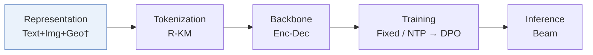
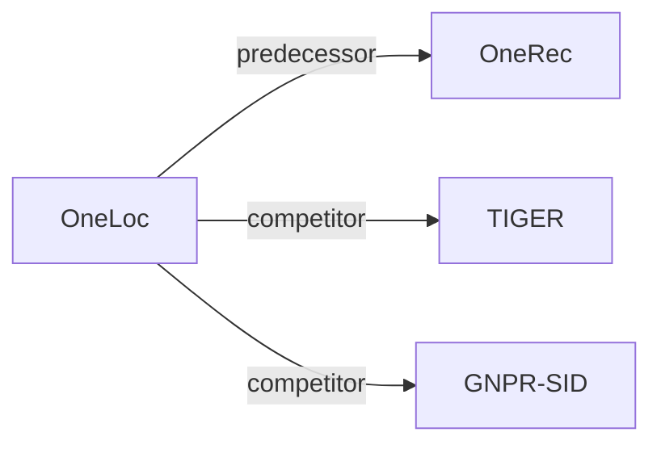

# OneLoc

*Geo-Aware Generative Recommender Systems for Local Life Service* — Wei et al. · arXiv’25

`I. 信息量` · `Representation` · `POI` · [论文](https://arxiv.org/abs/2508.14646) · [矩阵](../../../README.zh.md#i--representation) · [English](../../papers/oneloc.md)

阅读级别：概览（第 1 级） · 本页目录：[TL;DR](#tldr) · [速览](#速览) · [2. 方法](#2-方法) · [3. 实验发现](#3-实验发现) · [5. 相关工作](#5-相关工作)

- `R-KM`: Residual k-means.
- `Enc-Dec`: Encoder-decoder.
- `Fixed`: SIDs are built first and not changed while the generator trains.
- `NTP → DPO`: NTP, then preference optimization.

### TL;DR

> [!NOTE]
> OneLoc 在编号、编码器注意力与解码器提示中融入地理信息，并结合地理与 GMV 奖励做 DPO，将端到端生成式推荐扩展到本地生活短视频。

### 速览

| 维度 | 摘要 |
| :-- | :-- |
| 研究问题 | I. 信息量：Do the SIDs, or the model reading them, carry the collaborative and multimodal signals recommendation needs? |
| 核心贡献 | OneLoc 在编号、编码器注意力与解码器提示中融入地理信息，并结合地理与 GMV 奖励做 DPO，将端到端生成式推荐扩展到本地生活短视频。 |
| 主要改动阶段 | Representation |

### 2. 方法

### 3. 实验发现

实验设置

- **数据集**：KuaiLLSR: eight days of uniformly sampled Kuaishou local-life-service short-video interactions, with 60 million users, 900,000 videos, and 440 million interactions; additional filtering rules not reported. Foursquare NYC: 1,042 users, 36,359 POIs, 212,347 interactions; Tokyo: 2,187 users, 59,472 POIs, 545,301 interactions. The public subsets use LibCity preprocessing to filter users and POIs; numerical filtering thresholds not reported.
  - 出处：Section 4.1.1 and Table 2 identify the original industrial/public datasets and preprocessing, without numerical LibCity filter thresholds; [S4.SS1.SSS1.p1](https://arxiv.org/html/2508.14646v1#S4.SS1.SSS1.p1) and [S4.T2](https://arxiv.org/html/2508.14646v1#S4.T2).
- **切分**：KuaiLLSR: streaming training on the first seven days and evaluation on the final day. NYC and Tokyo: each user's check-ins are sorted chronologically, with interaction sequences split 80%/10%/10% for training/validation/testing.
  - 出处：Section 4.1.1 states streaming seven-day training plus next-day evaluation and the public 80/10/10 sequence split; [S4.SS1.SSS1.p1](https://arxiv.org/html/2508.14646v1#S4.SS1.SSS1.p1).
- **候选集**：not reported
  - 出处：Offline metrics do not disclose full-catalog versus sampled evaluation, and the online statement of identical candidate pools does not determine their size; [S4.SS1.SSS3.p1](https://arxiv.org/html/2508.14646v1#S4.SS1.SSS3.p1) and [S5.p1](https://arxiv.org/html/2508.14646v1#S5.p1).
- **可见性**：not reported
  - 出处：The paper claims cold-start benefits but does not define generator/tokenizer visibility for a cold-start evaluation; [S4.SS1.SSS1.p1](https://arxiv.org/html/2508.14646v1#S4.SS1.SSS1.p1) and [S5.p2](https://arxiv.org/html/2508.14646v1#S5.p2).
- **SID 规格**：3 layers x 8,192 codes per layer, using geo-aware residual K-means; collision handling not reported.
  - 出处：Sections 2.2 and 4.1.4 specify three residual-K-means layers of 8,192 codes, but no SID collision-resolution rule; [S2.SS2.p1](https://arxiv.org/html/2508.14646v1#S2.SS2.p1), [S2.SS2.p3](https://arxiv.org/html/2508.14646v1#S2.SS2.p3), and [S4.SS1.SSS4.p1](https://arxiv.org/html/2508.14646v1#S4.SS1.SSS4.p1).
- **推理预算**：Production serving uses beam search on NVIDIA A10 GPUs, followed by SID-to-video mapping, GMV scoring, rule-based filtering, and top-K output. Beam width and output K not reported. Dynamic batching, mixed precision, KV caching, and TensorRT are used; numerical inference batch size and latency not reported.
  - 出处：Section 3 gives serving hardware and optimizations but no numerical beam width, output K, batch size, or latency; the A800 hardware in Section 4.1.4 is for training; [S3.p1](https://arxiv.org/html/2508.14646v1#S3.p1) and [S4.SS1.SSS4.p1](https://arxiv.org/html/2508.14646v1#S4.SS1.SSS4.p1).
- **结果来源**：Table 1: offline Recall/NDCG at K=5, 10, and 20 on KuaiLLSR, NYC, and Tokyo. Table 3 and Figures 4-5: module/reward ablations. Table 4 and Section 5: one-week online A/B test with 10% treatment traffic, compared with the production multi-stage system.
  - 出处：Main offline comparisons and online outcomes are in Tables 1 and 4, with module ablations in Table 3 and Figures 4-5; [S2.T1](https://arxiv.org/html/2508.14646v1#S2.T1), [S4.T3](https://arxiv.org/html/2508.14646v1#S4.T3), [S4.F4](https://arxiv.org/html/2508.14646v1#S4.F4), [S4.F5](https://arxiv.org/html/2508.14646v1#S4.F5), [S5.p1](https://arxiv.org/html/2508.14646v1#S5.p1), and [S5.T4](https://arxiv.org/html/2508.14646v1#S5.T4).

### 5. 相关工作

- **前序工作** · [OneRec](onerec.md): OneRec establishes unified generative retrieval and ranking with preference alignment, while OneLoc develops this direction for local-life video recommendation through geographic modeling and geographic/GMV rewards.
  - 出处：OneLoc v1, Section 6.2 explicitly cites Deng et al. (2025), OneRec arXiv:2502.18965, for unified generation and preference alignment: https://arxiv.org/html/2508.14646v1#S6.SS2.p1; Section 2 describes OneLoc's geographic modules and rewards: https://arxiv.org/html/2508.14646v1#S2.p1.
- **同期对比** · [TIGER](tiger.md): TIGER is an evaluated generative baseline using RQ-VAE identifiers; OneLoc uses geo-aware residual-K-means identifiers together with geographic sequence modeling and neighborhood prompts.
  - 出处：OneLoc v1, Section 4.1.2 identifies TIGER as a baseline: https://arxiv.org/html/2508.14646v1#S4.SS1.SSS2.p1; Table 1 reports its comparison with OneLoc: https://arxiv.org/html/2508.14646v1#S2.T1; Sections 2 and 2.2 describe OneLoc's added geographic mechanisms: https://arxiv.org/html/2508.14646v1#S2.p1 and https://arxiv.org/html/2508.14646v1#S2.SS2.p1.
- **同期对比** · [GNPR-SID](gnpr-sid.md): GNPR-SID is an evaluated next-POI baseline with geographic semantic identifiers; OneLoc extends geographic modeling into attention, neighborhood prompting, and rewards for local-life video consumption.
  - 出处：OneLoc v1, Section 1 explains the geographic-modeling difference: https://arxiv.org/html/2508.14646v1#S1.p2, https://arxiv.org/html/2508.14646v1#S1.p3, and https://arxiv.org/html/2508.14646v1#S1.p4; Table 1 directly compares GNPR-SID and OneLoc: https://arxiv.org/html/2508.14646v1#S2.T1.

[查看同格全部论文](../../../README.zh.md#i--representation)
