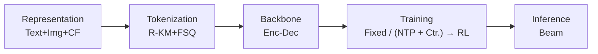
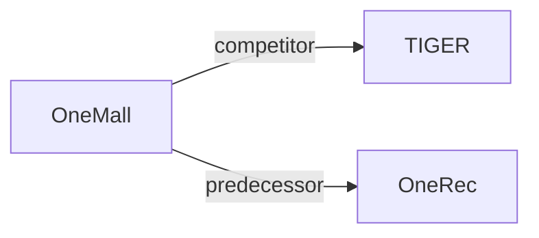

# OneMall

| **题目** | *One Architecture, More Scenarios -- End-to-End Generative Recommender Family at Kuaishou E-Commerce* |
| :-- | :-- |
| **作者** | Zhang et al. |
| **会议** | CIKM’26 |
| **问题与阶段** | `范式、系统与基准` · `无单一阶段` |
| **链接** | [论文](https://arxiv.org/abs/2601.21770) · [矩阵](../../../README.zh.md#范式系统与基准) · [English](../../papers/onemall.md) |
| **阅读级别** | 概览（第 1 级） |

本页目录：[TL;DR](#tldr) · [速览](#速览) · [3. 实验发现](#3-实验发现) · [5. 相关工作](#5-相关工作)

- `R-KM+FSQ`: Residual k-means combined with finite scalar quantization.
- `Enc-Dec`: Encoder-decoder.
- `Fixed`: SIDs are built first and not changed while the generator trains.
- `(NTP + Ctr.) → RL`: Joint next-token and contrastive training, followed by a reinforcement-learning stage; retained losses are specified per paper.

### TL;DR

> [!NOTE]
> OneMall 用业务感知编号器、Query-Former、稀疏 MoE 层以及作为强化学习奖励的排序模型，在单一生成器中统一商品卡、短视频与直播电商。

---

### 速览

| 维度 | 摘要 |
| :-- | :-- |
| 研究问题 | 范式、系统与基准：Baseline (TIGER), end-to-end multi-stage paradigms, open-source frameworks, benchmarks, and diagnostic resources. |
| 核心贡献 | OneMall 用业务感知编号器、Query-Former、稀疏 MoE 层以及作为强化学习奖励的排序模型，在单一生成器中统一商品卡、短视频与直播电商。 |
| 主要改动阶段 | 无单一阶段 |

---

### 3. 实验发现

实验设置

- **数据集**：Kuaishou product-card, short-video, and live-streaming logs; dates/sample counts not reported. Tokenizer: 70M product-product pairs (<=40 occurrences/item), 12M video-product pairs from long views 1-5 minutes before product clicks, excluding News/Comedy/Dance/Film-TV/Selfie videos and downsampling frequent products/same-user pairs.
  - 出处：Sections 3.1.1 and 4: [S3.SS1.SSS1.p1](https://arxiv.org/html/2601.21770v1#S3.SS1.SSS1.p1) and [S4.p1](https://arxiv.org/html/2601.21770v1#S4.p1)
- **切分**：Offline train/validation/test allocation not reported; simulation replays online requests. Online A/B duration and traffic allocation not reported.
  - 出处：Sections 4.2/4.3 describe replay and online tests, not a data split: [S4.SS2.p1](https://arxiv.org/html/2601.21770v1#S4.SS2.p1) and [S4.SS3.p1](https://arxiv.org/html/2601.21770v1#S4.SS3.p1)
- **候选集**：not reported
  - 出处：Section 4 evaluates generated top-K retrieval, without full-catalog/sampled-negative specification: [S4.p1](https://arxiv.org/html/2601.21770v1#S4.p1)
- **可见性**：warm; no unseen-item protocol is defined. Frozen codebooks can tokenize new uploads; encoder/tokenizer exposure to test items not reported.
  - 出处：Sections 2.2/4 define no unseen-item evaluation protocol: [S2.SS2.p1](https://arxiv.org/html/2601.21770v1#S2.SS2.p1) and [S4](https://arxiv.org/html/2601.21770v1#S4)
- **SID 规格**：Two Res-Kmeans levels plus a 4096-code FSQ final level; residual-only baseline uses 3x4096. Final variant's residual codebook sizes not separately stated. FSQ reduces collisions; residual collision resolution not reported.
  - 出处：Sections 3.1.3/4.5: [S3.SS1.SSS3.p1](https://arxiv.org/html/2601.21770v1#S3.SS1.SSS3.p1) and [S4.SS5.p1](https://arxiv.org/html/2601.21770v1#S4.SS5.p1) and [S4.SS5.p2](https://arxiv.org/html/2601.21770v1#S4.SS5.p2)
- **推理预算**：Deployed 0.5B-total/0.1B-active model; HR@50/100/500. Serving beam width, hardware, inference batch size, latency not reported; beam 768 is RL training candidate generation.
  - 出处：Sections 4/4.2/4.4: [S4.p1](https://arxiv.org/html/2601.21770v1#S4.p1) and [S4.SS2.p1](https://arxiv.org/html/2601.21770v1#S4.SS2.p1) and [S4.SS4.p1](https://arxiv.org/html/2601.21770v1#S4.SS4.p1)
- **结果来源**：Original Table 1: scaling; Table 2: replay versus equally sized SASRec/TIGER with identical input features; Table 3: online A/B; Tables 4/5: RL/tokenizer ablations.
  - 出处：Sections 4.2/4.3 and Tables 1-5: [S4.SS2.p1](https://arxiv.org/html/2601.21770v1#S4.SS2.p1) and [S4.T2](https://arxiv.org/html/2601.21770v1#S4.T2) and [S4.T3](https://arxiv.org/html/2601.21770v1#S4.T3) and [S3.T1](https://arxiv.org/html/2601.21770v1#S3.T1) and [S4.T4](https://arxiv.org/html/2601.21770v1#S4.T4) and [S4.T5](https://arxiv.org/html/2601.21770v1#S4.T5)

---

### 5. 相关工作

- **同期对比** · [TIGER](tiger.md): TIGER is the equally sized encoder-decoder replay baseline.
  - 出处：OneMall v1, Section 4.2 and Table 2: https://arxiv.org/html/2601.21770v1#S4.SS2.p1; https://arxiv.org/html/2601.21770v1#S4.T2.
- **前序工作** · [OneRec](onerec.md): OneMall adapts OneRec's end-to-end short-video paradigm to e-commerce scenarios.
  - 出处：OneMall v1, Section 1 (Deng et al., 2025, arXiv:2502.18965; distinct from Zhou et al., 2025 Technical Report): https://arxiv.org/html/2601.21770v1#S1.p5.

[查看同格全部论文](../../../README.zh.md#范式系统与基准)
