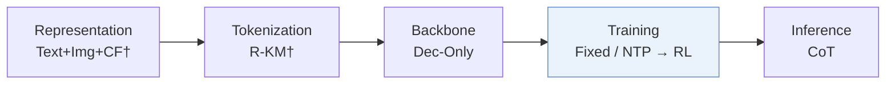
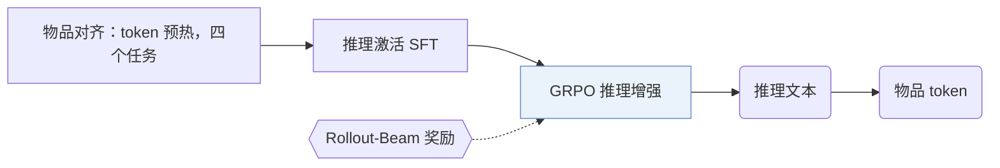
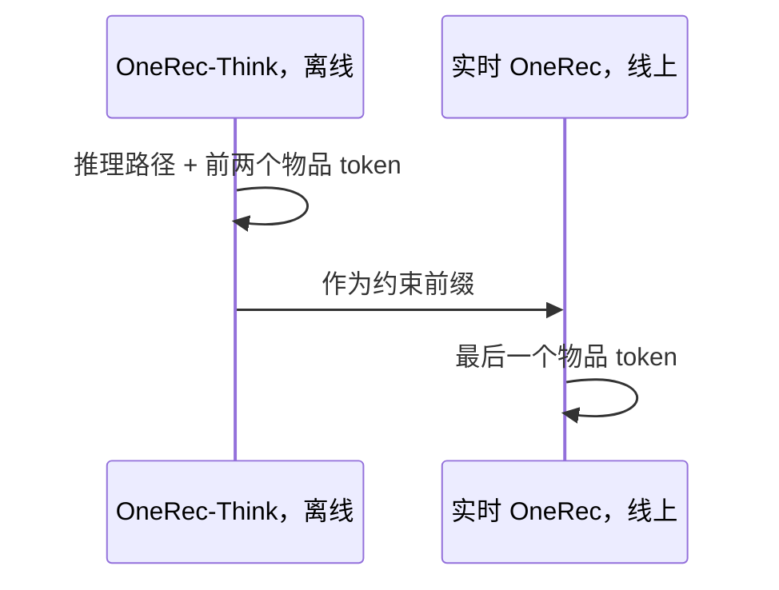
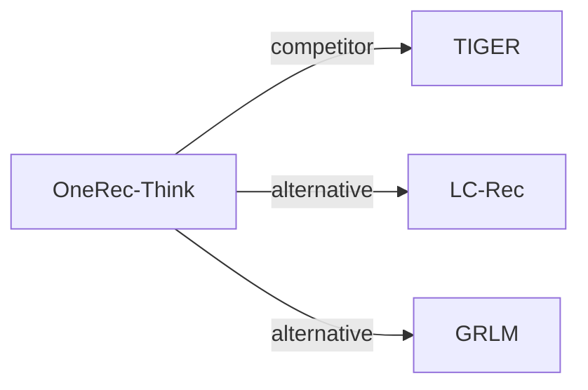

# OneRec-Think

| **题目** | *In-text reasoning for generative recommendation* |
| :-- | :-- |
| **作者** | Liu et al. |
| **会议** | arXiv’25 |
| **问题与阶段** | `III. SID 与模型对齐` · `Training` |
| **链接** | [论文](https://arxiv.org/abs/2510.11639) · [代码](https://github.com/wangshy31/OneRec-Think) · [矩阵](../../../README.zh.md#iii--training) · [English](../../papers/onerec-think.md) |
| **阅读级别** | 阅读笔记（第 2 级） |

本页目录：[TL;DR](#tldr) · [速览](#速览) · [1. 为什么重要](#1-为什么重要) · [2. 方法](#2-方法) · [3. 实验发现](#3-实验发现) · [4. 局限与分析](#4-局限与分析) · [5. 相关工作](#5-相关工作)

- `Dec-Only`: Decoder-only.
- `Fixed`: SIDs are built first and not changed while the generator trains.
- `NTP → RL`: NTP, then reinforcement learning (GRPO, GBPO, etc.).
- `CoT`: Chain-of-thought before the SID.

### TL;DR

> [!NOTE]
> OneRec-Think 通过物品-文本对齐、推理脚手架和面向多合法目标的推荐奖励，在 OneRec 式生成中加入显式文本推理，替代单纯隐式预测。

---

### 速览

| 维度 | 摘要 |
| :-- | :-- |
| 研究问题 | III. SID 与模型对齐：Can the generator read, write, and reason over SIDs, and do the tokenizer and generator work toward the same goal? |
| 核心贡献 | OneRec-Think 通过物品-文本对齐、推理脚手架和面向多合法目标的推荐奖励，在 OneRec 式生成中加入显式文本推理，替代单纯隐式预测。 |
| 主要改动阶段 | Training |
| 主要发现 | 在快手的在线 A/B 测试中，Think-Ahead 部署相比线上模型让 App 停留时长提升 0.159%（Sec. 5.4.2，Table 3）。 |
| 局限 | 多步推理和实时延迟要求冲突，完整模型只能离线运行，线上由另一个实时 OneRec 模型生成最后一个物品 token（Sec. 4.4）。 |

---

### 1. 为什么重要

OneRec 这类生成式推荐器直接预测物品 token，不给出明确、可控的推理（Abstract）。OneRec-Think 让 LLM 在同一次输出里先写推理，再写下一物品的 token。

> "In contrast, we reformulate this task to unify reasoning and recommendation in a single autoregressive pass."（Sec. 3）（把推理和推荐统一在一次自回归生成里。）

---

### 2. 方法

#### 物品对齐

在下一 token 预测下做多任务预训练，让 LLM 能同时读懂自然语言和物品 token（Sec. 4.1）。四个任务是：交错的用户画像落地、序列偏好建模、物品稠密描述、通用语言建模。先有一个 token 预热子阶段，冻结基座 LLM，只训练物品 token 的嵌入；之后所有参数一起训练。

#### 推理激活

工业行为序列噪声大。监督微调先从剪枝后的用户上下文中提取推理轨迹，再用这些轨迹引导模型在原始行为数据上生成推理（Sec. 4.2）。推理过程和目标物品用联合似然训练。

#### 推理增强

用 GRPO 做强化学习，打磨推理路径（Sec. 4.3）。每条采样出的推理之后，用约束束搜索生成候选，奖励取候选与目标物品 token 按位置匹配的最好结果（Eq. 6）。

> "To overcome this, we introduce the Rollout-Beam reward that evaluates reasoning capability by the model’s best achievable performance within a constrained beam."（Sec. 4.3）（Rollout-Beam 奖励用约束束内能达到的最好结果来评估推理能力。）

#### Think-Ahead 部署

完整的 OneRec-Think 模型离线生成推理路径和前两个物品 token（Sec. 4.4）。

> "It utilizes the pre-generated item-tokens as a constrained prefix to rapidly produce the final itemic token."（Sec. 4.4）（以预先生成的物品 token 作约束前缀，快速生成最后一个 token。）

---

### 3. 实验发现

实验设置

- **数据集**：Amazon Beauty, Toys, and Sports; users and items with fewer than 5 interactions are discarded. Industrial: Kuaishou short-video data with daily incremental training on about 20B tokens per day. Retained corpus sizes: not reported.
  - 出处：Public datasets: [S5.SS1.p2](https://arxiv.org/html/2510.11639v2#S5.SS1.p2); filtering and split: [A1.SS1.SSS0.Px2.p1](https://arxiv.org/html/2510.11639v2#A1.SS1.SSS0.Px2.p1); industrial deployment: [S5.SS4.SSS2.Px1.p1](https://arxiv.org/html/2510.11639v2#S5.SS4.SSS2.Px1.p1).
- **切分**：Public: leave-one-out (allocation not restated beyond the label); training histories capped at 50 items. Online: one-week A/B test with a 1.29% traffic group.
  - 出处：Leave-one-out and history cap: [A1.SS1.SSS0.Px2.p1](https://arxiv.org/html/2510.11639v2#A1.SS1.SSS0.Px2.p1); online test: [S5.SS4.SSS2.Px1.p1](https://arxiv.org/html/2510.11639v2#S5.SS4.SSS2.Px1.p1).
- **候选集**：not reported (full catalog versus sampled evaluation candidates); top-K lists from beam search with width 10.
  - 出处：Metrics only: [S5.SS1.p2](https://arxiv.org/html/2510.11639v2#S5.SS1.p2).
- **可见性**：warm; no unseen-item protocol is defined.
  - 出处：Standard split with no unseen-item protocol: [A1.SS1.SSS0.Px2.p1](https://arxiv.org/html/2510.11639v2#A1.SS1.SSS0.Px2.p1).
- **SID 规格**：Public: four-level hierarchical semantic IDs with 256 tokens per level (1,024 new tokens). Industrial: three levels x 8,192 itemic tokens (24,576 new tokens), plus item boundary tokens. The tokenizer algorithm is not restated; collision handling: not reported.
  - 出处：Public 4 levels x 256; industrial 3 levels x 8,192: [A1.SS1.SSS0.Px2.p1](https://arxiv.org/html/2510.11639v2#A1.SS1.SSS0.Px2.p1) and [S5.SS4.SSS1.p1](https://arxiv.org/html/2510.11639v2#S5.SS4.SSS1.p1); no collision rule found.
- **推理预算**：Public: beam search with width 10 after the reasoning text (Qwen3-1.7B). Industrial: Think-Ahead serving generates the reasoning and the first two itemic tokens offline with Qwen-8B, then a real-time OneRec model completes the last token online; latency numbers: not reported. Daily training on a cluster of 80 GPUs.
  - 出处：Beam width 10 for public evaluation: [A1.SS1.SSS0.Px2.p1](https://arxiv.org/html/2510.11639v2#A1.SS1.SSS0.Px2.p1); Rollout-Beam reward with width K: [S4.SS3.p2](https://arxiv.org/html/2510.11639v2#S4.SS3.p2); two-stage serving: [S4.SS4.p2](https://arxiv.org/html/2510.11639v2#S4.SS4.p2); training cluster: [S5.SS4.SSS1.p1](https://arxiv.org/html/2510.11639v2#S5.SS4.SSS1.p1).
- **结果来源**：Table 1 (Beauty, Toys, Sports versus sequential and generative baselines); Table 2 (alignment and reasoning ablation on Beauty); Table 3 (online A/B); Table 4 (user and video understanding BertScore).
  - 出处：Public: [S4.T1](https://arxiv.org/html/2510.11639v2#S4.T1); ablation: [S5.T2](https://arxiv.org/html/2510.11639v2#S5.T2); online: [S5.T3](https://arxiv.org/html/2510.11639v2#S5.T3); understanding benchmarks: [S5.T4](https://arxiv.org/html/2510.11639v2#S5.T4).

- 公开基准：在 Amazon Beauty、Toys 和 Sports 上，OneRec-Think 好于 Table 1 中的基线（Sec. 5.2）。
- 消融：在 Beauty 上，给基础模型先加物品对齐、再加推理机制，推荐指标都有提升（Sec. 5.3，Table 2）。

---

### 4. 局限与分析

**Our analysis.**

- OneRec 用 `NTP → DPO` 训练 `Enc-Dec` 生成器；OneRec-Think 用 `NTP → RL` 训练 `Dec-Only` LLM，并在物品之前先生成推理（`CoT`）。
- 在线收益来自一个拆开的系统，最后一个 token 由另一个模型生成。由此推断，测到的效果混合了离线推理和线上模型自身的更新。

---

### 5. 相关工作

- **同期对比** · [TIGER](tiger.md): TIGER generates the next itemic tokens directly; OneRec-Think first generates interleaved text-and-item reasoning and is rewarded with a beam-based signal.
  - 出处：OneRec-Think v2, baselines: https://arxiv.org/html/2510.11639v2#S5.SS1.p2 and https://arxiv.org/html/2510.11639v2#A1.SS1.SSS0.Px1.p1; Table 1: https://arxiv.org/html/2510.11639v2#S4.T1.
- **替代方案** · [LC-Rec](lc-rec.md): LC-Rec aligns LLMs to item indices with auxiliary tasks; OneRec-Think adds itemic-textual alignment followed by reasoning activation and RL.
  - 出处：OneRec-Think v2, Section 3 and Appendix A.1 cite Zheng et al. (2024): https://arxiv.org/html/2510.11639v2#S3.SS0.SSS0.Px2.p2 and https://arxiv.org/html/2510.11639v2#A1.SS1.SSS0.Px2.p1; not a baseline in Table 1.
- **替代方案** · [GRLM](grlm.md): GRLM later compares against OneRec-Think and replaces numeric itemic tokens with natural-language term IDs.
  - 出处：Evidence is from the later GRLM paper: LLM-based baselines and Table 2: https://arxiv.org/html/2601.06798v1#S4.I1.i3.p1 and https://arxiv.org/html/2601.06798v1#S5.T2.

[查看同格全部论文](../../../README.zh.md#iii--training)
