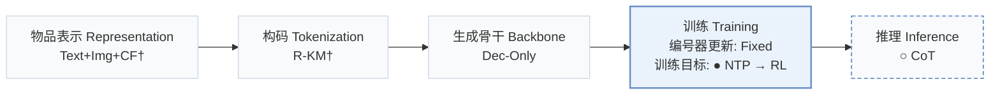
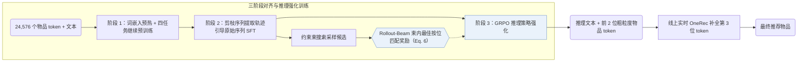
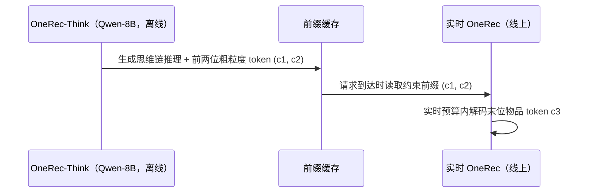
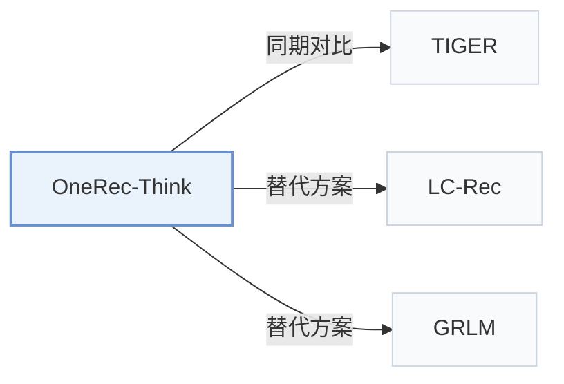

# OneRec-Think

[← 问题 × 阶段矩阵](../../../README.zh.md#iii--training) · [按阶段索引](../index/stages.md) · [按模态找论文](../index/modality.md) · [按领域找论文](../index/domain.md) · [English](../../papers/onerec-think.md) | 中文

| **题目** | *In-text reasoning for generative recommendation* |
| :-- | :-- |
| **作者** | Liu et al. |
| **发表** | arXiv’25 |
| **问题与阶段** | `III. SID 与模型对齐` · `训练（Training）` |
| **改动** | ● 训练目标 · ○ 推理 |
| **构码输入** | `MM` + `CF` |
| **领域** | `电商` · `短视频与直播` |
| **链接** | [论文](https://arxiv.org/abs/2510.11639) · [代码](https://github.com/wangshy31/OneRec-Think) |
| **阅读级别** | 阅读笔记（第 2 级） |

**本页目录**：[TL;DR](#tldr) · [速览](#速览) · [1. 为什么重要](#1-为什么重要) · [2. 方法](#2-方法) · [3. 实验发现](#3-实验发现) · [4. 局限与分析](#4-局限与分析) · [5. 相关工作](#5-相关工作)

- `Text+Img+CF†`：文本、图像与协同信号融合表征（由配置推断）。
- `R-KM†`：残差 k-means 编号（由配置推断）。
- `Dec-Only`：仅解码器（Decoder-only）自回归架构。
- `Fixed`：先独立训练并冻结编号器，生成器训练期间 SID 保持不变。
- `NTP → RL`：先进行下一 token 预测微调，再执行强化学习（如 GRPO、GBPO 等）。
- `CoT`：先生成思维链（Chain-of-Thought）推理文本，再输出目标 SID。

### TL;DR

> [!NOTE]
> OneRec-Think 通过物品-文本对齐、推理脚手架和面向多合法目标的推荐奖励，在 OneRec 式生成中加入显式文本推理，替代单纯隐式预测。

---

### 速览

| 维度 | 摘要 |
| :-- | :-- |
| 主要发现 | 在快手线上 A/B 测试中，Think-Ahead 部署使 App 停留时长相比线上基线提升 0.159%，同时在 Amazon Beauty、Toys 与 Sports 公开基准上全面超越对比方法（Sec. 5.2，Sec. 5.4.2，Tables 1 and 3）。 |
| 局限 | 多步思维链推理超出实时推荐延迟预算，完整模型只能离线预生成前两层粗粒度码，交由线上实时 OneRec 补全末位 token（Sec. 4.4）。 |

---

### 1. 为什么重要

OneRec 等直接生成式推荐器跳过显式推理过程直接输出离散物品码，难以做可控的多步意图推演（Abstract）。OneRec-Think 将自然语言思维链推理与层级语义 ID（Semantic ID，SID；文中称 itemic tokens）解码统一在单次自回归生成中，并设计离线-在线协同的 Think-Ahead 架构落地工业服务。

> "In contrast, we reformulate this task to unify reasoning and recommendation in a single autoregressive pass."（Sec. 3）

---

### 2. 方法

#### 物品对齐

多任务下一 token 预训练通过四项任务打通自然语言与离散物品 token：交错式用户画像对齐、序列偏好建模、物品稠密描述生成以及通用语言建模（Sec. 4.1）。训练先冻结基座 LLM、仅预热新增物品 token 嵌入，随后放开全量参数联合优化。

#### 推理激活

针对工业原始行为日志噪声大的问题，监督微调先在去噪剪枝后的用户上下文上提取高质量推理轨迹，再以此引导模型在原始行为序列上联合最大化“推理文本 + 目标物品 token”似然（Sec. 4.2）。

#### 推理增强

GRPO 强化学习进一步打磨推理质量（Sec. 4.3）：模型每采样出一条推理路径，便在其后运行约束束搜索生成候选物品序列，取束内候选与真实目标 token 按位匹配的最优得分作为该条推理的奖励（Eq. 6）。

> "To overcome this, we introduce the Rollout-Beam reward that evaluates reasoning capability by the model’s best achievable performance within a constrained beam."（Sec. 4.3）

#### Think-Ahead 部署

为满足苛刻的线上耗时约束，完整 OneRec-Think 离线异步生成推理路径与前两位粗粒度物品 token 并写入缓存；线上请求到达时，实时 OneRec 模型以这两个 token 为约束前缀快速解码最后一位物品 token（Sec. 4.4）。

> "It utilizes the pre-generated item-tokens as a constrained prefix to rapidly produce the final itemic token."（Sec. 4.4）

---

### 3. 实验发现

实验设置

- **数据集**：Amazon Beauty, Toys, and Sports; users and items with fewer than 5 interactions are discarded. Industrial: Kuaishou short-video data with daily incremental training on about 20B tokens per day. Retained corpus sizes: not reported.
  - 出处：Public datasets: [S5.SS1.p2](https://arxiv.org/html/2510.11639v2#S5.SS1.p2); filtering and split: [A1.SS1.SSS0.Px2.p1](https://arxiv.org/html/2510.11639v2#A1.SS1.SSS0.Px2.p1); industrial deployment: [S5.SS4.SSS2.Px1.p1](https://arxiv.org/html/2510.11639v2#S5.SS4.SSS2.Px1.p1).
- **切分**：Public: leave-one-out (allocation not restated beyond the label); training histories capped at 50 items. Online: one-week A/B test with a 1.29% traffic group.
  - 出处：Leave-one-out and history cap: [A1.SS1.SSS0.Px2.p1](https://arxiv.org/html/2510.11639v2#A1.SS1.SSS0.Px2.p1); online test: [S5.SS4.SSS2.Px1.p1](https://arxiv.org/html/2510.11639v2#S5.SS4.SSS2.Px1.p1).
- **候选集**：not reported (full catalog versus sampled evaluation candidates); top-K lists from beam search with width 10.
  - 出处：Metrics only: [S5.SS1.p2](https://arxiv.org/html/2510.11639v2#S5.SS1.p2).
- **可见性**：warm; no unseen-item protocol is defined.
  - 出处：Standard split with no unseen-item protocol: [A1.SS1.SSS0.Px2.p1](https://arxiv.org/html/2510.11639v2#A1.SS1.SSS0.Px2.p1).
- **SID 规格**：Public: four-level hierarchical semantic IDs with 256 tokens per level (1,024 new tokens). Industrial: three levels x 8,192 itemic tokens (24,576 new tokens), plus item boundary tokens. The tokenizer algorithm is not restated; collision handling: not reported.
  - 出处：Public 4 levels x 256; industrial 3 levels x 8,192: [A1.SS1.SSS0.Px2.p1](https://arxiv.org/html/2510.11639v2#A1.SS1.SSS0.Px2.p1) and [S5.SS4.SSS1.p1](https://arxiv.org/html/2510.11639v2#S5.SS4.SSS1.p1); no collision rule found.
- **推理预算**：Public: beam search with width 10 after the reasoning text (Qwen3-1.7B). Industrial: Think-Ahead serving generates the reasoning and the first two itemic tokens offline with Qwen-8B, then a real-time OneRec model completes the last token online; latency numbers: not reported. Daily training on a cluster of 80 GPUs.
  - 出处：Beam width 10 for public evaluation: [A1.SS1.SSS0.Px2.p1](https://arxiv.org/html/2510.11639v2#A1.SS1.SSS0.Px2.p1); Rollout-Beam reward with width K: [S4.SS3.p2](https://arxiv.org/html/2510.11639v2#S4.SS3.p2); two-stage serving: [S4.SS4.p2](https://arxiv.org/html/2510.11639v2#S4.SS4.p2); training cluster: [S5.SS4.SSS1.p1](https://arxiv.org/html/2510.11639v2#S5.SS4.SSS1.p1).
- **结果来源**：Table 1 (Beauty, Toys, Sports versus sequential and generative baselines); Table 2 (alignment and reasoning ablation on Beauty); Table 3 (online A/B); Table 4 (user and video understanding BertScore).
  - 出处：Public: [S4.T1](https://arxiv.org/html/2510.11639v2#S4.T1); ablation: [S5.T2](https://arxiv.org/html/2510.11639v2#S5.T2); online: [S5.T3](https://arxiv.org/html/2510.11639v2#S5.T3); understanding benchmarks: [S5.T4](https://arxiv.org/html/2510.11639v2#S5.T4).

- 公开基准：在 Amazon Beauty、Toys 与 Sports 上，OneRec-Think 在 Table 1 各项指标上均优于序列推荐与生成式基线（Sec. 5.2，Table 1）。
- 分阶段消融：在 Beauty 上，在基座模型上依次加入四任务物品对齐、思维链激活与 Rollout-Beam 强化学习均带来稳定递进的指标提升（Sec. 5.3，Table 2）。

---

### 4. 局限与分析

**Our analysis.**

- OneRec 采用 `NTP → DPO` 训练稀疏 MoE `Enc-Dec` 模型直接输出会话物品；OneRec-Think 则用 `NTP → RL` 训练 `Dec-Only` LLM 先生成显式推理再输出 SID（`CoT`）。
- 线上收益来自离线粗前缀缓存与线上实时补全组成的双模型系统，实测增益同时包含离线推理先验与线上实时模型高频特征的协同作用。

---

### 5. 相关工作

- **同期对比** · [TIGER](tiger.md): TIGER generates the next itemic tokens directly; OneRec-Think first generates interleaved text-and-item reasoning and is rewarded with a beam-based signal.
  - 出处：OneRec-Think v2, baselines: [S5.SS1.p2](https://arxiv.org/html/2510.11639v2#S5.SS1.p2) and [A1.SS1.SSS0.Px1.p1](https://arxiv.org/html/2510.11639v2#A1.SS1.SSS0.Px1.p1); Table 1: [S4.T1](https://arxiv.org/html/2510.11639v2#S4.T1).
- **替代方案** · [LC-Rec](lc-rec.md): LC-Rec aligns LLMs to item indices with auxiliary tasks; OneRec-Think adds itemic-textual alignment followed by reasoning activation and RL.
  - 出处：OneRec-Think v2, Section 3 and Appendix A.1 cite Zheng et al. (2024): [S3.SS0.SSS0.Px2.p2](https://arxiv.org/html/2510.11639v2#S3.SS0.SSS0.Px2.p2) and [A1.SS1.SSS0.Px2.p1](https://arxiv.org/html/2510.11639v2#A1.SS1.SSS0.Px2.p1); not a baseline in Table 1.
- **替代方案** · [GRLM](grlm.md): GRLM later compares against OneRec-Think and replaces numeric itemic tokens with natural-language term IDs.
  - 出处：Evidence is from the later GRLM paper: LLM-based baselines and Table 2: [S4.I1.i3.p1](https://arxiv.org/html/2601.06798v1#S4.I1.i3.p1) and [S5.T2](https://arxiv.org/html/2601.06798v1#S5.T2).

[查看同格全部论文](../../../README.zh.md#iii--training)
