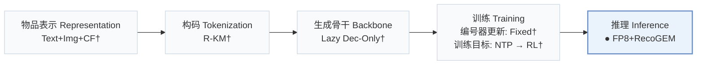
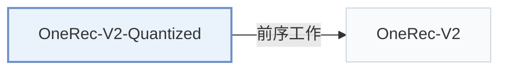

# OneRec-V2-Quantized

[← 问题 × 阶段矩阵](../../../README.zh.md#v--inference) · [按阶段索引](../index/stages.md) · [按模态找论文](../index/modality.md) · [按领域找论文](../index/domain.md) · [English](../../papers/onerec-v2-quantized.md) | 中文

| **题目** | *Quantized Inference for OneRec-V2* |
| :-- | :-- |
| **作者** | Su et al. |
| **发表** | arXiv’26 |
| **问题与阶段** | `V. 效率` · `推理（Inference）` |
| **改动** | ● 推理 |
| **构码输入** | `Text` + `Img` + `CF` |
| **领域** | `短视频与直播` |
| **应用场景** | `一般物品推荐`；`线上实验或部署` |
| **链接** | [论文](https://arxiv.org/abs/2603.11486) |
| **阅读级别** | 概览（第 1 级） |

**本页目录**：[TL;DR](#tldr) · [3. 实验发现](#3-实验发现) · [5. 相关工作](#5-相关工作)

- `Text+Img+CF†`：文本、图像与协同信号融合表征（由配置推断）。
- `R-KM†`：残差 k-means 编号（由配置推断）。
- `Lazy Dec-Only†`：由所沿用基座推断的延迟仅解码器架构。
- `Fixed†`：生成器训练期间冻结编号器（由配置推断）。
- `NTP → RL†`：先进行下一 token 预测微调，再执行强化学习（由配置推断）。
- `FP8+RecoGEM`：采用 FP8 低精度量化与 RecoGEM 推理引擎部署解码。

### TL;DR

> [!NOTE]
> OneRec-V2-Quantized 针对 OneRec-V2 权重与激活分布更接近 LLM 而非传统推荐模型的特点，引入低精度浮点后训练量化与优化的推理栈。

---

### 3. 实验发现

实验设置

- **数据集**：Production single-column short-video recommendation; online evaluation on Kuaishou and Kuaishou Lite. Dataset dates, sizes and filtering not reported.
  - 出处：Sections 5.1/5.3: [S5.SS1.p1](https://arxiv.org/html/2603.11486v1#S5.SS1.p1) and [S5.SS3.p1](https://arxiv.org/html/2603.11486v1#S5.SS3.p1)
- **切分**：Offline split not reported; online A/B runs one week, traffic allocation not reported.
  - 出处：Sections 5.1/5.3: [S5.SS1](https://arxiv.org/html/2603.11486v1#S5.SS1) and [S5.SS3.p1](https://arxiv.org/html/2603.11486v1#S5.SS3.p1)
- **候选集**：not reported
  - 出处：Section 5 evaluates serving performance and online engagement without a candidate protocol: [S5](https://arxiv.org/html/2603.11486v1#S5)
- **可见性**：warm; no unseen-item protocol is defined.
  - 出处：Sections 4.1/5 define PTQ and serving tests, without an unseen-item protocol: [S4.SS1.p1](https://arxiv.org/html/2603.11486v1#S4.SS1.p1) and [S5](https://arxiv.org/html/2603.11486v1#S5)
- **SID 规格**：not reported
  - 出处：Section 4.1 leaves the base model unchanged but does not specify SID construction: [S4.SS1.p1](https://arxiv.org/html/2603.11486v1#S4.SS1.p1)
- **推理预算**：4B fat-MoE, 0.5B active/token, batch 32. FP16 baseline versus FP8 Linear/MoE (Linear accumulation FP32): 139ms to 70ms mean latency; throughput 205 to 394, units not reported. GPU model, beam width and output K not reported.
  - 出处：Sections 4.1/5.1/5.2: [S4.SS1.p2](https://arxiv.org/html/2603.11486v1#S4.SS1.p2) and [S5.SS1.p1](https://arxiv.org/html/2603.11486v1#S5.SS1.p1) and [S5.SS1.p2](https://arxiv.org/html/2603.11486v1#S5.SS1.p2) and [S5.SS2.p2](https://arxiv.org/html/2603.11486v1#S5.SS2.p2)
- **结果来源**：Original Section 5.2/Figure 3: FP16 versus combined infrastructure/FP8/operator optimization; Table 1: online quality. The full 49% latency reduction and 92% throughput gain include all three changes.
  - 出处：Section 5.2/Figure 3 and Section 5.3/Table 1: [S5.SS2.p2](https://arxiv.org/html/2603.11486v1#S5.SS2.p2) and [S5.F3](https://arxiv.org/html/2603.11486v1#S5.F3) and [S5.T1](https://arxiv.org/html/2603.11486v1#S5.T1)

---

### 5. 相关工作

- **前序工作** · [OneRec-V2](onerec-v2.md): Provides the unchanged base architecture and training procedure for FP8 deployment.
  - 出处：Quantized Inference for OneRec-V2 v1, Introduction and Section 4.1: [S1.p3](https://arxiv.org/html/2603.11486v1#S1.p3); [S4.SS1.p1](https://arxiv.org/html/2603.11486v1#S4.SS1.p1).

[查看同格全部论文](../../../README.zh.md#v--inference)
