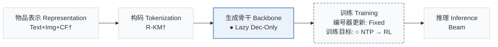
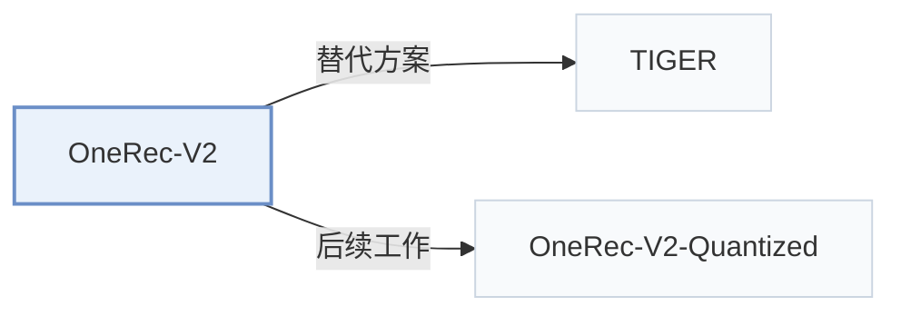

# OneRec-V2

[← 问题 × 阶段矩阵](../../../README.zh.md#v--backbone) · [按阶段索引](../index/stages.md) · [按模态找论文](../index/modality.md) · [按领域找论文](../index/domain.md) · [English](../../papers/onerec-v2.md) | 中文

| **题目** | *Technical Report* |
| :-- | :-- |
| **作者** | Zhou et al. |
| **发表** | arXiv’25 |
| **问题与阶段** | `V. 效率` · `生成骨干（Backbone）` |
| **改动** | ● 生成骨干 · ○ 训练目标 |
| **构码输入** | `Text` + `Img` + `CF` |
| **领域** | `短视频与直播` |
| **链接** | [论文](https://arxiv.org/abs/2508.20900) |
| **阅读级别** | 概览（第 1 级） |

**本页目录**：[TL;DR](#tldr) · [3. 实验发现](#3-实验发现) · [5. 相关工作](#5-相关工作)

- `Text+Img+CF†`：文本、图像与协同信号融合表征（由配置推断）。
- `R-KM†`：残差 k-means 编号（由配置推断）。
- `Lazy Dec-Only`：将计算集中在目标生成阶段的延迟仅解码器架构。
- `Fixed`：先独立训练并冻结编号器，生成器训练期间 SID 保持不变。
- `NTP → RL`：先进行下一 token 预测微调，再执行强化学习（如 GRPO、GBPO 等）。
- `Beam`：在 SID token 上执行自回归束搜索（Beam search）。

### TL;DR

> [!NOTE]
> OneRec-V2 用懒惰仅解码器架构替代 OneRec 的编码器-解码器以削减序列编码计算，并通过时长感知奖励塑形与自适应比率裁剪对齐真实反馈。

---

### 3. 实验发现

实验设置

- **数据集**：Kuaishou impressions, August 10-14 2025, for streaming architecture experiments; Kuaishou and Kuaishou Lite feeds for online evaluation. Filtering and dataset sizes not reported.
  - 出处：Sections 2.3/4: [S2.SS3.p1](https://arxiv.org/html/2508.20900v4#S2.SS3.p1) and [S4.p1](https://arxiv.org/html/2508.20900v4#S4.p1)
- **切分**：Offline holdout allocation not reported. Online: one week, 5% experimental traffic; V2 serves 25% of degraded traffic within that group (Appendix D wording). Separate 1% group disables caching and serves V2 for every request.
  - 出处：Sections 2.3/4 and Appendix D: [S2.SS3.p1](https://arxiv.org/html/2508.20900v4#S2.SS3.p1) and [S4.p1](https://arxiv.org/html/2508.20900v4#S4.p1) and [A4.p1](https://arxiv.org/html/2508.20900v4#A4.p1)
- **候选集**：not reported
  - 出处：Sections 2.3/4 describe training loss and online tests without candidate-enumeration protocol: [S2.SS3](https://arxiv.org/html/2508.20900v4#S2.SS3) and [S4](https://arxiv.org/html/2508.20900v4#S4)
- **可见性**：warm; no unseen-item protocol is defined. Cold-start video-view metrics are reported, but subset criteria and tokenizer exposure are not reported.
  - 出处：Sections 4/5 and Appendix D do not define a held-out unseen-item protocol: [S4](https://arxiv.org/html/2508.20900v4#S4) and [A4.p2](https://arxiv.org/html/2508.20900v4#A4.p2)
- **SID 规格**：3 semantic tokens using the OneRec-V1 tokenizer; codebook sizes and collision handling not reported here.
  - 出处：Section 2.2.2 Tokenizer: [S2.SS2.SSS2.Px1.p1](https://arxiv.org/html/2508.20900v4#S2.SS2.SSS2.Px1.p1)
- **推理预算**：Online 1B model, context 3000, beam 512, L20 GPUs, latency 36ms, MFU 62%; inference batch size not reported.
  - 出处：Section 4: [S4.p1](https://arxiv.org/html/2508.20900v4#S4.p1)
- **结果来源**：Original Tables 2-5: architecture/scaling; Tables 6-8: online alignment/deployment comparisons; Table 9: caching disabled. Online improvements are relative to OneRec-V1.
  - 出处：Original Tables 2-8 and Appendix D Table 9: [S2.T2](https://arxiv.org/html/2508.20900v4#S2.T2) and [S2.T5](https://arxiv.org/html/2508.20900v4#S2.T5) and [S3.T6](https://arxiv.org/html/2508.20900v4#S3.T6) and [S3.T8](https://arxiv.org/html/2508.20900v4#S3.T8) and [A4.T9](https://arxiv.org/html/2508.20900v4#A4.T9)

---

### 5. 相关工作

- **替代方案** · [TIGER](tiger.md): Earlier generative retrieval contrasts with V2's lazy-decoder compute allocation.
  - 出处：OneRec-V2 v4, Introduction and Section 2.1, citing Rajput et al. (2023): [S1.p1](https://arxiv.org/html/2508.20900v4#S1.p1); [S2.SS1](https://arxiv.org/html/2508.20900v4#S2.SS1).
- **后续工作** · [OneRec-V2-Quantized](onerec-v2-quantized.md): Adds FP8 post-training quantization and an optimized inference stack.
  - 出处：Evidence from Quantized Inference for OneRec-V2 v1, Section 4.1: [S4.SS1.p1](https://arxiv.org/html/2603.11486v1#S4.SS1.p1).

[查看同格全部论文](../../../README.zh.md#v--backbone)
