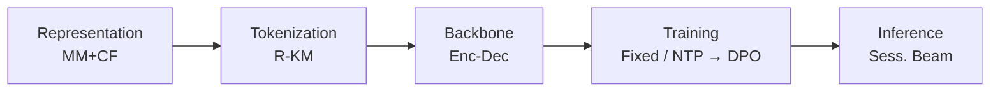
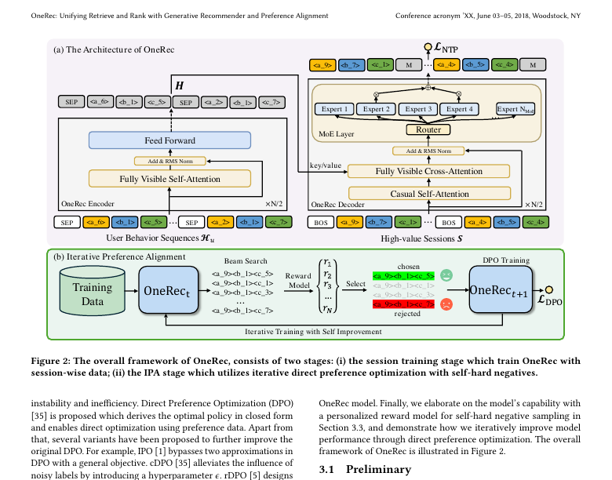
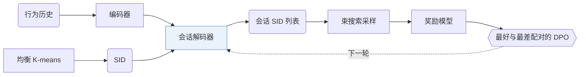
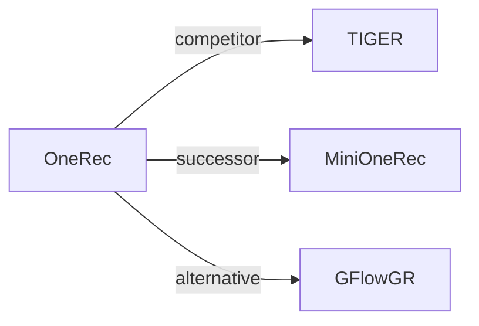

# OneRec

| **题目** | *Unifying retrieve and rank with generative recommender and iterative preference alignment* |
| :-- | :-- |
| **作者** | Deng et al. |
| **会议** | arXiv’25 |
| **问题与阶段** | `范式、系统与基准` · `无单一阶段` |
| **链接** | [论文](https://arxiv.org/abs/2502.18965) · [矩阵](../../../README.zh.md#范式系统与基准) · [English](../../papers/onerec.md) |
| **阅读级别** | 阅读笔记（第 2 级） |

本页目录：[TL;DR](#tldr) · [速览](#速览) · [1. 为什么重要](#1-为什么重要) · [2. 方法](#2-方法) · [3. 实验发现](#3-实验发现) · [4. 局限与分析](#4-局限与分析) · [5. 相关工作](#5-相关工作)

- `MM+CF`: Multimodal item representations aligned with collaborative signals.
- `R-KM`: Residual k-means.
- `Enc-Dec`: Encoder-decoder.
- `Fixed`: SIDs are built first and not changed while the generator trains.
- `NTP → DPO`: NTP, then preference optimization.

### TL;DR

> [!NOTE]
> OneRec 用带稀疏 MoE 的单一编码器-解码器生成器替代召回-排序级联，整段生成视频会话，并通过奖励模型与迭代 DPO 对齐用户偏好。

---

### 速览

| 维度 | 摘要 |
| :-- | :-- |
| 研究问题 | 范式、系统与基准：Baseline (TIGER), end-to-end multi-stage paradigms, open-source frameworks, benchmarks, and diagnostic resources. |
| 核心贡献 | OneRec 用带稀疏 MoE 的单一编码器-解码器生成器替代召回-排序级联，整段生成视频会话，并通过奖励模型与迭代 DPO 对齐用户偏好。 |
| 主要改动阶段 | 无单一阶段 |
| 局限 | 在线测试中，OneRec 提升了观看时长，但在点赞等互动指标上较弱（Sec. 6）。 |

---

### 1. 为什么重要

多数推荐器是"召回-排序"的级联，生成式模型即使有，也只在召回阶段选候选（Abstract）。作者认为，每一级都给下一级设了上限。

> "existing methods typically treat each ranker independently, where the effectiveness of each isolated stage serves as the upper bound for the subsequent ranking stage, thereby limiting the performance of the overall ranking system."（Sec. 1）（各级排序器独立处理，前一级的效果就是后一级的上限。）

OneRec 用一个单阶段生成式模型替代级联，并部署在快手主场景（Abstract，Sec. 1）。

---

### 2. 方法

#### 均衡的语义 ID

每个物品由均衡 K-means 得到语义 ID（Semantic ID，SID），每个簇里的物品数相同（Sec. 3.1，Algorithm 1）。

#### 按会话生成列表

OneRec 不只预测下一个物品，而是生成整个会话的物品列表，并考虑列表内物品的内容和顺序（Sec. 1）。编码器建模用户历史，解码器生成会话列表（Sec. 3.2）。

> "The decoder takes the semantic IDs of the target session as input and generates the target in an auto-regressive manner."（Sec. 3.2）（解码器以目标会话的语义 ID 为输入，自回归地生成。）

#### 迭代偏好对齐

推荐系统对每个请求只展示一次，同一请求下拿不到真正的正、负列表（Abstract）。OneRec 用束搜索采样多个结果，用预训练的奖励模型打分，把最高分和最低分的结果配成一对做 DPO（Sec. 3.3.2）。下一轮再由模型生成新样本。

---

### 3. 实验发现

实验设置

- **数据集**：Kuaishou short-video interaction logs; training sessions are built from high-quality user sessions (a session is 5-10 videos per request; the listed criteria include at least 5 videos actually watched, total watch time above a threshold whose value is not given, and interactions such as liking, collecting, or sharing). Dataset size: not reported.
  - 出处：Industrial Kuaishou data and session construction: [S3.SS2.p1](https://arxiv.org/html/2502.18965v1#S3.SS2.p1) and [S4.p1](https://arxiv.org/html/2502.18965v1#S4.p1); no dataset statistics found.
- **切分**：Offline: evaluation on a randomly sampled set of test cases in each iteration; the train/test construction is not reported. Online: A/B test on Kuaishou's main-page video scenarios with 1% of main traffic.
  - 出处：Offline evaluation on randomly sampled test cases: [S5.SS1.SSS3.p1](https://arxiv.org/html/2502.18965v1#S5.SS1.SSS3.p1); online: [S5.SS5.p1](https://arxiv.org/html/2502.18965v1#S5.SS5.p1).
- **候选集**：n/a for ranking metrics: generated sessions are scored by a pre-trained reward model (session watch time, view, follow, and like probabilities), not ranked against a candidate set.
  - 出处：Reward-model evaluation of generated sessions: [S5.SS1.SSS3.p1](https://arxiv.org/html/2502.18965v1#S5.SS1.SSS3.p1).
- **可见性**：warm; no unseen-item protocol is defined.
  - 出处：No unseen-item protocol: [S5.SS1.SSS3.p1](https://arxiv.org/html/2502.18965v1#S5.SS1.SSS3.p1).
- **SID 规格**：3 levels x 8,192 codes from multi-level balanced residual K-means over multimodal video embeddings aligned with user behavior; balanced K-means equalizes cluster sizes. Collision handling: not reported.
  - 出处：Balanced residual K-means, L=3 x K=8192: [S3.SS1.p2](https://arxiv.org/html/2502.18965v1#S3.SS1.p2), [S3.SS1.p3](https://arxiv.org/html/2502.18965v1#S3.SS1.p3), [S5.SS1.SSS1.p1](https://arxiv.org/html/2502.18965v1#S5.SS1.SSS1.p1); no collision rule found.
- **推理预算**：Beam search with beam size 128 (also used to generate 128 responses per user for DPO); KV-cache decoding with float16 quantization; MoE with 24 experts, 2 active (about 13% of parameters active at inference). Training on NVIDIA A800 GPUs; serving hardware, batch size, and latency: not reported.
  - 出处：Beam size 128 online and for DPO sampling; KV cache and float16: [S4.p1](https://arxiv.org/html/2502.18965v1#S4.p1) and [S5.SS1.SSS1.p1](https://arxiv.org/html/2502.18965v1#S5.SS1.SSS1.p1).
- **结果来源**：Table 1 (offline reward-model metrics versus pointwise, listwise, and preference-alignment baselines); Figure 4 (DPO sample ratio); Table 2 (online A/B: OneRec-1B+IPA +1.68% total watch time, +6.56% average view duration).
  - 出处：Offline: [S3.T1](https://arxiv.org/html/2502.18965v1#S3.T1); DPO ratio: [S5.F4](https://arxiv.org/html/2502.18965v1#S5.F4); online: [S5.T2](https://arxiv.org/html/2502.18965v1#S5.T2).

- 按会话生成：在奖励模型指标上，OneRec 好于点积召回方法和 TIGER 这类逐点生成方法（Sec. 5.2，Table 1）。
- 偏好对齐：加入 IPA 后，生成的会话进一步变好（Sec. 5.2，Table 1）。

---

### 4. 局限与分析

**Stated by the authors.**

> "Additionally, our analysis of online results reveals that, besides user watch time, our model has limitations in interactive indicators, such as likes."（Sec. 6）（在线结果显示，除观看时长外，模型在点赞等互动指标上有局限。）

**Our analysis.**

- DPO 样本对按奖励模型排序，而不是按用户对两个列表的真实反馈。由此推断，对齐质量受奖励模型限制。
- MiniOneRec 在公开数据上复现这条流程，改用只基于文本（`Text`）的 `RQ-VAE` SID、`Dec-Only` 生成器，并用 RL 替代 DPO（`NTP → RL`）。

---

### 5. 相关工作

- **同期对比** · [TIGER](tiger.md): TIGER generates one next item from RQ-VAE semantic IDs; OneRec generates whole sessions with balanced residual K-means IDs, an MoE encoder-decoder, and iterative DPO.
  - 出处：OneRec v1, baselines: https://arxiv.org/html/2502.18965v1#S5.I1.i4.p1; Table 1: https://arxiv.org/html/2502.18965v1#S3.T1; tokenizer contrast with RQ-VAE: https://arxiv.org/html/2502.18965v1#S3.SS1.p2.
- **后续工作** · [MiniOneRec](minionerec.md): MiniOneRec later reproduces the OneRec-style SID, SFT, and RL pipeline in open source on public data.
  - 出处：Evidence is from the later MiniOneRec paper, Section 1: https://arxiv.org/html/2510.24431v1#S1.p1 and https://arxiv.org/html/2510.24431v1#S1.p3.
- **替代方案** · [GFlowGR](gflowgr.md): GFlowGR later compares against OneRec's IPA alignment and replaces it with a GFlowNet objective over reward-weighted trajectories.
  - 出处：Evidence is from the later GFlowGR paper: IPA baseline and Table 2: https://arxiv.org/html/2506.16114v3#S4.I2.i6.p1 and https://arxiv.org/html/2506.16114v3#S4.T2.

[查看同格全部论文](../../../README.zh.md#范式系统与基准)
