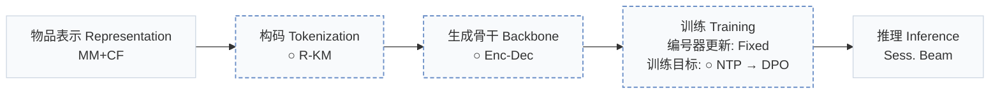
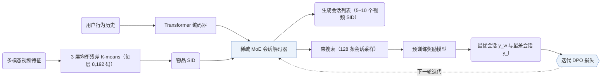
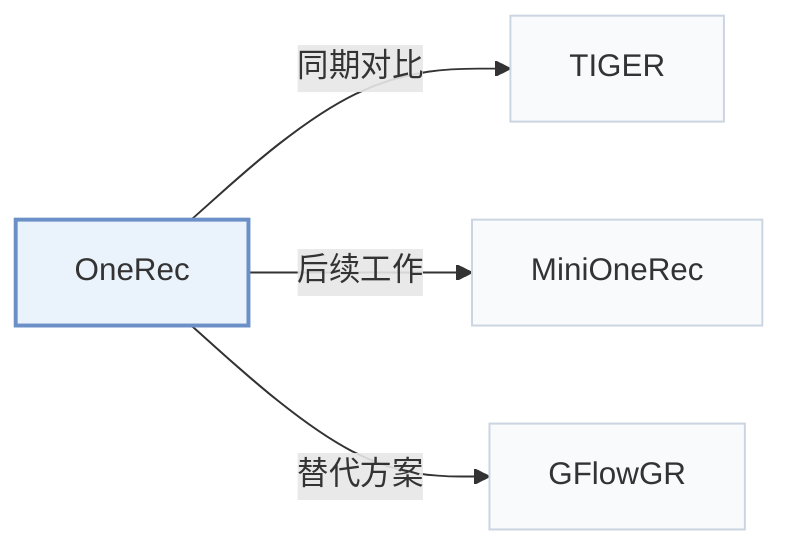

# OneRec

[← 问题 × 阶段矩阵](../../../README.zh.md#范式系统与基准) · [按阶段索引](../index/stages.md) · [按模态找论文](../index/modality.md) · [按领域找论文](../index/domain.md) · [English](../../papers/onerec.md) | 中文

| **题目** | *Unifying retrieve and rank with generative recommender and iterative preference alignment* |
| :-- | :-- |
| **作者** | Deng et al. |
| **发表** | arXiv’25 |
| **问题与阶段** | `范式、系统与基准` · `无单一阶段` |
| **改动** | ○ 构码 · ○ 生成骨干 · ○ 训练目标 |
| **构码输入** | `MM` + `CF` |
| **领域** | `短视频与直播` |
| **应用场景** | `一般物品推荐`；`线上实验或部署` |
| **链接** | [论文](https://arxiv.org/abs/2502.18965) |
| **阅读级别** | 阅读笔记（第 2 级） |

**本页目录**：[TL;DR](#tldr) · [速览](#速览) · [1. 为什么重要](#1-为什么重要) · [2. 方法](#2-方法) · [3. 实验发现](#3-实验发现) · [4. 局限与分析](#4-局限与分析) · [5. 相关工作](#5-相关工作)

- `MM+CF`：与协同过滤信号对齐的多模态物品表征。
- `R-KM`：残差 k-means 量化（Residual k-means）。
- `Enc-Dec`：编码器-解码器（Encoder-decoder）架构。
- `Fixed`：先独立训练并冻结编号器，生成器训练期间 SID 保持不变。
- `NTP → DPO`：先进行下一 token 预测微调，再执行直接偏好优化（DPO）。
- `Sess. Beam`：单次生成包含多个物品的整段会话列表（Session-wise beam search）。

### TL;DR

> [!NOTE]
> OneRec 用带稀疏 MoE 的单一编码器-解码器生成器替代召回-排序级联，整段生成视频会话，并通过奖励模型与迭代 DPO 对齐用户偏好。

---

### 速览

| 维度 | 摘要 |
| :-- | :-- |
| 主要发现 | 在离线奖励模型指标上，OneRec 优于点积召回基线及 TIGER 等逐点生成器（Table 1）；在快手在线 A/B 测试中，OneRec-1B+IPA 的总观看时长提升 +1.68%，平均单次观看时长提升 +6.56%（Table 2）。 |
| 局限 | 在线测试中，OneRec 提升了观看时长，但在点赞等互动指标上较弱（Sec. 6）。 |

---

### 1. 为什么重要

主流工业推荐系统采用多阶段“召回-排序”级联架构，前一阶段的候选集合直接限制后一阶段的效果上限；已有的生成式模型即便接入，也仅在召回阶段充当候选选择器。

> "existing methods typically treat each ranker independently, where the effectiveness of each isolated stage serves as the upper bound for the subsequent ranking stage, thereby limiting the performance of the overall ranking system."（Sec. 1）

OneRec 用单一阶段的生成式模型替代多级级联，并部署于快手主场景（Abstract，Sec. 1）。

---

### 2. 方法

#### 均衡的语义 ID

每个视频在行为对齐的多模态嵌入上通过多层均衡残差 K-means 获得 3 层语义 ID（Semantic ID，SID），每层码本含 8,192 个码，且每个簇容纳相同数量的物品（Sec. 3.1，Algorithm 1）。

#### 按会话生成列表

OneRec 不局限于预测单个下一物品，而是直接生成包含 5–10 个物品的完整会话列表，同时建模会话内物品的内容组合与排列顺序（Sec. 1）。Transformer 编码器编码用户交互历史，稀疏 MoE 解码器自回归生成目标会话的 SID 序列（Sec. 3.2）。

> "The decoder takes the semantic IDs of the target session as input and generates the target in an auto-regressive manner."（Sec. 3.2）

#### 迭代偏好对齐

推荐系统对每次请求只展示一个结果列表，日志中无法同时观测同一请求下的真实正、负会话列表。OneRec 用束搜索为每个用户采样 128 个候选会话，由预训练奖励模型打分，将得分最高与最低的会话配对用于 DPO 训练（Sec. 3.3.2），并在下一轮迭代中由更新后的生成器重新采样。

---

### 3. 实验发现

实验设置

- **数据集**：Kuaishou short-video interaction logs; training sessions are built from high-quality user sessions (a session is 5-10 videos per request; the listed criteria include at least 5 videos actually watched, total watch time above a threshold whose value is not given, and interactions such as liking, collecting, or sharing). Dataset size: not reported.
  - 出处：Industrial Kuaishou data and session construction: [S3.SS2.p1](https://arxiv.org/html/2502.18965v1#S3.SS2.p1) and [S4.p1](https://arxiv.org/html/2502.18965v1#S4.p1); no dataset statistics found.
- **切分**：Offline: evaluation on a randomly sampled set of test cases in each iteration; the train/test construction is not reported. Online: A/B test on Kuaishou's main-page video scenarios with 1% of main traffic.
  - 出处：Offline evaluation on randomly sampled test cases: [S5.SS1.SSS3.p1](https://arxiv.org/html/2502.18965v1#S5.SS1.SSS3.p1); online: [S5.SS5.p1](https://arxiv.org/html/2502.18965v1#S5.SS5.p1).
- **候选集**：n/a for ranking metrics: generated sessions are scored by a pre-trained reward model (session watch time, view, follow, and like probabilities), not ranked against a candidate set.
  - 出处：Reward-model evaluation of generated sessions: [S5.SS1.SSS3.p1](https://arxiv.org/html/2502.18965v1#S5.SS1.SSS3.p1).
- **可见性**：warm; no unseen-item protocol is defined.
  - 出处：No unseen-item protocol: [S5.SS1.SSS3.p1](https://arxiv.org/html/2502.18965v1#S5.SS1.SSS3.p1).
- **SID 规格**：3 levels x 8,192 codes from multi-level balanced residual K-means over multimodal video embeddings aligned with user behavior; balanced K-means equalizes cluster sizes. Collision handling: not reported.
  - 出处：Balanced residual K-means, L=3 x K=8192: [S3.SS1.p2](https://arxiv.org/html/2502.18965v1#S3.SS1.p2), [S3.SS1.p3](https://arxiv.org/html/2502.18965v1#S3.SS1.p3), [S5.SS1.SSS1.p1](https://arxiv.org/html/2502.18965v1#S5.SS1.SSS1.p1); no collision rule found.
- **推理预算**：Beam search with beam size 128 (also used to generate 128 responses per user for DPO); KV-cache decoding with float16 quantization; MoE with 24 experts, 2 active (about 13% of parameters active at inference). Training on NVIDIA A800 GPUs; serving hardware, batch size, and latency: not reported.
  - 出处：Beam size 128 online and for DPO sampling; KV cache and float16: [S4.p1](https://arxiv.org/html/2502.18965v1#S4.p1) and [S5.SS1.SSS1.p1](https://arxiv.org/html/2502.18965v1#S5.SS1.SSS1.p1).
- **结果来源**：Table 1 (offline reward-model metrics versus pointwise, listwise, and preference-alignment baselines); Figure 4 (DPO sample ratio); Table 2 (online A/B: OneRec-1B+IPA +1.68% total watch time, +6.56% average view duration).
  - 出处：Offline: [S3.T1](https://arxiv.org/html/2502.18965v1#S3.T1); DPO ratio: [S5.F4](https://arxiv.org/html/2502.18965v1#S5.F4); online: [S5.T2](https://arxiv.org/html/2502.18965v1#S5.T2).

- 按会话生成：在会话观看时长与互动概率等离线奖励模型指标上，OneRec 优于点积召回基线及 TIGER 等逐点生成方法（Sec. 5.2，Table 1）。
- 偏好对齐：加入迭代偏好对齐（IPA）进一步提升了离线会话奖励指标（Sec. 5.2，Table 1，Fig. 4），并在快手在线 A/B 测试中使 OneRec-1B+IPA 的总观看时长提升 +1.68%、平均单次观看时长提升 +6.56%（Table 2）。

---

### 4. 局限与分析

**Stated by the authors.**

> "Additionally, our analysis of online results reveals that, besides user watch time, our model has limitations in interactive indicators, such as likes."（Sec. 6）

**Our analysis.**

- DPO 样本对由预训练奖励模型排序，而非来自用户对候选列表的真实反馈。这表明对齐质量的上限受制于奖励模型在多目标上的拟合精度。
- MiniOneRec 在公开数据上复现该流程，改用仅基于文本（`Text`）的 `RQ-VAE` SID、`Dec-Only` 生成器，并用 RL 替代 DPO（`NTP → RL`）。

---

### 5. 相关工作

- **同期对比** · [TIGER](tiger.md): TIGER generates one next item from RQ-VAE semantic IDs; OneRec generates whole sessions with balanced residual K-means IDs, an MoE encoder-decoder, and iterative DPO.
  - 出处：OneRec v1, baselines: [S5.I1.i4.p1](https://arxiv.org/html/2502.18965v1#S5.I1.i4.p1); Table 1: [S3.T1](https://arxiv.org/html/2502.18965v1#S3.T1); tokenizer contrast with RQ-VAE: [S3.SS1.p2](https://arxiv.org/html/2502.18965v1#S3.SS1.p2).
- **后续工作** · [MiniOneRec](minionerec.md): MiniOneRec later reproduces the OneRec-style SID, SFT, and RL pipeline in open source on public data.
  - 出处：Evidence is from the later MiniOneRec paper, Section 1: [S1.p1](https://arxiv.org/html/2510.24431v1#S1.p1) and [S1.p3](https://arxiv.org/html/2510.24431v1#S1.p3).
- **替代方案** · [GFlowGR](gflowgr.md): GFlowGR later compares against OneRec's IPA alignment and replaces it with a GFlowNet objective over reward-weighted trajectories.
  - 出处：Evidence is from the later GFlowGR paper: IPA baseline and Table 2: [S4.I2.i6.p1](https://arxiv.org/html/2506.16114v3#S4.I2.i6.p1) and [S4.T2](https://arxiv.org/html/2506.16114v3#S4.T2).

[查看同格全部论文](../../../README.zh.md#范式系统与基准)
