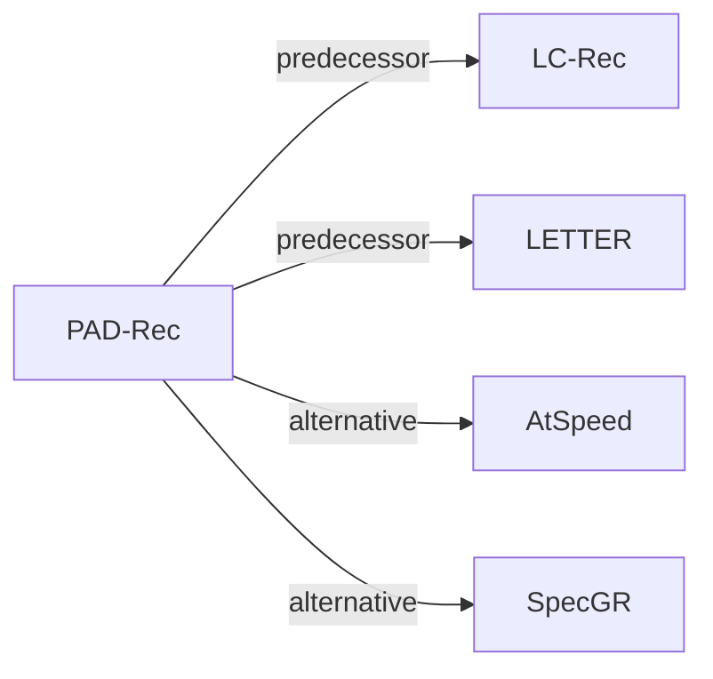

# PAD-Rec

| **题目** | *Position-Aware Drafting for Inference Acceleration in LLM-Based Generative List-Wise Recommendation* |
| :-- | :-- |
| **作者** | Chen et al. |
| **会议** | arXiv’26 |
| **问题与阶段** | `V. 效率` · `Inference` |
| **链接** | [论文](https://arxiv.org/abs/2604.27747) · [代码](https://github.com/Jiaju-Chen/PAD-Rec) · [矩阵](../../../README.zh.md#v--inference) · [English](../../papers/pad-rec.md) |
| **阅读级别** | 概览（第 1 级） |

本页目录：[TL;DR](#tldr) · [速览](#速览) · [3. 实验发现](#3-实验发现) · [5. 相关工作](#5-相关工作)

- `Text+SID`: Text representation plus semantic IDs (hybrid dense and generative retrieval).
- `Dec-Only`: Decoder-only.
- `Fixed`: SIDs are built first and not changed while the generator trains.
- `Spec. Dec.`: Speculative decoding.

### TL;DR

> [!NOTE]
> PAD-Rec 为投机解码的草稿模型加入门控的物品槽位嵌入与起草步位置嵌入，不再对所有 SID 草稿 token 做无差别处理。

---

### 速览

| 维度 | 摘要 |
| :-- | :-- |
| 研究问题 | V. 效率：Can it be trained and served within latency and cost budgets? |
| 核心贡献 | PAD-Rec 为投机解码的草稿模型加入门控的物品槽位嵌入与起草步位置嵌入，不再对所有 SID 草稿 token 做无差别处理。 |
| 主要改动阶段 | Inference |

---

### 3. 实验发现

实验设置

- **数据集**：Amazon Beauty (12,101 items / 22,363 sequences), Instruments (9,922 / 24,772), Games (17,332 / 49,156), and Yelp (20,033 / 30,431). Users with fewer than 11 interactions are removed; each remaining user's 10 most recent items form the target list.
  - 出处：Datasets and statistics: [S5.SS1.SSS1.p1](https://arxiv.org/html/2604.27747v1#S5.SS1.SSS1.p1) and [S5.T1](https://arxiv.org/html/2604.27747v1#S5.T1); preprocessing: [S5.SS1.SSS1.p3](https://arxiv.org/html/2604.27747v1#S5.SS1.SSS1.p3).
- **切分**：User-level 8:1:1 split into training, validation, and test, so all interactions of a user fall in one partition; targets are each user's 10 most recent items.
  - 出处：User-level 8:1:1 split: [S5.SS1.SSS1.p4](https://arxiv.org/html/2604.27747v1#S5.SS1.SSS1.p4).
- **候选集**：n/a for candidate ranking: the model generates a 10-item list that is compared with the user's 10 most recent items (Recall@10, NDCG@10).
  - 出处：List-wise recall against the 10-item ground-truth list: [S5.I4.i3.p1](https://arxiv.org/html/2604.27747v1#S5.I4.i3.p1) and [S5.I4.i4.p1](https://arxiv.org/html/2604.27747v1#S5.I4.i4.p1).
- **可见性**：warm; no unseen-item protocol is defined. Test users are held out from training (user-level split), while items are shared across splits.
  - 出处：Test users are disjoint from training users; items are shared: [S5.SS1.SSS1.p4](https://arxiv.org/html/2604.27747v1#S5.SS1.SSS1.p4).
- **SID 规格**：4-level RQ-VAE semantic IDs over embeddings that integrate semantic and collaborative signals (following LETTER), with separator tokens between items; codebook size and collision handling: not reported.
  - 出处：K=4 RQ-VAE codebooks following LETTER, separators between items: [S3.SS1.p3](https://arxiv.org/html/2604.27747v1#S3.SS1.p3) and [S5.SS1.SSS1.p3](https://arxiv.org/html/2604.27747v1#S5.SS1.SSS1.p3).
- **推理预算**：EAGLE-2-style tree speculative decoding with speculation depth 6 and tree width 10, at temperature 0 and 0.5; target LLM Llama-3.2-1B-Instruct (3B and 8B in scaling). Latency measured on NVIDIA RTX 3090 GPUs in fp16 with batch size 1 after three warm-up runs; Table 3 lists naive target-LLM latency (e.g. Beauty 693.55 at temp 0, units as in the table).
  - 出处：Tree-based speculative decoding settings and timing protocol: [S5.SS1.SSS4.p2](https://arxiv.org/html/2604.27747v1#S5.SS1.SSS4.p2) and [S5.SS1.SSS4.p3](https://arxiv.org/html/2604.27747v1#S5.SS1.SSS4.p3); baseline latency: [S5.T3](https://arxiv.org/html/2604.27747v1#S5.T3).
- **结果来源**：Table 2 (wall-clock speedup, accepted length, Recall@10, NDCG@10 versus EAGLE-2, HASS, FSPAD, GRIFFIN on four datasets); Table 3 (naive decoding latency); later tables and figures (ablations, model scaling, hyperparameters).
  - 出处：Main: [S5.T2](https://arxiv.org/html/2604.27747v1#S5.T2); latency: [S5.T3](https://arxiv.org/html/2604.27747v1#S5.T3); ablations and hyperparameters in Section 5.

---

### 5. 相关工作

- **前序工作** · [LC-Rec](lc-rec.md): PAD-Rec accelerates a list-wise LC-Rec target model with speculative decoding, adding item and step position embeddings to the draft head.
  - 出处：PAD-Rec v1, implementation on LC-Rec: https://arxiv.org/html/2604.27747v1#S5.SS1.SSS4.p1 and https://arxiv.org/html/2604.27747v1#S5.SS1.SSS1.p5.
- **前序工作** · [LETTER](letter.md): PAD-Rec obtains its semantic IDs following LETTER's semantic-collaborative embeddings and RQ-VAE.
  - 出处：PAD-Rec v1, Section 3.1 and Section 5.1 follow reference [40], LETTER: https://arxiv.org/html/2604.27747v1#S3.SS1.p3 and https://arxiv.org/html/2604.27747v1#S5.SS1.SSS1.p3.
- **替代方案** · [AtSpeed](atspeed.md): AtSpeed also accelerates LLM-based generative recommendation with speculative decoding; PAD-Rec targets list-wise generation with position-aware drafts.
  - 出处：PAD-Rec v1, Sections 1 and 2.3 cite AtSpeed: https://arxiv.org/html/2604.27747v1#S1.p2 and https://arxiv.org/html/2604.27747v1#S2.SS3.p1; not a baseline in Table 2.
- **替代方案** · [SpecGR](specgr.md): SpecGR uses speculative generation for inductive recommendation, while PAD-Rec speeds up decoding without changing the target model's outputs.
  - 出处：PAD-Rec v1, Section 2.3: https://arxiv.org/html/2604.27747v1#S2.SS3.p1.

[查看同格全部论文](../../../README.zh.md#v--inference)
