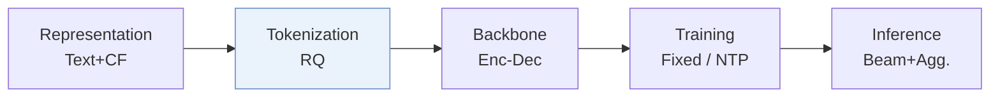
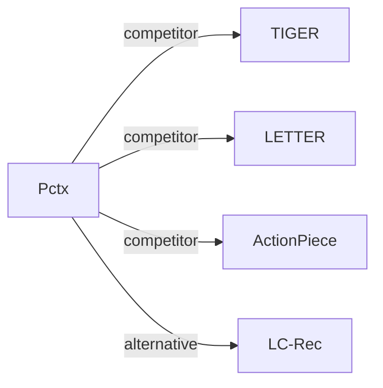

# Pctx

*Tokenizing Personalized Context for Generative Recommendation* — Zhong et al. · CIKM’26

`I. 信息量` · `Tokenization` · [论文](https://arxiv.org/abs/2510.21276) · [代码](https://github.com/YoungZ365/Pctx) · [矩阵](../../../README.zh.md#i--tokenization) · [English](../../papers/pctx.md)

阅读级别：概览（第 1 级） · 本页目录：[TL;DR](#tldr) · [速览](#速览) · [3. 实验发现](#3-实验发现) · [5. 相关工作](#5-相关工作)

- `RQ`: Residual quantization.
- `Enc-Dec`: Encoder-decoder.
- `Fixed`: SIDs are built first and not changed while the generator trains.
- `NTP`: Next-token prediction loss only; continuing from a pretrained LLM (SFT) also counts as NTP.
- `Beam+Agg.`: Beam search followed by aggregation of predictions that refer to the same item.

### TL;DR

> [!NOTE]
> Pctx 将用户交互历史作为上下文对物品编号，使同一物品面向不同用户可获得不同 SID，替代静态的纯物品映射。

### 速览

| 维度 | 摘要 |
| :-- | :-- |
| 研究问题 | I. 信息量：Do the SIDs, or the model reading them, carry the collaborative and multimodal signals recommendation needs? |
| 核心贡献 | Pctx 将用户交互历史作为上下文对物品编号，使同一物品面向不同用户可获得不同 SID，替代静态的纯物品映射。 |
| 主要改动阶段 | Tokenization |

### 3. 实验发现

实验设置

- **数据集**：Amazon Reviews 2023: Musical Instruments, Industrial & Scientific, Video Games; exclude users/items with fewer than five interactions; chronological histories capped at 20 items.
  - 出处：[S3.SS1.SSS0.Px1.p1](https://arxiv.org/html/2510.21276v1#S3.SS1.SSS0.Px1.p1) ; #A3.SS1.p1
- **切分**：Per-user chronological leave-one-out: most recent item test, penultimate validation, remaining interactions training.
  - 出处：[A3.SS3.p1](https://arxiv.org/html/2510.21276v1#A3.SS3.p1)
- **候选集**：full catalog; full-ranking evaluation rather than negative sampling.
  - 出处：[A3.SS3.p1](https://arxiv.org/html/2510.21276v1#A3.SS3.p1)
- **可见性**：warm; no unseen-item protocol is defined. Auxiliary DuoRec is pretrained on the same training data, and representative contexts come from training interactions; textual-tokenizer fitting exposure to test items not reported.
  - 出处：[S2.SS2.p1](https://arxiv.org/html/2510.21276v1#S2.SS2.p1) ; #S2.SS2.SSS1.Px1.p1 ; #S2.SS2.SSS2.p1 ; #A3.SS3.p1
- **SID 规格**：3 x 256 residual semantic codes plus an auxiliary collision token of unreported vocabulary size; multiple context-conditioned SIDs/item. Same-item IDs differing only in collision token are merged; collision tokens distinguish different items. Main text names RQ-VAE; appendix specifies FAISS quantization.
  - 出处：[S2.SS2.SSS2.Px1.p1](https://arxiv.org/html/2510.21276v1#S2.SS2.SSS2.Px1.p1) ; #S2.SS2.SSS2.Px2.p2 ; #A3.SS4.p1
- **推理预算**：Beam decoding with aggregation of generated SID probabilities per item; Recall/NDCG@5/10. GR baseline beam 50; Pctx-specific beam width not separately reported. Inference hardware, batch size and latency not reported.
  - 出处：[S2.SS3.SSS0.Px2.p1](https://arxiv.org/html/2510.21276v1#S2.SS3.SSS0.Px2.p1) ; #A3.SS3.p1 ; #S3.SS1.SSS0.Px3.p1
- **结果来源**：Table 1: Pctx experiments with most baseline rows (including TIGER/LETTER) copied from Zheng et al. (2025); other baselines reconstructed. Table 2: ablations; Table 3: ensemble comparisons; Table 6: explainability.
  - 出处：[S3.T1](https://arxiv.org/html/2510.21276v1#S3.T1) ; #S3.T2 ; #S3.T3 ; #A3.SS4.p1 ; #A4.T6

### 5. 相关工作

- **同期对比** · [TIGER](tiger.md): TIGER assigns static semantic IDs; Pctx conditions item tokenization on user context and aggregates probabilities across personalized IDs.
  - 出处：Pctx v1, Section 2.4 and Table 1; TIGER results are reused from prior work per Appendix C.4: https://arxiv.org/html/2510.21276v1#S2.SS4.SSS0.Px1.p1; https://arxiv.org/html/2510.21276v1#S3.T1; https://arxiv.org/html/2510.21276v1#A3.SS4.p1.
- **同期对比** · [LETTER](letter.md): LETTER injects collaborative information and diversity constraints into item quantization; Pctx adds history-conditioned user interpretations.
  - 出处：Pctx v1, Appendix C.2 and Table 1; LETTER results are reused per Appendix C.4: https://arxiv.org/html/2510.21276v1#A3.SS2.p1; https://arxiv.org/html/2510.21276v1#S3.T1; https://arxiv.org/html/2510.21276v1#A3.SS4.p1.
- **同期对比** · [ActionPiece](actionpiece.md): ActionPiece uses adjacent action context; Pctx extends tokenization context to the full user interaction history.
  - 出处：Pctx v1, Section 2.4 and Table 1: https://arxiv.org/html/2510.21276v1#S2.SS4.SSS0.Px3.p1; https://arxiv.org/html/2510.21276v1#S3.T1.
- **替代方案** · [LC-Rec](lc-rec.md): LC-Rec is discussed as static tokenization under a universal item-similarity assumption; Pctx maps an item to personalized IDs under different user contexts.
  - 出处：Pctx v1, Section 2.4: https://arxiv.org/html/2510.21276v1#S2.SS4.SSS0.Px1.p1.

[查看同格全部论文](../../../README.zh.md#i--tokenization)
