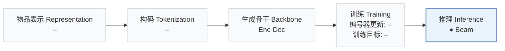
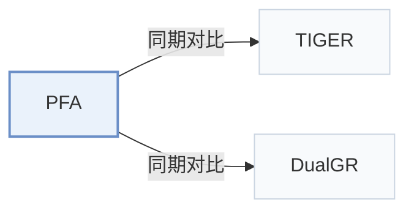

# PFA

[← 问题 × 阶段矩阵](../../../README.zh.md#v--inference) · [按阶段索引](../index/stages.md) · [按模态找论文](../index/modality.md) · [按领域找论文](../index/domain.md) · [English](../../papers/pfa.md) | 中文

| **题目** | *Attention Can Be Progressively Focused in Long-Sequence Generative Recommendation* |
| :-- | :-- |
| **作者** | Zhou et al. |
| **发表** | arXiv’26 |
| **问题与阶段** | `V. 效率` · `推理（Inference）` |
| **改动** | ● 推理 |
| **构码输入** | `其他`（四层编号，构码输入未写） |
| **领域** | `电商` · `广告` |
| **链接** | [论文](https://arxiv.org/abs/2610.39273) · [代码](https://anonymous.4open.science/r/PFA-review-088D) |
| **阅读级别** | 概览（第 1 级） |

**本页目录**：[TL;DR](#tldr) · [3. 实验发现](#3-实验发现) · [5. 相关工作](#5-相关工作)

- `Enc-Dec`：编码器-解码器（Encoder-decoder）架构。
- `Beam`：在 SID token 上执行自回归束搜索（Beam search）。

### TL;DR

> [!NOTE]
> PFA 在首个解码步保留完整注意力，随后在各束之间复用共享的重要性排序以缩减后续步关注的历史长度，加速长序列生成式解码。

---

### 3. 实验发现

实验设置

- **数据集**：Amazon 2023 Kindle Store (rating>=4, users>=128 positives); Tmall IJCAI-15 clicks; industrial advertising clicks. Click data retain earliest repeated user-item event; public items require >=5 training-instance occurrences, removing invalid users.
  - 出处：Section 4.1: [S4.SS1.SSS0.Px1.p1](https://arxiv.org/html/2610.39273v1#S4.SS1.SSS0.Px1.p1) and [S4.SS1.SSS0.Px2.p1](https://arxiv.org/html/2610.39273v1#S4.SS1.SSS0.Px2.p1)
- **切分**：Per-user chronological approximately 90%/5%/5% training/validation/test; rolling-history sliding windows use only behaviors preceding each target; deterministic public split sampling.
  - 出处：Section 4.1: [S4.SS1.SSS0.Px2.p1](https://arxiv.org/html/2610.39273v1#S4.SS1.SSS0.Px2.p1)
- **候选集**：not reported
  - 出处：Section 4.1 metrics do not specify full-catalog versus sampled evaluation: [S4.SS1.SSS0.Px4.p1](https://arxiv.org/html/2610.39273v1#S4.SS1.SSS0.Px4.p1)
- **可见性**：warm; retained public items have >=5 training-instance occurrences. Industrial item exposure is not separately reported.
  - 出处：Section 4.1 public filtering and split: [S4.SS1.SSS0.Px2.p1](https://arxiv.org/html/2610.39273v1#S4.SS1.SSS0.Px2.p1)
- **SID 规格**：Four codebooks: 128 codes/position on Kindle/Tmall, 300 on Industry. Tokenizer construction and collision handling: not reported.
  - 出处：Section 4.1: [S4.SS1.SSS0.Px5.p1](https://arxiv.org/html/2610.39273v1#S4.SS1.SSS0.Px5.p1)
- **推理预算**：Beam 100; 5 L20 GPUs, BF16, batch 512/GPU; k=256, retention=0.5; Recall/NDCG@5/10. Encoder+decoding latency: Kindle18/Industry62 ms/batch/GPU, excluding loading/embedding lookup; online RT11 ms.
  - 出处：Section 4.1, Section 4.5 and Tables 4/7: [S4.SS1.SSS0.Px6.p1](https://arxiv.org/html/2610.39273v1#S4.SS1.SSS0.Px6.p1) and [S4.SS5](https://arxiv.org/html/2610.39273v1#S4.SS5) and [S4.T4](https://arxiv.org/html/2610.39273v1#S4.T4) and [S4.T7](https://arxiv.org/html/2610.39273v1#S4.T7)
- **结果来源**：Reported Tables 3/4/5/6/7: main comparison, ablations, selection timing, token budgets, seven-day online A/B. Online control/treatment histories differ (128/512); offline comparisons hold efficient-method token budgets equal.
  - 出处：Tables 3-7: [S4.T3](https://arxiv.org/html/2610.39273v1#S4.T3) and [S4.T4](https://arxiv.org/html/2610.39273v1#S4.T4) and [S4.T5](https://arxiv.org/html/2610.39273v1#S4.T5) and [S4.T6](https://arxiv.org/html/2610.39273v1#S4.T6) and [S4.T7](https://arxiv.org/html/2610.39273v1#S4.T7) and [S4.SS6.p1](https://arxiv.org/html/2610.39273v1#S4.SS6.p1) and [S4.SS1.SSS0.Px3.p1](https://arxiv.org/html/2610.39273v1#S4.SS1.SSS0.Px3.p1)

---

### 5. 相关工作

- **同期对比** · [TIGER](tiger.md): TIGER is the standard generative full-history baseline.
  - 出处：PFA v1, Section 4.1 and Table 3: [S4.SS1.SSS0.Px3.p1](https://arxiv.org/html/2610.39273v1#S4.SS1.SSS0.Px3.p1); [S4.T3](https://arxiv.org/html/2610.39273v1#S4.T3).
- **同期对比** · [DualGR](dualgr.md): DualGR retrieves coarse-SID history buckets; PFA shares and reuses an attention-derived history ranking.
  - 出处：PFA v1, Sections 4.1/5 and Table 3: [S4.SS1.SSS0.Px3.p1](https://arxiv.org/html/2610.39273v1#S4.SS1.SSS0.Px3.p1); [S5.SS0.SSS0.Px2.p1](https://arxiv.org/html/2610.39273v1#S5.SS0.SSS0.Px2.p1); [S4.T3](https://arxiv.org/html/2610.39273v1#S4.T3).

[查看同格全部论文](../../../README.zh.md#v--inference)
