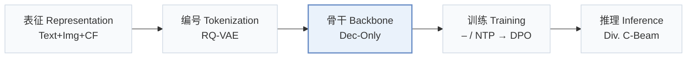
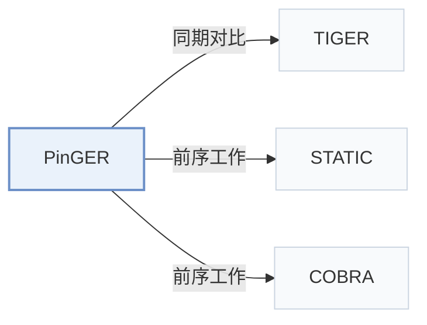

# PinGER

[← 问题 × 阶段矩阵](../../../README.zh.md#v--backbone) · [按阶段索引](../index/stages.md) · [按模态索引](../index/modality.md) · [English](../../papers/pinger.md) | 中文

| **题目** | *Token-Efficient Generative Retrieval with Semantic IDs* |
| :-- | :-- |
| **作者** | Li et al. |
| **发表** | arXiv’26 |
| **问题与阶段** | `V. 效率` · `骨干（Backbone）` |
| **链接** | [论文](https://arxiv.org/abs/2610.33435) |
| **阅读级别** | 概览（第 1 级） |

**本页目录**：[TL;DR](#tldr) · [速览](#速览) · [3. 实验发现](#3-实验发现) · [5. 相关工作](#5-相关工作)

- `Text+Img+CF`：文本、图像表征结合协同过滤信号。
- `RQ-VAE`：残差量化变分自编码器（Residual-Quantized VAE）。
- `Dec-Only`：仅解码器（Decoder-only）自回归架构。
- `NTP → DPO`：先进行下一 token 预测微调，再执行直接偏好优化（DPO）。
- `Div. C-Beam`：引入显式多样性机制的约束束搜索。

### TL;DR

> [!NOTE]
> PinGER 用非对称注意力掩码交错排列 SID 与稠密 token，使线上服务每个物品仅占一个 token，并结合目标条件、强化学习与多样性惩罚引导召回。

---

### 速览

| 维度 | 摘要 |
| :-- | :-- |
| 研究问题 | V. 效率：训练与在线服务能否满足实际的延迟、显存与吞吐预算？ |
| 核心贡献 | PinGER 用非对称注意力掩码交错排列 SID 与稠密 token，使线上服务每个物品仅占一个 token，并结合目标条件、强化学习与多样性惩罚引导召回。 |
| 主要改动阶段 | 骨干（Backbone） |

---

### 3. 实验发现

实验设置

- **数据集**：Pinterest session-centric UniPinRec data: historical cross-surface actions paired with target-surface session engagements; session sampling reflects traffic. Filtering rules: not reported.
  - 出处：Section 5.1: [S5.SS1.SSS0.Px1.p1](https://arxiv.org/html/2610.33435v1#S5.SS1.SSS0.Px1.p1)
- **切分**：Evaluation uses held-out users in a later, non-overlapping window disjoint from training. Window dates, allocation ratios and validation split: not reported.
  - 出处：Section 5.1: [S5.SS1.SSS0.Px1.p1](https://arxiv.org/html/2610.33435v1#S5.SS1.SSS0.Px1.p1)
- **候选集**：full catalog: generated identifiers resolve against the full production corpus.
  - 出处：Section 5.1: [S5.SS1.SSS0.Px1.p1](https://arxiv.org/html/2610.33435v1#S5.SS1.SSS0.Px1.p1)
- **可见性**：warm; no unseen-item protocol is defined. Users are held out; fresh-content analysis uses Pins created within 28 days, without specified generator/tokenizer item holdouts.
  - 出处：Section 5.1 and online fresh-content analysis: [S5.SS1.SSS0.Px1.p1](https://arxiv.org/html/2610.33435v1#S5.SS1.SSS0.Px1.p1) and [S5.SS3.SSS1.p1](https://arxiv.org/html/2610.33435v1#S5.SS3.SSS1.p1)
- **SID 规格**：RQ-VAE 5x2048; content-only PinCLIP input, OmniSage engagement distillation. Index resolves shared-SID item lists; insufficient leaves fall back to coarser prefixes, with round-robin interleaving across beams.
  - 出处：Sections 3.2 and 4.3: [S3.SS2.p1](https://arxiv.org/html/2610.33435v1#S3.SS2.p1) and [S4.SS3.p1](https://arxiv.org/html/2610.33435v1#S4.SS3.p1) and [S4.SS3.p2](https://arxiv.org/html/2610.33435v1#S4.SS3.p2)
- **推理预算**：Offline beam100, Recall@10/100. Online Related Pins beam60/penalty3; notifications beam100/penalty1. Serving L40S at ~200QPS/host: e2e p50/p99 51/77ms (beam60),54/81ms (beam100); batch not reported. Attention microbenchmark: A10G,batch4,history1018.
  - 出处：Sections 5.1/5.3, Table 1 and Figure 5: [S5.SS1.SSS0.Px2.p1](https://arxiv.org/html/2610.33435v1#S5.SS1.SSS0.Px2.p1) and [S5.SS3.SSS1.p1](https://arxiv.org/html/2610.33435v1#S5.SS3.SSS1.p1) and [S5.SS3.SSS2.p1](https://arxiv.org/html/2610.33435v1#S5.SS3.SSS2.p1) and [S4.T1](https://arxiv.org/html/2610.33435v1#S4.T1) and [S4.F5](https://arxiv.org/html/2610.33435v1#S4.F5)
- **结果来源**：Reported Tables 1/2/3/4: serving, offline PinRec/TIGER comparison, diversity, online A/B; Tables 5-8: context sweep, trie costs, segments, ablations. Borrowed-versus-rerun baseline provenance: not reported.
  - 出处：Tables 1-4 and Appendix Tables 5-8: [S4.T1](https://arxiv.org/html/2610.33435v1#S4.T1) and [S5.T2](https://arxiv.org/html/2610.33435v1#S5.T2) and [S5.T3](https://arxiv.org/html/2610.33435v1#S5.T3) and [S5.T4](https://arxiv.org/html/2610.33435v1#S5.T4) and [A1.T5](https://arxiv.org/html/2610.33435v1#A1.T5) and [A1.T8](https://arxiv.org/html/2610.33435v1#A1.T8)

---

### 5. 相关工作

- **同期对比** · [TIGER](tiger.md): TIGER is compared at matched training context and serving-token budgets.
  - 出处：PinGER v1, Section 5.2.1 and Table 2: [S5.SS2.SSS1.p1](https://arxiv.org/html/2610.33435v1#S5.SS2.SSS1.p1); [S5.T2](https://arxiv.org/html/2610.33435v1#S5.T2).
- **前序工作** · [STATIC](static.md): PinGER adopts STATIC's vectorized trie for valid-SID constrained decoding.
  - 出处：PinGER v1, Section 4.2: [S4.SS2.p2](https://arxiv.org/html/2610.33435v1#S4.SS2.p2).
- **前序工作** · [COBRA](cobra.md): PinGER retains COBRA-style SID/dense interleaving during training and removes past SIDs at serving.
  - 出处：PinGER v1, Section 2: [S2.SS0.SSS0.Px1.p1](https://arxiv.org/html/2610.33435v1#S2.SS0.SSS0.Px1.p1).

[查看同格全部论文](../../../README.zh.md#v--backbone)
