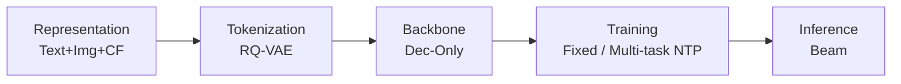
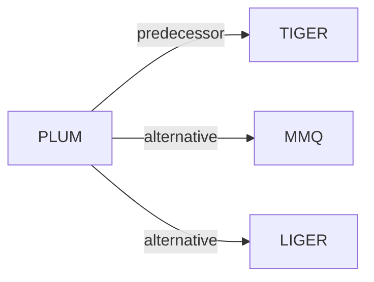

# PLUM

*Adapting Pre-trained Language Models for Industrial-scale Generative Recommendations* — He et al. · WWW’26

`范式、系统与基准` · `无单一阶段` · [论文](https://arxiv.org/abs/2510.07784) · [矩阵](../../../README.zh.md#范式系统与基准) · [English](../../papers/plum.md)

阅读级别：概览（第 1 级） · 本页目录：[TL;DR](#tldr) · [速览](#速览) · [3. 实验发现](#3-实验发现) · [5. 相关工作](#5-相关工作)

- `Dec-Only`: Decoder-only.
- `Fixed`: SIDs are built first and not changed while the generator trains.
- `Multi-task NTP`: The same NTP loss over several tasks.

### TL;DR

> [!NOTE]
> PLUM 通过 SID 编号、领域数据持续预训练与生成式检索微调将预训练 LLM 适配到工业推荐系统，替代大规模嵌入表。

### 速览

| 维度 | 摘要 |
| :-- | :-- |
| 研究问题 | 范式、系统与基准：Baseline (TIGER), end-to-end multi-stage paradigms, open-source frameworks, benchmarks, and diagnostic resources. |
| 核心贡献 | PLUM 通过 SID 编号、领域数据持续预训练与生成式检索微调将预训练 LLM 适配到工业推荐系统，替代大规模嵌入表。 |
| 主要改动阶段 | 无单一阶段 |

### 3. 实验发现

实验设置

- **数据集**：Internal YouTube LFV/Shorts engagement and video metadata; reward-based SFT downsampling. Scaling input: 1536 tokens, roughly 100 recent watches; other filtering rules not reported.
  - 出处：Sections 2.2/2.3/3.1/3.4: [S2.SS2.p1](https://arxiv.org/html/2510.07784v1#S2.SS2.p1) and [S2.SS3.p3](https://arxiv.org/html/2510.07784v1#S2.SS3.p3) and [S3.SS1.SSS1.Px1.p1](https://arxiv.org/html/2510.07784v1#S3.SS1.SSS1.Px1.p1) and [S3.SS4.SSS1.Px2.p1](https://arxiv.org/html/2510.07784v1#S3.SS4.SSS1.Px2.p1)
- **切分**：Scaling: shuffle seven consecutive July 2025 days for training; evaluate Day 8. CPT ablation also uses held-out next-day evaluation; main production validation/test allocation not reported.
  - 出处：Sections 3.3/3.4: [S3.SS3.SSS2.Px1.p1](https://arxiv.org/html/2510.07784v1#S3.SS3.SSS2.Px1.p1) and [S3.SS4.SSS1.Px2.p1](https://arxiv.org/html/2510.07784v1#S3.SS4.SSS1.Px2.p1)
- **候选集**：full catalog in the scaling study: billions of videos.
  - 出处：Section 3.4 explicitly evaluates against the comprehensive corpus: [S3.SS4.SSS1.Px1.p1](https://arxiv.org/html/2510.07784v1#S3.SS4.SSS1.Px1.p1)
- **可见性**：warm; no unseen-item protocol is defined. Tokenizer/CPT item exposure relative to next-day tests not reported.
  - 出处：Section 3 defines no unseen-item holdout: [S3](https://arxiv.org/html/2510.07784v1#S3)
- **SID 规格**：SID-v2 RQ-VAE: level-l codebook size 2048/2^(l-1); number of levels not reported. If a SID maps to multiple videos, randomly sample one for recall evaluation.
  - 出处：Sections 2.1.2/3.2: [S2.SS1.SSS2.p2](https://arxiv.org/html/2510.07784v1#S2.SS1.SSS2.p2) and [S3.SS2.p1](https://arxiv.org/html/2510.07784v1#S3.SS2.p1)
- **推理预算**：Beam decoding, width not reported; Recall@10 in scaling/ablations; production model 900M activated parameters. Serving hardware/batch size and latency not reported; 1024 v6e TPUs (four 256-TPU trainers) describe scaling training.
  - 出处：Sections 2.3/3.1/3.4: [S2.SS3.p4](https://arxiv.org/html/2510.07784v1#S2.SS3.p4) and [S3.SS1.SSS1.Px1.p1](https://arxiv.org/html/2510.07784v1#S3.SS1.SSS1.Px1.p1) and [S3.SS4.SSS1.Px2.p1](https://arxiv.org/html/2510.07784v1#S3.SS4.SSS1.Px2.p1)
- **结果来源**：Original Table 2: PLUM/production LEM ratios; Table 3: adding PLUM versus quota-matched LEM+; Tables 4/5: SID/CPT ablations.
  - 出处：Tables 2-5 and live protocol: [S3.T2](https://arxiv.org/html/2510.07784v1#S3.T2) and [S3.T3](https://arxiv.org/html/2510.07784v1#S3.T3) and [S3.T4](https://arxiv.org/html/2510.07784v1#S3.T4) and [S3.T5](https://arxiv.org/html/2510.07784v1#S3.T5) and [S3.SS1.SSS2.Px2.p1](https://arxiv.org/html/2510.07784v1#S3.SS1.SSS2.Px2.p1)

### 5. 相关工作

- **前序工作** · [TIGER](tiger.md): PLUM extends TIGER's SID construction and adapts pretrained LLMs.
  - 出处：PLUM v1, Sections 1.1.2/2.1.2: https://arxiv.org/html/2510.07784v1#S1.SS1.SSS2.p1; https://arxiv.org/html/2510.07784v1#S2.SS1.SSS2.p2.
- **替代方案** · [MMQ](mmq.md): MMQ generates modality-specific tokens; PLUM fuses embeddings before quantization.
  - 出处：PLUM v1, Section 1.1.2: https://arxiv.org/html/2510.07784v1#S1.SS1.SSS2.p2.
- **替代方案** · [LIGER](liger.md): LIGER mixes generated IDs with dense retrieval; PLUM emphasizes SID-LLM adaptation.
  - 出处：PLUM v1, Section 1.1.3 (Yang et al., 2024): https://arxiv.org/html/2510.07784v1#S1.SS1.SSS3.p1.

[查看同格全部论文](../../../README.zh.md#范式系统与基准)
