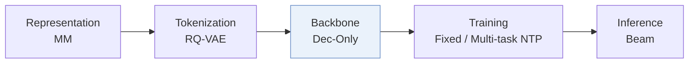
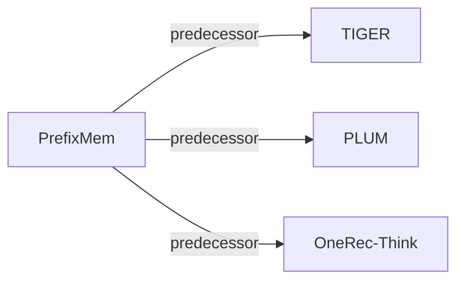

# PrefixMem

| **题目** | *LLMs Need Encoders for Semantic IDs Too* |
| :-- | :-- |
| **作者** | Chen et al. |
| **会议** | arXiv’26 |
| **问题与阶段** | `III. SID 与模型对齐` · `Backbone` |
| **链接** | [论文](https://arxiv.org/abs/2606.00324) · [矩阵](../../../README.zh.md#iii--backbone) · [English](../../papers/prefixmem.md) |
| **阅读级别** | 概览（第 1 级） |

本页目录：[TL;DR](#tldr) · [速览](#速览) · [3. 实验发现](#3-实验发现) · [5. 相关工作](#5-相关工作)

- `MM`: Multimodal item representations.
- `Dec-Only`: Decoder-only.
- `Fixed`: SIDs are built first and not changed while the generator trains.
- `Multi-task NTP`: The same NTP loss over several tasks.

### TL;DR

> [!NOTE]
> PrefixMem 用前缀 n-gram 记忆表为 LLM 构建可预训练的 SID 编码器，使每个 token 获得以前缀为条件的表示，替代普通词表嵌入。

---

### 速览

| 维度 | 摘要 |
| :-- | :-- |
| 研究问题 | III. SID 与模型对齐：Can the generator read, write, and reason over SIDs, and do the tokenizer and generator work toward the same goal? |
| 核心贡献 | PrefixMem 用前缀 n-gram 记忆表为 LLM 构建可预训练的 SID 编码器，使每个 token 获得以前缀为条件的表示，替代普通词表嵌入。 |
| 主要改动阶段 | Backbone |

---

### 3. 实验发现

实验设置

- **数据集**：Pinterest: about 10M engagement subsequences (<=32 events), 240M item occurrences, tens of millions of unique items. Filtering rules not reported.
  - 出处：Section 4.1: [S4.SS1.p1](https://arxiv.org/html/2606.00324v1#S4.SS1.p1)
- **切分**：Evaluation uses later dates and disjoint users; exact dates/fractions not reported. On 100K held-out examples, a random engagement position is the target and preceding events are history.
  - 出处：Sections 4.1/4.3: [S4.SS1.p2](https://arxiv.org/html/2606.00324v1#S4.SS1.p2) and [S4.SS3.p1](https://arxiv.org/html/2606.00324v1#S4.SS3.p1)
- **候选集**：not reported; retrieval evaluates exact ground-truth SID membership in generated beams.
  - 出处：Section 4.3 defines beam SID matching, not sampled item negatives: [S4.SS3.SSS0.Px2.p1](https://arxiv.org/html/2606.00324v1#S4.SS3.SSS0.Px2.p1)
- **可见性**：warm; no unseen-item protocol is defined. RQ-VAE codebook trained on the full billion-item catalog; evaluation users are disjoint, not explicitly evaluation items.
  - 出处：Section 4.1 has user/time holdout but no unseen-item holdout: [S4.SS1.p1](https://arxiv.org/html/2606.00324v1#S4.SS1.p1) and [S4.SS1.p2](https://arxiv.org/html/2606.00324v1#S4.SS1.p2)
- **SID 规格**：RQ-VAE on PinCLIP multimodal embeddings: 5 levels x 2048 codes. Collisions acknowledged; full-SID recall matches codes without resolving item collisions.
  - 出处：Sections 4.1/4.3: [S4.SS1.p1](https://arxiv.org/html/2606.00324v1#S4.SS1.p1) and [S4.SS3.p2](https://arxiv.org/html/2606.00324v1#S4.SS3.p2)
- **推理预算**：Qwen3-1.7B default; five-step SID beam search with K=20/30/50/100; TIGER extension uses beam 10. PrefixMem: 4 hash heads, 2M rows, dimension 256, active at levels 4/5. Hardware, inference batch size, measured latency not reported.
  - 出处：Sections 4.2/4.3 and Table 10: [S4.SS2.p1](https://arxiv.org/html/2606.00324v1#S4.SS2.p1) and [S4.SS2.p2](https://arxiv.org/html/2606.00324v1#S4.SS2.p2) and [S4.SS3.SSS0.Px2.p1](https://arxiv.org/html/2606.00324v1#S4.SS3.SSS0.Px2.p1) and [S5.T10](https://arxiv.org/html/2606.00324v1#S5.T10)
- **结果来源**：Original Tables 2/3: teacher-forcing/initialization; Table 4: full-SID recall; Tables 9/10: LLM/TIGER transfer; Table 11: SID-Transformer comparison. Same-corpus with/without-encoder experiments.
  - 出处：Tables 2-4/9-11: [S5.T2](https://arxiv.org/html/2606.00324v1#S5.T2) and [S5.T3](https://arxiv.org/html/2606.00324v1#S5.T3) and [S5.T4](https://arxiv.org/html/2606.00324v1#S5.T4) and [S5.T9](https://arxiv.org/html/2606.00324v1#S5.T9) and [S5.T10](https://arxiv.org/html/2606.00324v1#S5.T10) and [S5.T11](https://arxiv.org/html/2606.00324v1#S5.T11)

---

### 5. 相关工作

- **前序工作** · [TIGER](tiger.md): PrefixMem augments TIGER and transfers TIGER-trained memory to an LLM.
  - 出处：PrefixMem v1, Section 5.2 and Table 10: https://arxiv.org/html/2606.00324v1#S5.SS2.p5; https://arxiv.org/html/2606.00324v1#S5.T10.
- **前序工作** · [PLUM](plum.md): PrefixMem follows PLUM's SID-language adaptation and adds prefix-conditioned encoding.
  - 出处：PrefixMem v1, Sections 2/3.1: https://arxiv.org/html/2606.00324v1#S2.SS0.SSS0.Px1.p1; https://arxiv.org/html/2606.00324v1#S3.SS1.p1.
- **前序工作** · [OneRec-Think](onerec-think.md): PrefixMem simplifies the cited multi-stage SID-language pipeline to single-stage multitask training.
  - 出处：PrefixMem v1, Section 3.1 (Liu et al., 2025b, arXiv:2510.11639): https://arxiv.org/html/2606.00324v1#S3.SS1.p2.

[查看同格全部论文](../../../README.zh.md#iii--backbone)
