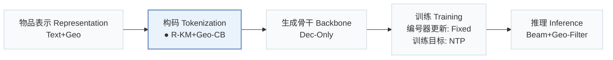
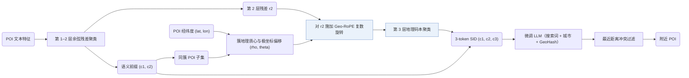
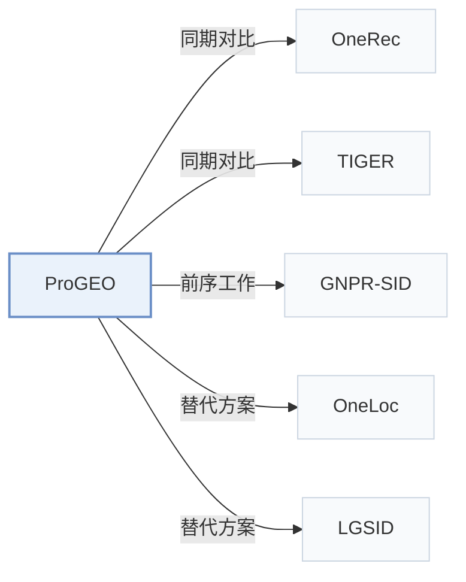

# ProGEO

[← 问题 × 阶段矩阵](../../../README.zh.md#i--tokenization) · [按阶段索引](../index/stages.md) · [按模态找论文](../index/modality.md) · [按领域找论文](../index/domain.md) · [English](../../papers/progeo.md) | 中文

| **题目** | *Birds of a Feather Cluster Nearby: A Proximity-Aware Geo-Codebook for Local Service Recommendation* |
| :-- | :-- |
| **作者** | He et al. |
| **发表** | arXiv’26 |
| **问题与阶段** | `I. 信息量` · `构码（Tokenization）` · `POI` |
| **改动** | ● 构码 |
| **构码输入** | `Text` + `Geo` |
| **领域** | `本地生活与 POI` · `搜索` |
| **链接** | [论文](https://arxiv.org/abs/2604.23156) |
| **阅读级别** | 阅读笔记（第 2 级） |

**本页目录**：[TL;DR](#tldr) · [速览](#速览) · [1. 为什么重要](#1-为什么重要) · [2. 方法](#2-方法) · [3. 实验发现](#3-实验发现) · [4. 局限与分析](#4-局限与分析) · [5. 相关工作](#5-相关工作)

- `Text+Geo`：文本表征结合地理空间特征。
- `R-KM+Geo-CB`：残差 k-means 结合独立地理码本。
- `Dec-Only`：仅解码器（Decoder-only）自回归架构。
- `Fixed`：先独立训练并冻结编号器，生成器训练期间 SID 保持不变。
- `NTP`：标准下一 token 预测（Next-Token Prediction）交叉熵损失；基于预训练 LLM 的指令微调（SFT）亦归入此类。
- `Beam+Geo-Filter`：结合地理位置范围过滤候选的束搜索。

### TL;DR

> [!NOTE]
> ProGEO 结合地理质心局部坐标系与地理旋转位置编码构建邻近感知地理码本，使 SID 同时刻画语义与地理邻近性。

---

### 速览

| 维度 | 摘要 |
| :-- | :-- |
| 主要发现 | 在工业数据集上，ProGEO 的 Hit@50 为 0.4243（RQ-Kmeans 为 0.4056），平均地理聚类距离降至 25.41 km（RQ-OPQ 为 46.71 km）（Table 1）。 |
| 局限 | 地理编码仅作用于第三层量化，且按最近用户距离消解 SID 冲突依赖公开 Foursquare 基准中缺失的实时用户坐标（Sec. 3.3，Table 3）。 |

---

### 1. 为什么重要

本地生活服务推荐既要求语义相关，又要求推荐地点在地理上可达；但标准语义码本仅按内容特征对物品聚类。

> "existing semantic codebooks neglect geographic constraints, often resulting in recommendations that are semantically relevant yet geographically unreachable."（Abstract）

ProGEO 在前两层保留标准语义码字，并在第三层追加地理码字，用以编码每个 POI 相对其所属语义簇的空间偏移，使地理位置直接成为语义 ID（Semantic ID，SID）的组成部分，而非弱辅助特征（Sec. 1）。

---

### 2. 方法

#### 语义层

前两层码本以余弦相似度为度量对混合特征向量做残差聚类，并将第二层投影残差 $`\mathbf{r}_2`$ 传给下一层（Sec. 3.1）。最终的 SID 由两层标准语义码本与一层地理码本组成（Fig. 2）。

#### 地理质心局部坐标

共享相同前两层语义前缀 $`(c_1, c_2)`$ 的全部 POI 构成一个语义簇子集。子集内 POI 的实际经纬度确定该簇的地理质心，每个 POI 的全局坐标随之转换为围绕该质心的局部极坐标 $`(\rho, \theta)`$（Sec. 1，Sec. 3.2）。

#### Geo-RoPE

在第三层聚类前，Geo-RoPE 将每个 POI 相对簇质心的极坐标偏移编码为作用在第二层语义残差 $`\mathbf{r}_2`$ 上的复数旋转（Sec. 1，Sec. 3.3）。旋转后向量之间的余弦相似度因此同时反映语义相似性与空间邻近度。

> "We extend RoPE to the spatial domain, formalizing geographic proximity as rotary operations in high-dimensional feature space."（Sec. 3.3）

#### 生成

在工业场景中，微调后的 LLM 提示包含搜索词、城市名称以及用户实时位置的 GeoHash（Table 4），并在推理时按离用户最近的距离筛选同 SID 候选以消解冲突（Table 3）。

---

### 3. 实验发现

实验设置

- **数据集**：Industrial: two months of transaction records from a Chinese local-life service platform (search query, user location, merchant exposure sequence, interactions); size and filtering not reported. Public: Foursquare NYC (1,083 users / 5,135 POIs) and TKY (2,293 / 7,873), filtered as in GNPR-SID (POIs with fewer than 10 interactions, users with fewer than 10 check-ins removed), and Yelp (150,346 POIs; clustering analysis only).
  - 出处：Industrial and public data: [A2.SS1.p1](https://arxiv.org/html/2604.23156v1#A2.SS1.p1); public statistics: [A2.SS2.SSS2.p1](https://arxiv.org/html/2604.23156v1#A2.SS2.SSS2.p1).
- **切分**：Industrial: two months of records for training and additional daily data reserved for validation; the test construction is not reported. Public: preprocessing follows GNPR-SID; the split is not restated.
  - 出处：Two-month training with extra daily validation data: [A2.SS1.p1](https://arxiv.org/html/2604.23156v1#A2.SS1.p1); public split follows GNPR-SID but is not restated.
- **候选集**：Industrial inference: for each generated semantic ID, the 10 POIs closest to the user's location form the candidate set, with beam width 20. Evaluation reports Hit@1, Hit@50, Hit@100 and NDCG@50, @100; full catalog versus sampled not otherwise stated.
  - 出处：Ten location-nearest POIs per semantic ID as candidates, then beam search: [A2.SS2.SSS1.p1](https://arxiv.org/html/2604.23156v1#A2.SS2.SSS1.p1); metrics: [A2.SS3.p3](https://arxiv.org/html/2604.23156v1#A2.SS3.p3).
- **可见性**：warm; no unseen-item protocol is defined.
  - 出处：No unseen-item protocol: [A2.SS1.p1](https://arxiv.org/html/2604.23156v1#A2.SS1.p1).
- **SID 规格**：Residual quantization with geographic rotary encoding (Geo-RoPE) at the third layer over 128-dimensional Qwen3-Embedding-8B text embeddings. Codebooks: [512, 512, 512] industrial; [32, 32, 32] NYC/TKY; [64, 64, 64] Yelp. Conflicts: industrial uses closest-location matching among POIs sharing a SID (best in Table 3); public datasets use a TIGER-style fourth-layer code because user location is unavailable.
  - 出处：Codebooks [512,512,512] industrial, [32,32,32] NYC/TKY, [64,64,64] Yelp, Geo-RoPE at layer 3: [A2.SS2.SSS1.p1](https://arxiv.org/html/2604.23156v1#A2.SS2.SSS1.p1) and [A2.SS2.SSS2.p1](https://arxiv.org/html/2604.23156v1#A2.SS2.SSS2.p1); conflict strategies: [S4.T3](https://arxiv.org/html/2604.23156v1#S4.T3).
- **推理预算**：Beam search with width 20 on Qwen2.5-1.5B; all experiments on 8 GPUs with 80GB memory. Inference batch size and latency: not reported.
  - 出处：Beam width 20 and hardware: [A2.SS2.SSS1.p1](https://arxiv.org/html/2604.23156v1#A2.SS2.SSS1.p1) and [A2.SS2.SSS2.p1](https://arxiv.org/html/2604.23156v1#A2.SS2.SSS2.p1).
- **结果来源**：Table 1 (industrial quantization and recommendation metrics versus RQ-VAE, RQ-Kmeans, HyMiRec-style RQ-Kmeans, RQ-OPQ); Table 2 (geographic attributes); Table 3 (conflict-resolution strategies); Table 6 (public datasets versus RQ-Kmeans); Figures 7-10 (sensitivity and case studies).
  - 出处：Main: [S4.T1](https://arxiv.org/html/2604.23156v1#S4.T1); geographic attributes: [S4.T2](https://arxiv.org/html/2604.23156v1#S4.T2); conflicts: [S4.T3](https://arxiv.org/html/2604.23156v1#S4.T3); public: [A2.T6](https://arxiv.org/html/2604.23156v1#A2.T6); sensitivity: [S4.F7](https://arxiv.org/html/2604.23156v1#S4.F7).

- Geo-RoPE 作用层位：仅在第三层聚类施加 Geo-RoPE 在各测试层位中取得了最高的码本利用率（CUR = 7.67%）与独立编码率（ICR = 57.08%）（Sec. 4.3.2，Fig. 5）。
- 空间可达性案例：引入 Geo-RoPE 后推荐的 POI 集中在用户周边，而去掉该模块的变体会返回位于另一城市的语义相似 POI（Sec. 4.5.2）。

  > "when Geo-RoPE is introduced, the recommended POIs are concentrated much closer to the user, typically within a 6-kilometer radius."（Sec. 4.5.2）

---

### 4. 局限与分析

**Our analysis.**

- 地理信号只进入 SID 的第三个 token。这意味着生成器在利用 SID 内部的空间线索之前，必须先选定前两层语义簇。
- OneLoc 使用普通 `R-KM` 码；ProGEO 在同类残差 K-means 编号器上增加了专用地理码本层（`R-KM+Geo-CB`）。
- GNPR-SID 同样在 POI SID 中编码地理信息（`Attr+Geo+CF`），但直接用普通 `RQ-VAE` 量化融合特征，未设空间旋转码本层。

---

### 5. 相关工作

- **同期对比** · [OneRec](onerec.md): OneRec's RQ-Kmeans is the second-best tokenizer in Table 1; Pro-GEO injects geographic rotary encoding at the third quantization layer and resolves SID conflicts by user distance.
  - 出处：Pro-GEO v1, baseline RQ-Kmeans (Deng et al., 2025): [A2.SS4.p1](https://arxiv.org/html/2604.23156v1#A2.SS4.p1); Table 1 and public Table 6: [S4.T1](https://arxiv.org/html/2604.23156v1#S4.T1) and [A2.T6](https://arxiv.org/html/2604.23156v1#A2.T6).
- **同期对比** · [TIGER](tiger.md): TIGER's RQ-VAE is a tokenizer baseline; Pro-GEO also borrows TIGER's fourth-layer code for conflicts on public data where user location is missing.
  - 出处：Pro-GEO v1, baseline RQ-VAE: [A2.SS4.p1](https://arxiv.org/html/2604.23156v1#A2.SS4.p1); Table 1: [S4.T1](https://arxiv.org/html/2604.23156v1#S4.T1); Layer-4 coding follows TIGER: [A2.SS2.SSS2.p1](https://arxiv.org/html/2604.23156v1#A2.SS2.SSS2.p1).
- **前序工作** · [GNPR-SID](gnpr-sid.md): Pro-GEO follows GNPR-SID's POI preprocessing for NYC and TKY; GNPR-SID's SIDs carry no explicit geographic encoding.
  - 出处：Pro-GEO v1, Appendix B.1 and B.2.2 follow Wang et al. (2025a): [A2.SS1.p1](https://arxiv.org/html/2604.23156v1#A2.SS1.p1) and [A2.SS2.SSS2.p1](https://arxiv.org/html/2604.23156v1#A2.SS2.SSS2.p1).
- **替代方案** · [OneLoc](oneloc.md): OneLoc adds location context to the SID input embedding for local-life video; Pro-GEO rotates residuals by geography inside the quantizer.
  - 出处：Pro-GEO v1, Sections 1 and 2.1 cite Wei et al. (2025): [S1.p2](https://arxiv.org/html/2604.23156v1#S1.p2) and [S2.SS1.p2](https://arxiv.org/html/2604.23156v1#S2.SS1.p2).
- **替代方案** · [LGSID](lgsid.md): LGSID aligns LLM embeddings with geographic rewards before quantization; Pro-GEO encodes geography within the quantization layers.
  - 出处：Pro-GEO v1, Section 2.1 cites LGSID: [S2.SS1.p2](https://arxiv.org/html/2604.23156v1#S2.SS1.p2).

[查看同格全部论文](../../../README.zh.md#i--tokenization)
