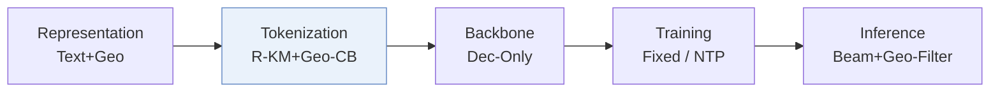
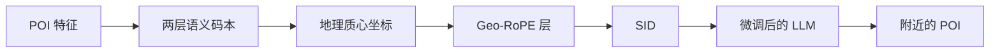
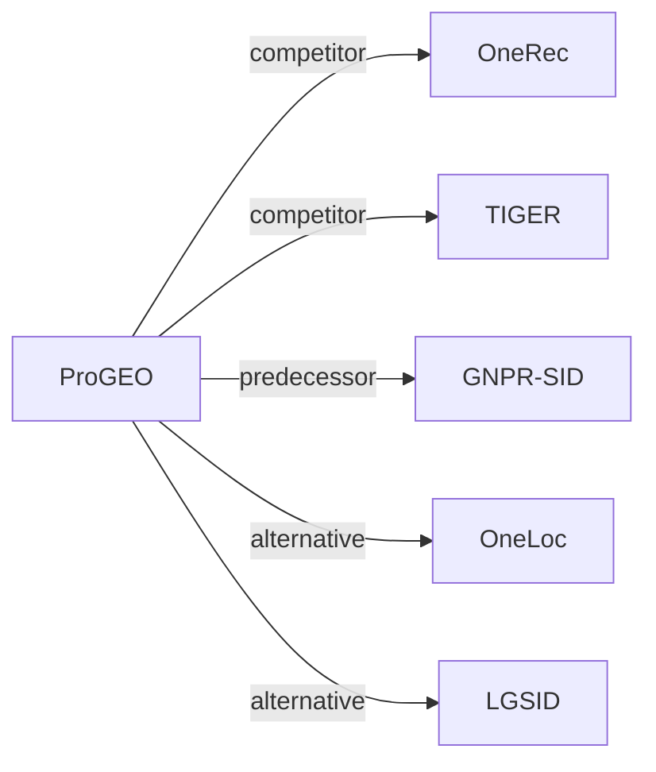

# ProGEO

*Birds of a Feather Cluster Nearby: A Proximity-Aware Geo-Codebook for Local Service Recommendation* — He et al. · arXiv’26

`I. 信息量` · `Tokenization` · `POI` · [论文](https://arxiv.org/abs/2604.23156) · [矩阵](../../../README.zh.md#i--tokenization) · [English](../../papers/progeo.md)

阅读级别：阅读笔记（第 2 级） · 本页目录：[TL;DR](#tldr) · [速览](#速览) · [1. 为什么重要](#1-为什么重要) · [2. 方法](#2-方法) · [3. 实验发现](#3-实验发现) · [4. 局限与分析](#4-局限与分析) · [5. 相关工作](#5-相关工作)

- `R-KM+Geo-CB`: Residual k-means combined with a geographic codebook.
- `Dec-Only`: Decoder-only.
- `Fixed`: SIDs are built first and not changed while the generator trains.
- `NTP`: Next-token prediction loss only; continuing from a pretrained LLM (SFT) also counts as NTP.
- `Beam+Geo-Filter`: Beam search with geographically restricted candidates.

### TL;DR

> [!NOTE]
> ProGEO 结合地理质心局部坐标系与地理旋转位置编码构建邻近感知地理码本，使 SID 同时刻画语义与地理邻近性。

### 速览

| 维度 | 摘要 |
| :-- | :-- |
| 研究问题 | I. 信息量：Do the SIDs, or the model reading them, carry the collaborative and multimodal signals recommendation needs? |
| 核心贡献 | ProGEO 结合地理质心局部坐标系与地理旋转位置编码构建邻近感知地理码本，使 SID 同时刻画语义与地理邻近性。 |
| 主要改动阶段 | Tokenization |
| 主要发现 | 在工业数据集上，ProGEO 的 Hit@50 为 0.4243，RQ-Kmeans 为 0.4056；平均地理聚类距离为 25.41 km，RQ-OPQ 为 46.71 km（Table 1）。 |

### 1. 为什么重要

本地服务平台的推荐既要相关，也要在地理上去得了（Abstract）。语义码本只按内容给物品聚类。

> "existing semantic codebooks neglect geographic constraints, often resulting in recommendations that are semantically relevant yet geographically unreachable."（Abstract）（现有语义码本忽略地理约束，推荐结果语义相关却去不了。）

ProGEO 保留标准的语义码字，再加一个地理码字，编码每个 POI 相对其语义簇的位置。地理由此成为语义 ID（Semantic ID，SID）的一部分，而不是一个弱的辅助特征（Abstract，Sec. 1）。

### 2. 方法

#### 语义层

前两层码本以余弦相似度为度量，对混合特征向量聚类，并把投影残差传给下一层（Sec. 3.1）。SID 由两层标准码本和一层地理码本组成（Fig. 2）。

#### 地理质心局部坐标

前两层 SID 相同的 POI 组成一个子集。这些 POI 的实际经纬度确定一个地理质心，每个 POI 的全局位置换算成围绕这个质心的极坐标（Sec. 1，Sec. 3.2）。

#### Geo-RoPE

Geo-RoPE 把每个 POI 相对质心的偏移，编码为对第二层残差的复数旋转（Sec. 1，Sec. 3.3）。两个旋转后向量的相似度因此同时取决于语义因素和空间关系。

> "We extend RoPE to the spatial domain, formalizing geographic proximity as rotary operations in high-dimensional feature space."（Sec. 3.3）（把 RoPE 推广到空间域，把地理邻近写成高维特征空间里的旋转。）

#### 生成

在工业场景中，LLM 的提示包含搜索词、城市和用户位置的 GeoHash（Table 4）。

### 3. 实验发现

实验设置

- **数据集**：Industrial: two months of transaction records from a Chinese local-life service platform (search query, user location, merchant exposure sequence, interactions); size and filtering not reported. Public: Foursquare NYC (1,083 users / 5,135 POIs) and TKY (2,293 / 7,873), filtered as in GNPR-SID (POIs with fewer than 10 interactions, users with fewer than 10 check-ins removed), and Yelp (150,346 POIs; clustering analysis only).
  - 出处：Industrial and public data: [A2.SS1.p1](https://arxiv.org/html/2604.23156v1#A2.SS1.p1); public statistics: [A2.SS2.SSS2.p1](https://arxiv.org/html/2604.23156v1#A2.SS2.SSS2.p1).
- **切分**：Industrial: two months of records for training and additional daily data reserved for validation; the test construction is not reported. Public: preprocessing follows GNPR-SID; the split is not restated.
  - 出处：Two-month training with extra daily validation data: [A2.SS1.p1](https://arxiv.org/html/2604.23156v1#A2.SS1.p1); public split follows GNPR-SID but is not restated.
- **候选集**：Industrial inference: for each generated semantic ID, the 10 POIs closest to the user's location form the candidate set, with beam width 20. Evaluation reports Hit@1, Hit@50, Hit@100 and NDCG@50, @100; full catalog versus sampled not otherwise stated.
  - 出处：Ten location-nearest POIs per semantic ID as candidates, then beam search: [A2.SS2.SSS1.p1](https://arxiv.org/html/2604.23156v1#A2.SS2.SSS1.p1); metrics: [A2.SS3.p3](https://arxiv.org/html/2604.23156v1#A2.SS3.p3).
- **可见性**：warm; no unseen-item protocol is defined.
  - 出处：No unseen-item protocol: [A2.SS1.p1](https://arxiv.org/html/2604.23156v1#A2.SS1.p1).
- **SID 规格**：Residual quantization with geographic rotary encoding (Geo-RoPE) at the third layer over 128-dimensional Qwen3-Embedding-8B text embeddings. Codebooks: [512, 512, 512] industrial; [32, 32, 32] NYC/TKY; [64, 64, 64] Yelp. Conflicts: industrial uses closest-location matching among POIs sharing a SID (best in Table 3); public datasets use a TIGER-style fourth-layer code because user location is unavailable.
  - 出处：Codebooks [512,512,512] industrial, [32,32,32] NYC/TKY, [64,64,64] Yelp, Geo-RoPE at layer 3: [A2.SS2.SSS1.p1](https://arxiv.org/html/2604.23156v1#A2.SS2.SSS1.p1) and [A2.SS2.SSS2.p1](https://arxiv.org/html/2604.23156v1#A2.SS2.SSS2.p1); conflict strategies: [S4.T3](https://arxiv.org/html/2604.23156v1#S4.T3).
- **推理预算**：Beam search with width 20 on Qwen2.5-1.5B; all experiments on 8 GPUs with 80GB memory. Inference batch size and latency: not reported.
  - 出处：Beam width 20 and hardware: [A2.SS2.SSS1.p1](https://arxiv.org/html/2604.23156v1#A2.SS2.SSS1.p1) and [A2.SS2.SSS2.p1](https://arxiv.org/html/2604.23156v1#A2.SS2.SSS2.p1).
- **结果来源**：Table 1 (industrial quantization and recommendation metrics versus RQ-VAE, RQ-Kmeans, HyMiRec-style RQ-Kmeans, RQ-OPQ); Table 2 (geographic attributes); Table 3 (conflict-resolution strategies); Table 6 (public datasets versus RQ-Kmeans); Figures 7-10 (sensitivity and case studies).
  - 出处：Main: [S4.T1](https://arxiv.org/html/2604.23156v1#S4.T1); geographic attributes: [S4.T2](https://arxiv.org/html/2604.23156v1#S4.T2); conflicts: [S4.T3](https://arxiv.org/html/2604.23156v1#S4.T3); public: [A2.T6](https://arxiv.org/html/2604.23156v1#A2.T6); sensitivity: [S4.F7](https://arxiv.org/html/2604.23156v1#S4.F7).

- Geo-RoPE 放在哪一层：只在第三层聚类上用 Geo-RoPE，CUR（7.67%）和 ICR（57.08%）在所试的位置中最高（Sec. 4.3.2，Fig. 5）。
- 案例：用了 Geo-RoPE，推荐的 POI 离用户近；不用的变体会推荐另一个城市的 POI（Sec. 4.5.2）。

  > "when Geo-RoPE is introduced, the recommended POIs are concentrated much closer to the user, typically within a 6-kilometer radius."（Sec. 4.5.2）（推荐的 POI 通常在用户 6 公里范围内。）

### 4. 局限与分析

**Our analysis.**

- 地理信号只进入 SID 的第三个 token。由此推断，生成器在用到任何空间信息之前，已经先选定了语义簇。
- OneLoc 用普通 `R-KM` 码；ProGEO 在同类编号器上加了一层地理码本（`R-KM+Geo-CB`）。
- GNPR-SID 也在 POI SID 中编码地理（`Attr+Geo+CF`），但用普通 `RQ-VAE`，没有专门的地理码本层。

### 5. 相关工作

- **同期对比** · [OneRec](onerec.md): OneRec's RQ-Kmeans is the second-best tokenizer in Table 1; Pro-GEO injects geographic rotary encoding at the third quantization layer and resolves SID conflicts by user distance.
  - 出处：Pro-GEO v1, baseline RQ-Kmeans (Deng et al., 2025): https://arxiv.org/html/2604.23156v1#A2.SS4.p1; Table 1 and public Table 6: https://arxiv.org/html/2604.23156v1#S4.T1 and https://arxiv.org/html/2604.23156v1#A2.T6.
- **同期对比** · [TIGER](tiger.md): TIGER's RQ-VAE is a tokenizer baseline; Pro-GEO also borrows TIGER's fourth-layer code for conflicts on public data where user location is missing.
  - 出处：Pro-GEO v1, baseline RQ-VAE: https://arxiv.org/html/2604.23156v1#A2.SS4.p1; Table 1: https://arxiv.org/html/2604.23156v1#S4.T1; Layer-4 coding follows TIGER: https://arxiv.org/html/2604.23156v1#A2.SS2.SSS2.p1.
- **前序工作** · [GNPR-SID](gnpr-sid.md): Pro-GEO follows GNPR-SID's POI preprocessing for NYC and TKY; GNPR-SID's SIDs carry no explicit geographic encoding.
  - 出处：Pro-GEO v1, Appendix B.1 and B.2.2 follow Wang et al. (2025a): https://arxiv.org/html/2604.23156v1#A2.SS1.p1 and https://arxiv.org/html/2604.23156v1#A2.SS2.SSS2.p1.
- **替代方案** · [OneLoc](oneloc.md): OneLoc adds location context to the SID input embedding for local-life video; Pro-GEO rotates residuals by geography inside the quantizer.
  - 出处：Pro-GEO v1, Sections 1 and 2.1 cite Wei et al. (2025): https://arxiv.org/html/2604.23156v1#S1.p2 and https://arxiv.org/html/2604.23156v1#S2.SS1.p2.
- **替代方案** · [LGSID](lgsid.md): LGSID aligns LLM embeddings with geographic rewards before quantization; Pro-GEO encodes geography within the quantization layers.
  - 出处：Pro-GEO v1, Section 2.1 cites LGSID: https://arxiv.org/html/2604.23156v1#S2.SS1.p2.

[查看同格全部论文](../../../README.zh.md#i--tokenization)
