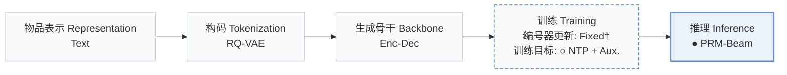
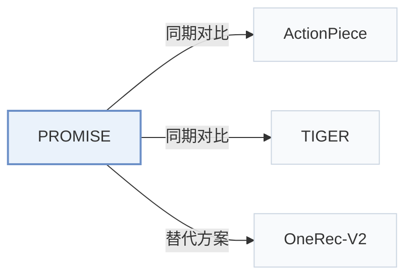

# PROMISE

[← 问题 × 阶段矩阵](../../../README.zh.md#iii--inference) · [按阶段索引](../index/stages.md) · [按模态找论文](../index/modality.md) · [按领域找论文](../index/domain.md) · [English](../../papers/promise.md) | 中文

| **题目** | *Process Reward Models Unlock Test-Time Scaling Laws in Generative Recommendations* |
| :-- | :-- |
| **作者** | Guo et al. |
| **发表** | arXiv’26 |
| **问题与阶段** | `III. SID 与模型对齐` · `推理（Inference）` |
| **改动** | ○ 训练目标 · ● 推理 |
| **构码输入** | `Text` |
| **领域** | `电商` · `短视频与直播` |
| **应用场景** | `一般物品推荐`；`线上实验或部署` |
| **链接** | [论文](https://arxiv.org/abs/2601.04674) |
| **阅读级别** | 概览（第 1 级） |

**本页目录**：[TL;DR](#tldr) · [3. 实验发现](#3-实验发现) · [5. 相关工作](#5-相关工作)

- `Text`：物品文本元数据（标题、描述、类目或提示词）。
- `RQ-VAE`：残差量化变分自编码器（Residual-Quantized VAE）。
- `Enc-Dec`：编码器-解码器（Encoder-decoder）架构。
- `Fixed†`：生成器训练期间冻结编号器（由配置推断）。
- `NTP + Aux.`：下一 token 预测结合辅助正则或对齐损失。
- `PRM-Beam`：由过程奖励模型（PRM）逐步引导的束搜索。

### TL;DR

> [!NOTE]
> PROMISE 加入轻量过程奖励模型对中间 SID 步骤打分并据此剪枝束搜索分支，纠正早期 token 的语义漂移并随推理计算量扩展性能。

---

### 3. 实验发现

实验设置

- **数据集**：Public: Amazon Beauty and Sports and Outdoors (May 1996-July 2014), following TIGER's preprocessing (users with fewer than 5 reviews removed). Industrial: Kuaishou online-learning logs (over 400 million daily active users, about 50 billion interactions per day, more than 100 million items).
  - 出处：Public datasets and TIGER protocol: [S4.SS1.SSS1.p1](https://arxiv.org/html/2601.04674v1#S4.SS1.SSS1.p1); industrial logs: [S4.SS2.SSS1.p2](https://arxiv.org/html/2601.04674v1#S4.SS2.SSS1.p2).
- **切分**：Public: chronological leave-one-out (last item for test, second-to-last for validation, rest for training). Industrial: online learning on real logs; the offline test construction is not reported. Online: 7-day A/B test on Kuaishou and Kuaishou Lite, with 5% of users (about 20 million) in the experimental group and another 5% in the control group for each app.
  - 出处：Leave-one-out allocation: [S4.SS1.SSS1.p1](https://arxiv.org/html/2601.04674v1#S4.SS1.SSS1.p1); industrial online learning: [S4.SS2.SSS1.p2](https://arxiv.org/html/2601.04674v1#S4.SS2.SSS1.p2); online A/B groups and length: [S4.SS3.p1](https://arxiv.org/html/2601.04674v1#S4.SS3.p1).
- **候选集**：not reported (full catalog versus sampled evaluation candidates); public Recall/NDCG at 5 and 10, industrial at 100, 500, 1000 from beam search.
  - 出处：Metrics only: [S4.SS1.SSS4.p1](https://arxiv.org/html/2601.04674v1#S4.SS1.SSS4.p1) and [S4.SS2.SSS4.p1](https://arxiv.org/html/2601.04674v1#S4.SS2.SSS4.p1).
- **可见性**：warm; no unseen-item protocol is defined.
  - 出处：No unseen-item protocol: [S4.SS1.SSS1.p1](https://arxiv.org/html/2601.04674v1#S4.SS1.SSS1.p1).
- **SID 规格**：Public: 3-level RQ-VAE x 256 codes. Industrial: residual K-means over multimodal representations, depth 3 x 8,192 codes. Collision handling: not reported.
  - 出处：Public 3 x 256 RQ-VAE: [S4.SS1.SSS3.p1](https://arxiv.org/html/2601.04674v1#S4.SS1.SSS3.p1); industrial residual K-means d=3, M=8192: [S4.SS2.SSS1.p2](https://arxiv.org/html/2601.04674v1#S4.SS2.SSS1.p2); no collision rule found.
- **推理预算**：PRM-guided beam search: expand to K+ candidate paths per step, score them with a lightweight path-level PRM, and keep K'. Industrial: K=K'=1000 with K+ of 4,000 or 6,000; 4 encoder and 4 decoder blocks plus 1 PRM block. Public beam settings, hardware, inference batch size, and latency: not reported.
  - 出处：PRM-guided beam: [S3.SS3.p3](https://arxiv.org/html/2601.04674v1#S3.SS3.p3); industrial K=K'=1000 and K+ in {4000, 6000}: [S4.SS2.SSS3.p1](https://arxiv.org/html/2601.04674v1#S4.SS2.SSS3.p1); public beam settings not found.
- **结果来源**：Table 1 (Beauty and Sports; baseline numbers taken from the original papers or identical settings); Table 2 (Kuaishou offline versus six deployed retrievers); Table 3 (online A/B); Table 4 (PRM step ablation with hierarchical recall); Figure 4 (test-time scaling of K+).
  - 出处：Public: [S4.T1](https://arxiv.org/html/2601.04674v1#S4.T1); industrial: [S4.T2](https://arxiv.org/html/2601.04674v1#S4.T2); online: [S4.T3](https://arxiv.org/html/2601.04674v1#S4.T3); ablation: [S4.T4](https://arxiv.org/html/2601.04674v1#S4.T4); test-time scaling: [S4.SS5.p1](https://arxiv.org/html/2601.04674v1#S4.SS5.p1).

---

### 5. 相关工作

- **同期对比** · [ActionPiece](actionpiece.md): ActionPiece is the strongest public baseline; it changes tokenization, whereas Promise keeps RQ-VAE SIDs and adds a process reward model to steer beam search.
  - 出处：Promise v1, generative baselines: [S4.I2.i3.p1](https://arxiv.org/html/2601.04674v1#S4.I2.i3.p1); Table 1 and Section 4.1.5: [S4.T1](https://arxiv.org/html/2601.04674v1#S4.T1) and [S4.SS1.SSS5.p2](https://arxiv.org/html/2601.04674v1#S4.SS1.SSS5.p2).
- **同期对比** · [TIGER](tiger.md): TIGER decodes with standard fixed-width beam search, which Promise argues suffers semantic drift; Promise rescores expanded paths at each step with a PRM.
  - 出处：Promise v1, baselines and protocol: [S4.I2.i1.p1](https://arxiv.org/html/2601.04674v1#S4.I2.i1.p1) and [S4.SS1.SSS1.p1](https://arxiv.org/html/2601.04674v1#S4.SS1.SSS1.p1); Table 1: [S4.T1](https://arxiv.org/html/2601.04674v1#S4.T1).
- **替代方案** · [OneRec-V2](onerec-v2.md): OneRec-V2 introduces a lazy decoder and scales parameters; Promise argues that scaling inference compute with PRM-guided search is a cheaper way to scale.
  - 出处：Promise v1, Section 6.1 describes OneRec V2 (Zhou et al., 2025c): [S6.SS1.p1](https://arxiv.org/html/2601.04674v1#S6.SS1.p1); Section 4.6.1 contrasts parameter scaling with test-time scaling: [S4.SS6.SSS1.p1](https://arxiv.org/html/2601.04674v1#S4.SS6.SSS1.p1).

[查看同格全部论文](../../../README.zh.md#iii--inference)
