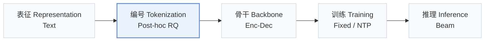
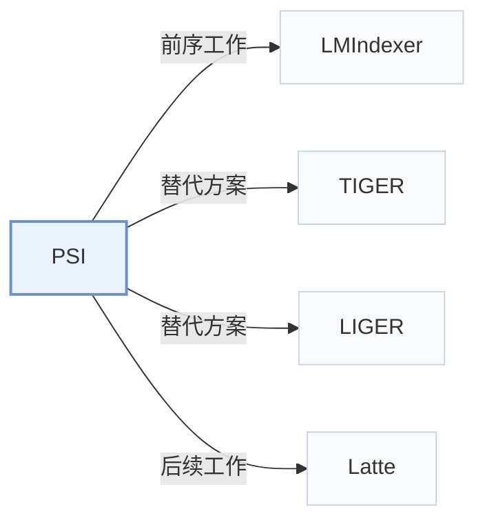

# PSI

[← 问题 × 阶段矩阵](../../../README.zh.md#ii--tokenization) · [按阶段索引](../index/stages.md) · [按模态索引](../index/modality.md) · [English](../../papers/psi.md) | 中文

| **题目** | *Purely Semantic Indexing for LLM-based Generative Recommendation and Retrieval* |
| :-- | :-- |
| **作者** | Zhang et al. |
| **发表** | arXiv’25 |
| **问题与阶段** | `II. 唯一性与合法性` · `编号（Tokenization）` |
| **链接** | [论文](https://arxiv.org/abs/2509.16446) · [代码](https://github.com/wangshanyw/PurelySemanticIndexing) |
| **阅读级别** | 概览（第 1 级） |

**本页目录**：[TL;DR](#tldr) · [速览](#速览) · [3. 实验发现](#3-实验发现) · [5. 相关工作](#5-相关工作)

- `Text`：物品文本元数据（标题、描述、类目或提示词）。
- `Post-hoc RQ`：残差量化后接无冲突全局/递归重分配。
- `Enc-Dec`：编码器-解码器（Encoder-decoder）架构。
- `Fixed`：先独立训练并冻结编号器，生成器训练期间 SID 保持不变。
- `NTP`：标准下一 token 预测（Next-Token Prediction）交叉熵损失；基于预训练 LLM 的指令微调（SFT）亦归入此类。
- `Beam`：在 SID token 上执行自回归束搜索（Beam search）。

### TL;DR

> [!NOTE]
> PSI 通过穷举候选匹配或递归残差搜索放宽最近质心选择，直接分配唯一且保语义的 ID，避免靠追加无语义后缀 token 消解冲突。

---

### 速览

| 维度 | 摘要 |
| :-- | :-- |
| 研究问题 | II. 唯一性与合法性：每个物品是否拥有无冲突的唯一 SID，生成的 SID 是否对应真实物品，码本是否均衡利用？ |
| 核心贡献 | PSI 通过穷举候选匹配或递归残差搜索放宽最近质心选择，直接分配唯一且保语义的 ID，避免靠追加无语义后缀 token 消解冲突。 |
| 主要改动阶段 | 编号（Tokenization） |

---

### 3. 实验发现

实验设置

- **数据集**：Sequential recommendation on Amazon Beauty (12,101 items / 22,363 users), Sports (18,357 / 35,598), and Toys (11,924 items), keeping users and items with at least 5 interactions, following LMIndexer. Also Amazon Product Search (same domains) and document retrieval on NQ320k and MS MARCO-1M.
  - 出处：Recommendation data and LMIndexer protocol: [Sx4.SSx1.p1](https://arxiv.org/html/2509.16446v1#Sx4.SSx1.p1) and [Sx4.SSx2.p2](https://arxiv.org/html/2509.16446v1#Sx4.SSx2.p2); statistics: [Sx4.T2](https://arxiv.org/html/2509.16446v1#Sx4.T2); search and retrieval data: [Sx4.SSx3.p2](https://arxiv.org/html/2509.16446v1#Sx4.SSx3.p2) and [Sx4.T3](https://arxiv.org/html/2509.16446v1#Sx4.T3).
- **切分**：Recommendation: per-user leave-one-out (last for test, second-to-last for validation, rest for training). Product search: the original train/test split. A cold-start test subset keeps targets that appear at most 0 or 1 time in training.
  - 出处：Leave-one-out allocation: [Sx4.SSx2.p2](https://arxiv.org/html/2509.16446v1#Sx4.SSx2.p2); cold-start subset: [Sx4.SSx10.p2](https://arxiv.org/html/2509.16446v1#Sx4.SSx10.p2).
- **候选集**：not reported (full catalog versus sampled evaluation candidates); generation over valid semantic IDs.
  - 出处：Metrics and protocol follow LMIndexer; candidate set not restated: [Sx4.SSx1.p1](https://arxiv.org/html/2509.16446v1#Sx4.SSx1.p1).
- **可见性**：Main: warm; no unseen-item protocol is defined. Cold-start subset: targets appearing at most once in training, including items never seen by the generator; whether the RQ-VAE or clustering indexer was fit with these items: not reported.
  - 出处：Cold-start subset with items that appear 0 or 1 time: [Sx4.SSx10.p2](https://arxiv.org/html/2509.16446v1#Sx4.SSx10.p2); the indexer embeds all items including test-only ones.
- **SID 规格**：Purely semantic IDs: conflicts are removed by assigning non-nearest centroids instead of appending a conflict token, via exhaustive candidate matching (ECM, global scoring of top-k combinations) or recursive residual search (RRS, greedy). Applied to RQ-VAE and hierarchical clustering indexers. The level study on Amazon product search compares three-level purely semantic IDs with two levels plus a conflict index (codebook size 256); the conflict-proportion study uses codebook sizes 512, 256, and 192. Levels and codebook sizes for the main tables: not reported.
  - 出处：ECM and RRS conflict-free assignment over RQ-VAE or hierarchical clustering: [Sx3.SSx1.p3](https://arxiv.org/html/2509.16446v1#Sx3.SSx1.p3), [Sx3.SSx2.p1](https://arxiv.org/html/2509.16446v1#Sx3.SSx2.p1), [Sx3.SSx3.p1](https://arxiv.org/html/2509.16446v1#Sx3.SSx3.p1); codebook size 256 in the level study: [Sx4.SSx7.SSSx1.p1](https://arxiv.org/html/2509.16446v1#Sx4.SSx7.SSSx1.p1); codebook sizes 512, 256, 192 in the conflict-proportion study: [Sx4.SSx9.p1](https://arxiv.org/html/2509.16446v1#Sx4.SSx9.p1).
- **推理预算**：T5-base generator initialized from the same checkpoint for all indexers; decoding method and beam width: not reported. All experiments on 2 NVIDIA RTX A6000 GPUs; inference batch size and latency: not reported.
  - 出处：T5-base, hardware, training batch: [Sx4.SSx1.p1](https://arxiv.org/html/2509.16446v1#Sx4.SSx1.p1) and [Sx4.SSx2.p3](https://arxiv.org/html/2509.16446v1#Sx4.SSx2.p3); decoding settings not found.
- **结果来源**：Table 5 (sequential recommendation on Beauty, Sports, Toys with RQ-VAE and HC indexers, 3 trials); Table 6 (product search); document-retrieval tables; Table 9 (candidate ranking ablation); Figure 5 (cold-start subset).
  - 出处：Recommendation: [Sx4.T5](https://arxiv.org/html/2509.16446v1#Sx4.T5); search: [Sx4.T6](https://arxiv.org/html/2509.16446v1#Sx4.T6); ablation: [Sx4.T9](https://arxiv.org/html/2509.16446v1#Sx4.T9); cold start: Figure 5 via [Sx4.SSx10.p2](https://arxiv.org/html/2509.16446v1#Sx4.SSx10.p2).

---

### 5. 相关工作

- **前序工作** · [LMIndexer](lmindexer.md): PSID follows LMIndexer's tasks, datasets, and setup, and replaces conflict tokens with conflict-free semantic assignment.
  - 出处：PSID v1, Section 4.1 follows Jin et al. (2023): [Sx4.SSx1.p1](https://arxiv.org/html/2509.16446v1#Sx4.SSx1.p1); dataset tables: [Sx4.T2](https://arxiv.org/html/2509.16446v1#Sx4.T2) and [Sx4.T3](https://arxiv.org/html/2509.16446v1#Sx4.T3).
- **替代方案** · [TIGER](tiger.md): TIGER appends a non-semantic conflict token to colliding IDs and uses a heuristic quota for cold-start items; PSID reassigns colliding items to non-nearest centroids so IDs stay fully semantic.
  - 出处：PSID v1, Section 1 on fallback tokens: [Sx1.p2](https://arxiv.org/html/2509.16446v1#Sx1.p2); cold-start discussion citing Rajput et al. (2023): [Sx4.SSx10.p1](https://arxiv.org/html/2509.16446v1#Sx4.SSx10.p1).
- **替代方案** · [LIGER](liger.md): LIGER adds dense retrieval to recover cold-start items; PSID improves cold-start generation by removing unpredictable conflict tokens.
  - 出处：PSID v1, Section 4.10 cites Yang et al. (2024): [Sx4.SSx10.p1](https://arxiv.org/html/2509.16446v1#Sx4.SSx10.p1).
- **后续工作** · [Latte](latte.md): Latte later uses PSID as its base model and its ESM conflict resolution, and adds latent prefix tokens.
  - 出处：Evidence is from the later Latte paper: [S5.SS1.SSS0.Px2.p1](https://arxiv.org/html/2605.06331v1#S5.SS1.SSS0.Px2.p1) and [A4.SS0.SSS0.Px2.p2](https://arxiv.org/html/2605.06331v1#A4.SS0.SSS0.Px2.p2).

[查看同格全部论文](../../../README.zh.md#ii--tokenization)
