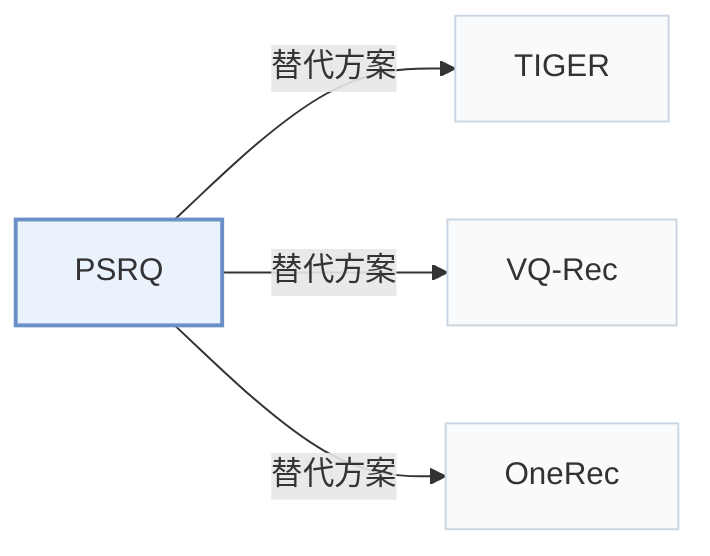

# PSRQ

[← 问题 × 阶段矩阵](../../../README.zh.md#i--tokenization) · [按阶段索引](../index/stages.md) · [按模态找论文](../index/modality.md) · [按领域找论文](../index/domain.md) · [English](../../papers/psrq.md) | 中文

| **题目** | *Progressive Semantic Residual Quantization for Multimodal-Joint Interest Modeling in Music Recommendation* |
| :-- | :-- |
| **作者** | Wang et al. |
| **发表** | CIKM’25 |
| **问题与阶段** | `I. 信息量` · `构码（Tokenization）` |
| **改动** | ● 构码 · ○ 生成骨干 |
| **构码输入** | text: `Text` · image: `Img` · audio: `Audio` · joint_Amazon: `Text` + `Img` · joint_Music: `Text` + `Audio` |
| **领域** | `电商` · `音乐` |
| **应用场景** | `排序与重排`；`线上实验或部署` |
| **链接** | [论文](https://arxiv.org/abs/2508.20359) |
| **阅读级别** | 概览（第 1 级） |

**本页目录**：[TL;DR](#tldr) · [3. 实验发现](#3-实验发现) · [5. 相关工作](#5-相关工作)

- `Text+Img`：文本与视觉图像表征。
- `Prog. RQ`：渐进式残差量化变体（Progressive RQ）。
- `Encoder`：双向编码器骨干，不进行逐位自回归解码。
- `Fixed`：先独立训练并冻结编号器，生成器训练期间 SID 保持不变。
- `Discrim.`：判别式候选物品打分损失，不直接生成 SID。
- `Scoring`：直接计算候选物品得分，不逐位生成 SID。

### TL;DR

> [!NOTE]
> PSRQ 生成保留前缀语义特征的模态特定与模态联合 SID，并用多码本交叉注意力建模音乐兴趣，减轻残差量化中的语义漂移。

---

### 3. 实验发现

实验设置

- **数据集**：Amazon Baby (81,423 users / 33,652 items; ratings of 4 or more are positives), an industrial music-streaming dataset from one week of logs (4,926,656 users / 1,387,247 songs; collections are positives, played-but-not-collected are negatives), and Music4all (14,127 users / 99,596 songs; repeated plays are positives). Items with fewer than 30 interactions are marked cold-start. Further filtering: not reported.
  - 出处：Datasets and labels: [S5.SS1.SSS1.p1](https://arxiv.org/html/2508.20359v1#S5.SS1.SSS1.p1), [S5.I2.i1.p1](https://arxiv.org/html/2508.20359v1#S5.I2.i1.p1), [S5.I2.i2.p1](https://arxiv.org/html/2508.20359v1#S5.I2.i2.p1), [S5.I2.i3.p1](https://arxiv.org/html/2508.20359v1#S5.I2.i3.p1); statistics: [S5.T1](https://arxiv.org/html/2508.20359v1#S5.T1).
- **切分**：not reported (sequences are built by timestamp and trained for one epoch, but the train/test division is not described). Online: A/B test in February 2025 on the music platform against a DLRM ranker.
  - 出处：Timestamp-ordered sequences, no split rule: [S5.I2.i1.p1](https://arxiv.org/html/2508.20359v1#S5.I2.i1.p1) and [S5.SS1.SSS2.p1](https://arxiv.org/html/2508.20359v1#S5.SS1.SSS2.p1); online test: [S5.SS3.p1](https://arxiv.org/html/2508.20359v1#S5.SS3.p1).
- **候选集**：n/a for ranking candidates: evaluation is pointwise AUC and Logloss on labeled positive and negative samples; how negatives relate to user history is defined by the labels above.
  - 出处：Pointwise AUC on labeled samples: [S5.SS1.SSS3.p1](https://arxiv.org/html/2508.20359v1#S5.SS1.SSS3.p1).
- **可见性**：warm; no unseen-item protocol is defined. 'Cold AUC' covers items with fewer than 30 interactions, which are low-frequency, not unseen.
  - 出处：Cold-start = fewer than 30 interactions, not unseen: [S5.SS1.SSS1.p1](https://arxiv.org/html/2508.20359v1#S5.SS1.SSS1.p1).
- **SID 规格**：Progressive Semantic Residual Quantization (PSRQ): layer-wise K-means over modality embeddings (text, image or audio) that preserves the prefix semantic feature, producing modal-specific and modal-joint semantic IDs; clusters per layer k = 64 (Amazon Baby), 256 (Industrial), 128 (Music4all), 3 layers. Collision handling: not reported.
  - 出处：Clusters k and layers l per dataset: [S5.SS1.SSS2.p1](https://arxiv.org/html/2508.20359v1#S5.SS1.SSS2.p1); PSRQ name and modal-specific/modal-joint IDs: [abstract1](https://arxiv.org/html/2508.20359v1#abstract1) and [S4.SS1.p1](https://arxiv.org/html/2508.20359v1#S4.SS1.p1).
- **推理预算**：n/a for generation (SIDs feed a DIN-style ranker with cross-attention, MCCA). MLLM feature extractors run on NVIDIA A100 GPUs; ranker inference batch size and latency: not reported.
  - 出处：Discriminative ranker, hardware for feature extraction: [S5.SS1.SSS2.p1](https://arxiv.org/html/2508.20359v1#S5.SS1.SSS2.p1).
- **结果来源**：Table 2 (All AUC, Cold AUC, Logloss versus multimodal and quantization-based rankers); Table 3 (quantizers added to DIN with text only); Table 4 (MCCA ablation); Section 5.3 (online A/B: collect +2.81%, full play +0.95%).
  - 出处：Main: [S5.T2](https://arxiv.org/html/2508.20359v1#S5.T2); quantizers in DIN: [S5.T3](https://arxiv.org/html/2508.20359v1#S5.T3); ablation: [S5.T4](https://arxiv.org/html/2508.20359v1#S5.T4); online: [S5.SS3.p1](https://arxiv.org/html/2508.20359v1#S5.SS3.p1).

---

### 5. 相关工作

- **替代方案** · [TIGER](tiger.md): TIGER introduced RQ-VAE semantic IDs for generative retrieval; PSRQ quantizes multimodal embeddings with progressive semantic residual K-means and uses the IDs as ranking features for cold-start items.
  - 出处：PSRQ v1, Section 1 and Section 2.2 cite Rajput et al. (2023): [S1.p3](https://arxiv.org/html/2508.20359v1#S1.p3) and [S2.SS2.p1](https://arxiv.org/html/2508.20359v1#S2.SS2.p1); RQ-VAE is a quantizer baseline in Table 3: [S5.T3](https://arxiv.org/html/2508.20359v1#S5.T3).
- **替代方案** · [VQ-Rec](vq-rec.md): VQ-Rec framed vector quantization for transferable recommenders; PSRQ adds modal-specific and modal-joint codebooks for multimodal cold-start ranking.
  - 出处：PSRQ v1, Section 1 and Section 2.2: [S1.p3](https://arxiv.org/html/2508.20359v1#S1.p3) and [S2.SS2.p1](https://arxiv.org/html/2508.20359v1#S2.SS2.p1).
- **替代方案** · [OneRec](onerec.md): OneRec uses residual K-means SIDs inside an end-to-end generator; PSRQ keeps a discriminative ranker and feeds it multimodal SID embeddings.
  - 出处：PSRQ v1, contribution list and Section 2.2 cite OneRec: [S1.I1.i2.p1](https://arxiv.org/html/2508.20359v1#S1.I1.i2.p1) and [S2.SS2.p1](https://arxiv.org/html/2508.20359v1#S2.SS2.p1).

[查看同格全部论文](../../../README.zh.md#i--tokenization)
