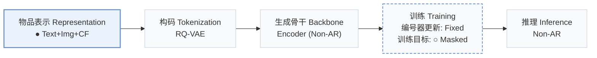
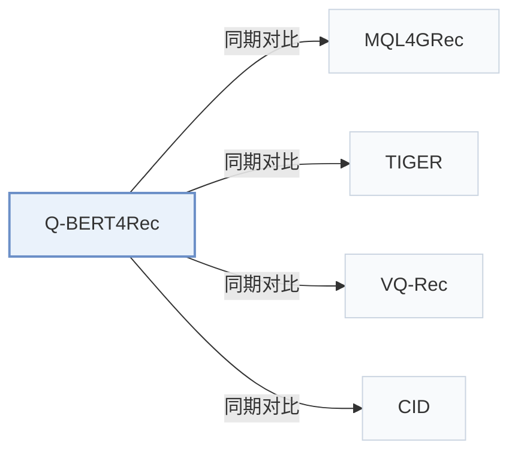

# Q-BERT4Rec

[← 问题 × 阶段矩阵](../../../README.zh.md#i--representation) · [按阶段索引](../index/stages.md) · [按模态找论文](../index/modality.md) · [按领域找论文](../index/domain.md) · [English](../../papers/q-bert4rec.md) | 中文

| **题目** | *Quantized Semantic-ID Representation Learning for Multimodal Recommendation* |
| :-- | :-- |
| **作者** | Huang and Gai |
| **发表** | arXiv’25 |
| **问题与阶段** | `I. 信息量` · `物品表示（Representation）` |
| **改动** | ● 物品表示 · ○ 训练目标 |
| **构码输入** | `Text` + `Img` |
| **领域** | `电商` |
| **特殊设置** | `跨域迁移` |
| **应用场景** | `一般物品推荐`；`公开数据` |
| **链接** | [论文](https://arxiv.org/abs/2512.02474) |
| **阅读级别** | 概览（第 1 级） |

**本页目录**：[TL;DR](#tldr) · [3. 实验发现](#3-实验发现) · [5. 相关工作](#5-相关工作)

- `Text+Img+CF`：文本、图像表征结合协同过滤信号。
- `RQ-VAE`：残差量化变分自编码器（Residual-Quantized VAE）。
- `Encoder (Non-AR)`：面向非自回归并行预测训练的双向编码器。
- `Fixed`：先独立训练并冻结编号器，生成器训练期间 SID 保持不变。
- `Masked`：掩码部分码位并重构（含离散掩码扩散目标）。
- `Non-AR`：单次前向非自回归并行解码。

### TL;DR

> [!NOTE]
> Q-BERT4Rec 将文本、图像与结构化特征融合为物品嵌入，经残差向量量化转为 SID token，并用多种掩码策略预训练双向编码器。

---

### 3. 实验发现

实验设置

- **数据集**：Amazon Reviews 2018: pre-training on six source domains (Pet, Cell, Automotive, Tools, Toys, Sports) and fine-tuning on Musical Instruments, Arts Crafts and Sewing, Video Games (same statistics table as MQL4GRec). Filtering rules: not restated.
  - 出处：Source and target domains: [S4.SS1.p1](https://arxiv.org/html/2512.02474v2#S4.SS1.p1), [S4.SS1.p2](https://arxiv.org/html/2512.02474v2#S4.SS1.p2), [S4.SS1.p3](https://arxiv.org/html/2512.02474v2#S4.SS1.p3); statistics: [S3.T1](https://arxiv.org/html/2512.02474v2#S3.T1).
- **切分**：Leave-one-out: most recent interaction for test, second most recent for validation, the rest for training.
  - 出处：Leave-one-out allocation: [S4.SS1.p4](https://arxiv.org/html/2512.02474v2#S4.SS1.p4).
- **候选集**：not reported explicitly; at inference the masked last position is filled with the most probable semantic ID over the item set (HR and NDCG at 1, 5, 10).
  - 出处：Argmax over item semantic IDs: [S3.SS6.p2](https://arxiv.org/html/2512.02474v2#S3.SS6.p2); metrics: [S4.SS1.p4](https://arxiv.org/html/2512.02474v2#S4.SS1.p4).
- **可见性**：warm; no unseen-item protocol is defined.
  - 出处：Standard split with no unseen-item protocol: [S4.SS1.p4](https://arxiv.org/html/2512.02474v2#S4.SS1.p4).
- **SID 规格**：4-level RQ-VAE x 256 codewords (dimension 32) over LLaMA text and CLIP-ViT image features fused by a cross-modal semantic injection module. Collisions are resolved by MQL4GRec's distance-based token reallocation.
  - 出处：4 levels x 256 x 32, MQL4GRec reallocation for collisions: [S4.SS1.p6](https://arxiv.org/html/2512.02474v2#S4.SS1.p6) and [S3.SS4.p7](https://arxiv.org/html/2512.02474v2#S3.SS4.p7).
- **推理预算**：Bidirectional masked prediction of the last position (no beam search); 4-layer Transformer encoder. NVIDIA RTX 4090 GPUs (four for pre-training, one for fine-tuning). Table 6 reports per-sample inference latency of about 2.66-2.67 ms with under 6M parameters.
  - 出处：Masked prediction at inference: [S3.SS6.p2](https://arxiv.org/html/2512.02474v2#S3.SS6.p2); hardware: [S4.SS1.p8](https://arxiv.org/html/2512.02474v2#S4.SS1.p8); latency: [A2.T6](https://arxiv.org/html/2512.02474v2#A2.T6).
- **结果来源**：Table 2 (Instruments, Arts, Games versus traditional, Transformer, multimodal, prompt-LLM, and semantic-ID baselines); Tables 3-4 (modalities and pre-training strategies); Figures 3-5 (layers, mask ratio, dropout); Table 6 (complexity and latency).
  - 出处：Main: [S3.T2](https://arxiv.org/html/2512.02474v2#S3.T2); ablations: [S3.T3](https://arxiv.org/html/2512.02474v2#S3.T3) and [S4.T4](https://arxiv.org/html/2512.02474v2#S4.T4); sensitivity: [S4.SS4.p1](https://arxiv.org/html/2512.02474v2#S4.SS4.p1); complexity: [A2.T6](https://arxiv.org/html/2512.02474v2#A2.T6).

---

### 5. 相关工作

- **同期对比** · [MQL4GRec](mql4grec.md): MQL4GRec generates multimodal quantitative language autoregressively; Q-BERT4Rec reuses its collision reallocation but fuses modalities before quantization and predicts masked SIDs bidirectionally.
  - 出处：Q-BERT4Rec v2, collision handling follows Zhai et al. (2025): [S3.SS4.p7](https://arxiv.org/html/2512.02474v2#S3.SS4.p7); Table 2 baseline: [S3.T2](https://arxiv.org/html/2512.02474v2#S3.T2).
- **同期对比** · [TIGER](tiger.md): TIGER decodes SIDs left to right with an encoder-decoder; Q-BERT4Rec uses a BERT-style encoder with multi-mask pre-training.
  - 出处：Q-BERT4Rec v2, Table 2 semantic-ID baseline: [S3.T2](https://arxiv.org/html/2512.02474v2#S3.T2); Appendix A baselines: [A1.I5.i1.p1](https://arxiv.org/html/2512.02474v2#A1.I5.i1.p1).
- **同期对比** · [VQ-Rec](vq-rec.md): VQ-Rec uses product-quantized text codes for transfer; Q-BERT4Rec quantizes fused text-image features with RQ-VAE and pre-trains on six source domains.
  - 出处：Q-BERT4Rec v2, Table 2 VQ/multimodal baseline: [S3.T2](https://arxiv.org/html/2512.02474v2#S3.T2).
- **同期对比** · [CID](cid.md): P5-CID uses collaborative IDs in a prompt-based LLM; Q-BERT4Rec uses multimodal semantic IDs in a small masked Transformer.
  - 出处：Q-BERT4Rec v2, Table 2 prompt-LLM baseline: [S3.T2](https://arxiv.org/html/2512.02474v2#S3.T2); Appendix A: [A1.I4.i1.p1](https://arxiv.org/html/2512.02474v2#A1.I4.i1.p1).

[查看同格全部论文](../../../README.zh.md#i--representation)
