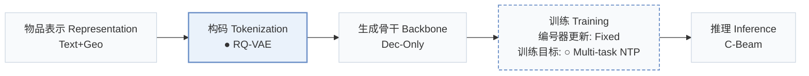
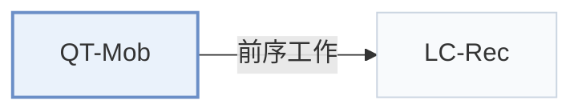

# QT-Mob

[← 问题 × 阶段矩阵](../../../README.zh.md#i--tokenization) · [按阶段索引](../index/stages.md) · [按模态找论文](../index/modality.md) · [按领域找论文](../index/domain.md) · [English](../../papers/qt-mob.md) | 中文

| **题目** | *Enhancing Large Language Models for Mobility Analytics with Semantic Location Tokenization* |
| :-- | :-- |
| **作者** | Chen et al. |
| **发表** | KDD’25 |
| **问题与阶段** | `I. 信息量` · `构码（Tokenization）` · `POI` |
| **改动** | ● 构码 · ○ 训练目标 |
| **构码输入** | `Text` + `Geo` |
| **领域** | `本地生活与 POI` |
| **特殊设置** | `冷启动（物品）` |
| **应用场景** | `POI 与本地生活`；`工业数据离线` |
| **链接** | [论文](https://arxiv.org/abs/2506.11109) · [代码](https://github.com/shadowfall09/QT-Mob) |
| **阅读级别** | 概览（第 1 级） |

**本页目录**：[TL;DR](#tldr) · [3. 实验发现](#3-实验发现) · [5. 相关工作](#5-相关工作)

- `Text+Geo`：文本表征结合地理空间特征。
- `RQ-VAE`：残差量化变分自编码器（Residual-Quantized VAE）。
- `Dec-Only`：仅解码器（Decoder-only）自回归架构。
- `Fixed`：先独立训练并冻结编号器，生成器训练期间 SID 保持不变。
- `Multi-task NTP`：在多个对齐或推荐子任务上联合优化下一 token 预测损失。
- `C-Beam`：受合法物品集合约束的束搜索（Constrained beam search）。

### TL;DR

> [!NOTE]
> QT-Mob 将位置编码为紧凑语义 token，并用将 token 对齐到 LLM 表示的互补目标微调模型，用于下一地点预测与移动轨迹恢复。

---

### 3. 实验发现

实验设置

- **数据集**：Foursquare NYC/SG, April 2012-February 2013; Singapore cellular trajectories, November 2022, using 400m grids. Remove locations with <5 visits; group records into 24h trajectories and discard trajectories with <3 records.
  - 出处：Section 5.1.1: [S5.SS1.SSS1.p1](https://arxiv.org/html/2506.11109v1#S5.SS1.SSS1.p1)
- **切分**：Per-user chronological trajectories: first 70% train, next 10% validation, last 20% test.
  - 出处：Section 5.1.1: [S5.SS1.SSS1.p1](https://arxiv.org/html/2506.11109v1#S5.SS1.SSS1.p1)
- **候选集**：not reported; the unseen-location experiment follows LLM-Move's zero-shot ranking setting without detailing its candidate pool.
  - 出处：Section 5.1 and Appendix D.4 do not specify catalog enumeration or candidate sampling: [S5.SS1](https://arxiv.org/html/2506.11109v1#S5.SS1) and [A4.SS4.p1](https://arxiv.org/html/2506.11109v1#A4.SS4.p1)
- **可见性**：Unseen-location probe: sample 100 test locations and remove all training trajectories containing them. Unseen by generator; whether unseen by tokenizer too: not reported.
  - 出处：Appendix D.4: [A4.SS4.p1](https://arxiv.org/html/2506.11109v1#A4.SS4.p1)
- **SID 规格**：4 RQ-VAE levels x 256 codes, code dimension 32; collision handling not reported.
  - 出处：Section 5.1.4: [S5.SS1.SSS4.p1](https://arxiv.org/html/2506.11109v1#S5.SS1.SSS4.p1)
- **推理预算**：Constrained beam 15; Hit/NDCG@1/5/10. Inference hardware, batch size and latency not reported; four V100 GPUs are specified for training.
  - 出处：Sections 5.1.3/5.1.4: [S5.SS1.SSS3.p1](https://arxiv.org/html/2506.11109v1#S5.SS1.SSS3.p1) and [S5.SS1.SSS4.p1](https://arxiv.org/html/2506.11109v1#S5.SS1.SSS4.p1)
- **结果来源**：Original Tables 2/3: next-location prediction/mobility recovery; Table 10: unseen locations. Five-run averages; compared baselines use their papers' default parameter settings.
  - 出处：Section 5.1.3/5.1.4 and Tables 2/3/10: [S5.SS1.SSS3.p1](https://arxiv.org/html/2506.11109v1#S5.SS1.SSS3.p1) and [S5.SS1.SSS4.p1](https://arxiv.org/html/2506.11109v1#S5.SS1.SSS4.p1) and [S5.T2](https://arxiv.org/html/2506.11109v1#S5.T2) and [S5.T3](https://arxiv.org/html/2506.11109v1#S5.T3) and [A4.T10](https://arxiv.org/html/2506.11109v1#A4.T10)

---

### 5. 相关工作

- **前序工作** · [LC-Rec](lc-rec.md): Its cited RQ-VAE tokenization approach informs QT-Mob's hierarchical location tokens.
  - 出处：QT-Mob v1, Section 4.2, citing Zheng et al. (2024): [S4.SS2.p1](https://arxiv.org/html/2506.11109v1#S4.SS2.p1); [S4.SS2.p4](https://arxiv.org/html/2506.11109v1#S4.SS2.p4).

[查看同格全部论文](../../../README.zh.md#i--tokenization)
