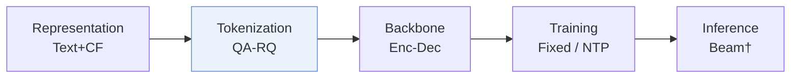
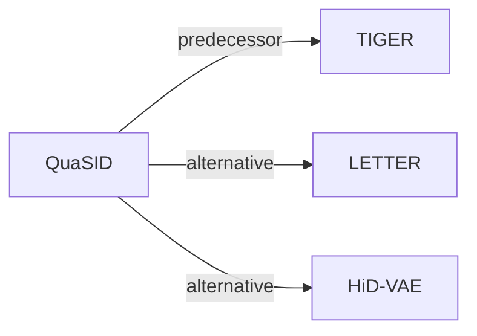

# QuaSID

| **题目** | *Stop Treating Collisions Equally: Qualification-Aware Semantic ID Learning for Recommendation at Industrial Scale* |
| :-- | :-- |
| **作者** | Hu et al. |
| **会议** | KDD’26 ADS |
| **问题与阶段** | `II. 唯一性与合法性` · `Tokenization` |
| **链接** | [论文](https://arxiv.org/abs/2603.00632) · [矩阵](../../../README.zh.md#ii--tokenization) · [English](../../papers/quasid.md) |
| **阅读级别** | 概览（第 1 级） |

本页目录：[TL;DR](#tldr) · [速览](#速览) · [3. 实验发现](#3-实验发现) · [5. 相关工作](#5-相关工作)

- `QA-RQ`: Qualification-Aware RQ-VAE.
- `Enc-Dec`: Encoder-decoder.
- `Fixed`: SIDs are built first and not changed while the generator trains.
- `NTP`: Next-token prediction loss only; continuing from a pretrained LLM (SFT) also counts as NTP.

### TL;DR

> [!NOTE]
> QuaSID 用按汉明距离缩放的间隔仅排斥判定为有害的冲突 SID 对，屏蔽良性重叠并加入双塔对比目标，不再对所有冲突一视同仁。

---

### 速览

| 维度 | 摘要 |
| :-- | :-- |
| 研究问题 | II. 唯一性与合法性：Does every item get its own SID, every generated SID name a real item, and the codebook get used evenly? |
| 核心贡献 | QuaSID 用按汉明距离缩放的间隔仅排斥判定为有害的冲突 SID 对，屏蔽良性重叠并加入双塔对比目标，不再对所有冲突一视同仁。 |
| 主要改动阶段 | Tokenization |

---

### 3. 实验发现

实验设置

- **数据集**：Amazon Reviews 2018 Beauty and Toys & Games, user/item 5-core; Kuaishou e-commerce industrial logs with multimodal item features.
  - 出处：Section 5.1.1: [S5.SS1.SSS1.p1](https://arxiv.org/html/2603.00632v1#S5.SS1.SSS1.p1)
- **切分**：Public: leave-one-out train/validation/test, exact held-out positions not reported. Online A/B: 5 days, about 5% randomized treatment traffic covering >20M users.
  - 出处：Sections 5.1.1/5.4: [S5.SS1.SSS1.p1](https://arxiv.org/html/2603.00632v1#S5.SS1.SSS1.p1) and [S5.SS4.p1](https://arxiv.org/html/2603.00632v1#S5.SS4.p1)
- **候选集**：not reported
  - 出处：Sections 5.1.3/5.1.4 and Appendix A.2 do not specify candidate enumeration or sampling: [S5.SS1.SSS3.p1](https://arxiv.org/html/2603.00632v1#S5.SS1.SSS3.p1) and [S5.SS1.SSS4.p1](https://arxiv.org/html/2603.00632v1#S5.SS1.SSS4.p1) and [A1.SS2](https://arxiv.org/html/2603.00632v1#A1.SS2)
- **可见性**：warm; no unseen-item protocol is defined. Industrial cold-start subsets have <100 or <600 video views within the first 48h; strict generator/tokenizer unseen status not reported.
  - 出处：Section 5.4: [S5.SS4.p1](https://arxiv.org/html/2603.00632v1#S5.SS4.p1)
- **SID 规格**：Public: 3 x 256; industrial: 4 x 1024. HaMR repels qualified full/partial collisions; additional inference-time collision resolution not reported.
  - 出处：Sections 4.2/5.1.4: [S4.SS2](https://arxiv.org/html/2603.00632v1#S4.SS2) and [S5.SS1.SSS4.p1](https://arxiv.org/html/2603.00632v1#S5.SS1.SSS4.p1)
- **推理预算**：Offline HitRate/NDCG@5/10; beam width, inference hardware, serving batch size and latency not reported. Appendix A.2 batches 256/1024 concern SID learning.
  - 出处：Section 5.1.3 and Appendix A.2: [S5.SS1.SSS3.p1](https://arxiv.org/html/2603.00632v1#S5.SS1.SSS3.p1) and [A1.SS2](https://arxiv.org/html/2603.00632v1#A1.SS2)
- **结果来源**：Original Table 2: matched-TIGER tokenizer comparison, five-seed means; Table 3: HaMR added to baselines; Table 4: online retrieval/ranking and low-view subsets.
  - 出处：Tables 2/3/4 and Section 5.1.4: [S4.T2](https://arxiv.org/html/2603.00632v1#S4.T2) and [S4.T3](https://arxiv.org/html/2603.00632v1#S4.T3) and [S5.T4](https://arxiv.org/html/2603.00632v1#S5.T4) and [S5.SS1.SSS4.p1](https://arxiv.org/html/2603.00632v1#S5.SS1.SSS4.p1)

---

### 5. 相关工作

- **前序工作** · [TIGER](tiger.md): Supplies the shared downstream backbone for tokenizer comparisons.
  - 出处：QuaSID v1, Section 5.1.4: https://arxiv.org/html/2603.00632v1#S5.SS1.SSS4.p1.
- **替代方案** · [LETTER](letter.md): Assignment balancing contrasts with QuaSID's qualified, severity-scaled collision repulsion.
  - 出处：QuaSID v1, Section 2.2: https://arxiv.org/html/2603.00632v1#S2.SS2.p2.
- **替代方案** · [HiD-VAE](hid-vae.md): Overlap regularization is contrasted with selectively repelling qualified conflicts.
  - 出处：QuaSID v1, Section 2.2: https://arxiv.org/html/2603.00632v1#S2.SS2.p2.

[查看同格全部论文](../../../README.zh.md#ii--tokenization)
