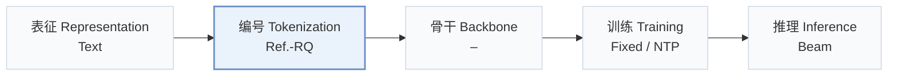
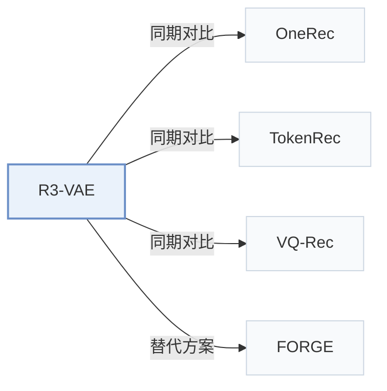

# R3-VAE

[← 问题 × 阶段矩阵](../../../README.zh.md#ii--tokenization) · [按阶段索引](../index/stages.md) · [按模态索引](../index/modality.md) · [English](../../papers/r3-vae.md) | 中文

| **题目** | *Reference Vector-Guided Rating Residual Quantization VAE for Generative Recommendation* |
| :-- | :-- |
| **作者** | Wan et al. |
| **发表** | arXiv’26 |
| **问题与阶段** | `II. 唯一性与合法性` · `编号（Tokenization）` |
| **链接** | [论文](https://arxiv.org/abs/2604.11440) · [代码](https://github.com/wwqq/R3-VAE) |
| **阅读级别** | 概览（第 1 级） |

**本页目录**：[TL;DR](#tldr) · [速览](#速览) · [3. 实验发现](#3-实验发现) · [5. 相关工作](#5-相关工作)

- `Text`：物品文本元数据（标题、描述、类目或提示词）。
- `Ref.-RQ`：引入参考锚点向量的残差量化。
- `Fixed`：先独立训练并冻结编号器，生成器训练期间 SID 保持不变。
- `NTP`：标准下一 token 预测（Next-Token Prediction）交叉熵损失；基于预训练 LLM 的指令微调（SFT）亦归入此类。
- `Beam`：在 SID token 上执行自回归束搜索（Beam search）。

### TL;DR

> [!NOTE]
> R3-VAE 用作为语义锚点的参考向量与点积评分机制稳定残差量化，并将两项 SID 质量指标作为训练正则项。

---

### 速览

| 维度 | 摘要 |
| :-- | :-- |
| 研究问题 | II. 唯一性与合法性：每个物品是否拥有无冲突的唯一 SID，生成的 SID 是否对应真实物品，码本是否均衡利用？ |
| 核心贡献 | R3-VAE 用作为语义锚点的参考向量与点积评分机制稳定残差量化，并将两项 SID 质量指标作为训练正则项。 |
| 主要改动阶段 | 编号（Tokenization） |

---

### 3. 实验发现

实验设置

- **数据集**：Public: Amazon Beauty, Sports, Toys, Clothing, plus LastFM and ML1M. Industrial: Toutiao interaction logs. Filtering rules and corpus sizes: not reported in the body.
  - 出处：Public datasets: [S4.SS1.SSS1.p1](https://arxiv.org/html/2604.11440v3#S4.SS1.SSS1.p1); industrial Toutiao data: [S4.SS3.p1](https://arxiv.org/html/2604.11440v3#S4.SS3.p1); no filtering rules or statistics found in the body.
- **切分**：not reported for the public datasets. Industrial: offline MRR plus online A/B tests for both the generative (OneRec framework) and CTR settings; test periods and traffic not reported.
  - 出处：No split rule found; online tests: [S4.T3](https://arxiv.org/html/2604.11440v3#S4.T3) and [S4.SS4.SSS3.p1](https://arxiv.org/html/2604.11440v3#S4.SS4.SSS3.p1).
- **候选集**：not reported (full catalog versus sampled); Recall and NDCG at 10, 20, 30 on the generated top-K sequence; industrial generative MRR and CTR UAUC.
  - 出处：Generated top-K sequences: [S4.SS1.SSS3.Px1.p1](https://arxiv.org/html/2604.11440v3#S4.SS1.SSS3.Px1.p1).
- **可见性**：warm; no unseen-item protocol is defined. The online CTR test reports cold-start click volume for existing and new users without defining item visibility.
  - 出处：Online cold-start click volume for new users, no unseen-item protocol: [S4.SS4.SSS3.p1](https://arxiv.org/html/2604.11440v3#S4.SS4.SSS3.p1).
- **SID 规格**：Reference-vector-guided residual quantization VAE: inputs are projected on a learned reference vector, each layer assigns soft top-K weights over codewords, and the SID takes the top-weighted index per layer; a metric loss maximizes semantic cohesion and preference discrimination. Industrial: 3 levels x 8,192. Public: the Beauty sensitivity study fixes L=3 and K=256; codebook sizes for the other public runs: not reported. Collision handling: not reported (collision rates are measured, e.g. Table 6).
  - 出处：Reference-vector projection and weighted rating residual quantization: [S3.SS3.SSS3.p1](https://arxiv.org/html/2604.11440v3#S3.SS3.SSS3.p1) and [S3.SS5.SSS1.p1](https://arxiv.org/html/2604.11440v3#S3.SS5.SSS1.p1); industrial codebooks 8192^3: [S4.SS3.SSS1.p1](https://arxiv.org/html/2604.11440v3#S4.SS3.SSS1.p1); Beauty sensitivity study with L=3, K=256 fixed: [S4.SS6.SSS2.p1](https://arxiv.org/html/2604.11440v3#S4.SS6.SSS2.p1).
- **推理预算**：Industrial generative setting follows OneRec: beam search generating 512 responses for DPO, on 64 NVIDIA A100 GPUs. CTR setting: SIDs replace item-ID embeddings in DIN, SIM, RankMixer (batch 2,048). Public decoding settings, inference batch size, and latency: not reported.
  - 出处：OneRec framework with beam 512 responses and hardware: [S4.SS3.SSS1.p1](https://arxiv.org/html/2604.11440v3#S4.SS3.SSS1.p1); CTR setting: [S4.SS4.SSS1.p1](https://arxiv.org/html/2604.11440v3#S4.SS4.SSS1.p1).
- **结果来源**：Table 1 (Beauty, Sports, Toys) and Table 2 (LastFM, ML1M, Clothing) with SC/PD metrics; Table 3 (industrial generative MRR and online A/B); Tables 4-5 (CTR UAUC and online A/B); Table 6 (Beauty SID quality including collision rate and Gini).
  - 出处：Results: [S3.T1](https://arxiv.org/html/2604.11440v3#S3.T1), [S4.T2](https://arxiv.org/html/2604.11440v3#S4.T2), [S4.T3](https://arxiv.org/html/2604.11440v3#S4.T3), [S4.T4](https://arxiv.org/html/2604.11440v3#S4.T4), [S4.T5](https://arxiv.org/html/2604.11440v3#S4.T5), [S4.T6](https://arxiv.org/html/2604.11440v3#S4.T6).

---

### 5. 相关工作

- **同期对比** · [OneRec](onerec.md): OneRec's residual K-means is the main industrial baseline and the generation framework; R3-VAE adds a reference-vector projection, rating-weighted residual quantization, and SID-quality regularization.
  - 出处：R3-VAE v3, baselines and OneRec framework: [S4.SS1.SSS2.p1](https://arxiv.org/html/2604.11440v3#S4.SS1.SSS2.p1) and [S4.SS3.SSS1.p1](https://arxiv.org/html/2604.11440v3#S4.SS3.SSS1.p1); Tables 1, 3, 4: [S3.T1](https://arxiv.org/html/2604.11440v3#S3.T1), [S4.T3](https://arxiv.org/html/2604.11440v3#S4.T3), [S4.T4](https://arxiv.org/html/2604.11440v3#S4.T4).
- **同期对比** · [TokenRec](tokenrec.md): TokenRec's masked vector-quantized tokenizer (MQ) is a baseline; R3-VAE differs by reference-guided soft residual assignment.
  - 出处：R3-VAE v3, baseline MQ [26]: [S4.SS1.SSS2.p1](https://arxiv.org/html/2604.11440v3#S4.SS1.SSS2.p1); Tables 1 and 4: [S3.T1](https://arxiv.org/html/2604.11440v3#S3.T1) and [S4.T4](https://arxiv.org/html/2604.11440v3#S4.T4).
- **同期对比** · [VQ-Rec](vq-rec.md): VQ-Rec's OPQ-style codes appear as the OPQ-KMeans baseline; R3-VAE uses residual rather than product quantization.
  - 出处：R3-VAE v3, baseline OPQ-KMeans [5, 7]: [S4.SS1.SSS2.p1](https://arxiv.org/html/2604.11440v3#S4.SS1.SSS2.p1); Table 1: [S3.T1](https://arxiv.org/html/2604.11440v3#S3.T1).
- **替代方案** · [FORGE](forge.md): FORGE proposes Embedding HitRate and Gini to evaluate SIDs without full training; R3-VAE proposes semantic cohesion and preference discrimination for the same purpose.
  - 出处：R3-VAE v3, Section 3.4 draws on FORGE [4]: [S3.SS4.p1](https://arxiv.org/html/2604.11440v3#S3.SS4.p1); Section 1: [S1.p3](https://arxiv.org/html/2604.11440v3#S1.p3).

[查看同格全部论文](../../../README.zh.md#ii--tokenization)
