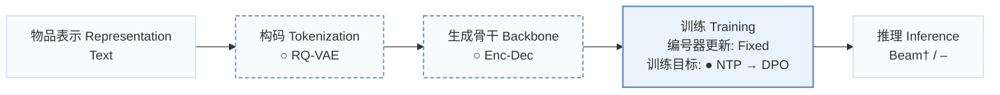
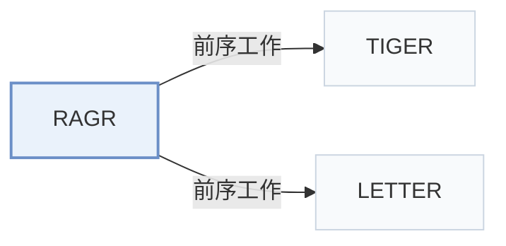

# RAGR

[← 问题 × 阶段矩阵](../../../README.zh.md#i--training) · [按阶段索引](../index/stages.md) · [按模态找论文](../index/modality.md) · [按领域找论文](../index/domain.md) · [English](../../papers/ragr.md) | 中文

| **题目** | *Review-Augmented Generative Recommendation* |
| :-- | :-- |
| **作者** | Zhang et al. |
| **发表** | arXiv’26 |
| **问题与阶段** | `I. 信息量` · `训练（Training）` |
| **改动** | ○ 构码 · ○ 生成骨干 · ● 训练目标 |
| **构码输入** | item: `Text` · review: `Text` |
| **领域** | `电商` |
| **应用场景** | `一般物品推荐`；`公开数据` |
| **链接** | [论文](https://arxiv.org/abs/2605.17267) · [代码](https://github.com/Zhang-Yingyi/TKDE_RAGR) |
| **阅读级别** | 概览（第 1 级） |

**本页目录**：[TL;DR](#tldr) · [3. 实验发现](#3-实验发现) · [5. 相关工作](#5-相关工作)

- `Text`：物品文本元数据（标题、描述、类目或提示词）。
- `RQ-VAE`：残差量化变分自编码器（Residual-Quantized VAE）。
- `Enc-Dec`：编码器-解码器（Encoder-decoder）架构。
- `Fixed`：先独立训练并冻结编号器，生成器训练期间 SID 保持不变。
- `NTP → DPO`：先进行下一 token 预测微调，再执行直接偏好优化（DPO）。
- `Beam† / –`：一种配置沿用束搜索，另一种配置未报告解码方式。

### TL;DR

> [!NOTE]
> RAGR 在用户序列中按时间交错排列物品 SID 与评论 SID，并用 DPO 在预测位置偏好物品 token，替代仅建模物品序列的做法。

---

### 3. 实验发现

实验设置

- **数据集**：Amazon Beauty, Sports and Outdoors, Toys and Games, with historical review text; remove users/items with fewer than five interactions; maximum history 20, truncating oldest interactions.
  - 出处：[S4.SS1.SSS1.p1](https://arxiv.org/html/2605.17267v1#S4.SS1.SSS1.p1) ; #S4.SS1.SSS4.p3
- **切分**：Per-user chronological leave-one-out: last interaction test, second last validation, remaining interactions training.
  - 出处：[S4.SS1.SSS1.p1](https://arxiv.org/html/2605.17267v1#S4.SS1.SSS1.p1)
- **候选集**：not reported
  - 出处：Experimental settings report top-K metrics but no candidate universe: [S4.SS1](https://arxiv.org/html/2605.17267v1#S4.SS1)
- **可见性**：warm; no unseen-item protocol is defined. Historical reviews are retained; tokenizer fitting exposure to test items not reported.
  - 出处：[S4.SS1.SSS1.p1](https://arxiv.org/html/2605.17267v1#S4.SS1.SSS1.p1) ; #S4.SS4.p4
- **SID 规格**：RQ-VAE: 4 x 256, 32-dimensional codewords, shared item/review token space. Default tokenizer fits item text only; collision handling not reported.
  - 出处：[S4.SS1.SSS4.p2](https://arxiv.org/html/2605.17267v1#S4.SS1.SSS4.p2) ; #S4.SS4.p4 ; #S4.SS5.p4
- **推理预算**：Autoregressive item-SID prediction; HIT/NDCG@5/10/20. Decoding algorithm/beam width, inference batch size and latency not reported. General experiment server: 8 RTX PRO 6000 96GB GPUs; inference-specific allocation not reported.
  - 出处：[S4.SS1.SSS3.p1](https://arxiv.org/html/2605.17267v1#S4.SS1.SSS3.p1) ; #S4.SS1.SSS4.p1 ; #S4.SS1.SSS4.p5
- **结果来源**：Original Table II: TIGER/LETTER with and without RAGR, means over seeds 42/43/44; all baselines trained/evaluated with the common split/protocol. Table III: ablations; Tables IV-V: tokenizer efficiency/collisions. No baseline-result reuse stated.
  - 出处：[S4.T2](https://arxiv.org/html/2605.17267v1#S4.T2) ; #S4.T3 ; #S4.T4 ; #S4.T5 ; #S4.SS1.SSS4.p1 ; #S4.SS1.SSS4.p5

---

### 5. 相关工作

- **前序工作** · [TIGER](tiger.md): RAGR augments TIGER with interleaved review SIDs, review-generation supervision and DPO alignment toward item generation.
  - 出处：RAGR v1, Section IV-A and Table II: [S4.SS1.SSS4.p1](https://arxiv.org/html/2605.17267v1#S4.SS1.SSS4.p1); [S4.T2](https://arxiv.org/html/2605.17267v1#S4.T2).
- **前序工作** · [LETTER](letter.md): LETTER is the second backbone receiving the same review augmentation and item-centric DPO alignment.
  - 出处：RAGR v1, Section IV-A and Table II: [S4.SS1.SSS4.p1](https://arxiv.org/html/2605.17267v1#S4.SS1.SSS4.p1); [S4.T2](https://arxiv.org/html/2605.17267v1#S4.T2).

[查看同格全部论文](../../../README.zh.md#i--training)
