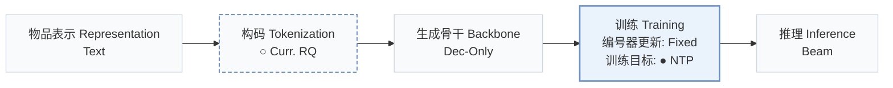
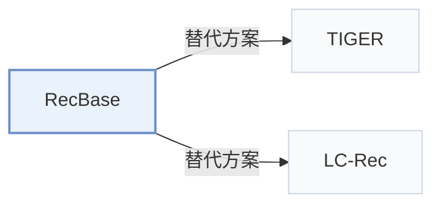

# RecBase

[← 问题 × 阶段矩阵](../../../README.zh.md#vi--training) · [按阶段索引](../index/stages.md) · [按模态找论文](../index/modality.md) · [按领域找论文](../index/domain.md) · [English](../../papers/recbase.md) | 中文

| **题目** | *Generative foundation model pretraining for zero-shot recommendation* |
| :-- | :-- |
| **作者** | Zhou et al. |
| **发表** | EMNLP’25 |
| **问题与阶段** | `VI. 泛化` · `训练（Training）` |
| **改动** | ○ 构码 · ● 训练目标 |
| **构码输入** | `Text` |
| **领域** | `新闻` · `电影` · `短视频与直播` · `图书与有声书` · `本地生活与 POI` · `游戏` · `电商` · `旅行与酒店` |
| **特殊设置** | `跨域迁移` |
| **链接** | [论文](https://arxiv.org/abs/2509.03131) · [代码](https://github.com/reczoo/RecBase) |
| **阅读级别** | 概览（第 1 级） |

**本页目录**：[TL;DR](#tldr) · [3. 实验发现](#3-实验发现) · [5. 相关工作](#5-相关工作)

- `Text`：物品文本元数据（标题、描述、类目或提示词）。
- `Curr. RQ`：课程式训练的层级残差量化。
- `Dec-Only`：仅解码器（Decoder-only）自回归架构。
- `Fixed`：先独立训练并冻结编号器，生成器训练期间 SID 保持不变。
- `NTP`：标准下一 token 预测（Next-Token Prediction）交叉熵损失；基于预训练 LLM 的指令微调（SFT）亦归入此类。
- `Beam`：在 SID token 上执行自回归束搜索（Beam search）。

### TL;DR

> [!NOTE]
> RecBase 用层级概念标识统一编号器在跨域语料上预训练域无关基础模型，面向零样本推荐，替代以自然语言为中心的预训练。

---

### 3. 实验发现

实验设置

- **数据集**：Pre-training on 15 datasets and testing on 8 unseen datasets from RecBench (MIND, MovieLens, MicroLens, Goodreads, Yelp, Steam, H&M, HotelRec as test sets). Totals: training 4,595,003 items / 35,047,682 users; fine-tuning 1,005,745 / 5,098,084; test 623,615 / 145,975. Length-based filtering: users with fewer than 15 interactions are removed (e.g. AmazonToys) and histories over 2,500 interactions are truncated (e.g. LastFM, PixelRec); thresholds for the other datasets: not reported.
  - 出处：RecBench and dataset roles: [S4.p1](https://arxiv.org/html/2509.03131v1#S4.p1) and [S4.SS1.p1](https://arxiv.org/html/2509.03131v1#S4.SS1.p1); statistics: [S4.T2](https://arxiv.org/html/2509.03131v1#S4.T2); length filtering: [A2.SS2.SSS0.Px2.p1](https://arxiv.org/html/2509.03131v1#A2.SS2.SSS0.Px2.p1).
- **切分**：Dataset-level: pre-train on training datasets and evaluate zero-shot on held-out datasets; a fine-tuning study adds in-domain data for five test datasets. Within-dataset split rules: not reported.
  - 出处：Dataset-level split between pre-training and zero-shot test: [S4.p1](https://arxiv.org/html/2509.03131v1#S4.p1); fine-tuning study: [S4.T3](https://arxiv.org/html/2509.03131v1#S4.T3).
- **候选集**：n/a for ranking candidates: user-item pairs are scored and evaluated by AUC (RecBench protocol); how negative pairs are formed is not restated.
  - 出处：User-item pair scoring with AUC: [S4.SS1.p1](https://arxiv.org/html/2509.03131v1#S4.SS1.p1) and [S4.SS1.p3](https://arxiv.org/html/2509.03131v1#S4.SS1.p3).
- **可见性**：Zero-shot: test datasets and their items are unseen by the generator; whether the CL-VAE tokenizer was trained on test-dataset items: not reported. Fine-tuned setting: warm.
  - 出处：Test datasets are unseen in pre-training: [S4.p1](https://arxiv.org/html/2509.03131v1#S4.p1) and [S4.SS1.p3](https://arxiv.org/html/2509.03131v1#S4.SS1.p3).
- **SID 规格**：Concept IDs from a curriculum-learning RQ-VAE (CL-VAE) with 4 levels x 2,048 codes over NV-Embed-v2 text embeddings, with codebook reinitialization against collapse. Collisions are measured as a conflict rate (Figure 2) but a resolution rule is not reported.
  - 出处：CL-VAE with 4 levels x 2048 over NV-Embed-v2: [S4.SS2.p1](https://arxiv.org/html/2509.03131v1#S4.SS2.p1); curriculum and reinitialization: [S3.SS2.p2](https://arxiv.org/html/2509.03131v1#S3.SS2.p2); conflict rate study: [S5.SS2.p1](https://arxiv.org/html/2509.03131v1#S5.SS2.p1).
- **推理预算**：Scores items from the logits over concept IDs (no beam search described); Qwen2-style decoder (Base: 24 layers, hidden 1,024; Large: 28 layers, hidden 1,536; vocabulary 20,000). Hardware, inference batch size, and latency: not reported.
  - 出处：Logit-based ranking of concept IDs: [S4.SS1.p2](https://arxiv.org/html/2509.03131v1#S4.SS1.p2); model sizes: [S4.SS2.p2](https://arxiv.org/html/2509.03131v1#S4.SS2.p2).
- **结果来源**：Table 1 (zero-shot AUC on 8 datasets versus P5, RecGPT, and LLM baselines); Table 3 (zero-shot versus fine-tuned); Table 4 (ablations of CL-VAE components); Figure 2 (codebook size and levels).
  - 出处：Zero-shot: [S3.T1](https://arxiv.org/html/2509.03131v1#S3.T1); fine-tuning: [S4.T3](https://arxiv.org/html/2509.03131v1#S4.T3); ablation: [S5.T4](https://arxiv.org/html/2509.03131v1#S5.T4); codebook study: [S5.SS2.p1](https://arxiv.org/html/2509.03131v1#S5.SS2.p1).

---

### 5. 相关工作

- **替代方案** · [TIGER](tiger.md): TIGER builds RQ-VAE semantic IDs per dataset for next-item generation; RecBase pre-trains a recommendation foundation model over concept IDs shared across many domains.
  - 出处：RecBase v1, Section 2.2 cites Rajput et al. (2023): [S2.SS2.p1](https://arxiv.org/html/2509.03131v1#S2.SS2.p1).
- **替代方案** · [LC-Rec](lc-rec.md): LC-Rec adapts an existing LLM to one domain's item indices; RecBase pre-trains from scratch on recommendation corpora for zero-shot transfer.
  - 出处：RecBase v1, Section 2.2: [S2.SS2.p1](https://arxiv.org/html/2509.03131v1#S2.SS2.p1).

[查看同格全部论文](../../../README.zh.md#vi--training)
