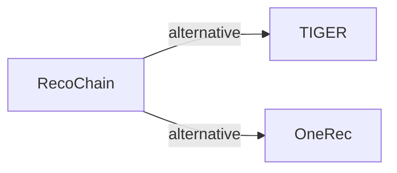

# RecoChain

| **题目** | *Harmonizing Generative Retrieval and Ranking in Chain-of-Recommendation* |
| :-- | :-- |
| **作者** | Liu and Cao |
| **会议** | arXiv’26 |
| **问题与阶段** | `IV. 实用目标` · `Backbone` |
| **链接** | [论文](https://arxiv.org/abs/2604.25787) · [矩阵](../../../README.zh.md#iv--backbone) · [English](../../papers/recochain.md) |
| **阅读级别** | 概览（第 1 级） |

本页目录：[TL;DR](#tldr) · [速览](#速览) · [3. 实验发现](#3-实验发现) · [5. 相关工作](#5-相关工作)

- `RQ`: Residual quantization.
- `Dec-Only`: Decoder-only.
- `Fixed`: SIDs are built first and not changed while the generator trains.
- `NTP + Rank`: NTP plus a ranking loss.

### TL;DR

> [!NOTE]
> RecoChain 在同一 Transformer 中先通过层级 SID 预测生成候选，再用基于 SIM 的点击率估计做排序，弥合生成与排序之间的差距。

---

### 速览

| 维度 | 摘要 |
| :-- | :-- |
| 研究问题 | IV. 实用目标：Are training and search aimed at what users and the platform value, rather than at token likelihood? |
| 核心贡献 | RecoChain 在同一 Transformer 中先通过层级 SID 预测生成候选，再用基于 SIM 的点击率估计做排序，弥合生成与排序之间的差距。 |
| 主要改动阶段 | Backbone |

---

### 3. 实验发现

实验设置

- **数据集**：TAOBAO-MM: 8.79M users, 35.4M items, 99M interactions, histories up to 1,000 interactions, with 128-dimensional multimodal item embeddings; adapted from CTR to sequential recommendation by keeping interaction histories and discarding exposure labels. Further filtering: not reported.
  - 出处：TAOBAO-MM and adaptation: [S3.p1](https://arxiv.org/html/2604.25787v1#S3.p1).
- **切分**：The official TAOBAO-MM train/validation/test split, without further sequence-level partitioning.
  - 出处：Official split: [S3.p1](https://arxiv.org/html/2604.25787v1#S3.p1).
- **候选集**：not reported (full catalog versus sampled); top-K comes from C beam candidates (beam size 20 by default) that are re-ranked by a click-probability head.
  - 出处：Beam candidates re-ranked; metrics: [S3.p4](https://arxiv.org/html/2604.25787v1#S3.p4) and [S2.SS4.p1](https://arxiv.org/html/2604.25787v1#S2.SS4.p1).
- **可见性**：warm; no unseen-item protocol is defined.
  - 出处：Official split with no unseen-item protocol: [S3.p1](https://arxiv.org/html/2604.25787v1#S3.p1).
- **SID 规格**：3-level RQ-Kmeans over the pretrained multimodal embeddings, plus a random fourth token s4 that makes the item-SID mapping one-to-one; codebook size per level: not reported.
  - 出处：3-level RQ-Kmeans plus a random fourth token: [S2.SS2.p1](https://arxiv.org/html/2604.25787v1#S2.SS2.p1).
- **推理预算**：Hierarchical beam search (default beam 20; 10 to 40 in Table 1) with KV cache, then for each candidate the top-10 most similar history items are appended and a rank head scores the candidate by continuing decoding. 2-layer decoder (hidden 1,024). Hardware, inference batch size, and latency: not reported.
  - 出处：Generate-retrieve-rerank with KV reuse: [S2.SS3.SSS2.p2](https://arxiv.org/html/2604.25787v1#S2.SS3.SSS2.p2), [S2.SS3.SSS2.p4](https://arxiv.org/html/2604.25787v1#S2.SS3.SSS2.p4), [S2.SS4.p2](https://arxiv.org/html/2604.25787v1#S2.SS4.p2); defaults: [S3.p4](https://arxiv.org/html/2604.25787v1#S3.p4); model: [S3.p2](https://arxiv.org/html/2604.25787v1#S3.p2).
- **结果来源**：Tables 1-3 (Recall and NDCG at 5 and 10 before and after re-ranking, varying beam size, input sequence length, and retrieval length on TAOBAO-MM).
  - 出处：Results: [S2.T1](https://arxiv.org/html/2604.25787v1#S2.T1), [S2.T2](https://arxiv.org/html/2604.25787v1#S2.T2), [S2.T3](https://arxiv.org/html/2604.25787v1#S2.T3).

---

### 5. 相关工作

- **替代方案** · [TIGER](tiger.md): TIGER stops at beam-search retrieval; RecoChain appends retrieved history items to each beam candidate and re-ranks them in the same decoder.
  - 出处：RecoChain v1, Section 1 cites TIGER and OneRec as beam-search retrievers: https://arxiv.org/html/2604.25787v1#S1.p4.
- **替代方案** · [OneRec](onerec.md): OneRec unifies retrieval and ranking with preference alignment over sessions; RecoChain chains generation and a click-probability re-rank head with KV-cache reuse.
  - 出处：RecoChain v1, Section 1: https://arxiv.org/html/2604.25787v1#S1.p2 and https://arxiv.org/html/2604.25787v1#S1.p4.

[查看同格全部论文](../../../README.zh.md#iv--backbone)
