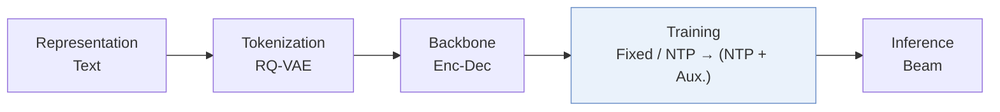
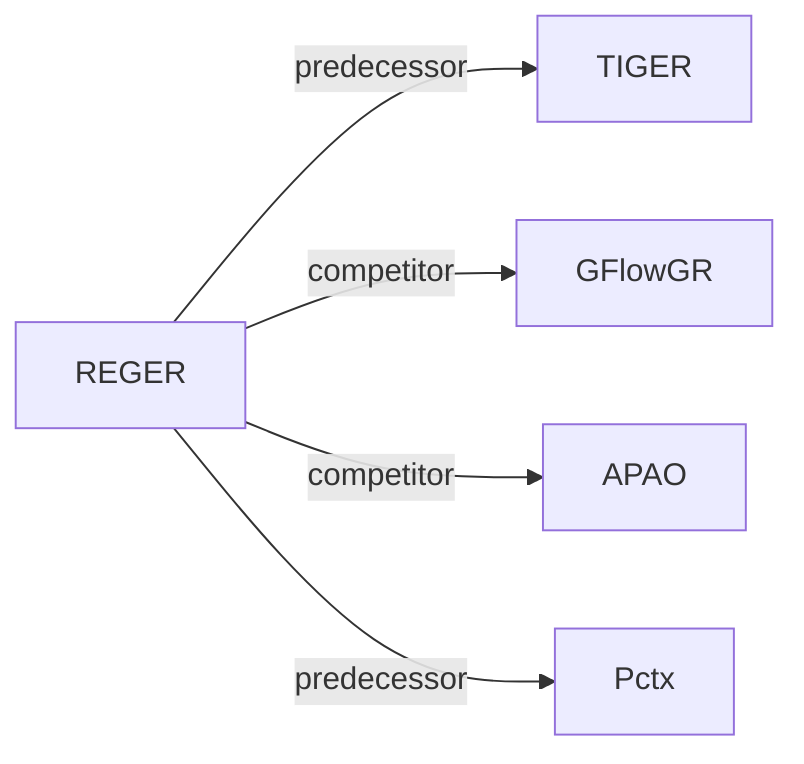

# REGER

| **题目** | *Modeling inter-item Relations with Semantic IDs for Generative Recommendation* |
| :-- | :-- |
| **作者** | Huang et al. |
| **会议** | arXiv’26 |
| **问题与阶段** | `I. 信息量` · `Training` |
| **链接** | [论文](https://arxiv.org/abs/2610.37584) · [矩阵](../../../README.zh.md#i--training) · [English](../../papers/reger.md) |
| **阅读级别** | 概览（第 1 级） |

本页目录：[TL;DR](#tldr) · [速览](#速览) · [3. 实验发现](#3-实验发现) · [5. 相关工作](#5-相关工作)

- `Enc-Dec`: Encoder-decoder.
- `Fixed`: SIDs are built first and not changed while the generator trains.
- `NTP → (NTP + Aux.)`: Next-token prediction, followed by joint optimization of next-token prediction and auxiliary objectives.

### TL;DR

> [!NOTE]
> REGER 预训练生成器以产出语义近邻的 SID，结合全局与 ID 边界局部注意力，并沿目标前缀路径蒸馏判别式教师的下一 token 分布。

---

### 速览

| 维度 | 摘要 |
| :-- | :-- |
| 研究问题 | I. 信息量：Do the SIDs, or the model reading them, carry the collaborative and multimodal signals recommendation needs? |
| 核心贡献 | REGER 预训练生成器以产出语义近邻的 SID，结合全局与 ID 边界局部注意力，并沿目标前缀路径蒸馏判别式教师的下一 token 分布。 |
| 主要改动阶段 | Training |

---

### 3. 实验发现

实验设置

- **数据集**：Amazon Reviews 2014 Beauty/Sports/Toys and 2023 Instruments/Scientific/Games; 5-core filtering and maximum history 20 items.
  - 出处：[S5.SS1.p1](https://arxiv.org/html/2610.37584v1#S5.SS1.p1) ; #A1.T6
- **切分**：Per-user chronological leave-one-out: latest interaction test, second latest validation, all earlier interactions training.
  - 出处：[A1.SS1.p1](https://arxiv.org/html/2610.37584v1#A1.SS1.p1)
- **候选集**：not reported
  - 出处：Evaluation settings give metrics and seeds but no evaluation universe: [S5.SS1](https://arxiv.org/html/2610.37584v1#S5.SS1) ; #A1.SS1
- **可见性**：warm; no unseen-item protocol is defined. GSR semantic neighbors are drawn from the item catalog; tokenizer and frozen DuoRec teacher exposure to test items/interactions not explicitly separated.
  - 出处：[S5.SS1.p1](https://arxiv.org/html/2610.37584v1#S5.SS1.p1) ; #S4.SS1.p3 ; #S4.SS3.SSS2.p1 ; #A1.SS3.p1
- **SID 规格**：RQ-VAE on Sentence-T5 embeddings reduced to 128 dimensions by PCA/whitening; semantic level count and codebook sizes not reported in paper. Extra token distinguishes identical semantic codes; suffix vocabulary size/assignment not reported. Dataset-specific SID mapping shared across recommender seeds.
  - 出处：[S3.SS1.p1](https://arxiv.org/html/2610.37584v1#S3.SS1.p1) ; #A1.SS3.p1
- **推理预算**：Unconstrained beam 20 for validation/test, without teacher; teacher ablation uses beam 50. Recall/NDCG@5/10. Table 4 efficiency probe on TIGER+HCPD: one L40, FP32, test batch 256, KV cache off, 16 s for full Beauty test set. REGER-specific absolute inference time and general inference batch/hardware not reported.
  - 出处：[A1.SS3.p2](https://arxiv.org/html/2610.37584v1#A1.SS3.p2) ; #A1.SS3.p4 ; #A1.T7 ; #S5.T4 ; #S5.SS4.p3
- **结果来源**：Table 1: 2014 comparisons with reproduced baselines, three seeds 2024/2025/2026; Table 2: training objectives on TIGER; Table 3: REGER ablations. Table 6: 2023 results, with published baseline rows from Latte, OMEGA, DECOR and TopoTok papers.
  - 出处：[S4.T1](https://arxiv.org/html/2610.37584v1#S4.T1) ; #S5.T2 ; #S5.T3 ; #A1.T6 ; #A1.SS3.p2

---

### 5. 相关工作

- **前序工作** · [TIGER](tiger.md): REGER uses residual-quantized SID generation and additionally tests its HCPD training objective directly on TIGER.
  - 出处：REGER v1, Section 3.1 and Table 2: https://arxiv.org/html/2610.37584v1#S3.SS1.p1; https://arxiv.org/html/2610.37584v1#S5.T2.
- **同期对比** · [GFlowGR](gflowgr.md): GFlowGR supervises generation with collaborative rewards and flow balance; HCPD directly matches teacher conditional preferences over legal prefix branches, using the same DuoRec teacher.
  - 出处：REGER v1, Section 5.4 and Table 2: https://arxiv.org/html/2610.37584v1#S5.SS4.p2; https://arxiv.org/html/2610.37584v1#S5.T2.
- **同期对比** · [APAO](apao.md): APAO-pointwise is a compared GR training objective; HCPD instead distills full conditional distributions over legal next tokens along observed target paths.
  - 出处：REGER v1, Sections 4.3.2/5.1 and Table 2: https://arxiv.org/html/2610.37584v1#S4.SS3.SSS2.p4; https://arxiv.org/html/2610.37584v1#S5.SS1.p3; https://arxiv.org/html/2610.37584v1#S5.T2.
- **前序工作** · [Pctx](pctx.md): REGER follows Pctx in choosing DuoRec as its auxiliary recommender, but transfers collaborative preferences through distillation rather than personalized tokenization.
  - 出处：REGER v1, Section 4.3.2: https://arxiv.org/html/2610.37584v1#S4.SS3.SSS2.p1.

[查看同格全部论文](../../../README.zh.md#i--training)
