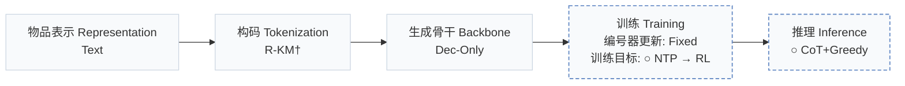
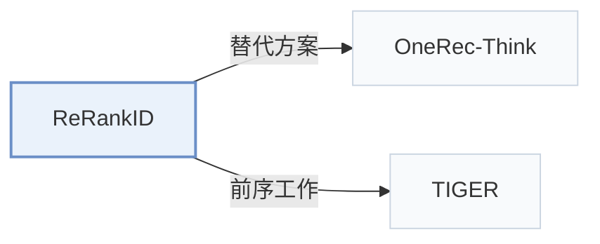

# ReRankID

[← 问题 × 阶段矩阵](../../../README.zh.md#范式系统与基准) · [按阶段索引](../index/stages.md) · [按模态找论文](../index/modality.md) · [按领域找论文](../index/domain.md) · [English](../../papers/rerankid.md) | 中文

| **题目** | *Reasoning Reranking with Semantic IDs as the Sole Item Representation* |
| :-- | :-- |
| **作者** | Tang et al. |
| **发表** | arXiv’26 |
| **问题与阶段** | `范式、系统与基准` · `无单一阶段` |
| **改动** | ○ 训练目标 · ○ 推理 |
| **构码输入** | `Text` |
| **领域** | `短视频与直播` |
| **特殊设置** | `冷启动（用户）` |
| **应用场景** | `排序与重排`；`公开数据` |
| **链接** | [论文](https://arxiv.org/abs/2610.22797) · [代码](https://github.com/lilv98/ReRankID) |
| **阅读级别** | 概览（第 1 级） |

**本页目录**：[TL;DR](#tldr) · [3. 实验发现](#3-实验发现) · [5. 相关工作](#5-相关工作)

- `Text`：物品文本元数据（标题、描述、类目或提示词）。
- `R-KM†`：残差 k-means 编号（由配置推断）。
- `Dec-Only`：仅解码器（Decoder-only）自回归架构。
- `Fixed`：先独立训练并冻结编号器，生成器训练期间 SID 保持不变。
- `NTP → RL`：先进行下一 token 预测微调，再执行强化学习（如 GRPO、GBPO 等）。
- `CoT+Greedy`：显式推理配合贪心解码。

### TL;DR

> [!NOTE]
> ReRankID 构建纯 SID 候选列表推理重排基准，在仅提供 SID 的条件下对比不同后训练方法对列表重排的影响。

---

### 3. 实验发现

实验设置

- **数据集**：Kuaishou OpenOneRec-RecIF short-video release, 162074 source users; evaluation requires a renderable positive and >=256 items with both SID/caption histories.
  - 出处：Section 3 and Appendix A.2: [S3.SS0.SSS0.Px2.p1](https://arxiv.org/html/2610.22797v1#S3.SS0.SSS0.Px2.p1) and [A1.SS2.p1](https://arxiv.org/html/2610.22797v1#A1.SS2.p1) and [A5.p1](https://arxiv.org/html/2610.22797v1#A5.p1)
- **切分**：User-disjoint SFT/post-training/development/test partitions; 400 development and 400 test users, each balanced 200 explicit-engagement/200 long-view positives; histories precede targets.
  - 出处：Appendix A.2: [A1.SS2.p1](https://arxiv.org/html/2610.22797v1#A1.SS2.p1)
- **候选集**：sampled: 29 negatives plus one positive at anchor; slate sizes 10/20/30/50/100. Exposure-hard negatives plus uniform catalog fill; user-engaged items excluded. Exclusion of other historical exposures: not reported.
  - 出处：Appendix A.2-A.3: [A1.SS2.p2](https://arxiv.org/html/2610.22797v1#A1.SS2.p2) and [A1.SS3.p1](https://arxiv.org/html/2610.22797v1#A1.SS3.p1)
- **可见性**：warm; evaluation release users/items were exposed during backbone pretraining, while post-training users are disjoint. Reranking supplied slates is a new task.
  - 出处：Appendix A.4: [A1.SS4.p1](https://arxiv.org/html/2610.22797v1#A1.SS4.p1) and [A1.SS4.p3](https://arxiv.org/html/2610.22797v1#A1.SS4.p3)
- **SID 规格**：Released OpenOneRec three-code SIDs from quantized item-text embeddings; quantizer algorithm, codebook sizes and collision handling: not reported.
  - 出处：Section 3 and Appendix A.1: [S3.SS0.SSS0.Px2.p1](https://arxiv.org/html/2610.22797v1#S3.SS0.SSS0.Px2.p1) and [A1.SS1.p1](https://arxiv.org/html/2610.22797v1#A1.SS1.p1)
- **推理预算**：SID: greedy reasoning 2048 tokens, fallback structured extraction 256 tokens from <=1200 reasoning characters; top-10 indices; A100/BF16. Text APIs: 8192-32768 output-token caps. Inference batch and latency: not reported.
  - 出处：Appendix B.1, Table B.2 and Appendix E: [A2.SS1.p2](https://arxiv.org/html/2610.22797v1#A2.SS1.p2) and [A2.T2](https://arxiv.org/html/2610.22797v1#A2.T2) and [A5.p2](https://arxiv.org/html/2610.22797v1#A5.p2)
- **结果来源**：This testbed's paired evaluations: Table 1 initial models/references, Table 2 post-training, Table D.1 full metrics. Each post-training method compares its own initializer; invalid outputs score zero.
  - 出处：Tables 1/2/D.1 and Section 5.1: [S4.T1](https://arxiv.org/html/2610.22797v1#S4.T1) and [S5.T2](https://arxiv.org/html/2610.22797v1#S5.T2) and [A4.T1](https://arxiv.org/html/2610.22797v1#A4.T1) and [S5.SS1.p1](https://arxiv.org/html/2610.22797v1#S5.SS1.p1)

---

### 5. 相关工作

- **替代方案** · [OneRec-Think](onerec-think.md): OneRec-Think reasons before catalog-item generation; ReRankID reasons over a supplied candidate slate.
  - 出处：ReRankID v1, Section 2: [S2.SS0.SSS0.Px1.p1](https://arxiv.org/html/2610.22797v1#S2.SS0.SSS0.Px1.p1).
- **前序工作** · [TIGER](tiger.md): TIGER's SID-generation paradigm is the background contrasted with SID-only slate reranking.
  - 出处：ReRankID v1, Section 2: [S2.SS0.SSS0.Px1.p1](https://arxiv.org/html/2610.22797v1#S2.SS0.SSS0.Px1.p1).

[查看同格全部论文](../../../README.zh.md#范式系统与基准)
