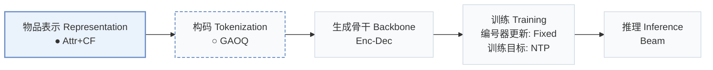
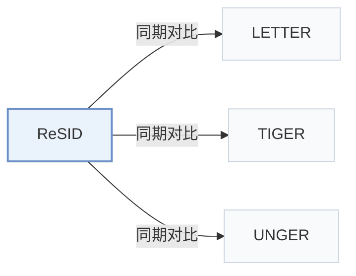

# ReSID

[← 问题 × 阶段矩阵](../../../README.zh.md#i--representation) · [按阶段索引](../index/stages.md) · [按模态找论文](../index/modality.md) · [按领域找论文](../index/domain.md) · [English](../../papers/resid.md) | 中文

| **题目** | *Rethinking Generative Recommender Tokenizer: Recsys-Native Encoding and Semantic Quantization Beyond LLMs* |
| :-- | :-- |
| **作者** | Liang et al. |
| **发表** | arXiv’26 |
| **问题与阶段** | `I. 信息量` · `物品表示（Representation）` |
| **改动** | ● 物品表示 · ○ 构码 |
| **构码输入** | `Attr` + `CF` |
| **领域** | `电商` |
| **链接** | [论文](https://arxiv.org/abs/2602.02338) · [代码](https://github.com/FuCongResearchSquad/ReSID) |
| **阅读级别** | 概览（第 1 级） |

**本页目录**：[TL;DR](#tldr) · [3. 实验发现](#3-实验发现) · [5. 相关工作](#5-相关工作)

- `Attr+CF`：结构化物品属性结合协同过滤信号。
- `GAOQ`：全局对齐正交量化（Globally Aligned Orthogonal Quantization）。
- `Enc-Dec`：编码器-解码器（Encoder-decoder）架构。
- `Fixed`：先独立训练并冻结编号器，生成器训练期间 SID 保持不变。
- `NTP`：标准下一 token 预测（Next-Token Prediction）交叉熵损失；基于预训练 LLM 的指令微调（SFT）亦归入此类。
- `Beam`：在 SID token 上执行自回归束搜索（Beam search）。

### TL;DR

> [!NOTE]
> ReSID 用字段感知掩码自编码从结构化特征学习物品表示，并用全局对齐正交量化将它转为离散码，替代 LLM 嵌入与通用量化器。

---

### 3. 实验发现

实验设置

- **数据集**：Amazon 2023: Musical Instruments, Video Games, Industrial/Scientific, Baby Products, Arts/Crafts/Sewing, Sports/Outdoors, Toys/Games, Health/Household, Beauty/Personal Care, Books. User/item 5-core; require store and three category-level fields.
  - 出处：Section 4 and Appendix C: [S4.p3](https://arxiv.org/html/2602.02338v1#S4.p3) and [A3.p1](https://arxiv.org/html/2602.02338v1#A3.p1)
- **切分**：Chronological per-user last/penultimate interactions test/validation; sliding training windows, maximum length 32. Evaluation target items absent from training are added to the training set.
  - 出处：Section 4 and Appendix C: [S4.p6](https://arxiv.org/html/2602.02338v1#S4.p6) and [A3.p1](https://arxiv.org/html/2602.02338v1#A3.p1)
- **候选集**：not reported
  - 出处：Section 4 and Appendix E specify ranking metrics but no candidate protocol; 128 sampled negatives are a training objective: [S4.p6](https://arxiv.org/html/2602.02338v1#S4.p6) and [A5.p2](https://arxiv.org/html/2602.02338v1#A5.p2)
- **可见性**：warm; evaluation target items absent from training are added to the training set.
  - 出处：Appendix C explicitly inserts evaluation-only items into training: [A3.p1](https://arxiv.org/html/2602.02338v1#A3.p1)
- **SID 规格**：GAOQ, 3 levels. Branching tuples: MI(32,40,19),VG(32,64,13),IS(24,80,14),BP(32,64,18),ACS(64,96,16),SO(128,128,11),TG(192,192,5),HH(50,512,8),BPC(96,192,11),Books(256,256,8). Global anchor-vocabulary sizes and collision handling: not reported.
  - 出处：Table 7 and Algorithm 1: [A5.T7](https://arxiv.org/html/2602.02338v1#A5.T7) and [alg1](https://arxiv.org/html/2602.02338v1#alg1)
- **推理预算**：Beam 50; Recall/NDCG@5/10. Inference hardware, batch size, latency: not reported; batch 2048 is training.
  - 出处：Section 4 and Appendix E: [S4.p6](https://arxiv.org/html/2602.02338v1#S4.p6) and [A5.p4](https://arxiv.org/html/2602.02338v1#A5.p4)
- **结果来源**：Tables 1/4 aggregate/full main comparison; Tables 2/5 ablations; Table 3 quantization runtime, not inference latency. All SID methods use this study's common T5-style generator; tokenizer settings follow original methods.
  - 出处：Tables 1-5 and Appendix E: [S5.T1](https://arxiv.org/html/2602.02338v1#S5.T1) and [S5.T2](https://arxiv.org/html/2602.02338v1#S5.T2) and [S5.T3](https://arxiv.org/html/2602.02338v1#S5.T3) and [A0.T4](https://arxiv.org/html/2602.02338v1#A0.T4) and [A0.T5](https://arxiv.org/html/2602.02338v1#A0.T5) and [A5.p4](https://arxiv.org/html/2602.02338v1#A5.p4) and [A5.p3](https://arxiv.org/html/2602.02338v1#A5.p3)

---

### 5. 相关工作

- **同期对比** · [LETTER](letter.md): LETTER is the strongest compared SID baseline and a quantization-runtime reference.
  - 出处：ReSID v1, Sections 5.1/5.4: [S5.SS1.p4](https://arxiv.org/html/2602.02338v1#S5.SS1.p4); [S5.SS4.p1](https://arxiv.org/html/2602.02338v1#S5.SS4.p1).
- **同期对比** · [TIGER](tiger.md): TIGER's semantic RQ-VAE tokenizer is compared under the common downstream generator.
  - 出处：ReSID v1, Appendix D/E: [A4.p3](https://arxiv.org/html/2602.02338v1#A4.p3); [A5.p4](https://arxiv.org/html/2602.02338v1#A5.p4).
- **同期对比** · [UNGER](unger.md): UNGER aligns semantic/collaborative representations; ReSID uses structured-field masked prediction.
  - 出处：ReSID v1, Section 3.1 and Appendix D: [S3.SS1.p3](https://arxiv.org/html/2602.02338v1#S3.SS1.p3); [A4.p3](https://arxiv.org/html/2602.02338v1#A4.p3).

[查看同格全部论文](../../../README.zh.md#i--representation)
