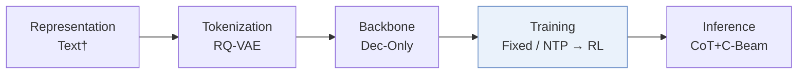
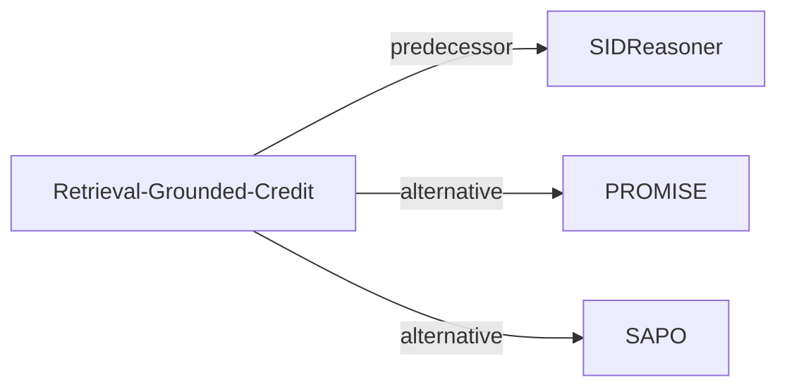

# Retrieval-Grounded-Credit

*From Interests to Semantic IDs: Retrieval-Grounded Credit Assignment for Generative Recommendation* — Zhu et al. · arXiv’26

`IV. 实用目标` · `Training` · [论文](https://arxiv.org/abs/2609.29983) · [代码](https://github.com/YuFan-Microsoft/Retrieval-Grounded-Credit-Assignment-for-Generative-Recommendation) · [矩阵](../../../README.zh.md#iv--training) · [English](../../papers/retrieval-grounded-credit.md)

阅读级别：概览（第 1 级） · 本页目录：[TL;DR](#tldr) · [速览](#速览) · [3. 实验发现](#3-实验发现) · [5. 相关工作](#5-相关工作)

- `Dec-Only`: Decoder-only.
- `Fixed`: SIDs are built first and not changed while the generator trains.
- `NTP → RL`: NTP, then reinforcement learning (GRPO, GBPO, etc.).
- `CoT+C-Beam`: Reasoning followed by constrained beam-search decoding.

### TL;DR

> [!NOTE]
> Retrieval-Grounded-Credit 将每条推理轨迹拆为多个兴趣假设，分别作为查询送入冻结检索器，对命中目标的假设直接给予奖励而非仅奖励最终解码的 SID。

### 速览

| 维度 | 摘要 |
| :-- | :-- |
| 研究问题 | IV. 实用目标：Are training and search aimed at what users and the platform value, rather than at token likelihood? |
| 核心贡献 | Retrieval-Grounded-Credit 将每条推理轨迹拆为多个兴趣假设，分别作为查询送入冻结检索器，对命中目标的假设直接给予奖励而非仅奖励最终解码的 SID。 |
| 主要改动阶段 | Training |

### 3. 实验发现

实验设置

- **数据集**：Amazon Video Games, Office Products, Industrial and Scientific; October 2016-November 2018 interactions, 5-core filtering, histories capped at 10 items.
  - 出处：v1 Section 4.1, pp. 5-6: [page=5](https://arxiv.org/pdf/2609.29983v1#page=5)
- **切分**：Per-user chronological last interaction test, penultimate validation; earlier interactions form sliding-window training pairs.
  - 出处：v1 Section 4.1, pp. 5-6: [page=5](https://arxiv.org/pdf/2609.29983v1#page=5)
- **候选集**：full catalog; trie contains all catalog SIDs, no sampled negatives.
  - 出处：v1 Section 4.1, p. 6: [page=6](https://arxiv.org/pdf/2609.29983v1#page=6)
- **可见性**：warm; no unseen-item protocol is defined. SIDReasoner tokenizers/mappings reused and frozen; tokenizer exposure to test items not reported.
  - 出处：v1 Sections 3.1/4.1, pp. 3/5-6 define no unseen-item holdout: [page=3](https://arxiv.org/pdf/2609.29983v1#page=3) and [page=5](https://arxiv.org/pdf/2609.29983v1#page=5)
- **SID 规格**：Domain-specific RQ-VAE: 3 levels x 256 codes; collision handling not reported.
  - 出处：v1 Section 3.1, p. 3: [page=3](https://arxiv.org/pdf/2609.29983v1#page=3)
- **推理预算**：Qwen3-1.7B; constrained beam returns 10 valid SIDs, metrics @5/10. Interests average 3.8/query set, each retrieves top-50 by frozen Qwen3-Embedding-4B exact cosine search. Hardware, inference batch size, latency not reported; training samples 16 trajectories/prompt, distinct from evaluation.
  - 出处：v1 Section 4.1, p. 6, Figure 5, p. 9: [page=6](https://arxiv.org/pdf/2609.29983v1#page=6) and [page=9](https://arxiv.org/pdf/2609.29983v1#page=9)
- **结果来源**：Original Table 4 RL controls/ours; external baselines are reported SIDReasoner results. Ours and SID-plus-trace control average three training seeds. Figure 5 interest-conditioned decoding includes target-aware oracle upper bounds.
  - 出处：v1 Section 4.1/Table 4, p. 6, Figure 5, p. 9: [page=6](https://arxiv.org/pdf/2609.29983v1#page=6) and [page=9](https://arxiv.org/pdf/2609.29983v1#page=9)

### 5. 相关工作

- **前序工作** · [SIDReasoner](sidreasoner.md): Reuses SIDReasoner's tokenizer, alignment data, and evaluator; adds retrieval-grounded trace credit.
  - 出处：Retrieval-Grounded-Credit v1, Sections 3.1/3.2 and 4.1, pp. 3/6: https://arxiv.org/pdf/2609.29983v1#page=3; https://arxiv.org/pdf/2609.29983v1#page=6.
- **替代方案** · [PROMISE](promise.md): PROMISE rewards intermediate SID paths; this method verifies language interests through retrieval.
  - 出处：Retrieval-Grounded-Credit v1, Section 2.3, p. 3: https://arxiv.org/pdf/2609.29983v1#page=3.
- **替代方案** · [SAPO](sapo.md): SAPO aligns reasoning blocks with SID tokens; this method attributes query hits to interest lines.
  - 出处：Retrieval-Grounded-Credit v1, Section 2.3, p. 3: https://arxiv.org/pdf/2609.29983v1#page=3.

[查看同格全部论文](../../../README.zh.md#iv--training)
