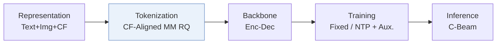
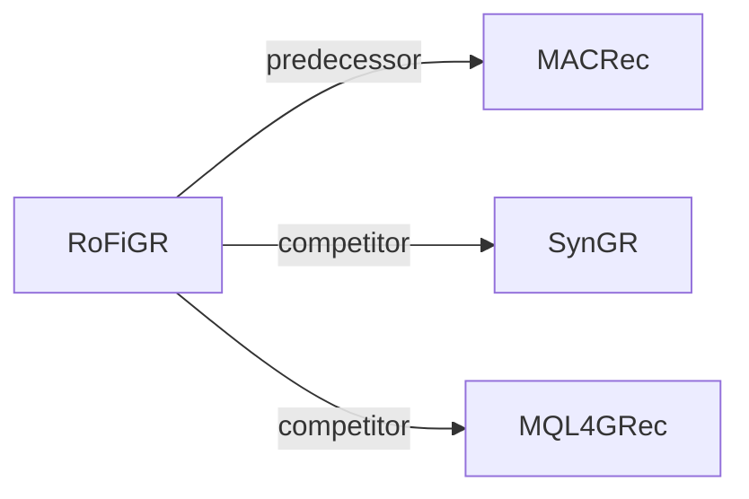

# RoFiGR

*Coarse Routing, Fine Refinement via Level-Adaptive Distillation in Multimodal Generative Recommendation* — Dai et al. · arXiv’26

`I. 信息量` · `Tokenization` · [论文](https://arxiv.org/abs/2610.39470) · [矩阵](../../../README.zh.md#i--tokenization) · [English](../../papers/rofigr.md)

阅读级别：概览（第 1 级） · 本页目录：[TL;DR](#tldr) · [速览](#速览) · [3. 实验发现](#3-实验发现) · [5. 相关工作](#5-相关工作)

- `CF-Aligned MM RQ`: Multimodal residual quantization aligned with collaborative signals.
- `Enc-Dec`: Encoder-decoder.
- `Fixed`: SIDs are built first and not changed while the generator trains.
- `NTP + Aux.`: NTP plus another auxiliary loss.
- `C-Beam`: Constrained beam search.

### TL;DR

> [!NOTE]
> RoFiGR 将粗粒度 SID 码向量与协同嵌入对齐，并用按层级自适应的权重在合法分支上蒸馏序列推荐教师，减少早期路由错误。

### 速览

| 维度 | 摘要 |
| :-- | :-- |
| 研究问题 | I. 信息量：Do the SIDs, or the model reading them, carry the collaborative and multimodal signals recommendation needs? |
| 核心贡献 | RoFiGR 将粗粒度 SID 码向量与协同嵌入对齐，并用按层级自适应的权重在合法分支上蒸馏序列推荐教师，减少早期路由错误。 |
| 主要改动阶段 | Tokenization |

### 3. 实验发现

实验设置

- **数据集**：Amazon Instruments, Arts, Games; 5-core filtering, histories capped at 20; catalogs 6250/9416/13839 items, respectively.
  - 出处：Section 4.1: [S4.SS1.p1](https://arxiv.org/html/2610.39470v1#S4.SS1.p1)
- **切分**：Per-user chronological last event test, penultimate validation, earlier events training; teacher fitting and student optimization use the training partition.
  - 出处：Section 4.1: [S4.SS1.p1](https://arxiv.org/html/2610.39470v1#S4.SS1.p1)
- **候选集**：full catalog; no sampled negatives. A target absent from the decoded stream union scores zero.
  - 出处：Section 4.1: [S4.SS1.p2](https://arxiv.org/html/2610.39470v1#S4.SS1.p2)
- **可见性**：warm; no unseen-item protocol is defined. MISSRec teacher fits training interactions; item embeddings/scores are frozen offline. Tokenizer exposure to test items not separately reported.
  - 出处：Sections 3.1/4.1 define no item holdout: [S3.SS1.p2](https://arxiv.org/html/2610.39470v1#S3.SS1.p2) and [S4.SS1.p1](https://arxiv.org/html/2610.39470v1#S4.SS1.p1)
- **SID 规格**：Separate text/image residual trees, each [64,256,256,512], code dimension 32. Collisions repaired at L4 or L3-L4, preserving L1-L2; complete SIDs uniquely identify items.
  - 出处：Sections 3.2/3.6: [S3.SS2.p2](https://arxiv.org/html/2610.39470v1#S3.SS2.p2) and [S3.SS6.p1](https://arxiv.org/html/2610.39470v1#S3.SS6.p1)
- **推理预算**：Four independent trie beams of 20, item union and equal-weight stream fusion; HR@1/5/10, NDCG@5/10. One L20, FP16, batch 1, history 20: four-stream mean latency 56.7/60.9/63.7 ms (Instruments/Arts/Games); two-stream 31.8/33.5/35.1 ms. Includes encoding through final sorting; no online teacher/reranker.
  - 出处：Sections 3.5/4.8: [S3.SS5.p3](https://arxiv.org/html/2610.39470v1#S3.SS5.p3) and [S4.SS8.p2](https://arxiv.org/html/2610.39470v1#S4.SS8.p2)
- **结果来源**：Original Table 3: five-seed main comparison; MACRec/SynGR retain native two-stream inference versus RoFiGR's four. Tables 5/6 separate task exposure, stream fusion, matched beam slots and candidate caps.
  - 出处：Section 4.1/4.2 and Tables 3/5/6: [S4.SS1.p2](https://arxiv.org/html/2610.39470v1#S4.SS1.p2) and [S3.T3](https://arxiv.org/html/2610.39470v1#S3.T3) and [S4.SS2.p1](https://arxiv.org/html/2610.39470v1#S4.SS2.p1) and [S4.T5](https://arxiv.org/html/2610.39470v1#S4.T5) and [S4.T6](https://arxiv.org/html/2610.39470v1#S4.T6)

### 5. 相关工作

- **前序工作** · [MACRec](macrec.md): RoFiGR retains MACRec's two-tree quantizer and adds coarse collaborative alignment.
  - 出处：RoFiGR v1, Section 3.2 and Table 3: https://arxiv.org/html/2610.39470v1#S3.SS2.p1; https://arxiv.org/html/2610.39470v1#S3.T3.
- **同期对比** · [SynGR](syngr.md): SynGR promotes cross-modal synergy; RoFiGR adds collaborative coarse routing supervision.
  - 出处：RoFiGR v1, Section 2 and Table 3: https://arxiv.org/html/2610.39470v1#S2.SS0.SSS0.Px2.p1; https://arxiv.org/html/2610.39470v1#S3.T3.
- **同期对比** · [MQL4GRec](mql4grec.md): RoFiGR adopts MQL4GRec's domain data setting and compares against it.
  - 出处：RoFiGR v1, Section 4.1 and Table 3: https://arxiv.org/html/2610.39470v1#S4.SS1.p1; https://arxiv.org/html/2610.39470v1#S3.T3.

[查看同格全部论文](../../../README.zh.md#i--tokenization)
