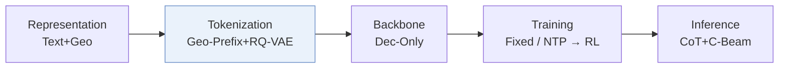
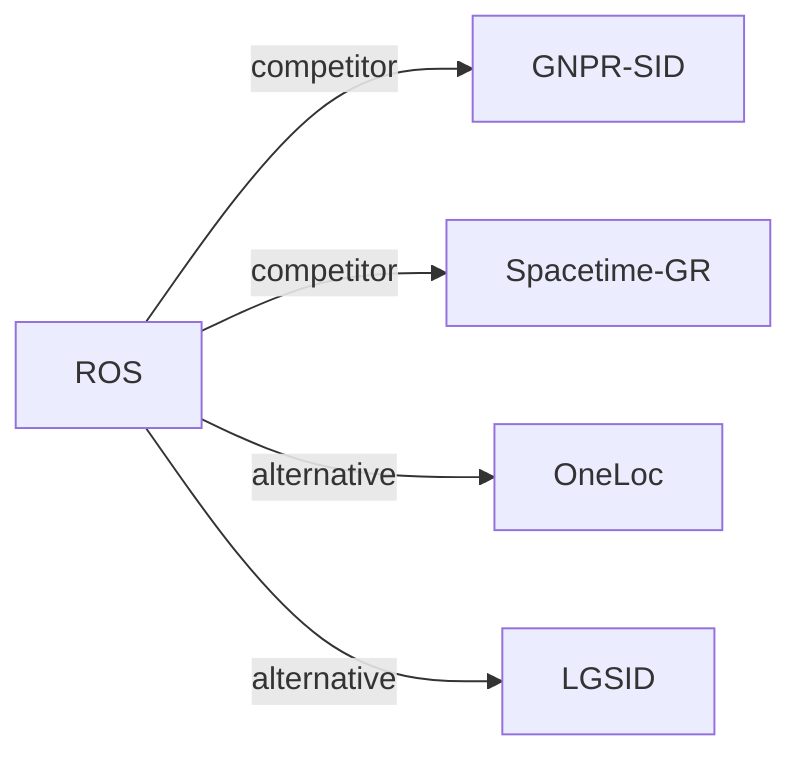

# ROS

*Reasoning Over Space: Enabling Geographic Reasoning for LLM-Based Generative Next POI Recommendation* — Lv et al. · ACL’26

`I. 信息量` · `Tokenization` · `POI` · [论文](https://arxiv.org/abs/2601.04562) · [代码](https://github.com/amap-cvlab/Reasoning-Over-Space) · [矩阵](../../../README.zh.md#i--tokenization) · [English](../../papers/ros.md)

阅读级别：概览（第 1 级） · 本页目录：[TL;DR](#tldr) · [速览](#速览) · [2. 方法](#2-方法) · [3. 实验发现](#3-实验发现) · [5. 相关工作](#5-相关工作)

- `Geo-Prefix+RQ-VAE`: Geographic prefixes combined with residual-quantized variational codes.
- `Dec-Only`: Decoder-only.
- `Fixed`: SIDs are built first and not changed while the generator trains.
- `NTP → RL`: NTP, then reinforcement learning (GRPO, GBPO, etc.).
- `CoT+C-Beam`: Reasoning followed by constrained beam-search decoding.

### TL;DR

> [!NOTE]
> ROS 为基于 LLM 的下一 POI 生成加入层级空间 SID、带局部性剪枝的移动思维链以及空间引导强化学习。

### 速览

| 维度 | 摘要 |
| :-- | :-- |
| 研究问题 | I. 信息量：Do the SIDs, or the model reading them, carry the collaborative and multimodal signals recommendation needs? |
| 核心贡献 | ROS 为基于 LLM 的下一 POI 生成加入层级空间 SID、带局部性剪枝的移动思维链以及空间引导强化学习。 |
| 主要改动阶段 | Tokenization |

### 2. 方法

### 3. 实验发现

实验设置

- **数据集**：Foursquare NYC and TKY, Gowalla CA, prepared with the LLM4POI pipeline: users and POIs with fewer than 10 check-ins removed, trajectories segmented by a 24-hour time-gap threshold, and street-level addresses added by reverse geocoding. Sizes after preprocessing (users / POIs / check-ins): NYC 1,048 / 4,981 / 103,941; TKY 2,282 / 7,833 / 405,000; CA 3,957 / 9,690 / 238,369.
  - 出处：Datasets and LLM4POI pipeline: [S3.SS1.p1](https://arxiv.org/html/2601.04562v2#S3.SS1.p1); 24-hour gap and sizes: [A1.T10](https://arxiv.org/html/2601.04562v2#A1.T10).
- **切分**：Temporal 80% / 10% / 10% train/validation/test split. Separate cross-city test: train on one city and evaluate on others.
  - 出处：Temporal 80/10/10 split keeping test users and POIs observed: [S3.SS1.p1](https://arxiv.org/html/2601.04562v2#S3.SS1.p1); cross-city: [S3.T6](https://arxiv.org/html/2601.04562v2#S3.T6).
- **候选集**：n/a for candidate ranking: the model outputs exactly one POI per request and is scored by HR@1.
  - 出处：One recommendation per request, HR@1: [S3.SS1.SSS0.Px2.p1](https://arxiv.org/html/2601.04562v2#S3.SS1.SSS0.Px2.p1).
- **可见性**：warm; validation and test users and POIs are kept only if observed in training. The cross-city test (Table 6) uses POIs of another city; their tokenizer exposure is not reported.
  - 出处：Test users and POIs observed in training: [S3.SS1.p1](https://arxiv.org/html/2601.04562v2#S3.SS1.p1).
- **SID 规格**：Hierarchical spatial SID [g; s; u]: two S2-cell locality tokens (after removing the dataset-wide common prefix), two semantic tokens from a 2-level residual quantizer with 28 codes per level over Qwen-0.6B category embeddings, and a sequential suffix token within each (g, s) pair that makes IDs unique (at most 8 suffix values observed).
  - 出处：HS-SID construction: [A1.SS3.SSS0.Px1.p1](https://arxiv.org/html/2601.04562v2#A1.SS3.SSS0.Px1.p1).
- **推理预算**：Generates a mobility chain-of-thought and then one POI SID per request (three inference runs averaged); decoding settings not reported. Qwen3-4B student on 8 NVIDIA H20 GPUs; inference batch size and latency: not reported.
  - 出处：One output per request, hardware: [S3.SS1.SSS0.Px2.p1](https://arxiv.org/html/2601.04562v2#S3.SS1.SSS0.Px2.p1) and [S3.SS1.SSS0.Px3.p1](https://arxiv.org/html/2601.04562v2#S3.SS1.SSS0.Px3.p1).
- **结果来源**：Table 1 (HR@1 on NYC, TKY, CA versus traditional, neural, and LLM-based baselines); Tables 2-5 and Figure 3 (SID design, CoT stages, geographic cues, reward weights); Table 6 (cross-city generalization).
  - 出处：Main: [S3.T1](https://arxiv.org/html/2601.04562v2#S3.T1); ablations: [S3.T2](https://arxiv.org/html/2601.04562v2#S3.T2), [S3.T3](https://arxiv.org/html/2601.04562v2#S3.T3), [S3.T4](https://arxiv.org/html/2601.04562v2#S3.T4), [S3.T5](https://arxiv.org/html/2601.04562v2#S3.T5); RL weights: [S3.F3](https://arxiv.org/html/2601.04562v2#S3.F3); cross-city: [S3.T6](https://arxiv.org/html/2601.04562v2#S3.T6).

### 5. 相关工作

- **同期对比** · [GNPR-SID](gnpr-sid.md): GNPR-SID quantizes POI embeddings without explicit spatial structure; ROS builds S2-cell locality tokens plus semantic codes and adds mobility chain-of-thought and spatial RL.
  - 出处：ROS v2, LLM-based baselines: https://arxiv.org/html/2601.04562v2#S3.SS1.SSS0.Px1.p1; Table 1: https://arxiv.org/html/2601.04562v2#S3.T1.
- **同期对比** · [Spacetime-GR](spacetime-gr.md): SpaceTime-GR also generates next POIs with an LLM; ROS adds hierarchical spatial SIDs and explicit reasoning before the recommendation.
  - 出处：ROS v2, LLM-based baselines (ST-GR): https://arxiv.org/html/2601.04562v2#S3.SS1.SSS0.Px1.p1; Table 1: https://arxiv.org/html/2601.04562v2#S3.T1.
- **替代方案** · [OneLoc](oneloc.md): OneLoc injects geography into the SID input and rewards; ROS encodes geography directly as S2-cell prefix tokens.
  - 出处：ROS v2, Section 1 cites OneLoc: https://arxiv.org/html/2601.04562v2#S1.p3.
- **替代方案** · [LGSID](lgsid.md): LGSID aligns embeddings with geographic rewards before quantization; ROS separates geographic and semantic tokens inside the SID.
  - 出处：ROS v2, Section 1 cites LGSID: https://arxiv.org/html/2601.04562v2#S1.p3.

[查看同格全部论文](../../../README.zh.md#i--tokenization)
