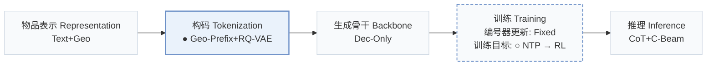
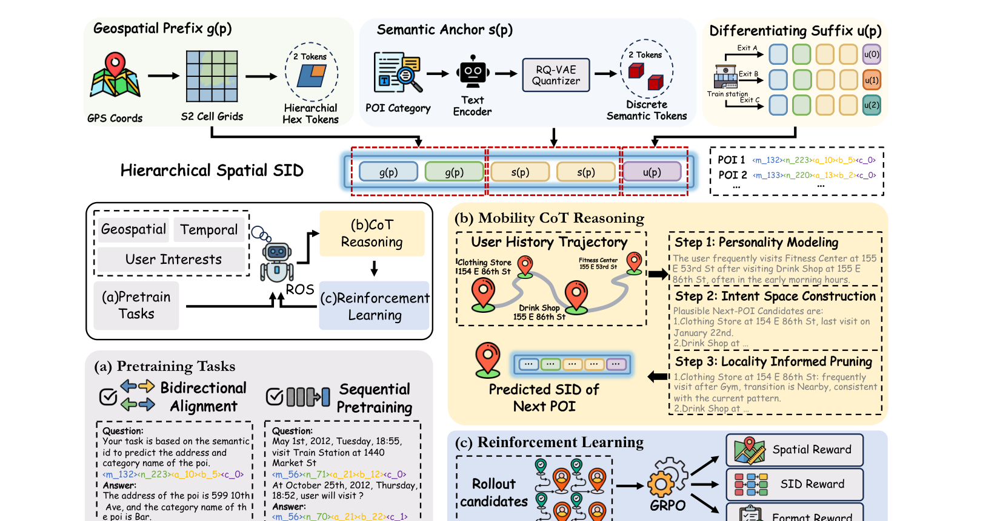
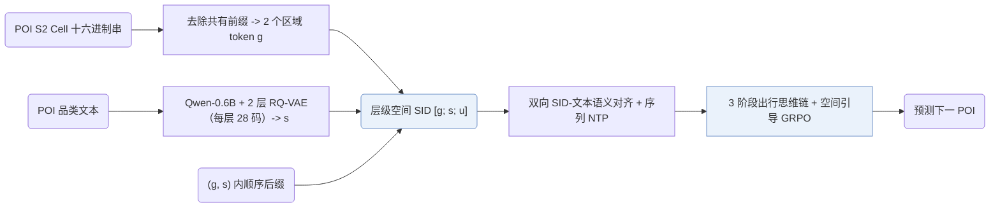
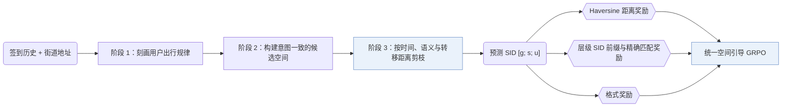
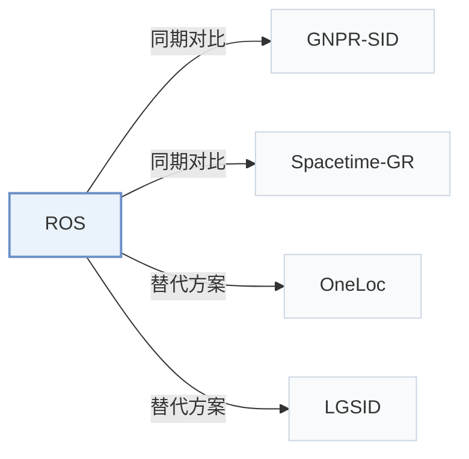

# ROS

[← 问题 × 阶段矩阵](../../../README.zh.md#i--tokenization) · [按阶段索引](../index/stages.md) · [按模态找论文](../index/modality.md) · [按领域找论文](../index/domain.md) · [English](../../papers/ros.md) | 中文

| **题目** | *Reasoning Over Space: Enabling Geographic Reasoning for LLM-Based Generative Next POI Recommendation* |
| :-- | :-- |
| **作者** | Lv et al. |
| **发表** | ACL’26 |
| **问题与阶段** | `I. 信息量` · `构码（Tokenization）` · `POI` |
| **改动** | ● 构码 · ○ 训练目标 |
| **构码输入** | `Text` + `Geo` |
| **领域** | `本地生活与 POI` |
| **特殊设置** | `跨域迁移` |
| **链接** | [论文](https://arxiv.org/abs/2601.04562) · [代码](https://github.com/amap-cvlab/Reasoning-Over-Space) |
| **阅读级别** | 阅读笔记（第 2 级） |

**本页目录**：[TL;DR](#tldr) · [速览](#速览) · [1. 为什么重要](#1-为什么重要) · [2. 方法](#2-方法) · [3. 实验发现](#3-实验发现) · [4. 局限与分析](#4-局限与分析) · [5. 相关工作](#5-相关工作)

- `Text+Geo`：文本表征结合地理空间特征。
- `Geo-Prefix+RQ-VAE`：地理空间前缀结合 RQ-VAE 残差码。
- `Dec-Only`：仅解码器（Decoder-only）自回归架构。
- `Fixed`：先独立训练并冻结编号器，生成器训练期间 SID 保持不变。
- `NTP → RL`：先进行下一 token 预测微调，再执行强化学习（如 GRPO、GBPO 等）。
- `CoT+C-Beam`：显式推理后接合法前缀约束束搜索。

### TL;DR

> [!NOTE]
> ROS 为基于 LLM 的下一 POI 生成加入层级空间 SID、带局部性剪枝的移动思维链以及空间引导强化学习。

---

### 速览

| 维度 | 摘要 |
| :-- | :-- |
| 主要发现 | 在 NYC 上，ROS 的 HR@1 为 0.4478，优于 CoAST 的 0.4027（+11.2%）；在 TKY 和 Gowalla-CA 上，较最强 LLM 基线分别提升 +11.0% 和 +15.7%（Table 1）。 |
| 局限 | 单调空间距离先验将短时间内的长距离移动视为低概率事件，因此在地铁或高速公路沿线及交通枢纽附近会低估快速跨区出行（Limitations）。 |

---

### 1. 为什么重要

基于 LLM 的生成式推荐器对地理结构的利用有限，而地理可达性在人类出行与本地生活服务中直接决定候选是否可行。ROS 将下一次到访建模为受时间、意图与地理联合约束的多步决策序列（Sec. 2.3），并用同时编码区域局部性与品类语义的层级空间语义 ID（Semantic ID，SID）`[g; s; u]` 表示每个 POI（Abstract）。

> "We present ROS, a generative next POI recommendation framework that treats geography as an explicit decision variable."（Sec. 5）

---

### 2. 方法

#### 层级空间 SID

每个 POI 的 SID 依次拼接地理前缀 `g`、语义锚点 `s` 和消歧后缀 `u`（Sec. 2.2.1）。地理前缀将 POI 的 S2 Cell ID 转为十六进制数字，剥离全城物品库共有的高位前缀后分组为两个区域 token；语义锚点用 Qwen-0.6B 编码品类描述，再经每层 28 码的 2 层 RQ-VAE 量化，最后在每个 `(g, s)` 组合内附加顺序后缀 `u` 保证唯一性。

#### SID 语义对齐

双向对齐任务同时训练 LLM 由 POI 文本预测空间 SID、以及由空间 SID 生成文本描述（Sec. 2.2.2）。

> "This bidirectional alignment grounds SID tokens in functional semantics and fine-grained neighborhood cues."（Sec. 2.2.2）

随后的序列预训练在 SID 轨迹上执行下一 POI 预测，使骨干网络掌握近期偏好、品类复访与街区连续性。

#### 出行思维链

在输出目标 SID 之前，生成器按三个确定阶段展开推理：刻画用户出行习惯、构建与当前意图一致的候选空间，并根据时间一致性、语义匹配度以及由街道地址和转移距离推断的空间可达性剪枝候选（Sec. 2.3）。

#### 空间引导的强化学习

GRPO 在统一复合奖励下优化“推理+生成”策略（Sec. 2.4.3）：奖励由预测 POI 与真实 POI 坐标间的单调 Haversine 距离衰减项（Sec. 2.4.1）、带精确命中加成的层级 SID 前缀匹配项（Sec. 2.4.2）以及输出格式校验项共同组成。

---

### 3. 实验发现

实验设置

- **数据集**：Foursquare NYC and TKY, Gowalla CA, prepared with the LLM4POI pipeline: users and POIs with fewer than 10 check-ins removed, trajectories segmented by a 24-hour time-gap threshold, and street-level addresses added by reverse geocoding. Sizes after preprocessing (users / POIs / check-ins): NYC 1,048 / 4,981 / 103,941; TKY 2,282 / 7,833 / 405,000; CA 3,957 / 9,690 / 238,369.
  - 出处：Datasets and LLM4POI pipeline: [S3.SS1.p1](https://arxiv.org/html/2601.04562v2#S3.SS1.p1); 24-hour gap and sizes: [A1.T10](https://arxiv.org/html/2601.04562v2#A1.T10).
- **切分**：Temporal 80% / 10% / 10% train/validation/test split. Separate cross-city test: train on one city and evaluate on others.
  - 出处：Temporal 80/10/10 split keeping test users and POIs observed: [S3.SS1.p1](https://arxiv.org/html/2601.04562v2#S3.SS1.p1); cross-city: [S3.T6](https://arxiv.org/html/2601.04562v2#S3.T6).
- **候选集**：n/a for candidate ranking: the model outputs exactly one POI per request and is scored by HR@1.
  - 出处：One recommendation per request, HR@1: [S3.SS1.SSS0.Px2.p1](https://arxiv.org/html/2601.04562v2#S3.SS1.SSS0.Px2.p1).
- **可见性**：warm; validation and test users and POIs are kept only if observed in training. The cross-city test (Table 6) uses POIs of another city; their tokenizer exposure is not reported.
  - 出处：Test users and POIs observed in training: [S3.SS1.p1](https://arxiv.org/html/2601.04562v2#S3.SS1.p1).
- **SID 规格**：Hierarchical spatial SID [g; s; u]: two S2-cell locality tokens (after removing the dataset-wide common prefix), two semantic tokens from a 2-level residual quantizer with 28 codes per level over Qwen-0.6B category embeddings, and a sequential suffix token within each (g, s) pair that makes IDs unique (at most 8 suffix values observed).
  - 出处：HS-SID construction: [A1.SS3.SSS0.Px1.p1](https://arxiv.org/html/2601.04562v2#A1.SS3.SSS0.Px1.p1).
- **推理预算**：Generates a mobility chain-of-thought and then one POI SID per request (three inference runs averaged); decoding settings not reported. Qwen3-4B student on 8 NVIDIA H20 GPUs; inference batch size and latency: not reported.
  - 出处：One output per request, hardware: [S3.SS1.SSS0.Px2.p1](https://arxiv.org/html/2601.04562v2#S3.SS1.SSS0.Px2.p1) and [S3.SS1.SSS0.Px3.p1](https://arxiv.org/html/2601.04562v2#S3.SS1.SSS0.Px3.p1).
- **结果来源**：Table 1 (HR@1 on NYC, TKY, CA versus traditional, neural, and LLM-based baselines); Tables 2-5 and Figure 3 (SID design, CoT stages, geographic cues, reward weights); Table 6 (cross-city generalization).
  - 出处：Main: [S3.T1](https://arxiv.org/html/2601.04562v2#S3.T1); ablations: [S3.T2](https://arxiv.org/html/2601.04562v2#S3.T2), [S3.T3](https://arxiv.org/html/2601.04562v2#S3.T3), [S3.T4](https://arxiv.org/html/2601.04562v2#S3.T4), [S3.T5](https://arxiv.org/html/2601.04562v2#S3.T5); RL weights: [S3.F3](https://arxiv.org/html/2601.04562v2#S3.F3); cross-city: [S3.T6](https://arxiv.org/html/2601.04562v2#S3.T6).

- 思维链阶段消融：同时保留全部三个出行思维链阶段取得最高 HR@1，去掉用户画像、候选构建或空间剪枝任一阶段都会降低各数据集上的准确率（Sec. 3.3，Table 3）。
- 跨城迁移：在单一城市训练并在两个未见城市上直接评测时，ROS 在所有迁移方向上均优于 LLM4POI 和 GA-LLM（Sec. 3.4，Table 6）。

---

### 4. 局限与分析

**Our analysis.**

- GNPR-SID 用普通 `RQ-VAE` 量化 POI 特征；ROS 在语义码前显式前置了 S2 单元区域前缀（`Geo-Prefix+RQ-VAE`）。
- SpaceTime-GR 仅使用纯地理索引（`Geo`，`Geo-Idx`）；ROS 将 S2 地理前缀与品类 `RQ-VAE` 语义码结合，并在受限束解码前执行结构化时空推理（`CoT+C-Beam`）。

---

### 5. 相关工作

- **同期对比** · [GNPR-SID](gnpr-sid.md): GNPR-SID quantizes POI embeddings without explicit spatial structure; ROS builds S2-cell locality tokens plus semantic codes and adds mobility chain-of-thought and spatial RL.
  - 出处：ROS v2, LLM-based baselines: [S3.SS1.SSS0.Px1.p1](https://arxiv.org/html/2601.04562v2#S3.SS1.SSS0.Px1.p1); Table 1: [S3.T1](https://arxiv.org/html/2601.04562v2#S3.T1).
- **同期对比** · [Spacetime-GR](spacetime-gr.md): SpaceTime-GR also generates next POIs with an LLM; ROS adds hierarchical spatial SIDs and explicit reasoning before the recommendation.
  - 出处：ROS v2, LLM-based baselines (ST-GR): [S3.SS1.SSS0.Px1.p1](https://arxiv.org/html/2601.04562v2#S3.SS1.SSS0.Px1.p1); Table 1: [S3.T1](https://arxiv.org/html/2601.04562v2#S3.T1).
- **替代方案** · [OneLoc](oneloc.md): OneLoc injects geography into the SID input and rewards; ROS encodes geography directly as S2-cell prefix tokens.
  - 出处：ROS v2, Section 1 cites OneLoc: [S1.p3](https://arxiv.org/html/2601.04562v2#S1.p3).
- **替代方案** · [LGSID](lgsid.md): LGSID aligns embeddings with geographic rewards before quantization; ROS separates geographic and semantic tokens inside the SID.
  - 出处：ROS v2, Section 1 cites LGSID: [S1.p3](https://arxiv.org/html/2601.04562v2#S1.p3).

[查看同格全部论文](../../../README.zh.md#i--tokenization)
