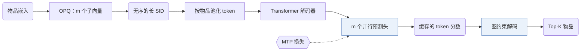
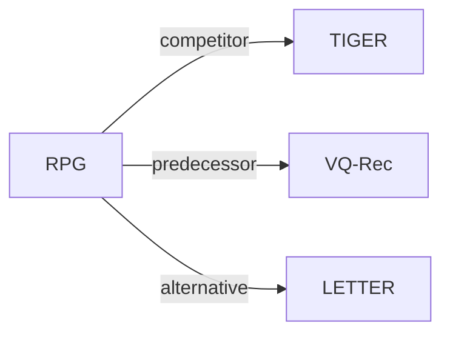

# RPG

| **题目** | *Generating long semantic ids in parallel for recommendation* |
| :-- | :-- |
| **作者** | Hou et al. |
| **会议** | KDD’25 |
| **问题与阶段** | `V. 效率` · `Backbone` |
| **链接** | [论文](https://arxiv.org/abs/2506.05781) · [代码](https://github.com/facebookresearch/RPG_KDD2025) · [矩阵](../../../README.zh.md#v--backbone) · [English](../../papers/rpg.md) |
| **阅读级别** | 代码级精读（第 3 级） |

本页目录：[TL;DR](#tldr) · [速览](#速览) · [1. 为什么重要](#1-为什么重要) · [2. 方法](#2-方法) · [3. 实验发现](#3-实验发现) · [4. 局限与分析](#4-局限与分析) · [5. 相关工作](#5-相关工作)


- `Non-AR`: Non-autoregressive.
- `Fixed`: SIDs are built first and not changed while the generator trains.
- `MTP`: Predicts several codes in parallel at once.

### TL;DR

> [!NOTE]
> RPG 用多 token 预测损失并行预测长且无序的 OPQ SID，并在合法 ID 图上解码，替代短 ID 上的自回归束搜索。

---

### 速览

| 维度 | 摘要 |
| :-- | :-- |
| 研究问题 | V. 效率：Can it be trained and served within latency and cost budgets? |
| 核心贡献 | RPG 用多 token 预测损失并行预测长且无序的 OPQ SID，并在合法 ID 图上解码，替代短 ID 上的自回归束搜索。 |
| 主要改动阶段 | Backbone |
| 主要发现 | 用 64 个 token 的 ID 时，RPG 在 NDCG@10 上比生成式基线平均高 12.6%，推理效率也更高（Abstract）。 |
| 局限 | 作者假设，给定输入序列时，一个语义 ID（Semantic ID，SID）的各 token 条件独立（Sec. 2.2.1）。 |

---

### 1. 为什么重要

TIGER 这类生成式推荐器用束搜索逐个 token 解码 SID，每次推荐都要让生成器前向好几次。因此现有模型都把 SID 做得很短，常见是 4 个 token（Abstract）。

> "Running beam search for 32 steps would be computationally prohibitive."（Sec. 1）（跑 32 步束搜索的计算量承受不起。）

---

### 2. 方法


#### 概览



#### 第 1 步：用 OPQ 构建长 SID

RPG 用优化乘积量化（OPQ）替代残差量化，让各 token 可以并行预测，而不必一个接一个（Sec. 2.1.1）。

> "To align with parallel decoding, we tokenize each item into an unordered long semantic ID (up to 64 tokens per item) using optimized product quantization (Jégou et al., 2011; Ge et al., 2014)."（Sec. 1）（为配合并行解码，用 OPQ 把每个物品编成无序的长语义 ID，最多 64 个 token。）

OPQ 把物品的语义嵌入切成 $`m`$ 个子向量，每个子向量用自己的大小为 $`M`$ 的码本量化（Sec. 2.1.1）。标准的乘积量化分配为：

```math
\mathbf{x}_i = \left[\mathbf{x}_i^{(1)}; \dots; \mathbf{x}_i^{(m)}\right], \qquad c_{i,j} = \arg\min_{c \in \mathcal{C}^{(j)}} \left\| \mathbf{x}_i^{(j)} - \mathbf{a}_c^{(j)} \right\|_2^2
```

其中：
- $`\mathbf{x}_i`$ 是物品 $`i`$ 经 OPQ 旋转后的语义嵌入；
- $`\mathbf{x}_i^{(j)}`$ 是它的第 $`j`$ 个子向量；
- $`\mathcal{C}^{(j)}`$ 是第 $`j`$ 个码本，含 $`M`$ 个码字 $`\mathbf{a}_c^{(j)}`$；
- $`c_{i,j}`$ 是物品 $`i`$ 的 SID 的第 $`j`$ 个 token。

"无序"指任何 token 都不由它前面的 token 预测。第 $`j`$ 位仍然属于第 $`j`$ 个码本（Sec. 2.1.1）。不同物品可能得到相同的 token 组合；作者认为在 64 个 token 的 ID 下这种冲突极不可能（Appendix C）。

#### 第 2 步：物品级输入

如果每个历史物品都展开成 64 个 token，输入序列就太长了（Sec. 2.1.2）。RPG 为每个码本设一张可学习的 token 嵌入表 $`\mathbf{E}_j \in \mathbb{R}^{M \times d}`$，用均值或最大池化把一个物品的 $`m`$ 个 token 嵌入合成一个向量 $`\mathbf{v}_i = \mathrm{Aggr}(\mathbf{e}_{1,c_{i,1}}, \dots, \mathbf{e}_{m,c_{i,m}})`$（Sec. 2.1.2）。Transformer 解码器读入序列 $`\mathbf{v}_1, \dots, \mathbf{v}_{t-1}`$，输出序列表示 $`\mathbf{s} \in \mathbb{R}^{d}`$（Sec. 2.2.1）。

#### 第 3 步：用 MTP 损失并行预测

RPG 为下一 SID 的每个 token 设一个预测头，用多 token 预测（MTP）损失一起训练所有预测头。

> "Since each token produced by OPQ encodes a separate subvector of the target item's semantic representation, we assume that tokens in the tuple are conditionally independent given the input sequence s."（Sec. 2.2.1）（OPQ 的每个 token 编码目标物品语义表示的一个独立子向量，所以假设给定输入序列 s 时各 token 条件独立。）

```math
\mathcal{L} = -\sum_{j=1}^{m} \log \mathbb{P}^{(j)}(c_{t,j} \mid s) = -\sum_{j=1}^{m} \log \frac{\exp\left(\mathbf{e}_{c_{t,j}}^{\top} g_j(\mathbf{s}) / \tau\right)}{\sum_{c \in \mathcal{C}^{(j)}} \exp\left(\mathbf{e}_{c}^{\top} g_j(\mathbf{s}) / \tau\right)}
```

其中：
- $`c_{t,j}`$ 是目标物品 SID 的第 $`j`$ 个 token；
- $`g_j`$ 是第 $`j`$ 个码本的 MLP 投影头；
- $`\mathbf{e}_c`$ 是 token $`c`$ 的嵌入；
- $`\tau`$ 是温度（Eq. 1）。

#### 第 4 步：缓存 token 分数

对一条输入序列，RPG 只算一次每个码本的 token 分布并缓存（Eq. 2）。任一候选 SID 的分数就是若干缓存值之和（Eq. 3）：

```math
\mathbf{p}^{(j)} = \mathrm{softmax}\left(\mathbf{E}_j\, g_j(\mathbf{s}) / \tau\right) \in \mathbb{R}^{M}, \qquad \mathrm{score}(c_1, \dots, c_m) = \sum_{j=1}^{m} \log p^{(j)}_{c_j}
```

其中 $`p^{(j)}_{c_j}`$ 是 $`\mathbf{p}^{(j)}`$ 中对应 token $`c_j`$ 的元素（Sec. 2.2.2）。

#### 第 5 步：图约束解码

训练完成后，RPG 建一张图，节点是物品库中各物品的 SID（Sec. 2.3.1）。两个 SID 的相似度是它们各位 token 嵌入内积之和：

```math
\mathrm{sim}(i, i') = \sum_{j=1}^{m} \mathbf{e}_{j,c_{i,j}}^{\top}\, \mathbf{e}_{j,c_{i',j}}
```

每个节点保留最相似的 $`k`$ 个邻居（Sec. 2.3.1），并有一条指向自己的边（Sec. 2.3.2）。解码分四步（Sec. 2.3.2）：

1. 从物品库中采样 $`b`$ 个 SID 作为初始束。
2. 把束中节点的全部 $`b \times k`$ 个邻居放进候选集。
3. 用缓存值给候选打分，保留最好的 $`b`$ 个。
4. 重复第 2、3 步共 $`q`$ 轮，最后的束即 top-$`K`$ 物品。

> "Since neighboring nodes in the graph tend to have similar logits, we expand the beam by propagating through the graph, including all b×k neighbors of the current beam into a temporary set."（Sec. 2.3.2）（图中相邻节点的 logit 相近，所以沿图扩展束，把当前束的 b×k 个邻居都放进临时集合。）

```python
import torch

def rpg_decode(s, heads, token_emb, item_codes, neighbors, b=10, q=2, tau=0.05):
    """
    s:          [d] sequence representation of one user
    heads:      list of m projection heads g_j, each mapping [d] -> [d]
    token_emb:  [m, M, d] token embedding tables E_j
    item_codes: [N, m] SID of every catalog item; entry j indexes codebook j
    neighbors:  [N, k] graph neighbors of every item; the item itself is included here
    """
    m = item_codes.size(1)
    # Eq. 2: one softmax per codebook, cached for this user
    proj = torch.stack([g(s) for g in heads])                                         # [m, d]
    log_p = torch.log_softmax(torch.einsum("jcd,jd->jc", token_emb, proj) / tau, -1)  # [m, M]
    # Eq. 3 for the whole catalog
    scores = log_p[torch.arange(m), item_codes].sum(dim=-1)                          # [N]
    # step 1: random initial beam of b valid SIDs
    beam = torch.randperm(item_codes.size(0))[:b]                                     # [b]
    for _ in range(q):
        # step 2: beam plus graph neighbors, without duplicates
        cand = torch.unique(neighbors[beam].reshape(-1))                              # [<= b*k]
        # step 3: keep the b best candidates
        beam = cand[torch.topk(scores[cand], k=min(b, cand.numel())).indices]
    return beam                                                                       # item indices
```

简化说明：代码在图搜索之前给物品库中每个物品都打了分；论文只给沿图的边访问到的节点打分（Sec. 2.3.3）。代码还把预测头、token 嵌入和图作为输入传入，省去了 OPQ、Transformer 解码器、MTP 训练和建图。

> "Compared to generative models like TIGER (Rajput et al., 2023), RPG reduces the number of sequence encoder forward passes per input instance from approximately O(bm) to just O(1), greatly improving inference efficiency (Section 3.3)."（Sec. 2.4.2）（与 TIGER 相比，每个输入的编码器前向次数从约 O(bm) 降到 O(1)。）


---

### 3. 实验发现

<details>
<summary>实验设置</summary>

- **数据集**：Amazon Reviews: Sports and Outdoors, Beauty, Toys and Games, and CDs and Vinyl; filtering rules: not reported.
  - 出处：The four Amazon categories and chronological protocol are stated, but 5-core or other filtering rules are not stated in the body or appendix; [S3.SS1.p1](https://arxiv.org/html/2506.05781v1#S3.SS1.p1) and [S3.SS1.p2](https://arxiv.org/html/2506.05781v1#S3.SS1.p2), dataset counts in [S2.T1](https://arxiv.org/html/2506.05781v1#S2.T1).
- **切分**：Per-user chronological leave-last-out: last item for test, second-last for validation, earlier items for training.
  - 出处：The last interaction is test, the second-last validation, and the remaining earlier interactions form the training history; [S3.SS1.p2](https://arxiv.org/html/2506.05781v1#S3.SS1.p2).
- **候选集**：Evaluation candidate protocol: not reported (full catalog versus sampled-negative ranking). Inference searches a graph of valid catalog items and scores only visited nodes; per-user exclusion rules are not reported.
  - 出处：The evaluation description does not specify full-catalog versus sampled-negative ranking; [S3.SS1.p2](https://arxiv.org/html/2506.05781v1#S3.SS1.p2). The separate inference description builds a graph over valid catalog items and starts with b random valid nodes; this does not by itself establish the evaluation candidate protocol; [S2.SS3.SSS1.p1](https://arxiv.org/html/2506.05781v1#S2.SS3.SSS1.p1) and [S2.SS3.SSS2.p2](https://arxiv.org/html/2506.05781v1#S2.SS3.SSS2.p2).
- **可见性**：Tokenizer exposure of test-only items: not reported. The long-tail analysis groups items by training frequency [0,5], [6,10], [11,15], and [16,20]; it does not isolate strictly unseen items from low-frequency items.
  - 出处：Figure 5 combines zero-frequency and low-frequency targets, so it cannot establish separate strictly unseen-item performance; tokenizer exposure of those targets is not specified; [S3.SS5.SSS3.p1](https://arxiv.org/html/2506.05781v1#S3.SS5.SSS3.p1).
- **SID 规格**：Parallel OPQ subspaces, with best lengths Sports 16, Beauty 32, Toys 16, and CDs 64; per-subspace codebook size: not reported as an experimental setting. Colliding items retain separate graph nodes; no guaranteed collision-free identifier is claimed.
  - 出处：Best SID lengths are in Table 6; the 256-entry codebook in the introduction is an example, not an explicit main-experiment setting; item-based graph nodes permit collisions; [A2.T6](https://arxiv.org/html/2506.05781v1#A2.T6), [S1](https://arxiv.org/html/2506.05781v1#S1), and [A3.p2](https://arxiv.org/html/2506.05781v1#A3.p2).
- **推理预算**：Initial random seeds and retained beam b=10; best (neighbors k, iterations q): Sports (100,2), Beauty (100,3), Toys (50,5), CDs (500,3). One NVIDIA RTX 3090 24GB; inference batch size: not reported (training batch size is 256). Sports-only fixed-configuration scaling experiment reports approximately 15x faster inference and 25x lower runtime memory than TIGER; these are not total-storage reductions or per-request latency claims.
  - 出处：Table 6 supplies b/k/q; Appendix B supplies hardware and separates checkpoint selection from graph-budget tuning; the batch size 256 in Section 3.1 is a training setting, not an inference setting; [A2.T6](https://arxiv.org/html/2506.05781v1#A2.T6), [A2.p1](https://arxiv.org/html/2506.05781v1#A2.p1), [S3.SS1.p6](https://arxiv.org/html/2506.05781v1#S3.SS1.p6). Speed/memory scope: [S3.SS3.p1](https://arxiv.org/html/2506.05781v1#S3.SS3.p1) and [S3.SS3.p2](https://arxiv.org/html/2506.05781v1#S3.SS3.p2).
- **结果来源**：arXiv:2506.05781v1: Table 2 (main ranking results), Table 3 (ablations), Table 4 (semantic-encoder-controlled comparison), Figure 3 (Sports efficiency), Figure 5 (training-frequency analysis), and Tables 6 and 8 (best inference budgets and memory scope).
  - 出处：Overall ranking metrics, graph/architecture ablations, encoder-matched comparisons, and the bounded efficiency study are separate result locations; [S2.T2](https://arxiv.org/html/2506.05781v1#S2.T2), [S3.T3](https://arxiv.org/html/2506.05781v1#S3.T3), [S3.T4](https://arxiv.org/html/2506.05781v1#S3.T4), and [S3.F3](https://arxiv.org/html/2506.05781v1#S3.F3).

</details>

- 总体：Table 2 给出与各基线的完整对比。
- 效率：在 Sports 上，RPG 的运行内存和推理时间都少于 TIGER（Sec. 3.3，Fig. 3）。

  > "Moreover, RPG reduces runtime memory consumption by nearly 25× and achieves an inference speedup of almost 15× compared to TIGER."（Sec. 3.3）（运行内存约降到 TIGER 的 1/25，推理约快 15 倍。）

- ID 长度：效果并非随长度一直上升。最佳长度在 Sports 上是 16，Beauty 上是 32，Toys 上是 16，CDs 上是 64（Sec. 3.5.1，Fig. 4）。

  > "From Figure 4, we observe that, in general, longer OPQ-based semantic IDs lead to better performance. However, for smaller datasets, they may converge earlier."（Sec. 3.5.1）（总体上 ID 越长越好，但小数据集可能更早饱和。）

- 语义编码器：主实验用 OpenAI text-embedding-3-large；为与基准结果对齐，Table 4 用 sentence-t5-base 重做了对比（Sec. 3.1，Sec. 3.5.2）。
- 长尾物品：在 Sports 上，作者认为 RPG 在各训练频次分组中总体最好（Sec. 3.5.3，Fig. 5）。

---

### 4. 局限与分析

**Stated by the authors.** 作者说明，效率实验只用一组固定的超参数；其中的运行内存指计算 logit 所用的 GPU 内存，不含模型参数的存储（Sec. 3.3）。

**Our analysis.**

- 一个 SID 的分数是各 token 分数之和（Eq. 3），模型无法表达同一 SID 内 token 之间的依赖。同格的 ACERec 加了对比和辅助目标（`MTP + Ctr. + Aux.`），SPRINT 把目标换成 `Dual-level Flow Ctr.`；两者都保留 `Par. OPQ` 和 `Non-AR`。
- 解码用的图是模型之外的一个索引。它每个物品一个节点，模型重训或重新编号后都要重建（Sec. 2.3.1）。

---

### 5. 相关工作



- **同期对比** · [TIGER](tiger.md): RPG compares its parallel OPQ-token prediction and graph-constrained decoding with TIGER's autoregressive RQ-VAE-token generation.
  - 出处：RPG v1, Section 2.1.1 describes OPQ: https://arxiv.org/html/2506.05781v1#S2.SS1.SSS1.p1; Section 2.4.2 explicitly contrasts TIGER: https://arxiv.org/html/2506.05781v1#S2.SS4.SSS2.p1; Section 3.1 names the TIGER baseline and Table 2 compares results: https://arxiv.org/html/2506.05781v1#S3.SS1.p4 and https://arxiv.org/html/2506.05781v1#S2.T2.
- **前序工作** · [VQ-Rec](vq-rec.md): RPG follows VQ-Rec in using optimized product quantization, then predicts individual codes and searches an item graph instead of using VQ-Rec's retrieval model.
  - 出处：RPG v1, Section 2.1.1 explicitly follows Hou et al. (2023) for OPQ: https://arxiv.org/html/2506.05781v1#S2.SS1.SSS1.p1; Section 2.4.1 identifies the compared model as VQ-Rec: https://arxiv.org/html/2506.05781v1#S2.SS4.SSS1.p1; Table 2 includes VQ-Rec: https://arxiv.org/html/2506.05781v1#S2.T2.
- **替代方案** · [LETTER](letter.md): LETTER regularizes a hierarchical RQ-VAE tokenizer for collaborative alignment and code diversity, whereas RPG uses long OPQ codes with parallel prediction to improve inference efficiency.
  - 出处：Manually compared mechanisms, not a head-to-head evaluation: RPG v1, Section 4 cites LETTER (Wang et al., 2024a) among quantization methods: https://arxiv.org/html/2506.05781v1#S4.p2; Section 2.1.1 gives RPG's OPQ rationale: https://arxiv.org/html/2506.05781v1#S2.SS1.SSS1.p1; LETTER v1, Section 3.1 defines its regularized hierarchical RQ-VAE tokenizer: https://arxiv.org/html/2405.07314v1#S3.SS1.p1 and https://arxiv.org/html/2405.07314v1#S3.SS1.p2.

[查看同格全部论文](../../../README.zh.md#v--backbone)
