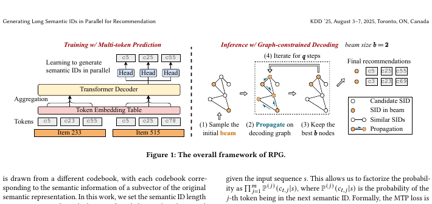
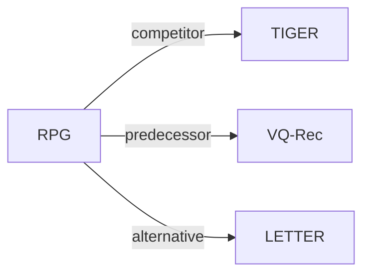

# RPG

*Generating long semantic ids in parallel for recommendation* — Hou et al. · KDD’25

`V. 效率` · `Backbone` · [论文](https://arxiv.org/abs/2506.05781) · [代码](https://github.com/facebookresearch/RPG_KDD2025) · [矩阵](../../../README.zh.md#v--backbone) · [English](../../papers/rpg.md)

阅读级别：概览（第 1 级） · 本页目录：[TL;DR](#tldr) · [速览](#速览) · [2. 方法](#2-方法) · [3. 实验发现](#3-实验发现) · [5. 相关工作](#5-相关工作)

- `Non-AR`: Non-autoregressive.
- `Fixed`: SIDs are built first and not changed while the generator trains.
- `MTP`: Predicts several codes in parallel at once.

### TL;DR

> [!NOTE]
> RPG 用多 token 预测损失并行预测长且无序的 OPQ SID，并在合法 ID 图上解码，替代短 ID 上的自回归束搜索。

### 速览

| 维度 | 摘要 |
| :-- | :-- |
| 研究问题 | V. 效率：Can it be trained and served within latency and cost budgets? |
| 核心贡献 | RPG 用多 token 预测损失并行预测长且无序的 OPQ SID，并在合法 ID 图上解码，替代短 ID 上的自回归束搜索。 |
| 主要改动阶段 | Backbone |

### 2. 方法

### 3. 实验发现

实验设置

- **数据集**：Amazon Reviews: Sports and Outdoors, Beauty, Toys and Games, and CDs and Vinyl; filtering rules: not reported.
  - 出处：The four Amazon categories and chronological protocol are stated, but 5-core or other filtering rules are not stated in the body or appendix; [S3.SS1.p1](https://arxiv.org/html/2506.05781v1#S3.SS1.p1) and [S3.SS1.p2](https://arxiv.org/html/2506.05781v1#S3.SS1.p2), dataset counts in [S2.T1](https://arxiv.org/html/2506.05781v1#S2.T1).
- **切分**：Per-user chronological leave-last-out: last item for test, second-last for validation, earlier items for training.
  - 出处：The last interaction is test, the second-last validation, and the remaining earlier interactions form the training history; [S3.SS1.p2](https://arxiv.org/html/2506.05781v1#S3.SS1.p2).
- **候选集**：Evaluation candidate protocol: not reported (full catalog versus sampled-negative ranking). Inference searches a graph of valid catalog items and scores only visited nodes; per-user exclusion rules are not reported.
  - 出处：The evaluation description does not specify full-catalog versus sampled-negative ranking; [S3.SS1.p2](https://arxiv.org/html/2506.05781v1#S3.SS1.p2). The separate inference description builds a graph over valid catalog items and starts with b random valid nodes; this does not by itself establish the evaluation candidate protocol; [S2.SS3.SSS1.p1](https://arxiv.org/html/2506.05781v1#S2.SS3.SSS1.p1) and [S2.SS3.SSS2.p2](https://arxiv.org/html/2506.05781v1#S2.SS3.SSS2.p2).
- **可见性**：Tokenizer exposure of test-only items: not reported. The long-tail analysis groups items by training frequency [0,5], [6,10], [11,15], and [16,20]; it does not isolate strictly unseen items from low-frequency items.
  - 出处：Figure 5 combines zero-frequency and low-frequency targets, so it cannot establish separate strictly unseen-item performance; tokenizer exposure of those targets is not specified; [S3.SS5.SSS3.p1](https://arxiv.org/html/2506.05781v1#S3.SS5.SSS3.p1).
- **SID 规格**：Parallel OPQ subspaces, with best lengths Sports 16, Beauty 32, Toys 16, and CDs 64; per-subspace codebook size: not reported as an experimental setting. Colliding items retain separate graph nodes; no guaranteed collision-free identifier is claimed.
  - 出处：Best SID lengths are in Table 6; the 256-entry codebook in the introduction is an example, not an explicit main-experiment setting; item-based graph nodes permit collisions; [A2.T6](https://arxiv.org/html/2506.05781v1#A2.T6), [S1](https://arxiv.org/html/2506.05781v1#S1), and [A3.p2](https://arxiv.org/html/2506.05781v1#A3.p2).
- **推理预算**：Initial random seeds and retained beam b=10; best (neighbors k, iterations q): Sports (100,2), Beauty (100,3), Toys (50,5), CDs (500,3). One NVIDIA RTX 3090 24GB; inference batch size: not reported (training batch size is 256). Sports-only fixed-configuration scaling experiment reports approximately 15x faster inference and 25x lower runtime memory than TIGER; these are not total-storage reductions or per-request latency claims.
  - 出处：Table 6 supplies b/k/q; Appendix B supplies hardware and separates checkpoint selection from graph-budget tuning; the batch size 256 in Section 3.1 is a training setting, not an inference setting; [A2.T6](https://arxiv.org/html/2506.05781v1#A2.T6), [A2.p1](https://arxiv.org/html/2506.05781v1#A2.p1), [S3.SS1.p6](https://arxiv.org/html/2506.05781v1#S3.SS1.p6). Speed/memory scope: [S3.SS3.p1](https://arxiv.org/html/2506.05781v1#S3.SS3.p1) and [S3.SS3.p2](https://arxiv.org/html/2506.05781v1#S3.SS3.p2).
- **结果来源**：arXiv:2506.05781v1: Table 2 (main ranking results), Table 3 (ablations), Table 4 (semantic-encoder-controlled comparison), Figure 3 (Sports efficiency), Figure 5 (training-frequency analysis), and Tables 6 and 8 (best inference budgets and memory scope).
  - 出处：Overall ranking metrics, graph/architecture ablations, encoder-matched comparisons, and the bounded efficiency study are separate result locations; [S2.T2](https://arxiv.org/html/2506.05781v1#S2.T2), [S3.T3](https://arxiv.org/html/2506.05781v1#S3.T3), [S3.T4](https://arxiv.org/html/2506.05781v1#S3.T4), and [S3.F3](https://arxiv.org/html/2506.05781v1#S3.F3).

### 5. 相关工作

- **同期对比** · [TIGER](tiger.md): RPG compares its parallel OPQ-token prediction and graph-constrained decoding with TIGER's autoregressive RQ-VAE-token generation.
  - 出处：RPG v1, Section 2.1.1 describes OPQ: https://arxiv.org/html/2506.05781v1#S2.SS1.SSS1.p1; Section 2.4.2 explicitly contrasts TIGER: https://arxiv.org/html/2506.05781v1#S2.SS4.SSS2.p1; Section 3.1 names the TIGER baseline and Table 2 compares results: https://arxiv.org/html/2506.05781v1#S3.SS1.p4 and https://arxiv.org/html/2506.05781v1#S2.T2.
- **前序工作** · [VQ-Rec](vq-rec.md): RPG follows VQ-Rec in using optimized product quantization, then predicts individual codes and searches an item graph instead of using VQ-Rec's retrieval model.
  - 出处：RPG v1, Section 2.1.1 explicitly follows Hou et al. (2023) for OPQ: https://arxiv.org/html/2506.05781v1#S2.SS1.SSS1.p1; Section 2.4.1 identifies the compared model as VQ-Rec: https://arxiv.org/html/2506.05781v1#S2.SS4.SSS1.p1; Table 2 includes VQ-Rec: https://arxiv.org/html/2506.05781v1#S2.T2.
- **替代方案** · [LETTER](letter.md): LETTER regularizes a hierarchical RQ-VAE tokenizer for collaborative alignment and code diversity, whereas RPG uses long OPQ codes with parallel prediction to improve inference efficiency.
  - 出处：Manually compared mechanisms, not a head-to-head evaluation: RPG v1, Section 4 cites LETTER (Wang et al., 2024a) among quantization methods: https://arxiv.org/html/2506.05781v1#S4.p2; Section 2.1.1 gives RPG's OPQ rationale: https://arxiv.org/html/2506.05781v1#S2.SS1.SSS1.p1; LETTER v1, Section 3.1 defines its regularized hierarchical RQ-VAE tokenizer: https://arxiv.org/html/2405.07314v1#S3.SS1.p1 and https://arxiv.org/html/2405.07314v1#S3.SS1.p2.

[查看同格全部论文](../../../README.zh.md#v--backbone)
