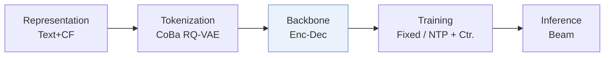
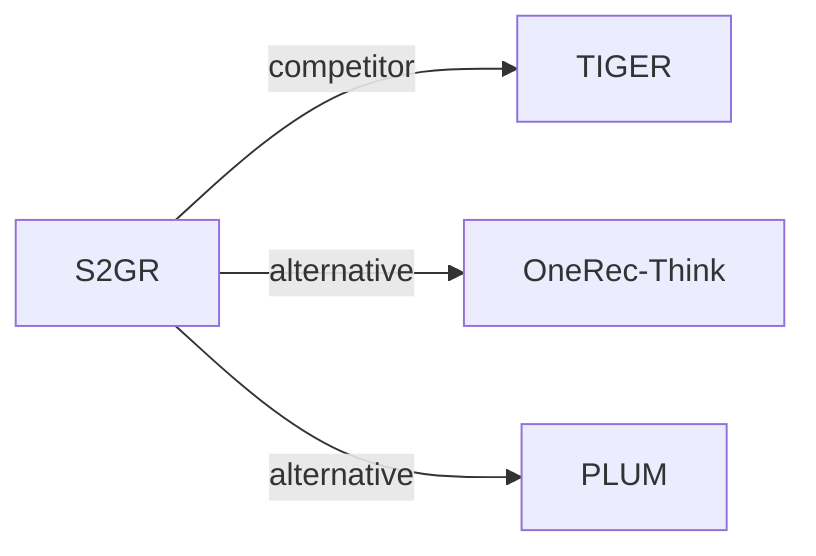

# S2GR

*Stepwise Semantic-Guided Reasoning in Latent Space for Generative Recommendation* — Guo et al. · KDD’26

`III. SID 与模型对齐` · `Backbone` · [论文](https://arxiv.org/abs/2601.18664) · [矩阵](../../../README.zh.md#iii--backbone) · [English](../../papers/s2gr.md)

阅读级别：阅读笔记（第 2 级） · 本页目录：[TL;DR](#tldr) · [速览](#速览) · [1. 为什么重要](#1-为什么重要) · [2. 方法](#2-方法) · [3. 实验发现](#3-实验发现) · [4. 局限与分析](#4-局限与分析) · [5. 相关工作](#5-相关工作)

- `CoBa RQ-VAE`: Collaborative and Balanced RQ-VAE.
- `Enc-Dec`: Encoder-decoder.
- `Fixed`: SIDs are built first and not changed while the generator trains.
- `NTP + Ctr.`: NTP plus a contrastive loss.

### TL;DR

> [!NOTE]
> S2GR 在每个 SID 解码步前插入受码本簇分布对比监督的思考 token，并用共现、负载均衡与均匀性目标构建码本。

### 速览

| 维度 | 摘要 |
| :-- | :-- |
| 研究问题 | III. SID 与模型对齐：Can the generator read, write, and reason over SIDs, and do the tokenizer and generator work toward the same goal? |
| 核心贡献 | S2GR 在每个 SID 解码步前插入受码本簇分布对比监督的思考 token，并用共现、负载均衡与均匀性目标构建码本。 |
| 主要改动阶段 | Backbone |
| 局限 | 在工业数据集上用同等规模的模型，训练约需 59 h，TIGER 约 45 h；推理总时长从约 0.88 h 增至约 0.90 h（Appendix B.1，Table B.1）。 |

### 1. 为什么重要

多数生成式推荐器直接从交互序列生成语义 ID（Semantic ID，SID），中间没有推理（Abstract）。作者指出推理增强变体的两个问题：推理全部放在生成之前，计算量在 SID 各层之间分配不均；潜在推理向量没有可解释的语义，也无法验证监督。S2GR 让思考 token 和 SID 码交替生成，每个码前一个思考 token，并用下一个码的语义监督它（Sec. 1）。

### 2. 方法

#### 与行为对齐的码本

S2GR 从历史序列构建物品共现图，在图上传播物品嵌入（Sec. 4.2.1）。

> "This encodes essential collaborative patterns without requiring additional model training."（Sec. 4.2.1）（不需额外训练模型就能编码基本的协同模式。）

码本均衡的 RQ-VAE 给量化器加了均匀性约束和自适应负载均衡（Sec. 4.2.2）。

#### 逐步潜在思考

生成器在每个 SID 码之前输出一个思考 token，它是连续的潜在嵌入，不是自然语言文本（Sec. 4.3.2）。对比损失让它对齐对应码本中下一个真实码的 k-means 簇中心。生成器的目标是推荐损失加上这个思考损失（Eqs. 22–24）。编号器单独优化（Sec. 4.2）。

#### 解码

每条束在一个连续步骤里生成思考 token 和其后的 SID 码，思考 token 不会让束变多（Appendix B.1）。

> "For inference, the increase in latency is relatively small."（Appendix B.1）（推理延迟增加较小。）

### 3. 实验发现

实验设置

- **数据集**：Amazon Beauty (May 1996-September 2014; 22,363 users / 12,101 items / 198,502 interactions) and an industrial short-video dataset of long-play records from sampled active users over 2 consecutive days (37,500 users / 1,086,872 items / 3,778,562 interactions). Dataset filtering rules: not reported; a table footnote states that user sequences shorter than 10 are filtered out during testing.
  - 出处：Datasets and statistics: [S5.SS1.SSS1.p1](https://arxiv.org/html/2601.18664v3#S5.SS1.SSS1.p1) and [S5.T1](https://arxiv.org/html/2601.18664v3#S5.T1); test-time length filter: footnote 1 of [S5.T2](https://arxiv.org/html/2601.18664v3#S5.T2).
- **切分**：not reported (the train/validation/test rule is not described). The co-occurrence graph for codebook optimization uses history sequences that precede those used for training and evaluation. Online: 7-day A/B test with 5.25% of users per group, TIGER as control.
  - 出处：No split rule stated; leakage control for co-occurrence: [S5.SS1.SSS3.p1](https://arxiv.org/html/2601.18664v3#S5.SS1.SSS3.p1); online test: [S5.SS4.p1](https://arxiv.org/html/2601.18664v3#S5.SS4.p1).
- **候选集**：not reported (full catalog versus sampled evaluation candidates); HR and NDCG at 5 and 10 (Beauty) and at 10 and 100 (industrial).
  - 出处：Metrics only: [S5.SS1.SSS1.p1](https://arxiv.org/html/2601.18664v3#S5.SS1.SSS1.p1).
- **可见性**：warm; no unseen-item protocol is defined.
  - 出处：No unseen-item protocol: [S5.SS1.SSS1.p1](https://arxiv.org/html/2601.18664v3#S5.SS1.SSS1.p1).
- **SID 规格**：3 levels x 256 codes from a codebook-balanced RQ-VAE (CoBa RQ-VAE) over Qwen3-Embedding-4B embeddings smoothed by multi-hop co-occurrence propagation; collision handling: not reported (independent coding rate 99.30% on Beauty, 76.25% industrial).
  - 出处：3 levels x 256, behavior-aligned embeddings and balanced RQ-VAE: [S5.SS1.SSS3.p1](https://arxiv.org/html/2601.18664v3#S5.SS1.SSS3.p1), [S4.SS2.SSS1.p3](https://arxiv.org/html/2601.18664v3#S4.SS2.SSS1.p3), [S4.SS2.SSS2.p1](https://arxiv.org/html/2601.18664v3#S4.SS2.SSS2.p1); utilization and ICR: [S5.T3](https://arxiv.org/html/2601.18664v3#S5.T3).
- **推理预算**：Thinking tokens are generated before each SID level; T5 with 4 encoder and 4 decoder layers (same as the TIGER baseline). Beam width, hardware, inference batch size, and latency: not reported.
  - 出处：T5 4+4 layers matching TIGER: [S5.SS1.SSS3.p1](https://arxiv.org/html/2601.18664v3#S5.SS1.SSS3.p1); decoding settings not found.
- **结果来源**：Table 2 (Beauty and industrial versus sequential, reasoning, and TIGER baselines); Table 3 (tokenizer CUR and ICR); Table 4 and Section 5.4 (7-day online A/B against TIGER).
  - 出处：Main: [S5.T2](https://arxiv.org/html/2601.18664v3#S5.T2); tokenizers: [S5.T3](https://arxiv.org/html/2601.18664v3#S5.T3); online: [S5.SS4.p1](https://arxiv.org/html/2601.18664v3#S5.SS4.p1).

- 消融：去掉逐步推理 token 或思考损失，Beauty 和工业数据集上的效果都下降（Sec. 5.3，Table 2）。
- 在线 A/B 测试：作者报告，在一个大规模短视频平台上以 TIGER 为对照的测试证实了 S2GR 有效（Abstract，Sec. 5.4，Table 4）。

### 4. 局限与分析

**Our analysis.**

- TIGER 用只基于文本的 `RQ-VAE` 码（`Text`）和普通 `NTP`；S2GR 在编号器里加入协同信号（`Text+CF`，`CoBa RQ-VAE`），在生成器上加对比项（`NTP + Ctr.`）。
- OneRec-Think 用 `Dec-Only` LLM 以文本推理（`CoT`）；S2GR 保留 `Enc-Dec` 生成器和 `Beam` 解码，用潜在 token 推理。

### 5. 相关工作

- **同期对比** · [TIGER](tiger.md): TIGER predicts SID codes directly; S2GR inserts thinking tokens aligned with coarse code semantics before each SID level and balances the codebook with behavior-aligned embeddings.
  - 出处：S2GR v3, baselines: https://arxiv.org/html/2601.18664v3#S5.I1.i6.p1; Table 2: https://arxiv.org/html/2601.18664v3#S5.T2; online control group: https://arxiv.org/html/2601.18664v3#S5.SS4.p1.
- **替代方案** · [OneRec-Think](onerec-think.md): OneRec-Think reasons explicitly in text with an LLM; S2GR reasons implicitly through latent thinking tokens inside a small seq2seq model to meet latency limits.
  - 出处：S2GR v3, Section 2.2 places OneRec-Think in the explicit-reasoning line: https://arxiv.org/html/2601.18664v3#S2.SS2.p2.
- **替代方案** · [PLUM](plum.md): PLUM feeds ID tokens to a pretrained LLM for explicit reasoning, whereas S2GR adds lightweight implicit reasoning steps.
  - 出处：S2GR v3, Section 2.2: https://arxiv.org/html/2601.18664v3#S2.SS2.p2.

[查看同格全部论文](../../../README.zh.md#iii--backbone)
