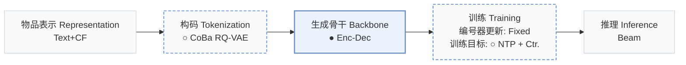
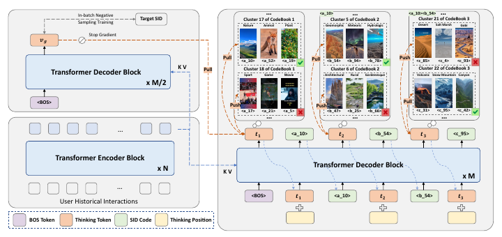
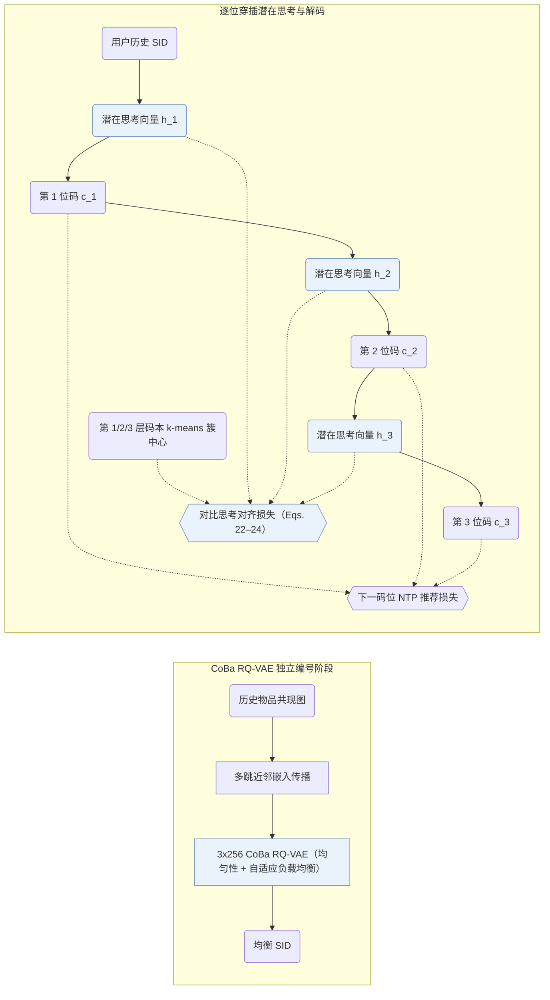
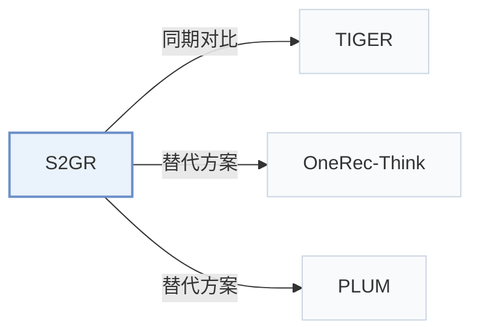

# S2GR

[← 问题 × 阶段矩阵](../../../README.zh.md#iii--backbone) · [按阶段索引](../index/stages.md) · [按模态找论文](../index/modality.md) · [按领域找论文](../index/domain.md) · [English](../../papers/s2gr.md) | 中文

| **题目** | *Stepwise Semantic-Guided Reasoning in Latent Space for Generative Recommendation* |
| :-- | :-- |
| **作者** | Guo et al. |
| **发表** | KDD’26 |
| **问题与阶段** | `III. SID 与模型对齐` · `生成骨干（Backbone）` |
| **改动** | ○ 构码 · ● 生成骨干 · ○ 训练目标 |
| **构码输入** | `Text` + `CF` |
| **领域** | `电商` · `短视频与直播` |
| **应用场景** | `一般物品推荐`；`线上实验或部署` |
| **链接** | [论文](https://arxiv.org/abs/2601.18664) |
| **阅读级别** | 阅读笔记（第 2 级） |

**本页目录**：[TL;DR](#tldr) · [速览](#速览) · [1. 为什么重要](#1-为什么重要) · [2. 方法](#2-方法) · [3. 实验发现](#3-实验发现) · [4. 局限与分析](#4-局限与分析) · [5. 相关工作](#5-相关工作)

- `Text+CF`：文本表征结合协同过滤信号。
- `CoBa RQ-VAE`：兼顾协同对齐与码本均衡的 RQ-VAE。
- `Enc-Dec`：编码器-解码器（Encoder-decoder）架构。
- `Fixed`：先独立训练并冻结编号器，生成器训练期间 SID 保持不变。
- `NTP + Ctr.`：下一 token 预测结合对比学习损失。
- `Beam`：在 SID token 上执行自回归束搜索（Beam search）。

### TL;DR

> [!NOTE]
> S2GR 在每个 SID 解码步前插入受码本簇分布对比监督的思考 token，并用共现、负载均衡与均匀性目标构建码本。

---

### 速览

| 维度 | 摘要 |
| :-- | :-- |
| 主要发现 | S2GR 在 Beauty 与工业短视频数据集上分别取得 99.30% 与 76.25% 的独立编码率，离线超越序列、推理与 TIGER 基线，并在短视频平台线上 A/B 测试中优于对照模型 TIGER（Abstract，Sec. 5.3，Sec. 5.4，Tables 2–4）。 |
| 局限 | 在工业数据集同等模型规模下，穿插潜在思考使训练耗时从 TIGER 的约 45 h 增至约 59 h，推理总耗时从约 0.88 h 微增至约 0.90 h（Appendix B.1，Table B.1）。 |

---

### 1. 为什么重要

常规生成式推荐器直接从交互序列输出语义 ID（Semantic ID，SID），而前置自然语言推理把全部算力堆在首位码之前，纯隐向量推理又缺乏可核验的语义监督（Abstract，Sec. 1）。S2GR 在每一位 SID 码之前穿插一个连续潜在思考向量，并用下一位真实码对应的 k-means 簇中心直接监督该思考步。

---

### 2. 方法

#### 与行为对齐的码本

S2GR 从训练期之前的历史序列构建物品共现图，在量化前沿图传播平滑物品文本嵌入（Sec. 4.2.1）。

> "This encodes essential collaborative patterns without requiring additional model training."（Sec. 4.2.1）

码本均衡 RQ-VAE（`CoBa RQ-VAE`）在此基础上加入分布均匀性约束与自适应负载均衡，先于生成器独立完成优化（Sec. 4.2，Sec. 4.2.2）。

#### 逐步潜在思考

编码器-解码器生成器在预测每一位离散 SID 码之前先输出一个连续潜在思考向量，不转换成自然语言词串（Sec. 4.3.2）。对比思考损失将该思考向量拉向对应层码本中真实下一码所在的 k-means 簇中心，与离散码位的推荐交叉熵损失联合训练（Eqs. 22–24）。

#### 解码

束搜索时，每条候选束在单步内确定性地前向产出连续思考向量并紧接着展开下一位 SID 码，思考向量本身不占用额外束宽（Appendix B.1）。

> "For inference, the increase in latency is relatively small."（Appendix B.1）

---

### 3. 实验发现

实验设置

- **数据集**：Amazon Beauty (May 1996-September 2014; 22,363 users / 12,101 items / 198,502 interactions) and an industrial short-video dataset of long-play records from sampled active users over 2 consecutive days (37,500 users / 1,086,872 items / 3,778,562 interactions). Dataset filtering rules: not reported; a table footnote states that user sequences shorter than 10 are filtered out during testing.
  - 出处：Datasets and statistics: [S5.SS1.SSS1.p1](https://arxiv.org/html/2601.18664v3#S5.SS1.SSS1.p1) and [S5.T1](https://arxiv.org/html/2601.18664v3#S5.T1); test-time length filter: footnote 1 of [S5.T2](https://arxiv.org/html/2601.18664v3#S5.T2).
- **切分**：not reported (the train/validation/test rule is not described). The co-occurrence graph for codebook optimization uses history sequences that precede those used for training and evaluation. Online: 7-day A/B test with 5.25% of users per group, TIGER as control.
  - 出处：No split rule stated; leakage control for co-occurrence: [S5.SS1.SSS3.p1](https://arxiv.org/html/2601.18664v3#S5.SS1.SSS3.p1); online test: [S5.SS4.p1](https://arxiv.org/html/2601.18664v3#S5.SS4.p1).
- **候选集**：not reported (full catalog versus sampled evaluation candidates); HR and NDCG at 5 and 10 (Beauty) and at 10 and 100 (industrial).
  - 出处：Metrics only: [S5.SS1.SSS1.p1](https://arxiv.org/html/2601.18664v3#S5.SS1.SSS1.p1).
- **可见性**：warm; no unseen-item protocol is defined.
  - 出处：No unseen-item protocol: [S5.SS1.SSS1.p1](https://arxiv.org/html/2601.18664v3#S5.SS1.SSS1.p1).
- **SID 规格**：3 levels x 256 codes from a codebook-balanced RQ-VAE (CoBa RQ-VAE) over Qwen3-Embedding-4B embeddings smoothed by multi-hop co-occurrence propagation; collision handling: not reported (independent coding rate 99.30% on Beauty, 76.25% industrial).
  - 出处：3 levels x 256, behavior-aligned embeddings and balanced RQ-VAE: [S5.SS1.SSS3.p1](https://arxiv.org/html/2601.18664v3#S5.SS1.SSS3.p1), [S4.SS2.SSS1.p3](https://arxiv.org/html/2601.18664v3#S4.SS2.SSS1.p3), [S4.SS2.SSS2.p1](https://arxiv.org/html/2601.18664v3#S4.SS2.SSS2.p1); utilization and ICR: [S5.T3](https://arxiv.org/html/2601.18664v3#S5.T3).
- **推理预算**：Thinking tokens are generated before each SID level; T5 with 4 encoder and 4 decoder layers (same as the TIGER baseline). Beam width, hardware, inference batch size, and latency: not reported.
  - 出处：T5 4+4 layers matching TIGER: [S5.SS1.SSS3.p1](https://arxiv.org/html/2601.18664v3#S5.SS1.SSS3.p1); decoding settings not found.
- **结果来源**：Table 2 (Beauty and industrial versus sequential, reasoning, and TIGER baselines); Table 3 (tokenizer CUR and ICR); Table 4 and Section 5.4 (7-day online A/B against TIGER).
  - 出处：Main: [S5.T2](https://arxiv.org/html/2601.18664v3#S5.T2); tokenizers: [S5.T3](https://arxiv.org/html/2601.18664v3#S5.T3); online: [S5.SS4.p1](https://arxiv.org/html/2601.18664v3#S5.SS4.p1).

- 模块消融：去掉穿插潜在思考向量或去掉簇中心对比思考损失，在 Amazon Beauty 与工业短视频数据集上均导致排序指标明显回落（Sec. 5.3，Table 2）。
- 在线 A/B 测试：在大规模短视频平台开展的 7 天线上 A/B 测试中，以同规模 TIGER 为对照基线，S2GR 取得稳定正向在线收益（Abstract，Sec. 5.4，Table 4）。

---

### 4. 局限与分析

**Our analysis.**

- TIGER 仅用纯文本训练 `RQ-VAE`（`Text`）并做单任务 `NTP`；S2GR 在编号前融入图传播协同信号（`Text+CF`，`CoBa RQ-VAE`），并在生成端联合优化思考对比项（`NTP + Ctr.`）。
- OneRec-Think 在 `Dec-Only` LLM 上自回归生成显式文本思维链（`CoT`）；S2GR 沿用紧凑的 `Enc-Dec` 架构与常规 `Beam` 搜索，以每层单步连续隐向量完成逐级推理。

---

### 5. 相关工作

- **同期对比** · [TIGER](tiger.md): TIGER predicts SID codes directly; S2GR inserts thinking tokens aligned with coarse code semantics before each SID level and balances the codebook with behavior-aligned embeddings.
  - 出处：S2GR v3, baselines: [S5.I1.i6.p1](https://arxiv.org/html/2601.18664v3#S5.I1.i6.p1); Table 2: [S5.T2](https://arxiv.org/html/2601.18664v3#S5.T2); online control group: [S5.SS4.p1](https://arxiv.org/html/2601.18664v3#S5.SS4.p1).
- **替代方案** · [OneRec-Think](onerec-think.md): OneRec-Think reasons explicitly in text with an LLM; S2GR reasons implicitly through latent thinking tokens inside a small seq2seq model to meet latency limits.
  - 出处：S2GR v3, Section 2.2 places OneRec-Think in the explicit-reasoning line: [S2.SS2.p2](https://arxiv.org/html/2601.18664v3#S2.SS2.p2).
- **替代方案** · [PLUM](plum.md): PLUM feeds ID tokens to a pretrained LLM for explicit reasoning, whereas S2GR adds lightweight implicit reasoning steps.
  - 出处：S2GR v3, Section 2.2: [S2.SS2.p2](https://arxiv.org/html/2601.18664v3#S2.SS2.p2).

[查看同格全部论文](../../../README.zh.md#iii--backbone)
