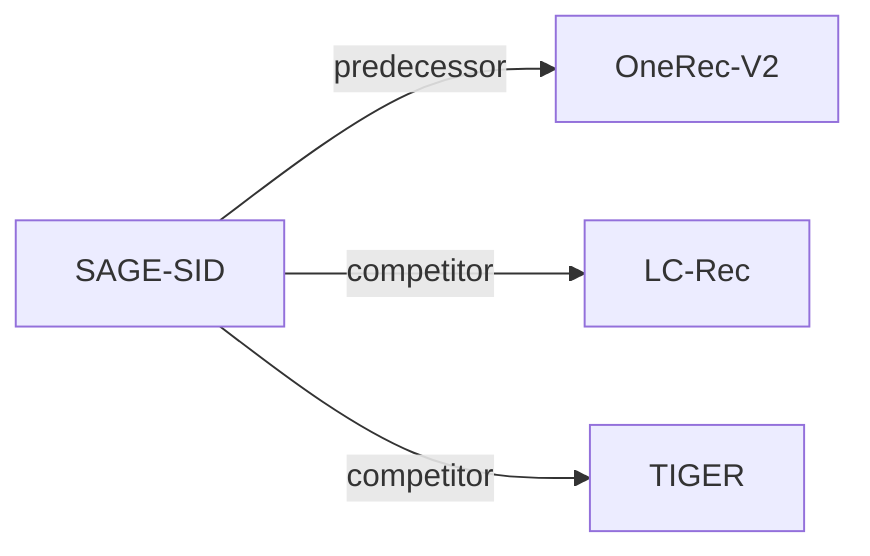

# SAGE-SID

| **题目** | *SAGE: Sequence-level Adaptive Gradient Evolution for Generative Recommendation* |
| :-- | :-- |
| **作者** | Xie et al. |
| **会议** | arXiv’26 |
| **问题与阶段** | `IV. 实用目标` · `Training` |
| **链接** | [论文](https://arxiv.org/abs/2601.21452) · [矩阵](../../../README.zh.md#iv--training) · [English](../../papers/sage-sid.md) |
| **阅读级别** | 概览（第 1 级） |

本页目录：[TL;DR](#tldr) · [速览](#速览) · [3. 实验发现](#3-实验发现) · [5. 相关工作](#5-相关工作)

- `NTP → RL`: NTP, then reinforcement learning (GRPO, GBPO, etc.).
- `–`: Not reported in the paper.

### TL;DR

> [!NOTE]
> SAGE-SID 用几何平均序列比率、解耦的多目标优势、非对称自适应裁剪界与熵感知惩罚优化列表级生成器，替代 GBPO 的对称裁剪界。

---

### 速览

| 维度 | 摘要 |
| :-- | :-- |
| 研究问题 | IV. 实用目标：Are training and search aimed at what users and the platform value, rather than at token likelihood? |
| 核心贡献 | SAGE-SID 用几何平均序列比率、解耦的多目标优势、非对称自适应裁剪界与熵感知惩罚优化列表级生成器，替代 GBPO 的对称裁剪界。 |
| 主要改动阶段 | Training |

---

### 3. 实验发现

实验设置

- **数据集**：Amazon Reviews 2014 Sports/Beauty/Toys; RecIF-Bench: about 120M interactions, 200K users, Short Video/Ad/Product. Filtering not reported.
  - 出处：Section 4.1.1: [S4.SS1.SSS1.p1](https://arxiv.org/html/2601.21452v3#S4.SS1.SSS1.p1) and [S4.SS1.SSS1.p2](https://arxiv.org/html/2601.21452v3#S4.SS1.SSS1.p2)
- **切分**：RecIF: 20% users held out, per-user histories separated temporally from future targets. Amazon split and validation allocation not reported.
  - 出处：Section 4.1.1: [S4.SS1.SSS1.p3](https://arxiv.org/html/2601.21452v3#S4.SS1.SSS1.p3)
- **候选集**：not reported for the SID branch
  - 出处：Section 4.1.4 identifies inherited SID evaluation settings but does not specify candidate enumeration: [S4.SS1.SSS4.p3](https://arxiv.org/html/2601.21452v3#S4.SS1.SSS4.p3)
- **可见性**：warm; no unseen-item protocol is defined. Amazon cold items are bottom 5% by training interaction frequency; RecIF holds out users, not explicitly items.
  - 出处：Sections 4.1.1/4.1.3: [S4.SS1.SSS1.p3](https://arxiv.org/html/2601.21452v3#S4.SS1.SSS1.p3) and [S4.SS1.SSS3.p1](https://arxiv.org/html/2601.21452v3#S4.SS1.SSS3.p1)
- **SID 规格**：OneRec-SAGE uses Semantic IDs and OpenOneRec checkpoints/settings; SID length, codebook sizes and collision handling not reported here.
  - 出处：Sections 4.1.2/4.1.4: [S4.SS1.SSS2.p4](https://arxiv.org/html/2601.21452v3#S4.SS1.SSS2.p4) and [S4.SS1.SSS4.p3](https://arxiv.org/html/2601.21452v3#S4.SS1.SSS4.p3)
- **推理预算**：Reported slate length 10; Amazon Recall/NDCG@5/10; RecIF Pass/Recall@1/32 and label AUC. SID beam width, inference hardware, batch size and latency not reported.
  - 出处：Sections 4.1.3/4.1.4: [S4.SS1.SSS3.p1](https://arxiv.org/html/2601.21452v3#S4.SS1.SSS3.p1) and [S4.SS1.SSS3.p2](https://arxiv.org/html/2601.21452v3#S4.SS1.SSS3.p2) and [S4.SS1.SSS4.p1](https://arxiv.org/html/2601.21452v3#S4.SS1.SSS4.p1) and [S4.SS1.SSS4.p3](https://arxiv.org/html/2601.21452v3#S4.SS1.SSS4.p3)
- **结果来源**：OneRec-SAGE rows in Tables 1/2 (Amazon) and 3/4 (RecIF). RecIF task-specific sequential and TIGER baseline numbers are reused from the benchmark; OneRec variants use public checkpoints/settings.
  - 出处：Tables 1-4 and Section 4.1.4: [S3.T1](https://arxiv.org/html/2601.21452v3#S3.T1) and [S3.T2](https://arxiv.org/html/2601.21452v3#S3.T2) and [S3.T3](https://arxiv.org/html/2601.21452v3#S3.T3) and [S4.T4](https://arxiv.org/html/2601.21452v3#S4.T4) and [S4.SS1.SSS4.p3](https://arxiv.org/html/2601.21452v3#S4.SS1.SSS4.p3)

---

### 5. 相关工作

- **前序工作** · [OneRec-V2](onerec-v2.md): SAGE extends the GBPO optimizer evaluated as OneRec-GBPO.
  - 出处：SAGE v3, Sections 3.4.1/4.1.2: https://arxiv.org/html/2601.21452v3#S3.SS4.SSS1.p1; https://arxiv.org/html/2601.21452v3#S4.SS1.SSS2.p4.
- **同期对比** · [LC-Rec](lc-rec.md): Adapted to a Qwen3-8B backbone for the RecIF comparison.
  - 出处：SAGE v3, Section 4.1.2: https://arxiv.org/html/2601.21452v3#S4.SS1.SSS2.p3.
- **同期对比** · [TIGER](tiger.md): RecIF comparison reuses TIGER's reported benchmark numbers.
  - 出处：SAGE v3, Section 4.1.4: https://arxiv.org/html/2601.21452v3#S4.SS1.SSS4.p3.

[查看同格全部论文](../../../README.zh.md#iv--training)
