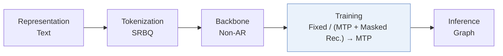
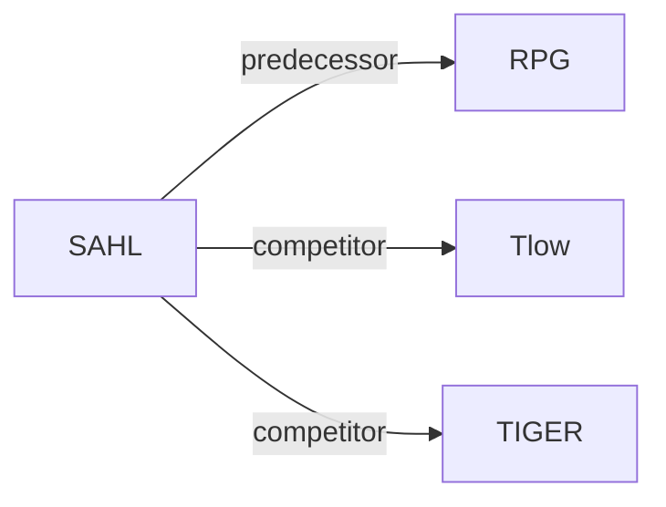

# SAHL

| **题目** | *Structure-Aligned History Learning with Subspace-Structured Semantic IDs for Generative Recommendation* |
| :-- | :-- |
| **作者** | Wei et al. |
| **会议** | arXiv’26 |
| **问题与阶段** | `IV. 实用目标` · `Training` |
| **链接** | [论文](https://arxiv.org/abs/2610.25093) · [代码](https://github.com/CQU-MM-Intelligent-Lab/SAHL) · [矩阵](../../../README.zh.md#iv--training) · [English](../../papers/sahl.md) |
| **阅读级别** | 概览（第 1 级） |

本页目录：[TL;DR](#tldr) · [速览](#速览) · [3. 实验发现](#3-实验发现) · [5. 相关工作](#5-相关工作)

- `SRBQ`: Semantic Residual Balanced Quantization
- `Non-AR`: Non-autoregressive.
- `Fixed`: SIDs are built first and not changed while the generator trains.
- `(MTP + Masked Rec.) → MTP`: Joint multi-token prediction and masked reconstruction, followed by multi-token prediction alone.

### TL;DR

> [!NOTE]
> SAHL 用 SRBQ 将物品量化为均衡的“token-子空间-物品”层级结构，按课程学习从多粒度历史重构过渡到下一物品预测，替代单纯下一物品预测。

---

### 速览

| 维度 | 摘要 |
| :-- | :-- |
| 研究问题 | IV. 实用目标：Are training and search aimed at what users and the platform value, rather than at token likelihood? |
| 核心贡献 | SAHL 用 SRBQ 将物品量化为均衡的“token-子空间-物品”层级结构，按课程学习从多粒度历史重构过渡到下一物品预测，替代单纯下一物品预测。 |
| 主要改动阶段 | Training |

---

### 3. 实验发现

实验设置

- **数据集**：Amazon Reviews 2014 Beauty, Toys and Games, Sports and Outdoors, CDs and Vinyl, in this order; user/item 5-core.
  - 出处：Section 5.1: [S5.SS1.p1](https://arxiv.org/html/2610.25093v1#S5.SS1.p1)
- **切分**：Per-user chronological leave-one-out: last interaction test, penultimate validation, earlier interactions train.
  - 出处：Section 5.2: [S5.SS2.p1](https://arxiv.org/html/2610.25093v1#S5.SS2.p1)
- **候选集**：not reported
  - 出处：Sections 5.2/5.4 specify graph-constrained decoding but not full-catalog versus sampled-negative evaluation: [S5.SS2](https://arxiv.org/html/2610.25093v1#S5.SS2) and [S5.SS4.p2](https://arxiv.org/html/2610.25093v1#S5.SS4.p2)
- **可见性**：warm; no unseen-item protocol is defined. Low-frequency analysis is explicitly near-cold, not zero-interaction.
  - 出处：Section 6.11.4: [S6.SS11.SSS4.p1](https://arxiv.org/html/2610.25093v1#S6.SS11.SSS4.p1)
- **SID 规格**：SRBQ: 4/8/8/16 subspaces x 4 residual levels x 256 codes, producing 16/32/32/64 tokens in dataset order. Colliding items remain separate, equal-scored candidates; fixed catalog indices break ties.
  - 出处：Sections 4.2.2/5.4: [S4.SS2.SSS2.p1](https://arxiv.org/html/2610.25093v1#S4.SS2.SSS2.p1) and [S5.SS4.p1](https://arxiv.org/html/2610.25093v1#S5.SS4.p1) and [S5.SS4.p2](https://arxiv.org/html/2610.25093v1#S5.SS4.p2)
- **推理预算**：Dataset order: beam 100/200/100/50, graph neighbors 100/100/200/500, propagation depths 3/5/2/4; temperature 0.03; Recall/NDCG@5/10. Inference hardware, batch size and latency not reported; A6000 timings concern training.
  - 出处：Section 5.4 and Section 6.11.2: [S5.SS4.p1](https://arxiv.org/html/2610.25093v1#S5.SS4.p1) and [S6.SS11.SSS2.p1](https://arxiv.org/html/2610.25093v1#S6.SS11.SSS2.p1) and [S6.SS11.SSS2.p3](https://arxiv.org/html/2610.25093v1#S6.SS11.SSS2.p3)
- **结果来源**：Table 2: overall comparison. RPG*, MHL and SAHL use matched controlled experiments; Tlow follows its published matched protocol. Other baseline score provenance not reported.
  - 出处：Sections 5.3/6.1 and Table 2: [S5.SS3.p2](https://arxiv.org/html/2610.25093v1#S5.SS3.p2) and [S6.SS1.p1](https://arxiv.org/html/2610.25093v1#S6.SS1.p1) and [S5.T2](https://arxiv.org/html/2610.25093v1#S5.T2)

---

### 5. 相关工作

- **前序工作** · [RPG](rpg.md): Supplies the parallel backbone and graph-constrained decoder retained by SAHL.
  - 出处：SAHL v1, Sections 5.3/6.11.2: https://arxiv.org/html/2610.25093v1#S5.SS3.p2; https://arxiv.org/html/2610.25093v1#S6.SS11.SSS2.p3.
- **同期对比** · [Tlow](tlow.md): Tokenizer-oriented comparator; its scores follow the published matched protocol.
  - 出处：SAHL v1, Section 5.3 and Table 2: https://arxiv.org/html/2610.25093v1#S5.SS3.p2; https://arxiv.org/html/2610.25093v1#S5.T2.
- **同期对比** · [TIGER](tiger.md): Included semantic-ID baseline; SAHL adds quantizer-aligned history reconstruction.
  - 出处：SAHL v1, Section 5.3 and Table 2: https://arxiv.org/html/2610.25093v1#S5.SS3.p1; https://arxiv.org/html/2610.25093v1#S5.T2.

[查看同格全部论文](../../../README.zh.md#iv--training)
