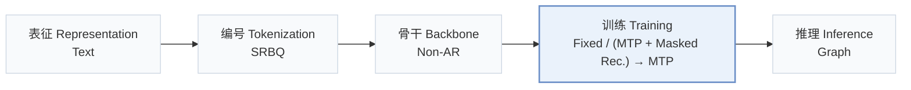
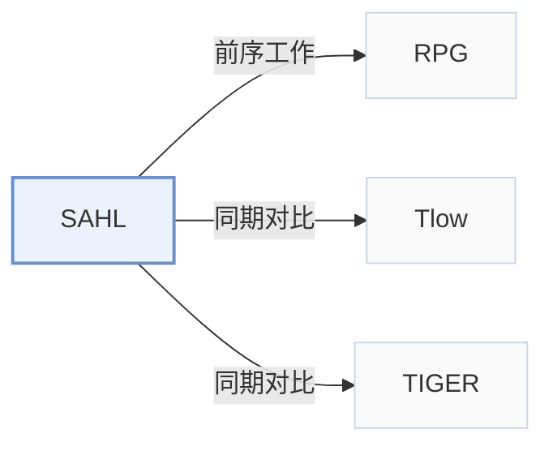

# SAHL

[← 问题 × 阶段矩阵](../../../README.zh.md#iv--training) · [按阶段索引](../index/stages.md) · [按模态索引](../index/modality.md) · [English](../../papers/sahl.md) | 中文

| **题目** | *Structure-Aligned History Learning with Subspace-Structured Semantic IDs for Generative Recommendation* |
| :-- | :-- |
| **作者** | Wei et al. |
| **发表** | arXiv’26 |
| **问题与阶段** | `IV. 实用目标` · `训练（Training）` |
| **链接** | [论文](https://arxiv.org/abs/2610.25093) · [代码](https://github.com/CQU-MM-Intelligent-Lab/SAHL) |
| **阅读级别** | 概览（第 1 级） |

**本页目录**：[TL;DR](#tldr) · [速览](#速览) · [3. 实验发现](#3-实验发现) · [5. 相关工作](#5-相关工作)

- `Text`：物品文本元数据（标题、描述、类目或提示词）。
- `SRBQ`：语义残差均衡量化（Semantic Residual Balanced Quantization）。
- `Non-AR`：非自回归（Non-autoregressive）并行预测架构。
- `Fixed`：先独立训练并冻结编号器，生成器训练期间 SID 保持不变。
- `(MTP + Masked Rec.) → MTP`：先联合训练多 token 预测与掩码重构，再单独微调多 token 预测。
- `Graph`：在合法物品 SID 近邻图上做迭代图搜索解码。

### TL;DR

> [!NOTE]
> SAHL 用 SRBQ 将物品量化为均衡的“token-子空间-物品”层级结构，按课程学习从多粒度历史重构过渡到下一物品预测，替代单纯下一物品预测。

---

### 速览

| 维度 | 摘要 |
| :-- | :-- |
| 研究问题 | IV. 实用目标：训练目标与解码搜索是否面向用户真实偏好与平台业务价值，而非单纯拟合下一 token 似然？ |
| 核心贡献 | SAHL 用 SRBQ 将物品量化为均衡的“token-子空间-物品”层级结构，按课程学习从多粒度历史重构过渡到下一物品预测，替代单纯下一物品预测。 |
| 主要改动阶段 | 训练（Training） |

---

### 3. 实验发现

实验设置

- **数据集**：Amazon Reviews 2014 Beauty, Toys and Games, Sports and Outdoors, CDs and Vinyl, in this order; user/item 5-core.
  - 出处：Section 5.1: [S5.SS1.p1](https://arxiv.org/html/2610.25093v1#S5.SS1.p1)
- **切分**：Per-user chronological leave-one-out: last interaction test, penultimate validation, earlier interactions train.
  - 出处：Section 5.2: [S5.SS2.p1](https://arxiv.org/html/2610.25093v1#S5.SS2.p1)
- **候选集**：not reported
  - 出处：Sections 5.2/5.4 specify graph-constrained decoding but not full-catalog versus sampled-negative evaluation: [S5.SS2](https://arxiv.org/html/2610.25093v1#S5.SS2) and [S5.SS4.p2](https://arxiv.org/html/2610.25093v1#S5.SS4.p2)
- **可见性**：warm; no unseen-item protocol is defined. Low-frequency analysis is explicitly near-cold, not zero-interaction.
  - 出处：Section 6.11.4: [S6.SS11.SSS4.p1](https://arxiv.org/html/2610.25093v1#S6.SS11.SSS4.p1)
- **SID 规格**：SRBQ: 4/8/8/16 subspaces x 4 residual levels x 256 codes, producing 16/32/32/64 tokens in dataset order. Colliding items remain separate, equal-scored candidates; fixed catalog indices break ties.
  - 出处：Sections 4.2.2/5.4: [S4.SS2.SSS2.p1](https://arxiv.org/html/2610.25093v1#S4.SS2.SSS2.p1) and [S5.SS4.p1](https://arxiv.org/html/2610.25093v1#S5.SS4.p1) and [S5.SS4.p2](https://arxiv.org/html/2610.25093v1#S5.SS4.p2)
- **推理预算**：Dataset order: beam 100/200/100/50, graph neighbors 100/100/200/500, propagation depths 3/5/2/4; temperature 0.03; Recall/NDCG@5/10. Inference hardware, batch size and latency not reported; A6000 timings concern training.
  - 出处：Section 5.4 and Section 6.11.2: [S5.SS4.p1](https://arxiv.org/html/2610.25093v1#S5.SS4.p1) and [S6.SS11.SSS2.p1](https://arxiv.org/html/2610.25093v1#S6.SS11.SSS2.p1) and [S6.SS11.SSS2.p3](https://arxiv.org/html/2610.25093v1#S6.SS11.SSS2.p3)
- **结果来源**：Table 2: overall comparison. RPG*, MHL and SAHL use matched controlled experiments; Tlow follows its published matched protocol. Other baseline score provenance not reported.
  - 出处：Sections 5.3/6.1 and Table 2: [S5.SS3.p2](https://arxiv.org/html/2610.25093v1#S5.SS3.p2) and [S6.SS1.p1](https://arxiv.org/html/2610.25093v1#S6.SS1.p1) and [S5.T2](https://arxiv.org/html/2610.25093v1#S5.T2)

---

### 5. 相关工作

- **前序工作** · [RPG](rpg.md): Supplies the parallel backbone and graph-constrained decoder retained by SAHL.
  - 出处：SAHL v1, Sections 5.3/6.11.2: [S5.SS3.p2](https://arxiv.org/html/2610.25093v1#S5.SS3.p2); [S6.SS11.SSS2.p3](https://arxiv.org/html/2610.25093v1#S6.SS11.SSS2.p3).
- **同期对比** · [Tlow](tlow.md): Tokenizer-oriented comparator; its scores follow the published matched protocol.
  - 出处：SAHL v1, Section 5.3 and Table 2: [S5.SS3.p2](https://arxiv.org/html/2610.25093v1#S5.SS3.p2); [S5.T2](https://arxiv.org/html/2610.25093v1#S5.T2).
- **同期对比** · [TIGER](tiger.md): Included semantic-ID baseline; SAHL adds quantizer-aligned history reconstruction.
  - 出处：SAHL v1, Section 5.3 and Table 2: [S5.SS3.p1](https://arxiv.org/html/2610.25093v1#S5.SS3.p1); [S5.T2](https://arxiv.org/html/2610.25093v1#S5.T2).

[查看同格全部论文](../../../README.zh.md#iv--training)
