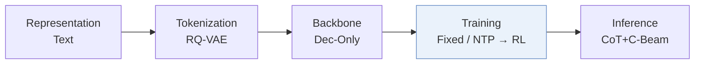
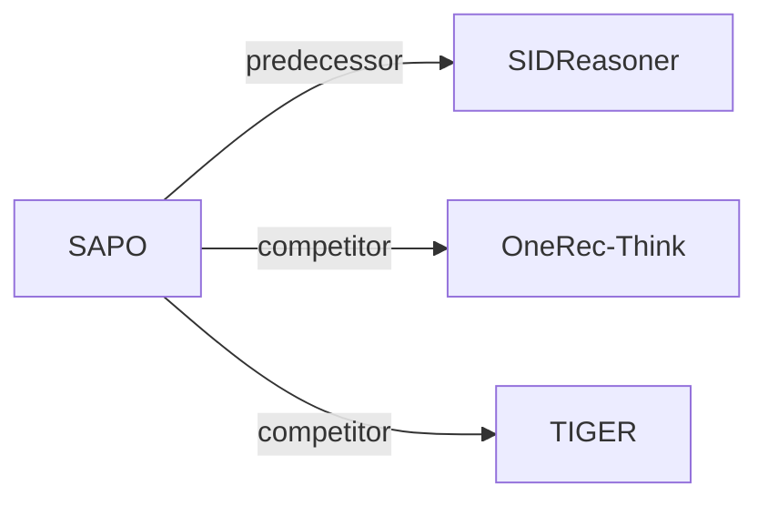

# SAPO

*Step-Aligned Policy Optimization for Reasoning-Based Generative Recommendation* — Zheng et al. · arXiv’26

`IV. 实用目标` · `Training` · [论文](https://arxiv.org/abs/2605.17648) · [代码](https://github.com/zhengzaiyi/SAPO) · [矩阵](../../../README.zh.md#iv--training) · [English](../../papers/sapo.md)

阅读级别：概览（第 1 级） · 本页目录：[TL;DR](#tldr) · [速览](#速览) · [3. 实验发现](#3-实验发现) · [5. 相关工作](#5-相关工作)

- `Dec-Only`: Decoder-only.
- `Fixed`: SIDs are built first and not changed while the generator trains.
- `NTP → RL`: NTP, then reinforcement learning (GRPO, GBPO, etc.).
- `CoT+C-Beam`: Reasoning followed by constrained beam-search decoding.

### TL;DR

> [!NOTE]
> SAPO 以一个思考块加一个 SID token 为一步，为每个推理步单独计算组相对优势，替代将单一精确匹配优势广播到整段回复的做法。

### 速览

| 维度 | 摘要 |
| :-- | :-- |
| 研究问题 | IV. 实用目标：Are training and search aimed at what users and the platform value, rather than at token likelihood? |
| 核心贡献 | SAPO 以一个思考块加一个 SID token 为一步，为每个推理步单独计算组相对优势，替代将单一精确匹配优势广播到整段回复的做法。 |
| 主要改动阶段 | Training |

### 3. 实验发现

实验设置

- **数据集**：Amazon Reviews Office Products, Video Games, Industrial & Scientific; October 2016-November 2018; 5-core users/items. Further history truncation not reported.
  - 出处：[S5.SS1.p1](https://arxiv.org/html/2605.17648v1#S5.SS1.p1) ; #A8.p1
- **切分**：Per-user chronological leave-one-out: last item test, second last validation, remaining prefix training; all valid sliding-window history/target pairs used for training.
  - 出处：[A8.p1](https://arxiv.org/html/2605.17648v1#A8.p1)
- **候选集**：not reported
  - 出处：[S5.SS1](https://arxiv.org/html/2605.17648v1#S5.SS1) ; #S5.SS2.p1 ; #A8
- **可见性**：warm; no unseen-item protocol is defined. Tokenizer fitting exposure to test items not explicitly separated.
  - 出处：[A8.p1](https://arxiv.org/html/2605.17648v1#A8.p1) ; #A8.p3
- **SID 规格**：RQ-VAE: 3 x 256 over title/category/brand/description embeddings. Paper reports training until every item has a unique tuple, with no extra collision suffix; a separate collision-assignment rule is not reported.
  - 出处：[A8.p3](https://arxiv.org/html/2605.17648v1#A8.p3)
- **推理预算**：Qwen3-1.7B generates three thinking blocks followed by three contiguous SID tokens, enabling trie-constrained beam decoding and KV reuse; Recall/NDCG@5/10. Test beam width, reasoning cap, hardware allocation, batch size and latency not reported. The 16 rollouts/prompt, 1024-token cap and 4 H100s are training settings.
  - 出处：[A6.p2](https://arxiv.org/html/2605.17648v1#A6.p2) ; #A9.SS2.p1 ; #A10.p1 ; #A11.p2
- **结果来源**：Original Table 1: main comparison; SIDReasoner uses author checkpoints evaluated by this paper, all other baselines reimplemented. Table 2: SAPO component ablations; Table 7: training overhead, not inference latency.
  - 出处：[S5.T1](https://arxiv.org/html/2605.17648v1#S5.T1) ; #S5.T2 ; #S5.SS1.p2 ; #A12.T7

### 5. 相关工作

- **前序工作** · [SIDReasoner](sidreasoner.md): SAPO shares SIDReasoner Stage 1/2 checkpoints but replaces rollout-level Stage 3 credit with rewards and advantages for thinking-block/SID-token pairs.
  - 出处：SAPO v1, Appendix G and Section 5.2: https://arxiv.org/html/2605.17648v1#A7.p3; https://arxiv.org/html/2605.17648v1#S5.SS2.p2.
- **同期对比** · [OneRec-Think](onerec-think.md): OneRec-Think is a reasoning-based generative baseline with outcome-level feedback; SAPO localizes RL credit to individual SID reasoning steps.
  - 出处：SAPO v1, Appendix G and Table 1: https://arxiv.org/html/2605.17648v1#A7.p3; https://arxiv.org/html/2605.17648v1#S5.T1.
- **同期对比** · [TIGER](tiger.md): TIGER is the non-reasoning residual-SID generation baseline; SAPO adds structured reasoning and step-aligned policy optimization.
  - 出处：SAPO v1, Appendix G and Table 1: https://arxiv.org/html/2605.17648v1#A7.p2; https://arxiv.org/html/2605.17648v1#S5.T1.

[查看同格全部论文](../../../README.zh.md#iv--training)
