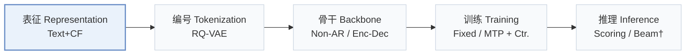
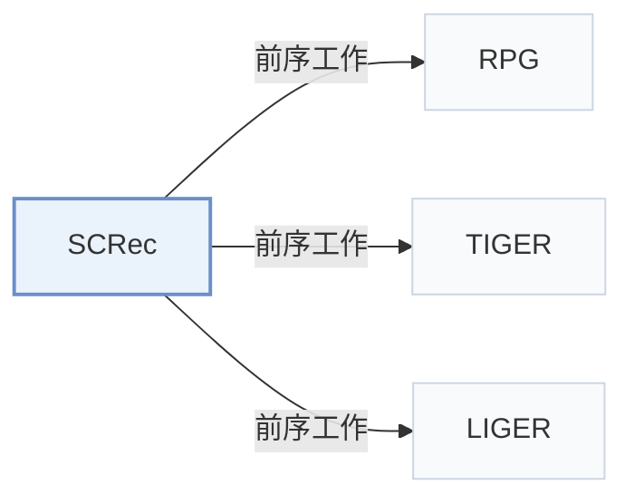

# SCRec

[← 问题 × 阶段矩阵](../../../README.zh.md#i--representation) · [按阶段索引](../index/stages.md) · [按模态索引](../index/modality.md) · [English](../../papers/screc.md) | 中文

| **题目** | *Addressing Cross-Stage Decoupling of Semantic and Collaborative Signals in Generative Recommendation* |
| :-- | :-- |
| **作者** | Dan |
| **发表** | RecSys’26 |
| **问题与阶段** | `I. 信息量` · `表征（Representation）` |
| **链接** | [论文](https://arxiv.org/abs/2609.13678) · [代码](https://github.com/DanJiayi/SCRec) |
| **阅读级别** | 概览（第 1 级） |

**本页目录**：[TL;DR](#tldr) · [速览](#速览) · [3. 实验发现](#3-实验发现) · [5. 相关工作](#5-相关工作)

- `Text+CF`：文本表征结合协同过滤信号。
- `RQ-VAE`：残差量化变分自编码器（Residual-Quantized VAE）。
- `Non-AR / Enc-Dec`：涵盖非自回归与编码器-解码器两种骨干变体。
- `Fixed`：先独立训练并冻结编号器，生成器训练期间 SID 保持不变。
- `MTP + Ctr.`：多 token 预测结合对比学习损失。
- `Scoring / Beam†`：判别式候选打分与生成式束搜索对比。

### TL;DR

> [!NOTE]
> SCRec 将文本化的协同信号注入语义编号，在生成时用可学习码嵌入校准语义先验，并对齐码本与语义空间以耦合两个阶段。

---

### 速览

| 维度 | 摘要 |
| :-- | :-- |
| 研究问题 | I. 信息量：SID 或读取它的模型是否充分携带了推荐所需的协同、多模态与时空信号？ |
| 核心贡献 | SCRec 将文本化的协同信号注入语义编号，在生成时用可学习码嵌入校准语义先验，并对齐码本与语义空间以耦合两个阶段。 |
| 主要改动阶段 | 表征（Representation） |

---

### 3. 实验发现

实验设置

- **数据集**：Amazon Reviews Beauty, Sports and Outdoors, Toys and Games. Filtering and maximum history length not reported directly; preprocessing settings delegated to RPG.
  - 出处：[S4.SS1.p1](https://arxiv.org/html/2609.13678v1#S4.SS1.p1) ; #S4.SS1.p5
- **切分**：Per-user chronological leave-last-out: final interaction test, penultimate validation, remaining interactions training; shared across baselines.
  - 出处：[S4.SS1.p1](https://arxiv.org/html/2609.13678v1#S4.SS1.p1)
- **候选集**：not reported; evaluation configurations are delegated to RPG without specifying the candidate universe or negative sampling.
  - 出处：[S4.SS1.p4](https://arxiv.org/html/2609.13678v1#S4.SS1.p4) ; #S4.SS1.p5
- **可见性**：warm; no unseen-item protocol is defined. SASRec for top-10 collaborative neighbors is pretrained on training data; tokenizer fitting exposure to test items not reported.
  - 出处：[S4.SS1.p1](https://arxiv.org/html/2609.13678v1#S4.SS1.p1) ; #S4.SS1.p5
- **SID 规格**：RQ-VAE with 256 entries/codebook and latent dimension 256, quantizing fused item-text and textualized-neighbor embeddings. Semantic level count and collision handling not reported.
  - 出处：[S3.SS1.p9](https://arxiv.org/html/2609.13678v1#S3.SS1.p9) ; #S4.SS1.p5
- **推理预算**：Main decoder-only backbone follows RPG, with TIGER/LIGER module variants. Exact main inference procedure, prediction-head structure and beam width not reported; Recall/NDCG@5/10. General experiment GPU: one RTX 4090; inference batch size and absolute latency not reported. Beauty module inference-time increases: TIGER 6.19%, LIGER 0.54%, averaged over ten runs.
  - 出处：[S3.SS2.p5](https://arxiv.org/html/2609.13678v1#S3.SS2.p5) ; #S4.SS1.p4 ; #S4.SS1.p5 ; #S4.SS5.p1 ; #S4.SS5.p2
- **结果来源**：Original Table 1: main comparison; baselines including RPG rerun in the same environment, TIGER/LIGER evaluated through the same LIGER codebase. Table 2: ablations; Table 3: backbone extensions; Tables 4-5: alternative fusion/alignment. No imported baseline results stated.
  - 出处：[S4.T1](https://arxiv.org/html/2609.13678v1#S4.T1) ; #S4.T2 ; #S4.T3 ; #S4.T4 ; #S4.T5 ; #S4.SS1.p5

---

### 5. 相关工作

- **前序工作** · [RPG](rpg.md): SCRec adopts a decoder-only backbone following RPG but replaces tokenization with collaborative-enhanced RQ-VAE and adds semantic/manifold alignment modules.
  - 出处：SCRec v1, Sections 3.1/4.1: [S3.SS1.p9](https://arxiv.org/html/2609.13678v1#S3.SS1.p9); [S4.SS1.p5](https://arxiv.org/html/2609.13678v1#S4.SS1.p5).
- **前序工作** · [TIGER](tiger.md): SCRec is also added to TIGER as a reusable module, improving collaborative input to tokenization and semantic guidance during generation.
  - 出处：SCRec v1, Section 4.5 and Table 3: [S4.SS5.p1](https://arxiv.org/html/2609.13678v1#S4.SS5.p1); [S4.T3](https://arxiv.org/html/2609.13678v1#S4.T3).
- **前序工作** · [LIGER](liger.md): SCRec augments the hybrid LIGER backbone with the same reusable cross-stage supplementation module and measures its inference overhead.
  - 出处：SCRec v1, Section 4.5 and Table 3: [S4.SS5.p1](https://arxiv.org/html/2609.13678v1#S4.SS5.p1); [S4.SS5.p2](https://arxiv.org/html/2609.13678v1#S4.SS5.p2); [S4.T3](https://arxiv.org/html/2609.13678v1#S4.T3).

[查看同格全部论文](../../../README.zh.md#i--representation)
