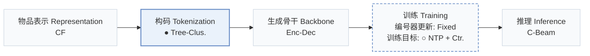
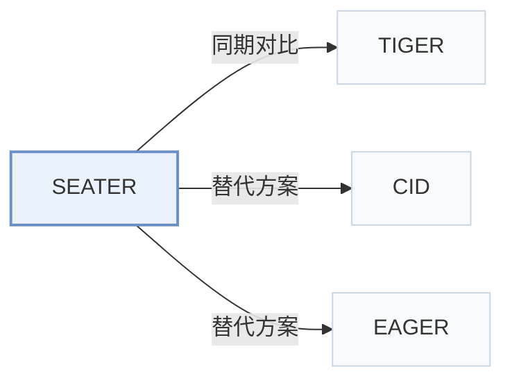

# SEATER

[← 问题 × 阶段矩阵](../../../README.zh.md#v--tokenization) · [按阶段索引](../index/stages.md) · [按模态找论文](../index/modality.md) · [按领域找论文](../index/domain.md) · [English](../../papers/seater.md) | 中文

| **题目** | *Generative retrieval with semantic tree-structured identifiers and contrastive learning* |
| :-- | :-- |
| **作者** | Si et al. |
| **发表** | SIGIR-AP’24 |
| **问题与阶段** | `V. 效率` · `构码（Tokenization）` |
| **改动** | ● 构码 · ○ 训练目标 |
| **构码输入** | `CF` |
| **领域** | `本地生活与 POI` · `电商` · `新闻` · `短视频与直播` |
| **链接** | [论文](https://arxiv.org/abs/2309.13375) · [代码](https://github.com/Ethan00Si/SEATER_Generative_Retrieval) |
| **阅读级别** | 概览（第 1 级） |

**本页目录**：[TL;DR](#tldr) · [3. 实验发现](#3-实验发现) · [5. 相关工作](#5-相关工作)

- `CF`：纯协同过滤交互信号。
- `Tree-Clus.`：均衡 k 叉树聚类编号。
- `Enc-Dec`：编码器-解码器（Encoder-decoder）架构。
- `Fixed`：先独立训练并冻结编号器，生成器训练期间 SID 保持不变。
- `NTP + Ctr.`：下一 token 预测结合对比学习损失。
- `C-Beam`：受合法物品集合约束的束搜索（Constrained beam search）。

### TL;DR

> [!NOTE]
> SEATER 在平衡 k 叉树上构建物品标识，并结合生成损失、InfoNCE 损失与三元组损失训练编码器-解码器，以相等的推理开销学习层级 token。

---

### 3. 实验发现

实验设置

- **数据集**：Yelp 2018 (31,668 users / 38,048 items), Amazon Books (459,133 / 313,966), MIND-small News (50,000 / 39,865), and an industrial Micro-Video dataset of 0.75 million randomly selected users over two weeks in 2023 (6.1 million items, 85 million interactions, unfiltered). Public-dataset filtering: not reported.
  - 出处：Datasets: [S5.SS1.SSS1.p1](https://arxiv.org/html/2309.13375v2#S5.SS1.SSS1.p1) and [S5.SS1.SSS1.p2](https://arxiv.org/html/2309.13375v2#S5.SS1.SSS1.p2); statistics: [S5.T2](https://arxiv.org/html/2309.13375v2#S5.T2).
- **切分**：Users are partitioned 8:1:1 into training, validation, and test; for each evaluated user the first 80% of behaviors are context and the remaining 20% are ground truth (ComiRec protocol).
  - 出处：User-level 8:1:1 split with 80/20 context/target: [S5.SS1.SSS2.p1](https://arxiv.org/html/2309.13375v2#S5.SS1.SSS2.p1).
- **候选集**：full catalog (top-n items from the entire candidate set via constrained beam search); NDCG uses all positive items for the ideal DCG.
  - 出处：Top-n from the entire candidate set: [S3.SS4.p1](https://arxiv.org/html/2309.13375v2#S3.SS4.p1); NDCG computed against all positives: [S5.SS1.SSS2.p2](https://arxiv.org/html/2309.13375v2#S5.SS1.SSS2.p2).
- **可见性**：warm; no unseen-item protocol is defined. Test users are held out from training (user-level split); the SASRec embeddings used to build identifiers are trained on interaction data whose user split is not restated.
  - 出处：Test users disjoint from training users; items shared: [S5.SS1.SSS2.p1](https://arxiv.org/html/2309.13375v2#S5.SS1.SSS2.p1).
- **SID 规格**：Balanced k-ary tree identifiers from recursive constrained k-means over trained SASRec item embeddings; leaf-layer tokens correspond one-to-one with items and share the item's embedding. The branch count k is searched over 2, 4, 8, 16, and 32, and the paper states that k is set to 8 or 16 in the experiments; the value per dataset: not reported.
  - 出处：Balanced k-ary tree from constrained k-means over SASRec embeddings; [algorithm1.6](https://arxiv.org/html/2309.13375v2#algorithm1.6); leaf tokens one-to-one with items: [S3.SS2.SSS2.p3](https://arxiv.org/html/2309.13375v2#S3.SS2.SSS2.p3); k search range: [S5.SS1.SSS3.p4](https://arxiv.org/html/2309.13375v2#S5.SS1.SSS3.p4); k set to 8 or 16: [S4.SS2.p2](https://arxiv.org/html/2309.13375v2#S4.SS2.p2).
- **推理预算**：Constrained beam search over the prefix tree with beam size 50 (also for TDM and RecForest); Table 1 gives asymptotic inference cost. Main SEATER uses a single encoder-decoder layer. Hardware, inference batch size, and latency: not reported.
  - 出处：Beam size 50 for tree-based and generative methods: [S5.SS1.SSS3.p4](https://arxiv.org/html/2309.13375v2#S5.SS1.SSS3.p4); complexity: [S3.T1](https://arxiv.org/html/2309.13375v2#S3.T1).
- **结果来源**：Table 3 (Yelp, News, Books, Micro-Video versus dual-encoder, tree-based, and generative baselines including GPTRec and TIGER); Table 1 (time and space complexity); Section 5.5 (more encoder-decoder layers).
  - 出处：Main: [S5.T3](https://arxiv.org/html/2309.13375v2#S5.T3); complexity: [S3.T1](https://arxiv.org/html/2309.13375v2#S3.T1).

---

### 5. 相关工作

- **同期对比** · [TIGER](tiger.md): TIGER builds identifiers by RQ-VAE over text embeddings; SEATER builds balanced tree identifiers from collaborative SASRec embeddings and adds alignment and ranking losses over the tree.
  - 出处：SEATER v2, Section 4.1 related work: [S4.SS1.p2](https://arxiv.org/html/2309.13375v2#S4.SS1.p2); Table 3 generative baseline: [S5.T3](https://arxiv.org/html/2309.13375v2#S5.T3).
- **替代方案** · [CID](cid.md): P5 with collaborative indexing uses spectral clustering of interactions for IDs; SEATER uses a balanced k-ary tree from constrained k-means.
  - 出处：SEATER v2, Section 4.1 cites Hua et al. (2023b): [S4.SS1.p2](https://arxiv.org/html/2309.13375v2#S4.SS1.p2).
- **替代方案** · [EAGER](eager.md): EAGER, a later paper that cites SEATER among generative recommenders, builds two tree-structured codes (behavior and semantic) with hierarchical k-means instead of one collaborative tree.
  - 出处：Evidence is from the later EAGER paper, Section 1: [S1.p2](https://arxiv.org/html/2406.14017v2#S1.p2).

[查看同格全部论文](../../../README.zh.md#v--tokenization)
