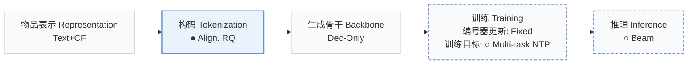
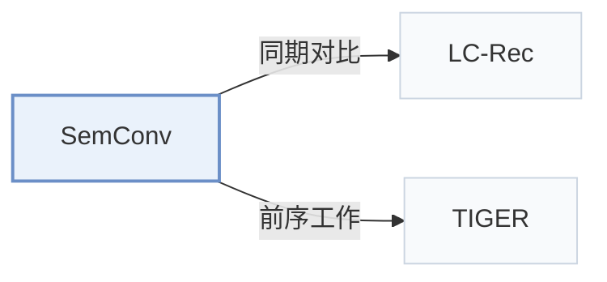

# SemConv

[← 问题 × 阶段矩阵](../../../README.zh.md#iii--tokenization) · [按阶段索引](../index/stages.md) · [按模态找论文](../index/modality.md) · [按领域找论文](../index/domain.md) · [English](../../papers/semconv.md) | 中文

| **题目** | *Semantic Convergence: Harmonizing Recommender Systems via Two-Stage Alignment and Behavioral Semantic Tokenization* |
| :-- | :-- |
| **作者** | Li et al. |
| **发表** | AAAI’25 |
| **问题与阶段** | `III. SID 与模型对齐` · `构码（Tokenization）` |
| **改动** | ● 构码 · ○ 训练目标 · ○ 推理 |
| **构码输入** | `Text` + `CF` |
| **领域** | `电商` |
| **应用场景** | `一般物品推荐`；`公开数据` |
| **链接** | [论文](https://arxiv.org/abs/2412.13771) |
| **阅读级别** | 概览（第 1 级） |

**本页目录**：[TL;DR](#tldr) · [3. 实验发现](#3-实验发现) · [5. 相关工作](#5-相关工作)

- `Text+CF`：文本表征结合协同过滤信号。
- `Align. RQ`：带对齐目标训练的残差量化。
- `Dec-Only`：仅解码器（Decoder-only）自回归架构。
- `Fixed`：先独立训练并冻结编号器，生成器训练期间 SID 保持不变。
- `Multi-task NTP`：在多个对齐或推荐子任务上联合优化下一 token 预测损失。
- `Beam`：在 SID token 上执行自回归束搜索（Beam search）。

### TL;DR

> [!NOTE]
> SemConv 通过对齐编号将物品 ID 转化为与 LLM 空间对齐的 token 序列，加入连接协同信号与自然语言的任务，并预缓存 top-K 结果用于线上服务。

---

### 3. 实验发现

实验设置

- **数据集**：Amazon Games, Arts and Instruments; history cap 20; exclude samples whose concatenated prompt exceeds 2048 tokens. Other filtering: not reported.
  - 出处：Experiment Setup, Datasets: [Sx4.SSx1.SSSx1.p1](https://arxiv.org/html/2412.13771v1#Sx4.SSx1.SSSx1.p1)
- **切分**：Evaluation uses each user's last interaction as target and preceding interactions as context. First S-1 actions form training examples; exact validation allocation: not reported.
  - 出处：Experiment Setup, Baselines: [Sx4.SSx1.SSSx2.p2](https://arxiv.org/html/2412.13771v1#Sx4.SSx1.SSSx2.p2)
- **候选集**：not reported
  - 出处：Experiment Setup does not specify evaluation candidate sampling; negative sampling in Alignment Task is training: [Sx4.SSx1](https://arxiv.org/html/2412.13771v1#Sx4.SSx1) and [Sx3.SSx2.p4](https://arxiv.org/html/2412.13771v1#Sx3.SSx2.p4)
- **可见性**：warm; no unseen-item protocol is defined. DCCF embedding exposure to test items/interactions: not reported.
  - 出处：Experiment Setup and Alignment Tokenization: [Sx4.SSx1](https://arxiv.org/html/2412.13771v1#Sx4.SSx1) and [Sx3.SSx1.p3](https://arxiv.org/html/2412.13771v1#Sx3.SSx1.p3)
- **SID 规格**：Aligned residual codebooks: 4 levels x 256 codes; Games reports 0% collisions at four levels. Explicit collision handling: not reported.
  - 出处：Alignment Tokenization and Table 5: [Sx3.SSx1.p10](https://arxiv.org/html/2412.13771v1#Sx3.SSx1.p10) and [Sx4.T5](https://arxiv.org/html/2412.13771v1#Sx4.T5)
- **推理预算**：Beam-generated valid item codes are cached per user; online serving reads cache. HR/NDCG@1/5/10. Beam width, cache K, hardware, inference batch, numerical latency: not reported.
  - 出处：Inference and Metrics: [Sx3.SSx3.p1](https://arxiv.org/html/2412.13771v1#Sx3.SSx3.p1) and [Sx4.SSx1.SSSx3.p1](https://arxiv.org/html/2412.13771v1#Sx4.SSx1.SSSx3.p1)
- **结果来源**：Reported Table 1 main comparison and Tables 3-8 Games ablations. P5 uses the cited external implementation; other baseline borrowed-versus-rerun provenance: not reported.
  - 出处：Tables 1/3-8: [Sx3.T1](https://arxiv.org/html/2412.13771v1#Sx3.T1) and [Sx4.T3](https://arxiv.org/html/2412.13771v1#Sx4.T3) and [Sx4.T8](https://arxiv.org/html/2412.13771v1#Sx4.T8) and [Sx4.SSx1.SSSx2.p1](https://arxiv.org/html/2412.13771v1#Sx4.SSx1.SSSx2.p1)

---

### 5. 相关工作

- **同期对比** · [LC-Rec](lc-rec.md): LC-Rec supplies the alignment-task/inference template and is the strongest evaluated baseline.
  - 出处：SemConv v1, Alignment Task, Inference and Table1: [Sx3.SSx2.p1](https://arxiv.org/html/2412.13771v1#Sx3.SSx2.p1); [Sx3.SSx3.p1](https://arxiv.org/html/2412.13771v1#Sx3.SSx3.p1); [Sx3.T1](https://arxiv.org/html/2412.13771v1#Sx3.T1).
- **前序工作** · [TIGER](tiger.md): SemConv draws on TIGER's residual codebooks while removing autoencoder reconstruction.
  - 出处：SemConv v1, Alignment Tokenization: [Sx3.SSx1.p2](https://arxiv.org/html/2412.13771v1#Sx3.SSx1.p2); [Sx3.SSx1.p11](https://arxiv.org/html/2412.13771v1#Sx3.SSx1.p11).

[查看同格全部论文](../../../README.zh.md#iii--tokenization)
