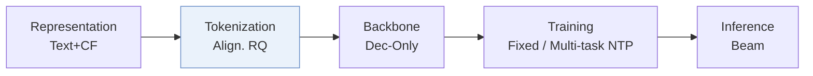
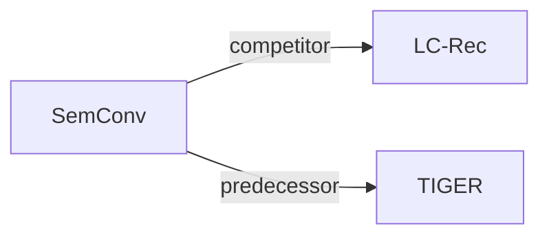

# SemConv

*Semantic Convergence: Harmonizing Recommender Systems via Two-Stage Alignment and Behavioral Semantic Tokenization* — Li et al. · AAAI’25

`III. SID 与模型对齐` · `Tokenization` · [论文](https://arxiv.org/abs/2412.13771) · [矩阵](../../../README.zh.md#iii--tokenization) · [English](../../papers/semconv.md)

阅读级别：概览（第 1 级） · 本页目录：[TL;DR](#tldr) · [速览](#速览) · [3. 实验发现](#3-实验发现) · [5. 相关工作](#5-相关工作)

- `Align. RQ`: Residual quantization trained with alignment objectives.
- `Dec-Only`: Decoder-only.
- `Fixed`: SIDs are built first and not changed while the generator trains.
- `Multi-task NTP`: The same NTP loss over several tasks.

### TL;DR

> [!NOTE]
> SemConv 通过对齐编号将物品 ID 转化为与 LLM 空间对齐的 token 序列，加入连接协同信号与自然语言的任务，并预缓存 top-K 结果用于线上服务。

### 速览

| 维度 | 摘要 |
| :-- | :-- |
| 研究问题 | III. SID 与模型对齐：Can the generator read, write, and reason over SIDs, and do the tokenizer and generator work toward the same goal? |
| 核心贡献 | SemConv 通过对齐编号将物品 ID 转化为与 LLM 空间对齐的 token 序列，加入连接协同信号与自然语言的任务，并预缓存 top-K 结果用于线上服务。 |
| 主要改动阶段 | Tokenization |

### 3. 实验发现

实验设置

- **数据集**：Amazon Games, Arts and Instruments; history cap 20; exclude samples whose concatenated prompt exceeds 2048 tokens. Other filtering: not reported.
  - 出处：Experiment Setup, Datasets: [Sx4.SSx1.SSSx1.p1](https://arxiv.org/html/2412.13771v1#Sx4.SSx1.SSSx1.p1)
- **切分**：Evaluation uses each user's last interaction as target and preceding interactions as context. First S-1 actions form training examples; exact validation allocation: not reported.
  - 出处：Experiment Setup, Baselines: [Sx4.SSx1.SSSx2.p2](https://arxiv.org/html/2412.13771v1#Sx4.SSx1.SSSx2.p2)
- **候选集**：not reported
  - 出处：Experiment Setup does not specify evaluation candidate sampling; negative sampling in Alignment Task is training: [Sx4.SSx1](https://arxiv.org/html/2412.13771v1#Sx4.SSx1) and [Sx3.SSx2.p4](https://arxiv.org/html/2412.13771v1#Sx3.SSx2.p4)
- **可见性**：warm; no unseen-item protocol is defined. DCCF embedding exposure to test items/interactions: not reported.
  - 出处：Experiment Setup and Alignment Tokenization: [Sx4.SSx1](https://arxiv.org/html/2412.13771v1#Sx4.SSx1) and [Sx3.SSx1.p3](https://arxiv.org/html/2412.13771v1#Sx3.SSx1.p3)
- **SID 规格**：Aligned residual codebooks: 4 levels x 256 codes; Games reports 0% collisions at four levels. Explicit collision handling: not reported.
  - 出处：Alignment Tokenization and Table 5: [Sx3.SSx1.p10](https://arxiv.org/html/2412.13771v1#Sx3.SSx1.p10) and [Sx4.T5](https://arxiv.org/html/2412.13771v1#Sx4.T5)
- **推理预算**：Beam-generated valid item codes are cached per user; online serving reads cache. HR/NDCG@1/5/10. Beam width, cache K, hardware, inference batch, numerical latency: not reported.
  - 出处：Inference and Metrics: [Sx3.SSx3.p1](https://arxiv.org/html/2412.13771v1#Sx3.SSx3.p1) and [Sx4.SSx1.SSSx3.p1](https://arxiv.org/html/2412.13771v1#Sx4.SSx1.SSSx3.p1)
- **结果来源**：Reported Table 1 main comparison and Tables 3-8 Games ablations. P5 uses the cited external implementation; other baseline borrowed-versus-rerun provenance: not reported.
  - 出处：Tables 1/3-8: [Sx3.T1](https://arxiv.org/html/2412.13771v1#Sx3.T1) and [Sx4.T3](https://arxiv.org/html/2412.13771v1#Sx4.T3) and [Sx4.T8](https://arxiv.org/html/2412.13771v1#Sx4.T8) and [Sx4.SSx1.SSSx2.p1](https://arxiv.org/html/2412.13771v1#Sx4.SSx1.SSSx2.p1)

### 5. 相关工作

- **同期对比** · [LC-Rec](lc-rec.md): LC-Rec supplies the alignment-task/inference template and is the strongest evaluated baseline.
  - 出处：SemConv v1, Alignment Task, Inference and Table1: https://arxiv.org/html/2412.13771v1#Sx3.SSx2.p1; https://arxiv.org/html/2412.13771v1#Sx3.SSx3.p1; https://arxiv.org/html/2412.13771v1#Sx3.T1.
- **前序工作** · [TIGER](tiger.md): SemConv draws on TIGER's residual codebooks while removing autoencoder reconstruction.
  - 出处：SemConv v1, Alignment Tokenization: https://arxiv.org/html/2412.13771v1#Sx3.SSx1.p2; https://arxiv.org/html/2412.13771v1#Sx3.SSx1.p11.

[查看同格全部论文](../../../README.zh.md#iii--tokenization)
