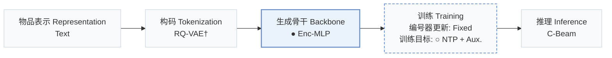
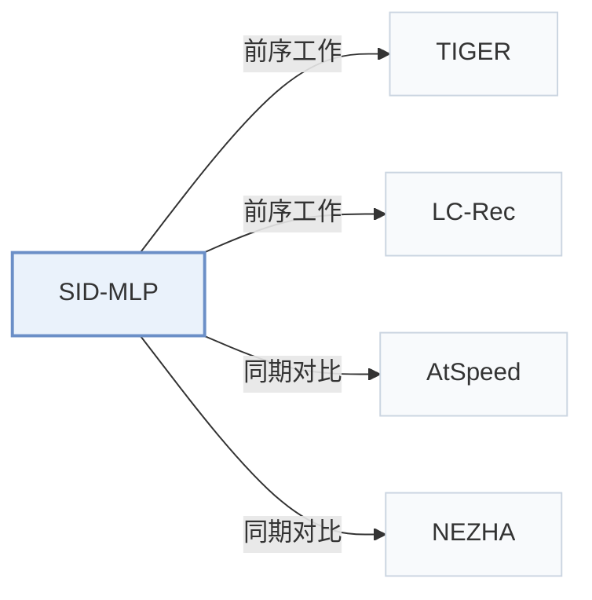

# SID-MLP

[← 问题 × 阶段矩阵](../../../README.zh.md#v--backbone) · [按阶段索引](../index/stages.md) · [按模态找论文](../index/modality.md) · [按领域找论文](../index/domain.md) · [English](../../papers/sid-mlp.md) | 中文

| **题目** | *MLPs are Efficient Distilled Generative Recommenders* |
| :-- | :-- |
| **作者** | Guo et al. |
| **发表** | arXiv’26 |
| **问题与阶段** | `V. 效率` · `生成骨干（Backbone）` |
| **改动** | ● 生成骨干 · ○ 训练目标 |
| **构码输入** | `Text` |
| **领域** | `电商` |
| **链接** | [论文](https://arxiv.org/abs/2605.12617) · [代码](https://github.com/ztguo715/SID-MLP.git) |
| **阅读级别** | 概览（第 1 级） |

**本页目录**：[TL;DR](#tldr) · [3. 实验发现](#3-实验发现) · [5. 相关工作](#5-相关工作)

- `Text`：物品文本元数据（标题、描述、类目或提示词）。
- `RQ-VAE†`：残差量化变分自编码器（由配置推断）。
- `Enc-MLP`：序列历史编码器后接多层感知机（MLP）预测头。
- `Fixed`：先独立训练并冻结编号器，生成器训练期间 SID 保持不变。
- `NTP + Aux.`：下一 token 预测结合辅助正则或对齐损失。
- `C-Beam`：受合法物品集合约束的束搜索（Constrained beam search）。

### TL;DR

> [!NOTE]
> SID-MLP 将自回归 Transformer 解码器蒸馏为建立在单次用户上下文计算之上的按位置 MLP 预测头，替代 SID 解码中重复的注意力计算。

---

### 3. 实验发现

实验设置

- **数据集**：Main: Amazon Reviews 2023 Musical Instruments, Industrial & Scientific and Video Games, 5-core. LC-Rec extension: Amazon Reviews 2018 Musical Instruments, Arts Crafts and Sewing and Video Games, filtering users/items with fewer than five interactions.
  - 出处：Sec.4.1 and Appendix C.1/D.1: [S4.SS1.p1](https://arxiv.org/html/2605.12617v1#S4.SS1.p1) and [A3.T10](https://arxiv.org/html/2605.12617v1#A3.T10) and [A4.T13](https://arxiv.org/html/2605.12617v1#A4.T13)
- **切分**：Main: chronological leave-last-out, history truncated to 20 items; four rolling next-item training targets per user; evaluation leave-one-out. Exact validation allocation: not reported. LC-Rec extension follows its protocol; exact allocation/history cap: not reported.
  - 出处：Appendix C.1 and D.1: [A3.SS1.p1](https://arxiv.org/html/2605.12617v1#A3.SS1.p1) and [A3.T10](https://arxiv.org/html/2605.12617v1#A3.T10) and [A4.SS1.p1](https://arxiv.org/html/2605.12617v1#A4.SS1.p1)
- **候选集**：Evaluation over valid four-digit SIDs with a fixed item-to-SID prefix mask. Full-catalog versus sampled ranking and history-item exclusion: not reported.
  - 出处：Sec.4.1 and Sec.3.4: [S4.SS1.p3](https://arxiv.org/html/2605.12617v1#S4.SS1.p3) and [S3.SS4.p2](https://arxiv.org/html/2605.12617v1#S3.SS4.p2)
- **可见性**：warm; no unseen-item protocol is defined. Temporal-80/90 diagnostics select targets introduced after global 80%/90% timestamps while reusing existing TIGER checkpoints, tokenizer and candidates; the paper explicitly excludes a strict zero-shot insertion interpretation. Tokenizer exposure to test items: not reported.
  - 出处：Appendix E.3 explicitly distinguishes temporal shift from strict zero-shot insertion: [A5.SS3.p1](https://arxiv.org/html/2605.12617v1#A5.SS3.p1)
- **SID 规格**：Fixed teacher SID mapping: four digits, three residual-quantization codes with 256-way codebook plus a conflict-avoidance digit; main experiments use sentence-T5 SIDs. Tokenizer sensitivity tests RQ-KMeans, RQ-VAE and PSID. LC-Rec retains its four SID tokens.
  - 出处：Sec.2.1, Sec.3.4, Sec.4.4 and Appendix D.2: [S2.SS1.p1](https://arxiv.org/html/2605.12617v1#S2.SS1.p1) and [S3.SS4.p2](https://arxiv.org/html/2605.12617v1#S3.SS4.p2) and [S4.SS4.p2](https://arxiv.org/html/2605.12617v1#S4.SS4.p2) and [A4.SS2.p2](https://arxiv.org/html/2605.12617v1#A4.SS2.p2) and [A4.SS4.p3](https://arxiv.org/html/2605.12617v1#A4.SS4.p3)
- **推理预算**：Constrained beam 50, batch 32, Recall/NDCG@5/10; one context read followed by four sequential MLP heads. Main profile: one RTX A6000 48GB; timed forward passes, beam expansion, validity mask, item lookup and metrics, excluding initialization/loading/offline extraction. SID-MLP/++: 3706/4347 samples/s, 8.74x/10.25x TIGER-kv; reported 0.27/0.23 ms/sample is inverse throughput. Peak memory on Instruments: 0.09/0.43GB. LC-Rec extension reports 38.04 samples/s end-to-end and 5194 decode-only; Figure4 uses decode-only LC-Rec rates excluding prefill. Extension beam/batch: not separately reported.
  - 出处：Sec.3.4/4.1, Appendix C.3, D.1 and Figure4: [S3.SS4.p2](https://arxiv.org/html/2605.12617v1#S3.SS4.p2) and [S4.SS1.p3](https://arxiv.org/html/2605.12617v1#S4.SS1.p3) and [A3.SS3.p1](https://arxiv.org/html/2605.12617v1#A3.SS3.p1) and [A3.SS3.p2](https://arxiv.org/html/2605.12617v1#A3.SS3.p2) and [A3.SS3.p3](https://arxiv.org/html/2605.12617v1#A3.SS3.p3) and [A3.T11](https://arxiv.org/html/2605.12617v1#A3.T11) and [A4.SS1.p5](https://arxiv.org/html/2605.12617v1#A4.SS1.p5) and [A4.F4](https://arxiv.org/html/2605.12617v1#A4.F4)
- **结果来源**：This paper's matched-checkpoint evaluations, baseline adaptations and ablations, not quoted baseline scores. Table3 main comparisons; Tables5/14 ablations, Table11 profile, Table12 seeds 42/43/44, Table15 temporal diagnostic. AtSpeed/EARN/NEZHA are ports to TIGER; NEZHA is also reproduced on LC-Rec. LC-Rec extension uses released Amazon-2018 checkpoints and retrains TIGER at three scales; Figure4 LC-Rec throughput excludes prefill.
  - 出处：Tables3/5/11/12 and Appendices D.1-D.4/E: [S4.T3](https://arxiv.org/html/2605.12617v1#S4.T3) and [S4.T5](https://arxiv.org/html/2605.12617v1#S4.T5) and [A3.T11](https://arxiv.org/html/2605.12617v1#A3.T11) and [A3.T12](https://arxiv.org/html/2605.12617v1#A3.T12) and [A4.SS1.p2](https://arxiv.org/html/2605.12617v1#A4.SS1.p2) and [A4.SS3.p1](https://arxiv.org/html/2605.12617v1#A4.SS3.p1) and [A4.SS4.p1](https://arxiv.org/html/2605.12617v1#A4.SS4.p1) and [A5.T14](https://arxiv.org/html/2605.12617v1#A5.T14) and [A5.T15](https://arxiv.org/html/2605.12617v1#A5.T15)

---

### 5. 相关工作

- **前序工作** · [TIGER](tiger.md): TIGER supplies the main frozen teacher and fixed SID space.
  - 出处：SID-MLP v1, Sec.4.1: [S4.SS1.p1](https://arxiv.org/html/2605.12617v1#S4.SS1.p1); [S4.SS1.p2](https://arxiv.org/html/2605.12617v1#S4.SS1.p2).
- **前序工作** · [LC-Rec](lc-rec.md): LC-Rec supplies the second, LLaMA-2 teacher for the extension.
  - 出处：SID-MLP v1, Appendix D.1: [A4.SS1.p2](https://arxiv.org/html/2605.12617v1#A4.SS1.p2).
- **同期对比** · [AtSpeed](atspeed.md): Strict and relaxed AtSpeed variants are adapted to TIGER and compared.
  - 出处：SID-MLP v1, Appendix D.2: [A4.SS2.p2](https://arxiv.org/html/2605.12617v1#A4.SS2.p2); [S4.T3](https://arxiv.org/html/2605.12617v1#S4.T3).
- **同期对比** · [NEZHA](nezha.md): NEZHA is reproduced on both TIGER and LC-Rec.
  - 出处：SID-MLP v1, Appendix D.4: [A4.SS4.p1](https://arxiv.org/html/2605.12617v1#A4.SS4.p1); [A4.SS4.p5](https://arxiv.org/html/2605.12617v1#A4.SS4.p5).

[查看同格全部论文](../../../README.zh.md#v--backbone)
