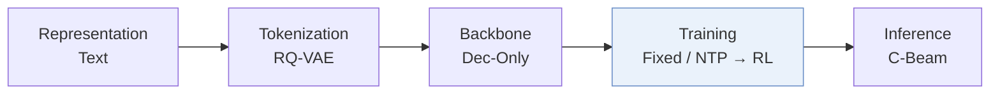
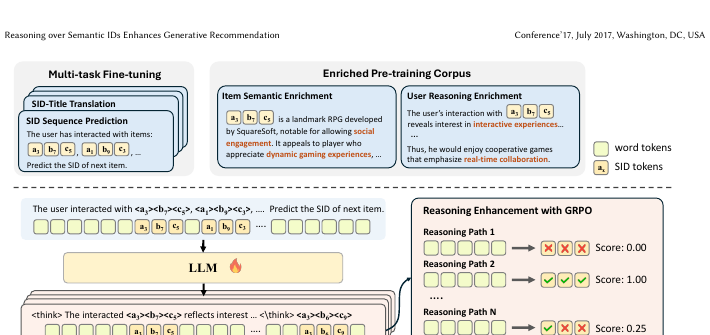
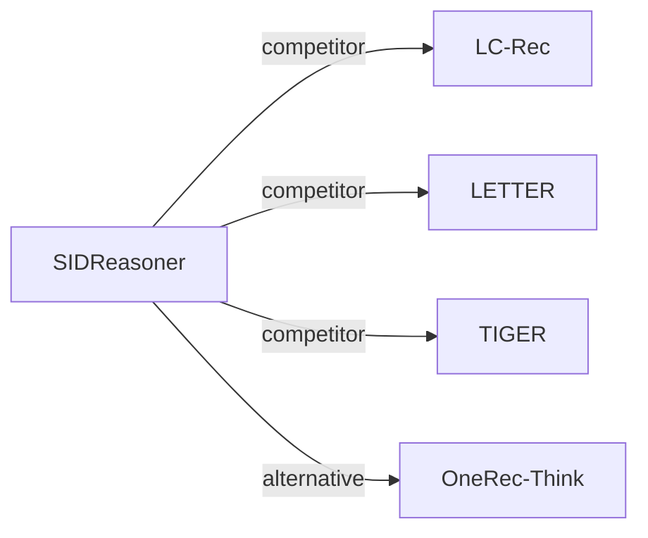

# SIDReasoner

*Reasoning over Semantic IDs Enhances Generative Recommendation* — He et al. · KDD’26

`III. SID 与模型对齐` · `Training` · [论文](https://arxiv.org/abs/2603.23183) · [代码](https://github.com/HappyPointer/SIDReasoner) · [矩阵](../../../README.zh.md#iii--training) · [English](../../papers/sidreasoner.md)

阅读级别：概览（第 1 级） · 本页目录：[TL;DR](#tldr) · [速览](#速览) · [2. 方法](#2-方法) · [3. 实验发现](#3-实验发现) · [5. 相关工作](#5-相关工作)

- `Dec-Only`: Decoder-only.
- `Fixed`: SIDs are built first and not changed while the generator trains.
- `NTP → RL`: NTP, then reinforcement learning (GRPO, GBPO, etc.).
- `C-Beam`: Constrained beam search.

### TL;DR

> [!NOTE]
> SIDReasoner 在教师合成语料上用多任务训练加强 SID 与自然语言的对齐，再通过结果驱动的强化学习改进推理，不依赖人工标注的推荐推理轨迹。

### 速览

| 维度 | 摘要 |
| :-- | :-- |
| 研究问题 | III. SID 与模型对齐：Can the generator read, write, and reason over SIDs, and do the tokenizer and generator work toward the same goal? |
| 核心贡献 | SIDReasoner 在教师合成语料上用多任务训练加强 SID 与自然语言的对齐，再通过结果驱动的强化学习改进推理，不依赖人工标注的推荐推理轨迹。 |
| 主要改动阶段 | Training |

### 2. 方法

### 3. 实验发现

实验设置

- **数据集**：Amazon Reviews 2023: Video Games (3,858 items / 61,417 interactions), Office Products (3,459 / 48,656), Industrial and Scientific (3,686 / 45,325); 5-core filtering of users and items; histories truncated by a sliding window of length 10.
  - 出处：Datasets, 5-core, sliding window 10: [S4.SS1.SSS1.p1](https://arxiv.org/html/2603.23183v2#S4.SS1.SSS1.p1); statistics: [S3.T1](https://arxiv.org/html/2603.23183v2#S3.T1).
- **切分**：Per user, interactions sorted chronologically and split 8:1:1 into training, validation, and test, with the most recent interactions for validation and test.
  - 出处：Temporal 8:1:1 per user: [S4.SS1.SSS1.p1](https://arxiv.org/html/2603.23183v2#S4.SS1.SSS1.p1).
- **候选集**：full catalog (ranking metrics over the entire item set rather than sampled negatives).
  - 出处：Full-item ranking: [S4.SS1.SSS1.p2](https://arxiv.org/html/2603.23183v2#S4.SS1.SSS1.p2).
- **可见性**：warm; no unseen-item protocol is defined.
  - 出处：Temporal split with no unseen-item protocol: [S4.SS1.SSS1.p1](https://arxiv.org/html/2603.23183v2#S4.SS1.SSS1.p1).
- **SID 规格**：RQ-VAE semantic IDs with L codebooks of K codes over text-encoder embeddings, added to the Qwen3-1.7B vocabulary as new tokens; numerical L and K and collision handling: not reported.
  - 出处：RQ-VAE with L codebooks of K codes over text embeddings: [S3.SS2.SSS1.p1](https://arxiv.org/html/2603.23183v2#S3.SS2.SSS1.p1); numerical L, K not found.
- **推理预算**：Reason-then-recommend generation: the model writes a reasoning sequence and then the target SID; evaluation decoding method and width: not reported (GRPO training uses 16 rollouts). Hardware, inference batch size, and latency: not reported.
  - 出处：Rollout and training settings: [S4.SS1.SSS3.p1](https://arxiv.org/html/2603.23183v2#S4.SS1.SSS3.p1) and [S4.SS1.SSS3.p3](https://arxiv.org/html/2603.23183v2#S4.SS1.SSS3.p3); decoding for evaluation not found.
- **结果来源**：Table 2 (Games, Office, Industrial versus discriminative, generative, and reasoning baselines); Table 3 (alignment strategies before and after RL); Table 4 (general-ability benchmarks); Table 5 (teacher models for corpus enrichment).
  - 出处：Main: [S4.T2](https://arxiv.org/html/2603.23183v2#S4.T2); alignment ablation: [S4.T3](https://arxiv.org/html/2603.23183v2#S4.T3); general abilities: [S4.T4](https://arxiv.org/html/2603.23183v2#S4.T4); teachers: [S4.T5](https://arxiv.org/html/2603.23183v2#S4.T5).

### 5. 相关工作

- **同期对比** · [LC-Rec](lc-rec.md): LC-Rec aligns an LLM to SIDs with multi-task tuning; SIDReasoner enriches SID-language alignment with teacher-written corpora and adds reasoning activation and GRPO.
  - 出处：SIDReasoner v2, generative baselines: https://arxiv.org/html/2603.23183v2#S4.SS1.SSS2.p1; Table 2: https://arxiv.org/html/2603.23183v2#S4.T2; multi-task alignment is ablation S1 in Table 3: https://arxiv.org/html/2603.23183v2#S4.T3.
- **同期对比** · [LETTER](letter.md): LETTER improves the tokenizer; SIDReasoner keeps RQ-VAE IDs and changes how the LLM reasons over them.
  - 出处：SIDReasoner v2, generative baselines: https://arxiv.org/html/2603.23183v2#S4.SS1.SSS2.p1; Table 2: https://arxiv.org/html/2603.23183v2#S4.T2.
- **同期对比** · [TIGER](tiger.md): TIGER predicts SIDs directly with a small generator; SIDReasoner reasons in language before predicting SIDs.
  - 出处：SIDReasoner v2, generative baselines: https://arxiv.org/html/2603.23183v2#S4.SS1.SSS2.p1; Table 2: https://arxiv.org/html/2603.23183v2#S4.T2.
- **替代方案** · [OneRec-Think](onerec-think.md): OneRec-Think also interleaves reasoning with itemic tokens; SIDReasoner relies on enriched SID-language alignment and outcome-reward GRPO.
  - 出处：SIDReasoner v2, Sections 1 and 2.2 cite OneRec-Think: https://arxiv.org/html/2603.23183v2#S1.p2 and https://arxiv.org/html/2603.23183v2#S2.SS2.p2; not a baseline in Table 2.

[查看同格全部论文](../../../README.zh.md#iii--training)
