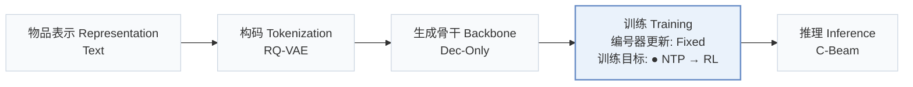
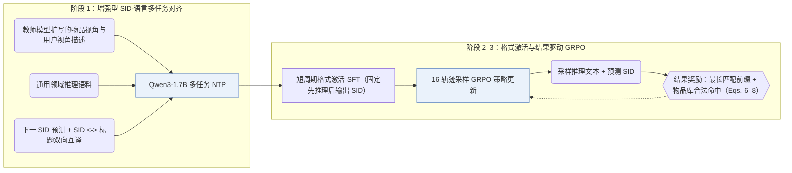
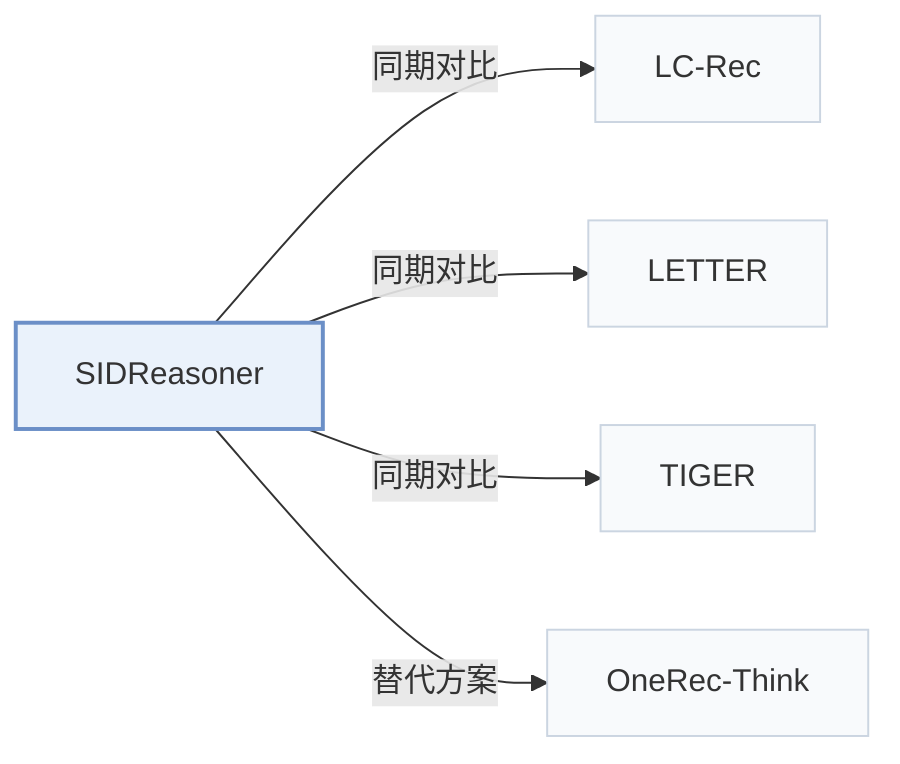

# SIDReasoner

[← 问题 × 阶段矩阵](../../../README.zh.md#iii--training) · [按阶段索引](../index/stages.md) · [按模态找论文](../index/modality.md) · [按领域找论文](../index/domain.md) · [English](../../papers/sidreasoner.md) | 中文

| **题目** | *Reasoning over Semantic IDs Enhances Generative Recommendation* |
| :-- | :-- |
| **作者** | He et al. |
| **发表** | KDD’26 |
| **问题与阶段** | `III. SID 与模型对齐` · `训练（Training）` |
| **改动** | ● 训练目标 |
| **构码输入** | `Text` |
| **领域** | `电商` |
| **特殊设置** | `跨域迁移` |
| **链接** | [论文](https://arxiv.org/abs/2603.23183) · [代码](https://github.com/HappyPointer/SIDReasoner) |
| **阅读级别** | 阅读笔记（第 2 级） |

**本页目录**：[TL;DR](#tldr) · [速览](#速览) · [1. 为什么重要](#1-为什么重要) · [2. 方法](#2-方法) · [3. 实验发现](#3-实验发现) · [4. 局限与分析](#4-局限与分析) · [5. 相关工作](#5-相关工作)

- `Text`：物品文本元数据（标题、描述、类目或提示词）。
- `RQ-VAE`：残差量化变分自编码器（Residual-Quantized VAE）。
- `Dec-Only`：仅解码器（Decoder-only）自回归架构。
- `Fixed`：先独立训练并冻结编号器，生成器训练期间 SID 保持不变。
- `NTP → RL`：先进行下一 token 预测微调，再执行强化学习（如 GRPO、GBPO 等）。
- `C-Beam`：受合法物品集合约束的束搜索（Constrained beam search）。

### TL;DR

> [!NOTE]
> SIDReasoner 在教师合成语料上用多任务训练加强 SID 与自然语言的对齐，再通过结果驱动的强化学习改进推理，不依赖人工标注的推荐推理轨迹。

---

### 速览

| 维度 | 摘要 |
| :-- | :-- |
| 主要发现 | 引入教师合成的多视角描述与通用推理语料做多任务 SID-语言对齐后，SIDReasoner 在 Amazon Games、Office 与 Industrial 全库评测中于 GRPO 前后均取得显著提升（Tables 2 and 3）。 |
| 局限 | 强化学习阶段仅根据最终语义 ID（Semantic ID，SID）的最长正确前缀与物品库合法性计算结果奖励，不对中间推理文本施加直接过程监督（Sec. 3.3.2）。 |

---

### 1. 为什么重要

即便把离散 SID 与自然语言放进同一词表，大语言模型（LLM）面对无原生语义的编码仍难以展开有效推演，而推荐场景又缺乏高质量人工推理标注（Abstract）。SIDReasoner 先通过教师扩写语料与通用推理数据强化 SID-语言双向对齐，再配合轻量的结果导向 GRPO，将基座的通用推理能力直接迁移至推荐任务。

> "Stronger SID–language alignment can help general reasoning abilities better generalize to recommendation tasks."（Sec. 5）

---

### 2. 方法

#### SID-语言对齐

多任务对齐阶段联合训练序列下一 SID 预测与“SID-物品标题”双向互译（Sec. 3.2.2），并由教师模型从物品特征与用户画像两个视角扩写描述，同时混入通用推理数据防止基座推理能力退化（Sec. 3.2.3）。

#### 推理激活

简短的有监督“冷启动推理激活”（"cold-start reasoning activation"）阶段训练模型稳定输出“先推理、后推荐”的响应格式；此处的“冷启动”仅指推理格式初始化，与冷启动用户或物品无关（Sec. 3.3.1）。

> "This stage mainly serves to improve the reliability of response formatting, ensuring that reasoning is consistently generated before recommendation."（Sec. 3.3.1）

#### 基于结果的 GRPO

GRPO 对每条历史提示采样 16 条“推理 + SID”完整轨迹，仅按生成 SID 的最长正确前缀长度及是否命中合法物品赋分更新策略（Sec. 3.3.2，Eqs. 6–8）。

---

### 3. 实验发现

实验设置

- **数据集**：Amazon Reviews 2023: Video Games (3,858 items / 61,417 interactions), Office Products (3,459 / 48,656), Industrial and Scientific (3,686 / 45,325); 5-core filtering of users and items; histories truncated by a sliding window of length 10.
  - 出处：Datasets, 5-core, sliding window 10: [S4.SS1.SSS1.p1](https://arxiv.org/html/2603.23183v2#S4.SS1.SSS1.p1); statistics: [S3.T1](https://arxiv.org/html/2603.23183v2#S3.T1).
- **切分**：Per user, interactions sorted chronologically and split 8:1:1 into training, validation, and test, with the most recent interactions for validation and test.
  - 出处：Temporal 8:1:1 per user: [S4.SS1.SSS1.p1](https://arxiv.org/html/2603.23183v2#S4.SS1.SSS1.p1).
- **候选集**：full catalog (ranking metrics over the entire item set rather than sampled negatives).
  - 出处：Full-item ranking: [S4.SS1.SSS1.p2](https://arxiv.org/html/2603.23183v2#S4.SS1.SSS1.p2).
- **可见性**：warm; no unseen-item protocol is defined.
  - 出处：Temporal split with no unseen-item protocol: [S4.SS1.SSS1.p1](https://arxiv.org/html/2603.23183v2#S4.SS1.SSS1.p1).
- **SID 规格**：RQ-VAE semantic IDs with L codebooks of K codes over text-encoder embeddings, added to the Qwen3-1.7B vocabulary as new tokens; numerical L and K and collision handling: not reported.
  - 出处：RQ-VAE with L codebooks of K codes over text embeddings: [S3.SS2.SSS1.p1](https://arxiv.org/html/2603.23183v2#S3.SS2.SSS1.p1); numerical L, K not found.
- **推理预算**：Reason-then-recommend generation: the model writes a reasoning sequence and then the target SID; evaluation decoding method and width: not reported (GRPO training uses 16 rollouts). Hardware, inference batch size, and latency: not reported.
  - 出处：Rollout and training settings: [S4.SS1.SSS3.p1](https://arxiv.org/html/2603.23183v2#S4.SS1.SSS3.p1) and [S4.SS1.SSS3.p3](https://arxiv.org/html/2603.23183v2#S4.SS1.SSS3.p3); decoding for evaluation not found.
- **结果来源**：Table 2 (Games, Office, Industrial versus discriminative, generative, and reasoning baselines); Table 3 (alignment strategies before and after RL); Table 4 (general-ability benchmarks); Table 5 (teacher models for corpus enrichment).
  - 出处：Main: [S4.T2](https://arxiv.org/html/2603.23183v2#S4.T2); alignment ablation: [S4.T3](https://arxiv.org/html/2603.23183v2#S4.T3); general abilities: [S4.T4](https://arxiv.org/html/2603.23183v2#S4.T4); teachers: [S4.T5](https://arxiv.org/html/2603.23183v2#S4.T5).

- 对齐策略消融：在多任务对齐中加入教师扩写描述与通用推理语料，无论在对齐后直接评测还是叠加 GRPO 后评测均稳定提升全库排序指标（Table 3）。
- 跨域推理迁移：在多领域联合完成 SID-语言对齐后，仅在单一领域上运行 GRPO 学到的推理策略即可迁移提升其余领域的准确率（Sec. 4.2.2，Fig. 3）。

  > "Such reasoning knowledge, once learned, can be transferred across domains."（Sec. 4.2.2）

- 推理链自适应压缩：随 GRPO 迭代推进，生成的推理文本长度自然缩短，未牺牲推荐精度（Sec. 4.4.2，Fig. 6）。

---

### 4. 局限与分析

**Our analysis.**

- LC-Rec 在 `Dec-Only` LLM 上仅执行 `Multi-task NTP` 指令对齐；SIDReasoner 在教师增强对齐之后衔接格式激活与结果导向强化学习（`NTP → RL`，`CoT`）。
- TIGER 用小型 `Enc-Dec` 生成器通过 `NTP` 直接解码 `RQ-VAE` SID；SIDReasoner 则在 Qwen3-1.7B 上先生成自然语言推理链再输出 `RQ-VAE` SID。

---

### 5. 相关工作

- **同期对比** · [LC-Rec](lc-rec.md): LC-Rec aligns an LLM to SIDs with multi-task tuning; SIDReasoner enriches SID-language alignment with teacher-written corpora and adds reasoning activation and GRPO.
  - 出处：SIDReasoner v2, generative baselines: [S4.SS1.SSS2.p1](https://arxiv.org/html/2603.23183v2#S4.SS1.SSS2.p1); Table 2: [S4.T2](https://arxiv.org/html/2603.23183v2#S4.T2); multi-task alignment is ablation S1 in Table 3: [S4.T3](https://arxiv.org/html/2603.23183v2#S4.T3).
- **同期对比** · [LETTER](letter.md): LETTER improves the tokenizer; SIDReasoner keeps RQ-VAE IDs and changes how the LLM reasons over them.
  - 出处：SIDReasoner v2, generative baselines: [S4.SS1.SSS2.p1](https://arxiv.org/html/2603.23183v2#S4.SS1.SSS2.p1); Table 2: [S4.T2](https://arxiv.org/html/2603.23183v2#S4.T2).
- **同期对比** · [TIGER](tiger.md): TIGER predicts SIDs directly with a small generator; SIDReasoner reasons in language before predicting SIDs.
  - 出处：SIDReasoner v2, generative baselines: [S4.SS1.SSS2.p1](https://arxiv.org/html/2603.23183v2#S4.SS1.SSS2.p1); Table 2: [S4.T2](https://arxiv.org/html/2603.23183v2#S4.T2).
- **替代方案** · [OneRec-Think](onerec-think.md): OneRec-Think also interleaves reasoning with itemic tokens; SIDReasoner relies on enriched SID-language alignment and outcome-reward GRPO.
  - 出处：SIDReasoner v2, Sections 1 and 2.2 cite OneRec-Think: [S1.p2](https://arxiv.org/html/2603.23183v2#S1.p2) and [S2.SS2.p2](https://arxiv.org/html/2603.23183v2#S2.SS2.p2); not a baseline in Table 2.

[查看同格全部论文](../../../README.zh.md#iii--training)
