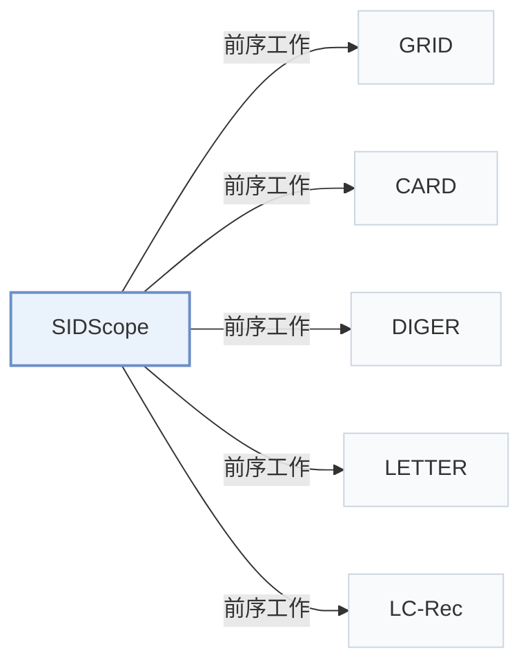

# SIDScope

[← 问题 × 阶段矩阵](../../../README.zh.md#范式系统与基准) · [按阶段索引](../index/stages.md) · [按模态索引](../index/modality.md) · [English](../../papers/sidscope.md) | 中文

| **题目** | *A Diagnostic Resource for Semantic-ID Interfaces in Generative Recommendation* |
| :-- | :-- |
| **作者** | Ding et al. |
| **发表** | arXiv’26 |
| **问题与阶段** | `范式、系统与基准` · `无单一阶段` |
| **链接** | [论文](https://arxiv.org/abs/2608.18779) · [代码](https://github.com/jdding/sidscope) |
| **阅读级别** | 概览（第 1 级） |

**本页目录**：[TL;DR](#tldr) · [速览](#速览) · [3. 实验发现](#3-实验发现) · [5. 相关工作](#5-相关工作)

### TL;DR

> [!NOTE]
> SIDScope 面向公开 SID 映射提供接口诊断工具，检查码组织结构、物品解析精度以及词表刷新后与生成器的兼容性。

---

### 速览

| 维度 | 摘要 |
| :-- | :-- |
| 研究问题 | 范式、系统与基准：基线范式（TIGER）、端到端多阶段工业框架、开源代码库、评测基准与诊断工具。 |
| 核心贡献 | SIDScope 面向公开 SID 映射提供接口诊断工具，检查码组织结构、物品解析精度以及词表刷新后与生成器的兼容性。 |
| 主要改动阶段 | 无单一阶段 |

---

### 3. 实验发现

实验设置

- **数据集**：Diagnostic resource with nine named exports from seven tokenizer families: Amazon Musical, Video Games, Beauty (P5), and Instruments, plus Yelp Business; eight exports enter the executable diagnostic matrix. A separate DACT Tools case studies mapping refresh. For the compact D3 graph, duplicate user-item pairs are removed and only users with 2-50 distinct mapped items are included; users above 50 are excluded, not truncated. Upstream dataset filtering is not reported uniformly across routes.
  - 出处：Table 2 defines named route coverage, Section 3.2 defines bounded-graph filtering, and Section 6 adds a separate Tools lifecycle case; [S3.T2](https://arxiv.org/html/2608.18779v2#S3.T2), [S3.SS2.SSS0.Px2.p1](https://arxiv.org/html/2608.18779v2#S3.SS2.SSS0.Px2.p1), [S3.SS2.SSS0.Px2.p2](https://arxiv.org/html/2608.18779v2#S3.SS2.SSS0.Px2.p2), and [S6.SS1.p1](https://arxiv.org/html/2608.18779v2#S6.SS1.p1).
- **切分**：Protocol-dependent. Mapping profiles use declared training splits or supplied reference interactions when split labels are absent. Fixed-budget Beauty studies use explicit training/validation splits; ReSOT Instruments uses earlier events as history, the penultimate event for validation, and the final event as unused future holdout, with hashed users separating diagnostics from 2,000 validation users. GRID beam studies train outside each of two evaluation folds; DIGER uses a last-event case. DACT refresh uses the same 5,364 held-out users/targets across states, with test targets excluded from training and checkpoint selection.
  - 出处：Profile, fixed-budget, beam, and lifecycle studies use distinct splits, so none is promoted to a resource-wide train/test protocol; [S3.SS2.SSS0.Px2.p2](https://arxiv.org/html/2608.18779v2#S3.SS2.SSS0.Px2.p2), [S5.SS2.p1](https://arxiv.org/html/2608.18779v2#S5.SS2.p1), [S5.SS5.p1](https://arxiv.org/html/2608.18779v2#S5.SS5.p1), and [S6.SS1.p2](https://arxiv.org/html/2608.18779v2#S6.SS1.p2).
- **候选集**：Protocol-dependent: fixed-budget prefix retrieval uses exactly 100 candidate items per user, with sensitivity budgets of 50 and 200; sampled-ranking tests use the target plus 100 catalog negatives after excluding history items, using popular or uniformly sampled negatives; frozen-beam resolver comparisons use the same top-50 generated paths, with top-20 sensitivity and no candidate-budget expansion.
  - 出处：Fixed-budget retrieval, sampled ranking, and beam accounting have different candidate meanings; [S5.SS2.p1](https://arxiv.org/html/2608.18779v2#S5.SS2.p1), [A1.SS1.SSS0.Px1.p1](https://arxiv.org/html/2608.18779v2#A1.SS1.SSS0.Px1.p1), [A2.SS3.p1](https://arxiv.org/html/2608.18779v2#A2.SS3.p1), and [A2.SS4.p2](https://arxiv.org/html/2608.18779v2#A2.SS4.p2).
- **可见性**：No single warm/cold regime. Fixed-budget studies separate diagnostic and validation users, not the upstream tokenizer's training population. The DACT refresh case includes 584 new-item targets and compares the released checkpoint with adapted checkpoints; whether these items were unseen during tokenizer fitting is not reported.
  - 出处：Disjoint diagnostic users do not establish tokenizer-unseen items, and the DACT new-item handoff is not a declared tokenizer-cold-start protocol; [S5.SS2.p1](https://arxiv.org/html/2608.18779v2#S5.SS2.p1) and [S6.SS1.p2](https://arxiv.org/html/2608.18779v2#S6.SS1.p2).
- **SID 规格**：Named exports have 3 or 4 SID levels; a single layers-by-codebook-size configuration is n/a, and nominal per-level codebook capacities are not reported uniformly across routes. Table 3's D1 counts are occupied first-level symbols, not nominal capacities. Shared full codes are measured explicitly; frozen-beam comparisons use singleton credit, uniform within-leaf expected credit, or deterministic training-popularity resolution with item-ID tie-breaking.
  - 出处：Table 2 gives SID depths, Table 3 reports occupied symbols rather than codebook capacity, and Section 5.6 defines the collision-accounting/resolution alternatives; [S3.T2](https://arxiv.org/html/2608.18779v2#S3.T2), [S4.T3](https://arxiv.org/html/2608.18779v2#S4.T3), [S5.SS6.p1](https://arxiv.org/html/2608.18779v2#S5.SS6.p1), and [S5.SS6.p2](https://arxiv.org/html/2608.18779v2#S5.SS6.p2).
- **推理预算**：DACT TIGER/T5 constraint comparison: beam width 50 on 500 fixed targets. Controlled GRID/P5 GRU runs: beam width 50 on 500 targets per evaluation fold, with a DIGER portability case under the same accounting. Three GRU exports each contain 25,000 beam rows for 500 targets. Generator inference hardware, inference batch size, and latency not reported; the stated batch size 512 is for GRU training.
  - 出处：Sections 5.4-5.5 state the actual beam budgets, Appendix B.4's batch 512 is a training setting, and Section 3.2 distinguishes topology from runtime; [S5.SS4.p1](https://arxiv.org/html/2608.18779v2#S5.SS4.p1), [S5.SS5.p1](https://arxiv.org/html/2608.18779v2#S5.SS5.p1), [A2.SS4.p1](https://arxiv.org/html/2608.18779v2#A2.SS4.p1), [A2.SS4.p2](https://arxiv.org/html/2608.18779v2#A2.SS4.p2), and [S3.SS2.SSS0.Px3.p2](https://arxiv.org/html/2608.18779v2#S3.SS2.SSS0.Px3.p2).
- **结果来源**：Table 3: eight-route D1-D5 profiles. Table 4: D3 calibration checks. Table 5: fixed-budget prefix retrieval. Section 5.4: released TIGER/T5 constrained versus unconstrained decoding. Table 6: controlled beam accounting. Table 7: resolution policies on identical beams. Table 8: DACT mapping refresh and generator handoff. Appendix B, Tables 11-12: measurement checks and candidate-budget sensitivity.
  - 出处：The cited tables separate mapping diagnostics, candidate exposure, beam accounting, resolver outcomes, and lifecycle handoff; [S4.T3](https://arxiv.org/html/2608.18779v2#S4.T3), [S5.T4](https://arxiv.org/html/2608.18779v2#S5.T4), [S5.T5](https://arxiv.org/html/2608.18779v2#S5.T5), [S5.T6](https://arxiv.org/html/2608.18779v2#S5.T6), [S5.T7](https://arxiv.org/html/2608.18779v2#S5.T7), [S6.T8](https://arxiv.org/html/2608.18779v2#S6.T8), [S5.SS4.p1](https://arxiv.org/html/2608.18779v2#S5.SS4.p1), [A2.T11](https://arxiv.org/html/2608.18779v2#A2.T11), and [A2.T12](https://arxiv.org/html/2608.18779v2#A2.T12).

---

### 5. 相关工作

- **前序工作** · [GRID](grid.md): GRID supplies an upstream Beauty/P5 tokenizer mapping that SIDScope rebuilds and audits through interface diagnostics, fixed-budget prefix retrieval, and frozen-beam item-resolution tests.
  - 出处：SIDScope v2, Table 2 identifies the rebuilt GRID Beauty/P5 mapping: [S3.T2](https://arxiv.org/html/2608.18779v2#S3.T2); Table 3 gives its diagnostic profile: [S4.T3](https://arxiv.org/html/2608.18779v2#S4.T3); Tables 5 and 7 report the fixed-budget and resolver tests: [S5.T5](https://arxiv.org/html/2608.18779v2#S5.T5) and [S5.T7](https://arxiv.org/html/2608.18779v2#S5.T7).
- **前序工作** · [CARD](card.md): CARD supplies an upstream Beauty/P5 SID mapping inspected by SIDScope through a code-derived export and budget-matched prefix retrieval controls on the same catalog as GRID.
  - 出处：SIDScope v2, Table 2 identifies CARD's code-derived Beauty/P5 export: [S3.T2](https://arxiv.org/html/2608.18779v2#S3.T2); Section 5.2 and Table 5 define the same-catalog, fixed-budget tests: [S5.SS2.p1](https://arxiv.org/html/2608.18779v2#S5.SS2.p1) and [S5.T5](https://arxiv.org/html/2608.18779v2#S5.T5).
- **前序工作** · [DIGER](diger.md): DIGER supplies upstream checkpoint-derived SID mappings for Beauty and Yelp that SIDScope profiles separately and uses in a last-event beam-accounting portability case.
  - 出处：SIDScope v2, Tables 2 and 3 identify and profile the DIGER Beauty and Yelp exports: [S3.T2](https://arxiv.org/html/2608.18779v2#S3.T2) and [S4.T3](https://arxiv.org/html/2608.18779v2#S4.T3); Section 5.5 and Table 6 identify the last-event sensitivity route: [S5.SS5.p1](https://arxiv.org/html/2608.18779v2#S5.SS5.p1) and [S5.T6](https://arxiv.org/html/2608.18779v2#S5.T6).
- **前序工作** · [LETTER](letter.md): LETTER supplies a released Instruments SID index that SIDScope re-audits under its common bounded diagnostic protocol as an upstream mapping source.
  - 出处：SIDScope v2, Table 2 identifies LETTER's released Instruments index: [S3.T2](https://arxiv.org/html/2608.18779v2#S3.T2); Section 4.1 states that LETTER is recomputed under the common C3 protocol: [S4.SS1.p3](https://arxiv.org/html/2608.18779v2#S4.SS1.p3); Table 3 reports the resulting profile: [S4.T3](https://arxiv.org/html/2608.18779v2#S4.T3).
- **前序工作** · [LC-Rec](lc-rec.md): LC-Rec supplies a released Instruments SID index that SIDScope re-audits alongside LETTER to distinguish mapping addressability from prefix behavioral alignment.
  - 出处：SIDScope v2, Table 2 identifies LC-Rec's released Instruments index: [S3.T2](https://arxiv.org/html/2608.18779v2#S3.T2); Section 4.1 compares its mapping properties with LETTER and states the shared bounded protocol: [S4.SS1.p2](https://arxiv.org/html/2608.18779v2#S4.SS1.p2) and [S4.SS1.p3](https://arxiv.org/html/2608.18779v2#S4.SS1.p3); Table 3 reports both profiles: [S4.T3](https://arxiv.org/html/2608.18779v2#S4.T3).

[查看同格全部论文](../../../README.zh.md#范式系统与基准)
